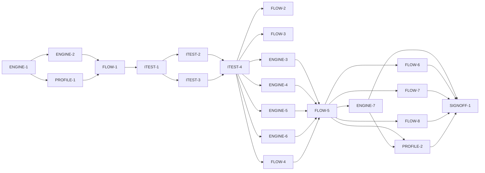

# Master Plan — CVD self-assessment (onboarding)

**Spec:** [bs-07-cvd-self-assessment.feature](../bs-07-cvd-self-assessment.feature)
**Status:** In progress — **behaviour stage COMPLETE; all 14 ACs delivered (suite 14 A/0); every gate green.** FLOW-2 (AC-14) done 2026-10-13 — the last build phase. **Next = SIGNOFF-1** (the only remaining phase).
**Architecture:** [docs/paint-color-app-solution-intent.md](../../docs/paint-color-app-solution-intent.md) §"CVD self-assessment (onboarding)" (tiers 0–4) + §"CVD pipeline"; wireframe `Paint Color Assistant.dc.html` region S1.R1 (E36–E41, E43); reuses `lib/a11y/cvd/cvd_profile.dart` (bs-03) and `lib/store/PersistentStore` (bs-06).
**Code home:** /Users/matthew.quirk/Nuance · remote https://github.com/meatsquirk/Nuance · base `main` after the bs-05 + bs-06 merge (G-3) · extends the bs-01..bs-06 foundation (confirmed by Matt Quirk via sibling *Code home* lines, 2026-10-11)

## Gap analysis (against `main` after bs-05+bs-06 merge; seams read from feat/bs-06 @ `6ab1440`)

| AC | Exists today | Missing |
|---|---|---|
| AC-1 result caveat | `SelfAssessmentEntryScreen` placeholder only | A result step that labels the estimate approximate and recommends a clinical anomaloscope test |
| AC-2 Tier 0 lighting gate | — | Lighting/display setup step; a continue action gated until brightness/night-light/daylight checks confirmed |
| AC-3 Tier 1 intake prior | — | Intake question step; an answer recorded toward a starting prior in the engine |
| AC-4 intake diagnosis seed | — | Intake path for a reported prior diagnosis that seeds the prior (e.g. deutan) |
| AC-5 Tier 2 screening | — | Pseudoisochromatic plate screening scored to presence + R-G/B-Y direction |
| AC-6 arrangement place | — | Arrangement step: cap pool → placing a cap takes the next arranged position and leaves the pool |
| AC-7 arrangement start-over | — | Start-over returns every cap to the pool |
| AC-8 arrangement skip | — | Skip continues the flow without an arrangement result |
| AC-9 Tier 4 threshold | — | Adaptive threshold probing scored to a severity along the confusion line |
| AC-10 adjust type | — | Result step control that overrides the estimated `CvdType` by hand |
| AC-11 severity band | — | Severity value → plain-language band (mild/moderate/strong) shown on the result |
| AC-12 self-calibration | — | Severity slider over a simulated/original pair; the chosen severity kept as the subjective calibration |
| AC-13 save profile | `CvdProfile` value type exists; `AppDependencies.cvdProfile` is a const default; `PersistentStore` exists; **no profile is persisted** | Persist one profile via `PersistentStore`; wire the live dependency so bs-03 confusion check + (future) bs-08/bs-10 read the measured profile |
| AC-14 progress | — | A step-progress indicator showing current step of the total |

## Build order

| Stage | Phases |
|---|---|
| 1 Scaffold | ENGINE-1 |
| 2 Component shells | ENGINE-2, PROFILE-1, FLOW-1 |
| 3 Acceptance tests | ITEST-1, ITEST-2, ITEST-3, ITEST-4 (test review, G-2) |
| 4 Behavior | FLOW-2, FLOW-3, ENGINE-3, ENGINE-4, ENGINE-5, FLOW-4, ENGINE-6, FLOW-5 *(enabler)*, ENGINE-7, FLOW-6, FLOW-7, FLOW-8, PROFILE-2 |
| 5 Sign-off | SIGNOFF-1 |

## Acceptance criteria coverage

| AC | Scenario | Integration test (ITEST) | Behavior phases | Status |
|---|---|---|---|---|
| AC-1 | The estimate is labelled approximate and a clinical test is recommended | ITEST-2 `TestAC01_EstimateLabelledApproximate` | FLOW-8 | ✅ Done |
| AC-2 | The lighting setup must be confirmed before testing begins | ITEST-2 `TestAC02_LightingConfirmedBeforeTesting` | FLOW-3 | ✅ Done |
| AC-3 | An intake answer contributes to the starting prior | ITEST-3 `TestAC03_IntakeAnswerToPrior` | ENGINE-3 | ✅ Done |
| AC-4 | A prior clinical diagnosis entered at intake seeds the prior | ITEST-3 `TestAC04_DiagnosisSeedsPrior` | ENGINE-4 | ✅ Done |
| AC-5 | Screening yields presence and the red-green versus blue-yellow direction | ITEST-3 `TestAC05_ScreeningPresenceAndDirection` | ENGINE-5 | ✅ Done |
| AC-6 | The painter places colour caps in hue order | ITEST-3 `TestAC06_PlaceCapNextPosition` | FLOW-4 | ✅ Done |
| AC-7 | Starting over clears the arrangement | ITEST-3 `TestAC07_StartOverClearsArrangement` | FLOW-4 | ✅ Done |
| AC-8 | The painter skips the arrangement for now | ITEST-3 `TestAC08_SkipArrangement` | FLOW-4 | ✅ Done |
| AC-9 | Threshold probing yields a severity along the confusion line | ITEST-3 `TestAC09_ThresholdSeverity` | ENGINE-6 | ✅ Done |
| AC-10 | The painter adjusts the estimated type by hand | ITEST-2 `TestAC10_AdjustTypeByHand` | FLOW-6 | ✅ Done |
| AC-11 | The severity value sets a plain-language band | ITEST-2 `TestAC11_SeverityBand` | ENGINE-7 | ✅ Done |
| AC-12 | The severity slider doubles as subjective self-calibration | ITEST-2 `TestAC12_SelfCalibration` | FLOW-7 | ✅ Done |
| AC-13 | Saving the profile configures simulation, daltonization and confusion warnings | ITEST-2 `TestAC13_SaveConfiguresPipeline` | PROFILE-2 | ✅ Done |
| AC-14 | The current step is shown against the total | ITEST-2 `TestAC14_ProgressStepOfTotal` | FLOW-2 | ✅ Done |

14 ACs (AC-11 is a Scenario Outline tested over its 3 examples: 30→mild, 60→moderate, 90→strong). Every AC → one integration test → ≥1 behavior phase.

## Design decisions

| # | Decision | Why |
|---|---|---|
| D-1 | Reuse `CvdProfile {CvdType type, double severity 0..1}` unchanged; bs-07 only populates measured values, no schema change | The profile's own doc-comment designates bs-07 as the "populate" change; bs-03/bs-08/bs-10 already consume this value type |
| D-2 | Persist the one profile as a single document — collection `cvd_profile`, id `current` — over `PersistentStore`, matching `source_photo_store.dart`; body `{type: <name>, severity: <double>}` | One stored profile (spec); reuses the bs-06 generic document store; no new persistence engine |
| D-3 | Load `AppDependencies.cvdProfile` from the store at app assembly, defaulting to the const default when absent; saving updates both the store and the live dependency | So the measured profile flows to bs-03's `ConfusionCheck` and the `projectDichromat` seam bs-08/bs-10 reuse |
| D-4 | The onboarding presents **four** top-level steps (progress = N of 4): **[Lighting (T0), Intake (T1), Vision tests, Result]**; screening (T2), arrangement (T3) and threshold (T4) all nest inside the single **Vision-tests** step and do not advance the step counter — **confirmed by Matt Quirk via G-5, 2026-10-13** | AC-14 says "four steps"; the wireframe draws four (lighting, intake, arrangement, result); screening+threshold are in-scope-but-undrawn tiers |
| D-5 | UI severity slider is 0..100; stored `severity = value/100`. Band anchors 30→mild, 60→moderate, 90→strong; boundaries at the anchor midpoints — **confirmed G-4 2026-10-12**: mild `[0,0.45)`, moderate `[0.45,0.75)`, strong `[0.75,1.0]` | AC-11 examples fix three anchors; the profile stores 0..1 |
| D-6 | Self-calibration (AC-12) is kept **as** the profile severity — the painter-tuned slider value is the subjective calibration; no separate field | AC-12's "kept as the subjective self-calibration" with a profile that has only type+severity |
| D-7 | The engine assembles the estimate from whatever tier results are present (prior + screening direction + arrangement + threshold); the result step shows type+severity even when a tier was skipped (AC-8) | Tiers are optional/fastest-first; the flow must reach a result without every tier |
| D-8 | AC-13 "configures simulation and daltonization" is verified at the **shared profile seam** (the single source all three consumers read), since bs-08/bs-10 are not built; confusion-warning configuration is asserted behaviourally via bs-03's `ConfusionCheck`. Behavioural sim/dalt assertions are a known gap owned by bs-08/bs-10 | Those features do not exist yet; the profile is the one thing they all read |
| D-9 | Each tier's scoring lives in `AssessmentEngine` (pure, unit-tested to 100%); the controller calls the engine and read endpoints expose state; no scoring in widgets | Keeps domain testable and the UI thin |

## Acceptance integration test plan

Module plan: [modules/ITEST.md](modules/ITEST.md).

**Where it lives and how it runs:** `integration_test/self_assessment_harness.dart` (vocabulary + fixtures + wiring) and `integration_test/self_assessment_test.dart` (runner). Default target (pending skipped): `flutter test integration_test/self_assessment_test.dart -d <booted-udid>`. Run-pending / red baseline: add `--dart-define=BS07_RUN_PENDING=true`. **A booted sim udid (`-d`) is mandatory** — without it the run executes zero tests and exits 0 (false green; see Known flakes). Single exclusive lane via `coord.sh with-lock` in parallel sessions.
**Where assertions look:** the rendered widget tree (keyed region finders for E36–E41, E43 and the progress indicator); `OnboardingReadEndpoint` (live controller state: step index/total, lighting flags, prior, screening result, arrangement pool/placed, threshold, assembled estimate, band, caveat shown, calibrated severity); `CvdProfileReadEndpoint` (the persisted profile); bs-03's `ConfusionCheck` behaviour on a fixed colour pair (for AC-13); `FakeSpeech` log if a step speaks.
**What is real and what is faked:** the whole app assembled through `buildApp(deps)`; real engine, controller, screens, profile store contract, confusion check and `projectDichromat`. Faked infrastructure only: `FakeSpeech`, `FakeHaptics`, and an `InMemoryPersistentStore` double exercising the same `PersistentStore` write-side contract. No scoring/colour/ΔE math faked — band and direction are graded against an independent in-harness reference.

**Fixtures:**

| Fixture | Shape |
|---|---|
| `bootedDevice` | A booted simulator udid passed via `-d`; mandatory for every acceptance run |
| `fakeSpeech` / `fakeHaptics` | Infrastructure doubles recording spoken/haptic events |
| `memoryStore` | `InMemoryPersistentStore` behind the production `PersistentStore` interface; starts empty (no profile persisted) |
| `intakeAnswers` | The intake questions and answer options, incl. the "reds/browns/greens mixed up?" item (AC-3) and the prior-diagnosis path (AC-4) |
| `screeningPlates` | An openly-licensed plate set whose scoring yields presence + R-G vs B-Y direction (AC-5) |
| `capPool` | The unordered colour-cap pool for the arrangement (AC-6/7/8) |
| `thresholdProbe` | The adaptive probe sequence whose scoring yields a severity on the confusion line (AC-9) |
| `referenceBand` | Independent in-harness severity→band mapping to grade AC-11 against (not the product function) |
| `fixedPair` | A colour pair confusable only under a specific CVD type/severity, to prove the saved profile reconfigures bs-03's confusion check (AC-13) |

**Test catalogue:**

| AC | Given: built via public flows → checked by | When | Then: exact assertions | Rejects |
|---|---|---|---|---|
| AC-1 | Complete the flow to the result step → read endpoint shows the result step reached | result shown | result text labels it an **approximate estimate** (exact phrase present) **and** recommends a **clinical anomaloscope test** for ground truth (both present) | a result that states the type/severity with no approximate-estimate label or no clinical-test recommendation |
| AC-2 | On the lighting step with brightness/night-light/daylight **not all** confirmed → read endpoint shows the three flags not-all-true and testing not started | tap Continue (E43) | testing does **not** begin — still on the lighting step after a settle (the continue event is processed; read endpoint: step unchanged, testing-started false). Control: confirm all three, Continue → advances | a Continue that advances regardless of the checks |
| AC-3 | On the intake step asked "Do reds, browns and greens get mixed up?" → read endpoint shows the question asked and prior at baseline | answer "Often" | the answer is recorded toward the starting prior — read endpoint prior reflects the "Often" contribution (changed from baseline, toward red-green). Control: a neutral/"Never" answer moves it the other way or not at all | an intake that discards the answer (prior unchanged) |
| AC-4 | At intake report a prior diagnosis of **deutan** → read endpoint shows the diagnosis captured | intake recorded | starting prior is **seeded as deutan** (read endpoint prior.type == deutan). Control: a protan diagnosis seeds protan | ignoring the diagnosis (prior not seeded / default) |
| AC-5 | Complete the plate screening with a fixture that is R-G deficient → read endpoint shows screening completed | screening scored | reports **present == true** **and** **direction == redGreen**. Controls: a B-Y fixture → blueYellow; a no-deficiency fixture → present false | a scorer that always returns present, or that can't distinguish R-G from B-Y (graded vs `referenceBand`/direction reference) |
| AC-6 | Arrangement step showing a pool of unplaced caps → read endpoint: pool full, arranged empty | place a cap from the pool | that cap takes the **next** position in the arranged order (arranged.last == the placed cap; arranged length +1) **and** it is **removed from the pool** (pool no longer contains it; length −1) | a place that appends to a wrong index, duplicates, or leaves the cap in the pool |
| AC-7 | Place several caps → read endpoint: arranged length ≥ 2, pool reduced | start over (E39) | **all** caps return to the pool and **none** are placed (arranged empty; pool == full set) | a reset that clears only the last placement or leaves some arranged |
| AC-8 | Have not placed all caps (arranged partial) → read endpoint shows the arrangement incomplete | skip the arrangement (E43) | the flow continues **without** an arrangement result — read endpoint: advanced past arrangement, arrangementResult absent/null. Control: completing instead records a result | a skip that blocks, or that fabricates an arrangement result |
| AC-9 | Complete the adaptive threshold probing with a fixture → read endpoint shows probing completed | probing scored | yields a **severity value along the painter's confusion line** — read endpoint threshold severity in range and tied to the confusion line of the current type/direction. Control: an easier-threshold fixture yields a lower severity than a harder one | a scorer returning a constant, or a severity not tied to the confusion line (graded vs reference) |
| AC-10 | Reach the result step estimating **deutan** (via FLOW-5 enabler + deutan-leaning inputs) → read endpoint: estimate.type == deutan | set the type to **protan** (E40) | profile/estimate **type is protan** (read endpoint type == protan). Control: setting it back to deutan reads deutan | a control that ignores the override (type stays deutan) |
| AC-11 | On the result step setting severity (FLOW-5 reached) → read endpoint: on result step | set severity to 30 / 60 / 90 (E41) | result reads **"mild" / "moderate" / "strong"** respectively (exact band string per example row) | a mapping returning one band for all values, inverted, or off-by-one (graded vs `referenceBand`; the three distinct outputs are the control) |
| AC-12 | A simulated-vs-original pair shown with the severity slider on the result → read endpoint: pair shown, calibration unset | set severity until the pair stops looking different (set a value, confirm) | the chosen severity is **kept as the subjective self-calibration** — read endpoint calibratedSeverity == the set value, and it is the value saved as profile severity. Control: a different set value is kept instead | discarding the slider value / keeping a default severity |
| AC-13 | Result of **deutan-type, moderate** on the result step (FLOW-5 + ENGINE-7); store empty; `fixedPair` not confusable under the default profile → read endpoint: no profile persisted, confusion check uses default | save the profile (E43) | **one** stored CVD profile is written (`CvdProfileReadEndpoint` count == 1, {deutan, moderate-severity}); the live `AppDependencies.cvdProfile` now equals it; bs-03's `ConfusionCheck` on `fixedPair` changes to reflect the saved profile (control: before save it used the default). Sim/daltonization verified at the shared seam only (D-8, known gap) | a save that writes nothing, writes >1, or leaves the pipeline on the default profile |
| AC-14 | A self-assessment of four steps; advance to the second step → read endpoint: stepTotal == 4, stepIndex == 2 | on the second step | the progress indicator shows the **second of four** steps as current (rendered indicator reads 2 of 4; read endpoint stepIndex==2, stepTotal==4). Control: advancing again reads 3 of 4 | an indicator hard-coded to a step, or showing the wrong total |

**Red baseline** and **test augmentations:** tracked in [modules/ITEST.md](modules/ITEST.md).
Pre-seeded augmentations: AC-13's confusion-check behavioural assertion is confirmed once bs-03's check reads the live dependency after save (within PROFILE-2); no intra-feature test is green-at-baseline — each fails on its Then or on a precondition naming its behavior phase. Sim/dalt behavioural assertions are a **known gap** owned by bs-08/bs-10 (not a bs-07 augmentation row).

## Modules

| Module | Plan | Purpose | Depends on | Status |
|---|---|---|---|---|
| ENGINE | [modules/ENGINE.md](modules/ENGINE.md) | Scaffold + pure assessment domain: tier scoring (intake prior, screening presence/direction, threshold severity), estimate assembly inputs, severity→band | — | ✅ Done (ENGINE-1..7 ✅) |
| PROFILE | [modules/PROFILE.md](modules/PROFILE.md) | Persist the one CVD profile over `PersistentStore`; wire `AppDependencies.cvdProfile` to the store; the save path | ENGINE | ✅ Done (PROFILE-1/2 ✅) |
| FLOW | [modules/FLOW.md](modules/FLOW.md) | Onboarding controller + state + four-step flow + screens (lighting/intake/screening/arrangement/threshold/result) + read endpoint + route; estimate assembly; result-step behaviours | ENGINE, PROFILE | ✅ Done (FLOW-1..8 all ✅) |
| ITEST | [modules/ITEST.md](modules/ITEST.md) | Acceptance integration suite: one pending test per AC, and its review | all shell phases | ✅ Done (ITEST-1, ITEST-2, ITEST-3 ✅; ITEST-4 ✅ — G-2 approved 2026-10-12) |

## Dependency graph

**Parallel windows:** ENGINE-2 ∥ PROFILE-1 (disjoint files). ITEST-2 ∥ ITEST-3 share `self_assessment_test.dart` → **merge-risky; run sequentially** (or split into two files included by the runner). Behavior phases mostly touch the shared `OnboardingController`/screens → run sequentially; ENGINE-3/4/5/6 are domain-heavy but each also wires a controller call, so pair any parallel run cautiously (merge-risky on the controller). FLOW-5 is a barrier before the result-step phases.

## Open gates

| Gate | Kind | Decision needed | Blocks | Status |
|---|---|---|---|---|
| G-1 | decision | Approve the spec (record approval as its first line, replacing the Draft banner) | ENGINE-1 | ✅ Resolved 2026-10-11 21:46 EDT: spec approved; Draft banner replaced with approval line — Matt Quirk |
| G-2 | decision | Approve the acceptance tests (ITEST-4's packet) | every behavior phase | ✅ Resolved 2026-10-12: **approved** — Matt Quirk; packet (14 pending AC tests, clean red baseline, 7 A / 7 B-pending all deferred-driver limits, 3 judgment calls) accepted as-is; un-blocks every behavior phase |
| G-3 | dependency | bs-05 **and** bs-06 signed off and merged to `main` (the `PersistentStore`, the `self_assessment` entry seam and the pubspec superset land on main) — closed by the human merging `feat/bs-05` and `feat/bs-06` | ENGINE-1 | ✅ Resolved 2026-10-11 21:46 EDT: `feat/bs-05` (990a67a→merge 9760a4f) + `feat/bs-06` (e998bac→merge cd1c86b) merged to `main`; `persistent_store.dart`, `self_assessment_entry_screen.dart`, `router.toSelfAssessment()`, pubspec superset (drift/path_provider/printing) confirmed present; analyze clean + 849 unit tests green post-merge — Matt Quirk |
| G-4 | decision | Pin the profile persistence + scales: (a) persist via `PersistentStore` collection `cvd_profile`/id `current`, reusing `CvdProfile` unchanged; (b) slider 0..100 → severity 0..1; (c) band boundaries around the 30/60/90 anchors | PROFILE-1, ENGINE-7 | ✅ Resolved 2026-10-12 — approved as proposed (Matt Quirk): (a) collection `cvd_profile`/id `current`, body `{type, severity}`, `CvdProfile` reused unchanged; (b) `severity = slider/100`; (c) midpoint cutoffs mild `[0,0.45)` / moderate `[0.45,0.75)` / strong `[0.75,1.0]` |
| G-5 | decision | Reconcile the four-step progress (AC-14) with the five tiers: which tiers are the four counted steps, and where screening (Tier 2) and threshold (Tier 4) sit (proposed D-4) — routed to the spec author | FLOW-2 | ✅ Resolved 2026-10-13 09:06 EDT — Matt Quirk: the four counted steps are **Lighting (T0), Intake (T1), Vision tests, Result**; screening (T2), arrangement (T3) and threshold (T4) nest inside the single Vision-tests step (D-4 confirmed) |

Resolved: `✅ Resolved <date time>: <decision, one line> — <who>`.

## Known flakes

| Test | Symptom | Rate (runs) | Measured at | Owner | Status |
|---|---|---|---|---|---|
| coverage_gate — const-constructor line | `flutter test --coverage` intermittently records a const-folded constructor line in `lib/**` as uncovered, so the gate may FAIL on a file this phase never touched | intermittent | first bs-01 `88c5add` | re-run `flutter test --coverage` once; green on re-run ⇒ ignore | Open |
| integration suite — no `-d <udid>` | `flutter test integration_test/…` with no booted device runs zero tests and still exits 0 (false green) | deterministic | bs-05/bs-06 | always pass `-d <booted-udid>` | Open |

## Session log

| # | Phase | Target | Status | Tokens | Time | Notes |
|---|---|---|---|---|---|---|
| 1 | ENGINE-1 | scaffold: branch from merged main, baseline, coverage gate confirm, bs07 pending runner (14 ACs) | ✅ Done | 3,619,703 | 13m 16s | branch `feat/bs-07` @ main `a695e4c`; analyze clean · 849 unit · gate PASS-clean + FAIL-on-gap proven; 14 ACs seeded; runner + 3 scaffold guards green |
| 2 | ENGINE-2 | shell: assessment domain types + `AssessmentEngine` interface | ✅ Done | 3,709,673 | 9m 29s | 4 files in `lib/onboarding/engine/`; analyze clean · 912 unit (849 + 63) · coverage 100% on 4 touched files |
| 3 | PROFILE-1 | shell: `CvdProfileStore` + `CvdProfileReadEndpoint` + `AppDependencies` wiring | ✅ Done | 7,782,453 | 20m 30s | G-4 resolved |
| 4 | FLOW-1 | shell: `OnboardingController`/state + `OnboardingReadEndpoint` + screen host & keyed step widgets + route (replace placeholder) | ✅ Done | 13,152,941 | 26m 57s | controller (14 actions throw) + state + read endpoint + host/screen + 7 keyed step widgets; entry screen replaced (anchor preserved); analyze clean · 957 unit · gate 100% on 23 touched · integ 134 |
| 5 | ITEST-1 | acceptance-tests: harness, fixtures, pending gate (14 ACs), smoke test | ✅ Done | 12,779,960 | 1h 30m | harness + 9 fixtures + smoke + 6 fixture guards; analyze clean · bs-07 suite 10/10 · unit 957 · coverage N/A (no lib/); grade A (1 B fixed); fix 2/3 |
| 6 | ITEST-2 | acceptance-tests: AC-1,2,10,11,12,13,14 (pending) + red baseline | ✅ Done | 6,494,040 | 27m 23s | 7 pending tests; default 10 pass/7 skip, run-pending +10/−7; grade 5 A + 2 B-pending (AC-10→FLOW-6, AC-13→PROFILE-2); fix 0/3 |
| 7 | ITEST-3 | acceptance-tests: AC-3,4,5,6,7,8,9 (pending) + red baseline | ✅ Done | 5,169,129 | 18m 56s | 7 pending tests; default 10 pass/14 skip, run-pending +10/−14 (all fail cleanly on Then/precondition); grade 2 A (AC-3, AC-9) + 5 B-pending (AC-4→ENGINE-4, AC-5→ENGINE-5, AC-6/7/8→FLOW-4); fix 0/3 |
| 8 | ITEST-4 | test-review: packet; G-2 | ✅ Done | 847,758 | 2m 56s | packet assembled (14-AC catalogue + red-baseline + 8 augmentation rows + 3 look-first calls); **G-2 approved 2026-10-12 — Matt Quirk** (packet accepted as-is); no code |
| 9 | FLOW-2 | AC-14 progress indicator | ✅ Done | 8,041,545 | 16m 48s | AC-14 un-pended + green (last build phase); four steps pinned `[Lighting/Intake/Vision-tests/Result]` (G-5), Tier-0 gate scoped to step 0; unit 1069/cov 100% touched/accept default 24 pass 0 skip (pending set empty); grade **14 A/0** (AC-14 impl A, AC-13 brought current B→A, AC-2 re-confirmed); fix 0/3 |
| 10 | FLOW-3 | AC-2 lighting gate (Tier 0) | ✅ Done | 8,229,212 | 16m 09s (16m 09s) | AC-2 un-pended + green; unit 967; cov 100% (23); accept 11 pass/13 skip; grade A; fix 0/3 |
| 11 | ENGINE-3 | AC-3 intake answer → prior (Tier 1) | ✅ Done | 9,029,262 | 16m 39s (2h 53m) | AC-3 un-pended + green; real `TieredAssessmentEngine.recordIntake` (host-injected); unit 980; cov 100% (23); accept 12 pass/12 skip; grade A; fix 0/3 |
| 12 | ENGINE-4 | AC-4 diagnosis seeds prior (Tier 1) | ✅ Done | 12,538,664 | 16m 43s | AC-4 un-pended + green; `seedFromDiagnosis` override + `reportDiagnosis` + intake type-picker; AC-4 B-pending→A (protan control); unit 988; cov 100% (23); accept 13 pass/11 skip; grade 3×A; fix 0/3 |
| 13 | ENGINE-5 | AC-5 screening presence + direction (Tier 2) | ✅ Done | 16,401,020 | 21m 15s | AC-5 un-pended + green; grade A (B pending→A); unit 1007/cov 100% touched/accept default 17 pass 7 skip; fix 0/3 |
| 14 | FLOW-4 | AC-6/7/8 arrangement place/start-over/skip (Tier 3) | ✅ Done | 14,878,591 | 25m 54s | AC-6/7/8 un-pended + green; grade A; unit 997/cov 100% touched/accept default 16 pass 8 skip; fix 1/3 |
| 15 | ENGINE-6 | AC-9 threshold severity (Tier 4) | ✅ Done | 8,996,409 | 16m 28s | AC-9 un-pended + green; `scoreThreshold` (highest failed contrast) + one-probe-at-a-time threshold step + controller wiring; grade A; unit 1018/cov 100% touched (23)/accept default 18 pass 6 skip; grade 12 A/2 B-pending; fix 0/3 |
| 16 | FLOW-5 | enabler: assemble estimate + advance to result step | ✅ Done | 11,668,942 | 18m 21s (18m 21s) | enabler (un-pends no AC): `assemble` fold + `advanceToResult` + "See my result" control + `ResultStep` renders type/severity; unit 1033/cov 100% (23); accept default 18 pass/6 skip, run-pending 19 pass/5 fail — result-step ACs now reach the result step, fail on own downstream Then (no FLOW-5 precondition failure); grade 12 A/2 B-pending; fix 0/3 |
| 17 | ENGINE-7 | AC-11 severity → band (result) | ✅ Done | 10,921,888 | 21m 30s (21m 30s) | AC-11 un-pended + green over 30/60/90; `SeverityBand.forSeverity` (G-4 cut-offs) + `TieredAssessmentEngine.band` override + live result slider renders band label; unit 1043/cov 100% (23 touched)/accept default 19 pass 5 skip; grade 12 A/2 B-pending; fix 1/3 |
| 18 | FLOW-6 | AC-10 adjust type by hand (result) | ✅ Done | 10,189,552 | 20m 24s | AC-10 un-pended + green; `setType` override + 3-way type picker (`typeChoiceKey`) on result step; `whenAdjustType(CvdType)` selects a specific type; AC-10 B-pending→A; unit 1047/cov 100% (23)/accept default 20 pass 4 skip, run-pending 21 pass 3 fail (own downstream Then); grade 13 A/1 B-pending; fix 0/3 |
| 19 | FLOW-7 | AC-12 severity slider self-calibration (result) | ✅ Done | 12,947,153 | 25m 37s | AC-12 un-pended + green; `setSeverity`/`confirmCalibration`→`calibratedSeverity` (D-6) + sim/original pair; result step now `StatelessWidget` reading `calibratedSeverity ?? estimate.severity`; unit 1055/cov 100% touched/accept default 21 pass 3 skip, run-pending 22 pass 2 fail (own downstream Then); grade 13 A/1 B-pending (AC-12 implemented A, AC-10/11 re-confirmed); fix 1/3 |
| 20 | FLOW-8 | AC-1 result caveat (result) | ✅ Done | 7,458,547 | 13m 45s | AC-1 un-pended + green; `_caveat()` (approximate-estimate label + anomaloscope recommendation) in result estimate branch + `advanceToResult` sets `caveatShown`; unit 1057/cov 100% (24 touched)/accept default 22 pass 2 skip, run-pending 23 pass 1 fail (AC-13 own save Then); grade 13 A/1 B-pending (AC-1 implemented A, AC-10/11/12 re-confirmed); fix 0/3 |
| 21 | PROFILE-2 | AC-13 save profile configures the pipeline | ✅ Done | 14,408,911 | 22m 50s | AC-13 un-pended + green; `save` projects estimate→`CvdProfile` (type + `calibratedSeverity ?? estimate.severity`, D-6) through `profileStore` (1 doc) + sets `saved` + live-pipeline reconfig via `LiveProfileScope`/`withCvdProfile`/stateful `_App` root (D-3/D-8); live-dep augmentation closed; unit 1067/cov 100% touched/accept default 23 pass 1 skip, run-pending 24/0; grade 14 A/0; fix 1/3 |
| 22 | SIGNOFF-1 | sign-off: packet + summary page + manual approval | ⬜ Next | | | **startable** — all 14 ACs delivered; suite 14 A/0; every gate green. Assemble packet + summary page, record the human decision; carry the D-8 sim/dalt gap; merge `feat/bs-07`→`main` at sign-off (closes bs-10 G-4) |

*Tokens* / *Time* = the phase totals from the *Token usage* ledger (Time = active, wall in brackets), filled when the row is marked done.

## Next phase

**Behaviour stage COMPLETE — all 14 ACs delivered; suite 14 A / 0; every gate green. FLOW-2 (AC-14, the last build phase) done 2026-10-13.**
- **SIGNOFF-1** — **now startable, the only remaining phase.** Assemble the sign-off packet + summary page and record the human decision. Carry the **D-8** sim/daltonization behavioural gap (AC-13 verified at the shared profile seam; behavioural sim/dalt owned by bs-08/bs-10). On approval, merge `feat/bs-07` → `main` (closes **bs-10 G-4**). Run with `/feature-next-phase bs07 SIGNOFF-1`.

Open gates: none (G-1..G-5 all resolved).

## Token usage

<!-- One row per session, appended as that session's last edit (SKILL.md § Token usage). -->

| Phase / activity | Session | Start | End | Wall | Active | Model(s) | Input | Cache write | Cache read | Output | Total | Outcome |
|---|---|---|---|---|---|---|---|---|---|---|---|---|
| PLAN | 7a934388 | 2026-10-11 21:04 EDT | 21:20 | 15m 39s | 15m 39s | claude-opus-4-8 | 56 | 194,229 | 1,861,476 | 56,221 | 2,111,982 | plan written |
| GATE-DECISION | 6e88f0bc | 2026-10-11 21:45 EDT | 21:58 | 13m 16s | 13m 16s | claude-opus-4-8 | 104 | 106,275 | 4,977,129 | 51,472 | 5,134,980 | G-1 approved (spec), G-3 resolved (bs-05 merge 9760a4f + bs-06 merge cd1c86b to main; analyze clean, 849 unit tests green) |
| ENGINE-1 | 0e802231 | 2026-10-11 22:21 EDT | 22:35 | 13m 16s | 13m 16s | claude-opus-4-8 | 78 | 89,922 | 3,495,346 | 34,357 | 3,619,703 | scaffold done: branch feat/bs-07 @ main a695e4c; analyze clean, 849 unit, coverage gate PASS-clean + FAIL-on-planted-gap proven; 14-AC pending gate + runner (3 scaffold guards) green; no lib/ code |
| ENGINE-2 | 26735695 | 2026-10-12 05:06 EDT | 05:16 | 9m 29s | 9m 29s | claude-opus-4-8 | 82 | 87,787 | 3,583,371 | 38,433 | 3,709,673 | shell done: 4 engine files (tier types, CvdEstimate, SeverityBand, AssessmentEngine + ShellAssessmentEngine); analyze clean, 912 unit (849+63), coverage 100% on 4 touched files; no lib/ wiring |
| PROFILE-1 | dd73b464 | 2026-10-12 05:47 EDT | 06:16 | 29m 34s | 20m 30s | claude-opus-4-8 | 136 | 129,456 | 7,602,795 | 50,066 | 7,782,453 | shell done (G-4 resolved as proposed): CvdProfileStore + CvdProfileReadEndpoint + loadCvdProfile wired into assembly; analyze clean, 923 unit, coverage 100% on 8 touched, integ 134 green; no AC |
| FLOW-1 | b44af27c | 2026-10-12 07:10 EDT | 07:37 | 26m 57s | 26m 57s | claude-opus-4-8 | 170 | 196,438 | 12,874,964 | 81,369 | 13,152,941 | shell done: OnboardingController (14 actions throw) + state + OnboardingReadEndpoint + host/screen + 7 keyed step widgets; entry screen replaced (anchor preserved); analyze clean, 957 unit, coverage 100% on 23 touched, integ 134; no AC |
| ITEST-1 | 129d7bd8 | 2026-10-12 07:55 EDT | 09:25 | 1h 30m | 1h 30m | claude-opus-4-8 | 144 | 299,463 | 12,389,172 | 91,181 | 12,779,960 | harness + 9 fixtures + smoke + 6 fixture guards: analyze clean, bs-07 acceptance suite 10/10 on sim, unit 957, coverage N/A (no lib/ touched), grade A (1 vacuous-guard B fixed in-phase), fix 2/3; no AC un-pended (all 14 pending) |
| ITEST-2 | 3d96a895 | 2026-10-12 09:37 EDT | 10:04 | 27m 23s | 27m 23s | claude-opus-4-8 | 92 | 229,468 | 6,196,083 | 68,397 | 6,494,040 | 7 pending AC tests (AC-1,2,10,11,12,13,14) landed: analyze clean, default 10 pass/7 skip, run-pending red baseline +10/-7 (all fail cleanly on Then/precondition), grade 5 A + 2 B-pending (AC-10->FLOW-6, AC-13->PROFILE-2 augmentation rows), fix 0/3; no lib/ touched (coverage N/A) |
| ITEST-3 | 6ee00b57 | 2026-10-12 10:16 EDT | 10:35 | 18m 56s | 18m 56s | claude-opus-4-8 | 84 | 221,924 | 4,890,544 | 56,577 | 5,169,129 | 7 pending AC tests (AC-3,4,5,6,7,8,9) landed: analyze clean, default 10 pass/14 skip, run-pending red baseline +10/-14 (all fail cleanly on Then/precondition naming owning phase), grade 2 A (AC-3,AC-9) + 5 B-pending (AC-4->ENGINE-4, AC-5->ENGINE-5, AC-6/7/8->FLOW-4; augmentation rows added), fix 0/3; no lib/ touched (coverage N/A); all 14 ACs now pending, suite 7 A/7 B-pending |
| ITEST-4 | 25fd326c | 2026-10-12 10:59 EDT | 11:02 | 2m 56s | 2m 56s | claude-opus-4-8 | 22 | 64,372 | 771,555 | 11,809 | 847,758 | test-review: packet assembled (14-AC catalogue, red-baseline summary, 8 augmentation rows, 3 look-first calls); phase awaiting review, G-2 awaiting decision; no code |
| SIGNOFF-DECISION | e8593bcd | 2026-10-12 11:10 EDT | 11:33 | 22m 40s | 2m 38s | claude-opus-4-8 | 40 | 48,830 | 1,281,327 | 10,682 | 1,340,879 | ITEST-4 approved |
| FLOW-3 | 5d3cf382 | 2026-10-12 12:02 EDT | 12:19 | 16m 09s | 16m 09s | claude-opus-4-8 | 146 | 191,105 | 7,984,152 | 53,809 | 8,229,212 | AC-2 un-pended + green; grade A; unit 967/cov 100% (23)/accept 11 pass·13 skip; fix 0/3 |
| RECONCILE | a2103b3f | 2026-10-12 12:21 EDT | 12:26 | 4m 27s | 4m 27s | claude-opus-4-8 | 40 | 55,674 | 1,364,817 | 18,218 | 1,438,749 | FLOW-3 merged into feat/bs-07 @ 175e1f8 (ff); master plan reconciled (AC-2 ✅); FLOW-3 worktree+branch removed; ENGINE-3 ∥ FLOW-4 unblocked on HEAD |
| ENGINE-3 | 19382fb0 | 2026-10-12 12:51 EDT | 15:44 | 2h 53m | 16m 39s | claude-opus-4-8 | 140 | 245,603 | 8,723,452 | 60,067 | 9,029,262 | AC-3 un-pended + green; grade A; unit 980; cov 100%; accept 12/12 skip; fix 0/3 |
| RECONCILE | a5d483c1 | 2026-10-12 16:02 EDT | 16:04 | 2m 29s | 2m 29s | claude-opus-4-8 | 38 | 46,265 | 1,196,039 | 10,404 | 1,252,746 | ENGINE-3 merged into feat/bs-07 @ 23a6fce (ff); master plan reconciled (AC-3 ✅); rollup deleted; ENGINE-4 now Next |
| ENGINE-4 | a5d483c1 | 2026-10-12 16:02 EDT | 16:18 | 16m 43s | 16m 43s | claude-opus-4-8 | 204 | 244,704 | 12,235,522 | 58,234 | 12,538,664 | AC-4 un-pended + green; seedFromDiagnosis + reportDiagnosis + intake type-picker; AC-4 B-pending→A; unit 988; cov 100%; accept 13/11 skip; grade 3xA; fix 0/3 |
| FLOW-4 | 1171db35 | 2026-10-12 16:24 EDT | 16:50 | 25m 54s | 25m 54s | claude-opus-4-8 | 170 | 305,652 | 14,484,624 | 88,145 | 14,878,591 | AC-6/7/8 un-pended + green; grade A (fresh subagent); unit 997/cov 100% touched/accept default 16 pass 8 skip; fix 1/3 |
| RECONCILE | 02c60cd2 | 2026-10-12 17:09 EDT | 17:12 | 2m 42s | 2m 42s | claude-opus-4-8 | 42 | 65,311 | 1,484,182 | 11,495 | 1,561,030 | FLOW-4 merged into feat/bs-07 @ c571cdd (ff); master plan reconciled (AC-6/7/8 ✅; grade grid 11 A/3 B-pending); rollup deleted; ENGINE-5 now Next |
| ENGINE-5 | 02c60cd2 | 2026-10-12 17:09 EDT | 17:30 | 21m 15s | 21m 15s | claude-opus-4-8 | 206 | 306,758 | 16,020,946 | 73,110 | 16,401,020 | AC-5 un-pended + green; scoreScreening (per-plate axis misses) + stateful screening step + controller wiring; AC-5 B pending→A; unit 1007/cov 100% touched (24)/accept default 17 pass 7 skip; grade 12 A/2 B-pending; fix 0/3 |
| ENGINE-6 | a1c8868a | 2026-10-12 18:01 EDT | 18:18 | 16m 28s | 16m 28s | claude-opus-4-8 | 138 | 228,839 | 8,717,008 | 50,424 | 8,996,409 | AC-9 un-pended + green; scoreThreshold (highest failed contrast) + one-probe-at-a-time threshold step + controller wiring; unit 1018/cov 100% touched (23)/accept default 18 pass 6 skip; grade 12 A/2 B-pending; fix 0/3 |
| FLOW-5 | be30afa8 | 2026-10-12 19:32 EDT | 19:50 | 18m 21s | 18m 21s | claude-opus-4-8 | 160 | 274,785 | 11,329,601 | 64,396 | 11,668,942 | enabler: assemble + advanceToResult + See-my-result control + ResultStep renders type/severity; un-pends no AC; unit 1033/cov 100% (23); accept default 18 pass/6 skip, run-pending 19 pass/5 fail (result-step ACs reach result step, fail on own downstream Then, no FLOW-5 precondition failure); grade 12 A/2 B-pending; fix 0/3 |
| ENGINE-7 | 53d39318 | 2026-10-12 21:04 EDT | 21:25 | 21m 30s | 21m 30s | claude-opus-4-8 | 166 | 244,488 | 10,613,327 | 63,907 | 10,921,888 | AC-11 un-pended + green (12 A/2 B-pending); band G-4 cut-offs + live result slider; unit 1043/cov 100%/accept 19 pass 5 skip; fix 1/3 |
| FLOW-6 | 1f0f180e | 2026-10-12 21:32 EDT | 21:52 | 20m 24s | 20m 24s | claude-opus-4-8 | 168 | 223,892 | 9,915,281 | 50,211 | 10,189,552 | AC-10 un-pended + green; setType override + 3-way type picker; whenAdjustType(CvdType) selects a specific type; AC-10 B-pending->A; unit 1047/cov 100% (23)/accept default 20 pass 4 skip, run-pending 21 pass 3 fail (own downstream Then); grade 13 A/1 B-pending; fix 0/3 |
| FLOW-7 | 1f334bf8 | 2026-10-12 22:14 EDT | 22:40 | 25m 37s | 25m 37s | claude-opus-4-8 | 184 | 266,453 | 12,609,466 | 71,050 | 12,947,153 | AC-12 un-pended + green; grade A (implemented); unit 1055/cov 100% touched/accept default 21 pass 3 skip, run-pending 22 pass 2 fail (own downstream Then); 13 A/1 B-pending; fix 1/3 |
| FLOW-8 | 79617e82 | 2026-10-13 05:02 EDT | 05:16 | 13m 45s | 13m 45s | claude-opus-4-8 | 132 | 231,117 | 7,193,177 | 34,121 | 7,458,547 | AC-1 un-pended + green; result caveat (approximate-estimate label + anomaloscope recommendation) + advanceToResult sets caveatShown; unit 1057/cov 100% (24 touched)/accept default 22 pass 2 skip, run-pending 23 pass 1 fail (AC-13 own save Then); grade 13 A/1 B-pending; fix 0/3 |
| PROFILE-2 | 9067b96e | 2026-10-13 07:26 EDT | 07:48 | 22m 50s | 22m 50s | claude-opus-4-8 | 146 | 243,212 | 14,091,623 | 73,930 | 14,408,911 | AC-13 un-pended + green; save projects estimate->CvdProfile (type + calibratedSeverity ?? estimate.severity, D-6) through profileStore (1 doc) + sets saved + live-pipeline reconfig (LiveProfileScope/withCvdProfile/stateful _App, D-3/D-8); live-dep augmentation closed; unit 1067/cov 100% touched/accept default 23 pass 1 skip, run-pending 24/0; grade 14 A/0; fix 1/3 |
| GATE-DECISION | 792eb5ec | 2026-10-13 07:58 EDT | 09:08 | 1h 10m | 5m 56s | claude-opus-4-8 | 66 | 105,085 | 2,456,417 | 23,154 | 2,584,722 | G-5 approved: four steps = Lighting/Intake/Vision-tests/Result (D-4 confirmed) |
| FLOW-2 | 1d47144c | 2026-10-13 10:35 EDT | 10:51 | 16m 48s | 16m 48s | claude-opus-4-8 | 132 | 259,085 | 7,730,203 | 52,125 | 8,041,545 | AC-14 un-pended + green; four steps pinned (G-5); grade 14 A/0; fix 0/3 |
| **Feature total** |  | **2026-10-11 21:04 EDT** | **2026-10-13 10:51** | **12h 38m** | **8h 28m** |  | **3,286** | **5,206,192** | **208,073,599** | **1,407,364** | **214,690,441** |  |

## Sign-off

| Round | Packet | At code | Grades | Decision |
|---|---|---|---|---|
| 1 | [signoff/round-1.md](signoff/round-1.md) | `<commit>` | | ⏸ Not yet created |
