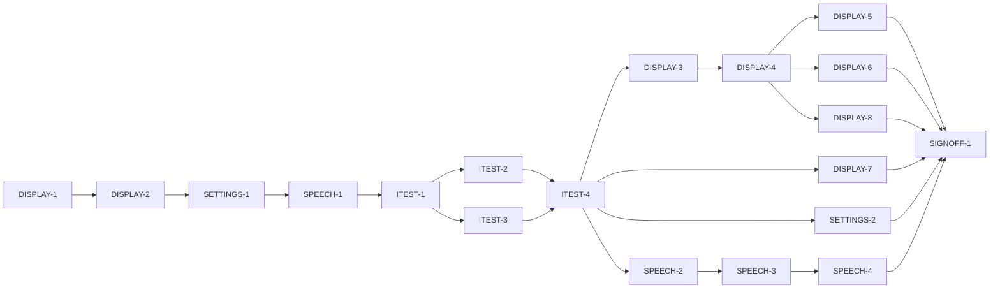

# Master Plan — Display, simulation and spoken output

**Spec:** [bs-08-display-simulation-and-spoken-output.feature](../bs-08-display-simulation-and-spoken-output.feature)
**Status:** ⏸ Awaiting sign-off — all **10/10 ACs ✅**, all gates green; **SIGNOFF-1** packet assembled (round 1): verification green (analyze clean, unit 931, coverage 100% on 14 files, regression 152, bs-08 21 default + 21 run-pending), fresh independent grid **21 A / 0 below**; awaiting the human decision
**Architecture:** [docs/paint-color-app-solution-intent.md](../../docs/paint-color-app-solution-intent.md) §"Accessibility as an architectural concern" (TTS seam, CVD pipeline, value-only views, label contract) + §"Architecture overview" (accessibility services apply to every layer); wireframe `Paint Color Assistant.dc.html` region S1.R1 (E2, E46, E47, E48, E50). Reuses `projectDichromat` + `CvdProfile` (`lib/a11y/cvd/confusion_check.dart`, `cvd_profile.dart`, both exposed for bs-08 reuse), the `Speech` seam (`lib/a11y/speech.dart`), and the shared colour widgets (`lib/widgets/color_chip.dart`).
**Code home:** /Users/matthew.quirk/Nuance · remote https://github.com/meatsquirk/Nuance · base `main` @ `4d4aedd` (bs-01..bs-06 merged) · extends the bs-01..bs-06 foundation (confirmed by sibling *Code home* lines + Matt Quirk directing the bs-06→main merge, 2026-10-11)

## Gap analysis (against `main` @ `4d4aedd`, bs-01..bs-06 merged)

| AC | Exists today | Missing |
|---|---|---|
| AC-1 open settings | No display/simulation settings surface anywhere | A settings surface reachable from any screen that shows the simulation, grayscale and theme controls |
| AC-2 sim off = trichromat | Colour renders directly today (effectively "simulation off"), but there is no simulation state to be *off* | A display-settings state with simulation off meaning the displayed colour is the original (trichromat) view — the explicit identity path |
| AC-3 simulate a type alongside original | `projectDichromat(ColorCoordinates, CvdProfile)` exists (exposed for bs-08); nothing renders a simulated swatch | A chosen `CvdType` set in settings projects the displayed colour via `projectDichromat`, shown alongside the untouched original |
| AC-4 severity slider | `projectDichromat` already blends by `CvdProfile.severity` | A severity control (0..100) in settings that feeds the projection's severity |
| AC-5 grayscale clears sim | — | Turning grayscale on sets the simulation off (mutually exclusive views) |
| AC-6 grayscale greys whole app | ColorChip/camera/palette render in colour; no global desaturation | A root-level value-only grayscale that greys the camera feed and the palettes as well as the readings |
| AC-7 reading keeps value+label under sim | Label contract holds (`ColorChip`/`ValueReading` require text) | Under simulation the reading still shows its numeric value + plain-language label (a guard the simulated view must not break) |
| AC-8 repeat spoken output | `Speech.speak(utterance)` is fire-and-forget; no memory of the last utterance | A repeatable speech service that remembers the last utterance and re-speaks it on request (E50) |
| AC-9 one consistent phrasing | Readout (bs-01), comparison (bs-03) and recipes (bs-04) all speak through the one injected `Speech` seam | Verify a reading and a comparison are spoken through the single shared service (one phrasing path), not a second route |
| AC-10 panel never auto-dismisses | Standing requirement (nothing auto-dismisses) but no spoken-output panel exists | A spoken-output panel that stays until the painter leaves it — no timer, no auto-dismiss |

## Build order

| Stage | Phases |
|---|---|
| 1 Scaffold | DISPLAY-1 |
| 2 Component shells | DISPLAY-2, SETTINGS-1, SPEECH-1 |
| 3 Acceptance tests | ITEST-1, ITEST-2, ITEST-3, ITEST-4 (test review, G-2) |
| 4 Behavior | DISPLAY-3, DISPLAY-4, DISPLAY-5, DISPLAY-6, DISPLAY-7, DISPLAY-8, SETTINGS-2, SPEECH-2, SPEECH-3, SPEECH-4 |
| 5 Sign-off | SIGNOFF-1 |

## Acceptance criteria coverage

| AC | Scenario | Integration test (ITEST) | Behavior phases | Status |
|---|---|---|---|---|
| AC-1 | The painter opens the display and simulation settings | ITEST-2 `TestAC01_OpenDisplaySettings` | SETTINGS-2 | ✅ Done |
| AC-2 | With simulation off, displayed colour is shown as a trichromat sees it | ITEST-2 `TestAC02_SimOffTrichromat` | DISPLAY-3 | ✅ Done |
| AC-3 | The painter simulates a chosen deficiency type alongside the original | ITEST-2 `TestAC03_SimulateTypeAlongsideOriginal` | DISPLAY-4 | ✅ Done |
| AC-4 | The painter sets the simulation strength with the severity slider | ITEST-2 `TestAC04_SeveritySlider` | DISPLAY-5 | ✅ Done |
| AC-5 | Turning on grayscale clears an active simulation | ITEST-2 `TestAC05_GrayscaleClearsSimulation` | DISPLAY-6 | ✅ Done |
| AC-6 | The value-only view greys the camera and the palettes as well as the readings | ITEST-2 `TestAC06_GrayscaleWholeApp` | DISPLAY-7 | ✅ Done |
| AC-7 | A reading under simulation keeps its numeric value and label | ITEST-2 `TestAC07_ReadingKeepsValueAndLabel` | DISPLAY-8 | ✅ Done |
| AC-8 | The painter repeats the last spoken output | ITEST-3 `TestAC08_RepeatSpokenOutput` | SPEECH-2 | ✅ Done |
| AC-9 | Readings and comparisons are spoken through one consistent phrasing | ITEST-3 `TestAC09_OneConsistentPhrasing` | SPEECH-3 | ✅ Done |
| AC-10 | The spoken-output panel stays until the painter leaves it | ITEST-3 `TestAC10_PanelNeverAutoDismisses` | SPEECH-4 | ✅ Done |

10 ACs (AC-3 is a Scenario Outline tested over its 3 examples: protan, deutan, tritan). Every AC → one integration test → exactly one behavior phase.

## Design decisions

| # | Decision | Why |
|---|---|---|
| D-1 | Reuse `projectDichromat(ColorCoordinates, CvdProfile)` (`lib/a11y/cvd/confusion_check.dart`) for the simulation; no new colour-space maths | Its doc-comment designates bs-08/bs-10 as the reuse sites (Viénot 1999 / BVM); a second projection would be a second author |
| D-2 | bs-08 reads the painter's type/severity from `AppDependencies.cvdProfile` (const deutan default; **bs-07** populates it). The simulation *setting* carries its own `simulationType`/`simulationSeverity`, defaulting from `cvdProfile` when settings open — the painter may select any type (AC-3). Soft dependency on bs-07, **not a blocker** | The seam already exists (bs-03); AC-3 lets the painter choose a type, so the setting is independent of the stored profile. Honors "Builds on: bs-07" by consuming the shared profile seam |
| D-3 | A cross-cutting `DisplayController` (`ChangeNotifier`) holds `DisplaySettings {CvdType? simulationType, double simulationSeverity 0..1, bool grayscale}`, injected app-wide via a `DisplayScope` (`InheritedNotifier`); every colour render reads it | SI: accessibility services "apply to every layer" — one chokepoint, not per-screen state; `simulationType == null` is "simulation off" |
| D-4 | Simulation renders the **original and the simulated swatch side by side** through the shared colour widget (`ColorChip` gains an optional display transform read from `DisplayScope`); when sim on, it shows the projected swatch alongside the untouched original | AC-3 "the original colour is shown alongside the simulation"; keeps the one label-contract widget the chokepoint |
| D-5 | Value-only grayscale is a **single root-level `ColorFiltered`** (saturation-0 matrix) wrapping the whole app in `buildApp`, active when `grayscale` is set — greys camera preview, palette swatches and readings uniformly | AC-6 "the whole app… camera and palettes as well as the readings"; a global filter covers surfaces a per-widget transform (ColorChip) cannot (live camera) |
| D-6 | Severity slider is 0..100 in the panel; stored `simulationSeverity = value/100` (matches bs-07 D-5); `projectDichromat` already blends by severity | AC-4; one severity scale across the app |
| D-7 | AC-7 reuses the existing label contract (`ColorChip`/`ValueReading` require non-empty text); the simulated view must keep rendering the numeric value + plain-language label | SI: "no meaning in colour alone"; simulation must not strip the text the reading already carries |
| D-8 | Spoken output becomes `RepeatableSpeech` **behind the existing `Speech` seam** — it records the last utterance and exposes `repeat()` (re-speaks it). Production wraps the existing `NoopSpeech` (still no native TTS, bs-01 D-1); the suite injects `FakeSpeech` | AC-8; keeps callers (readout/comparison/recipes) unchanged; repeat is observed as two identical `FakeSpeech` log entries |
| D-9 | AC-9 is satisfied because readout (bs-01), comparison (bs-03) and recipes (bs-04) already speak through the one injected `Speech`; bs-08 adds no second phrasing path and the test proves both go through the single service | SI: "a single `Speech` service with consistent phrasing" — one seam is the consistency |
| D-10 | The spoken-output panel (E50) is a persistent widget with no timer / no auto-dismiss; it stays until the painter navigates away | AC-10 + the standing "nothing auto-dismisses" requirement |
| D-11 | A theme (light/dark) control is **shown** in the settings panel (AC-1 requires it shown) but its behaviour is out of scope (spec boundary: theme is presentation, unspecified) — a presentation affordance only | AC-1 lists "theme controls" among what is shown; the spec explicitly leaves theme unspecified |

## Acceptance integration test plan

Module plan: [modules/ITEST.md](modules/ITEST.md).

**Where it lives and how it runs:** `integration_test/display_harness.dart` (vocabulary + fixtures + independent reference + wiring) and `integration_test/display_test.dart` (runner). Default target (pending skipped): `flutter test integration_test/display_test.dart -d <booted-udid>`. Run-pending / red baseline: `--dart-define=BS08_RUN_PENDING=true`. **A booted sim udid (`-d`) is mandatory** — without it the run executes zero tests and exits 0 (false green; see Known flakes). The pending gate lives in `integration_test/bs08/pending.dart` (seeded in **DISPLAY-1** with the 10 ACs → owning phase; the module plan + session log are authoritative — earlier prose here said ITEST-1). Single exclusive lane via `coord.sh with-lock` in parallel sessions.
**Where assertions look:** the rendered widget tree (keyed finders for the settings entry E2, the panel controls E46/E47/E48, the spoken-output panel E50, the original + simulated swatches, the root grayscale filter); `DisplayReadEndpoint` (live `DisplaySettings`: `simulationType`, `simulationSeverity`, `grayscale`); the displayed swatch colours (read off the rendered `ColorChip`/`Container` decoration); `FakeSpeech` log (utterances + repeat).
**What is real and what is faked:** the whole app assembled through `buildApp(deps)`; real `DisplayController`, real `projectDichromat`, real `ColorChip`/root grayscale rendering, real readout/comparison speech paths. Faked infrastructure only: `FakeSpeech`, `FakeHaptics`. The simulated colour (AC-3/AC-4) is graded against `referenceProjectDichromat`, an **independent** in-harness Viénot projection, so the shipped projection is never graded against itself (same discipline as bs-03 AC-7).

**Fixtures:**

| Fixture | Shape |
|---|---|
| `bootedDevice` | A booted simulator udid passed via `-d`; mandatory for every acceptance run |
| `fakeSpeech` / `fakeHaptics` | Infrastructure doubles recording spoken/haptic events |
| `displaySample` | A known, chromatic colour (clearly non-grey, clearly shifts under each dichromat projection) rendered on screen so simulation/grayscale are observable |
| `referenceProjectDichromat` | An independent in-harness Viénot/BVM dichromat projection to grade AC-3/AC-4 against (not the shipped `projectDichromat`) |
| `cvdProfileFixture` | The painter's injected `CvdProfile` (type + severity) the settings default from (AC-3/AC-4 default path) |
| `readingAndComparison` | A reading and a comparison both reachable so each can be spoken through the one `Speech` seam (AC-9) |

**Test catalogue:**

| AC | Given: built via public flows → checked by | When | Then: exact assertions (negative Thens: after settle) | Rejects |
|---|---|---|---|---|
| AC-1 | On any screen (open the app on a reading) → read endpoint: settings not shown | open the display and simulation settings (E2) | the settings surface is shown with **all three** controls present: simulation selector (E47), value-only grayscale toggle (E46), **and** a theme control (D-11) — all three found | a settings surface missing any of the three controls, or an entry not reachable from the screen |
| AC-2 | Display settings open with **simulation off** (`simulationType == null`) → read endpoint: sim off | a colour is displayed | the displayed swatch colour **equals the original** (trichromat) — no projection applied (displayed == `displaySample`'s own colour within tolerance); only one swatch (no simulated-alongside pair) | a view that projects or desaturates when simulation is off |
| AC-3 | Settings open, sim off → read endpoint: sim off, one swatch | set the simulation to `<type>` (protan/deutan/tritan via E47) | the displayed swatch is **projected for `<type>`** (matches `referenceProjectDichromat(displaySample, <type>, severity)` within tolerance) **and** the **original** swatch is shown alongside it (two distinct swatches: one original, one simulated). Outline over all three types | a selector that changes nothing, applies the wrong type, or drops the original (no "alongside") — graded vs `referenceProjectDichromat`; the three distinct type outputs are the control |
| AC-4 | Simulation set to **deutan** (via DISPLAY-4) → read endpoint: deutan, baseline severity | set the simulation severity to 60 (E48) | `simulationSeverity == 0.60` and the simulated swatch is rendered **at that severity** (matches `referenceProjectDichromat(displaySample, deutan, 0.60)` within tolerance; differs from the severity-1.0 render). Control: severity 0 → equals the original | a slider that doesn't reach the projection (render unchanged across severities) or renders at a fixed severity — graded vs reference |
| AC-5 | Simulation set to **deutan** (via DISPLAY-4) → read endpoint: `simulationType == deutan` | turn on the value-only grayscale view (E46) | the whole app is shown in grayscale (root grayscale filter active) **and** the simulation is turned **off** (`simulationType == null`). Control: turning grayscale off again does not re-enable the simulation | a grayscale toggle that leaves the simulation active (both views at once) |
| AC-6 | The value-only grayscale view **on** (via DISPLAY-7 toggle) with the camera/capture surface and a palette shown → read endpoint: grayscale on | the camera and the palettes are shown | the camera feed **and** the palette swatches **and** the readings are all rendered in grayscale (the root saturation-0 filter wraps the whole app; sampled rendered colours are achromatic) | a grayscale that greys only the readings (ColorChip) and leaves the camera preview or palette swatches in colour |
| AC-7 | Simulation set to **deutan** (via DISPLAY-4); a reading displayed → read endpoint: deutan | a reading is displayed | the reading still shows its **numeric value** and its **plain-language label** (both present as text) — not colour alone — while simulated. Control: with sim off the same value + label are present | a simulated reading that renders a colour swatch with no accompanying value/label text |
| AC-8 | A reading has just been spoken through the shared speech (open a reading, speak it) → `FakeSpeech` log has exactly that one utterance; `RepeatableSpeech.lastUtterance` set | ask to repeat it (E50) | the **same** utterance is spoken again — `FakeSpeech` log ends with a second entry **identical** to the first (count +1, text equal). Control: with nothing spoken yet, repeat is inert (no utterance, control disabled) | a repeat that speaks a different/empty utterance, or speaks nothing |
| AC-9 | A reading and a comparison both produced → each spoken through the injected `Speech` | each is spoken | **both** utterances went through the **one** shared speech service (the single injected `FakeSpeech` recorded both; both utterances are non-empty and built by the shared phrasing builders, not an ad-hoc second path) | one of the two bypassing the shared service, or two different speech sinks |
| AC-10 | The spoken-output panel opened for a reading (E50) → panel present | the painter does not act for a while (pump a long duration, e.g. 60s, and settle) | the spoken-output panel is **still present** and nothing dismissed it on a timer (panel found after the long pump; no auto-dismiss). Control: navigating away removes it | a panel that disappears after a timeout / auto-dismisses on a timer |

**Red baseline** and **test augmentations:** tracked in [modules/ITEST.md](modules/ITEST.md).
Augmentations (confirmed by ITEST-2): **AC-7** is green-at-baseline and *limited* (bs-01's label contract already shows value + label; no simulated swatch exists until DISPLAY-4, so it cannot yet reject "a swatch with no text") → one augmentation row, owner **DISPLAY-8** (assert the simulated swatch coexists with value + label, then re-grade A). The other display ACs fail at baseline on their own Then naming the owning phase; **AC-1** is green-at-baseline and fully discriminating (SETTINGS-1 built the panel + three controls), so it needs no augmentation — SETTINGS-2 un-pends and keeps it green. AC-9's "both through the one service" is discriminating only once both speak paths are asserted against the single injected sink; to be confirmed by ITEST-3.

## Modules

| Module | Plan | Purpose | Depends on | Status |
|---|---|---|---|---|
| DISPLAY | [modules/DISPLAY.md](modules/DISPLAY.md) | Scaffold + the cross-cutting display pipeline: `DisplaySettings`/`DisplayController`/`DisplayScope`/`DisplayReadEndpoint`, the simulation rendering (reusing `projectDichromat`), the sim-off identity, the root value-only grayscale filter, and the mutual exclusion | — | 🔄 In progress (DISPLAY-1, DISPLAY-2, DISPLAY-3, DISPLAY-4, DISPLAY-5, DISPLAY-6, DISPLAY-7, DISPLAY-8 ✅) |
| SETTINGS | [modules/SETTINGS.md](modules/SETTINGS.md) | The open-from-any-screen entry (E2) + the settings panel (E46 grayscale toggle, E47 simulation selector, E48 severity slider, theme control), bound to the `DisplayController` | DISPLAY | ✅ Done (SETTINGS-1, SETTINGS-2 ✅; AC-1) |
| SPEECH | [modules/SPEECH.md](modules/SPEECH.md) | Repeatable spoken output (`RepeatableSpeech`: remembers last + `repeat()`), the one-consistent-phrasing verification, and the spoken-output panel (E50) that never auto-dismisses | DISPLAY (scaffold only) | ✅ Done (SPEECH-1, SPEECH-2, SPEECH-3, SPEECH-4 ✅; AC-8/9/10) |
| ITEST | [modules/ITEST.md](modules/ITEST.md) | Acceptance integration suite: one pending test per AC, and its review | all shell phases | ✅ Done (ITEST-1..4 ✅; G-2 approved 2026-10-12) |

## Dependency graph

**Parallel windows:** Shells are sequential — DISPLAY-2, SETTINGS-1, SPEECH-1 all touch `lib/app/build_app.dart` (merge-risky; run in order). ITEST-2 ∥ ITEST-3 share `display_test.dart` → **merge-risky; run sequentially** (or split into two files included by the runner). In behavior: DISPLAY-7 (grayscale rendering), SETTINGS-2 (AC-1 open panel) and the SPEECH chain are independent of the simulation chain (DISPLAY-3→4→{5,6,8}) and may run concurrently with it; within each chain run in order. DISPLAY-4 is the barrier the simulation-dependent ACs (AC-4/AC-5/AC-7) wait on.

## Open gates

| Gate | Kind | Decision needed | Blocks | Status |
|---|---|---|---|---|
| G-1 | decision | Approve the spec (record the approval as its first line, replacing the `# Draft: awaiting owner approval` banner) | DISPLAY-1 | ✅ Resolved 2026-10-11: spec approved; Draft banner replaced with approval line — Matt Quirk |
| G-2 | decision | Approve the acceptance tests (ITEST-4's packet) | every behavior phase | ✅ Resolved 2026-10-12 11:32 EDT: approved — Matt Quirk. The ten pending AC tests (24 A + 1 B-pending-DISPLAY-8) are approved as the acceptance contract; ITEST-4 done; all ten behavior phases open |

Resolved: `✅ Resolved <date time>: <decision, one line> — <who>`.

Note (not a gate): bs-08 consumes `AppDependencies.cvdProfile`, which **bs-07** (CVD self-assessment) populates. Until bs-07 lands, the simulation defaults from the const deutan profile (D-2); the painter can still select any type. This is a known gap, not a blocker — bs-08 builds now on `main` @ `4d4aedd` (bs-01..bs-06).

## Known flakes

| Test | Symptom | Rate (runs) | Measured at | Owner | Status |
|---|---|---|---|---|---|
| coverage_gate — const-constructor line | `flutter test --coverage` intermittently records a const-folded constructor line in `lib/**` as uncovered, so the gate may FAIL on a file this phase never touched | intermittent | first bs-01 `88c5add` | re-run `flutter test --coverage` once; green on re-run ⇒ ignore | Open |
| integration suite — no `-d <udid>` | `flutter test integration_test/…` with no booted device runs zero tests and still exits 0 (false green) | deterministic | bs-05/bs-06 | always pass `-d <booted-udid>` | Open |

## Session log

| # | Phase | Target | Status | Tokens | Time | Notes |
|---|---|---|---|---|---|---|
| 1 | DISPLAY-1 | scaffold: branch from `main` @ a695e4c (=4d4aedd tree), baseline, coverage gate confirm, bs08 pending runner (10 ACs) | ✅ Done | 4,979,118 | 14m 13s (15m 17s) | G-1 approved inside; analyze clean, 849 unit pass, gate PASS clean / FAIL planted, smoke 3/3 on sim |
| 2 | DISPLAY-2 | shell: `DisplaySettings` + `DisplayController` + `DisplayScope` + `DisplayReadEndpoint` + buildApp wiring + inert simulation/grayscale rendering seams | ✅ Done | 8,485,201 | 15m 04s (15m 04s) | analyze clean, 885 unit (849+36), gate 100% on 8 touched files, bs08 integration green on sim; all seams inert (behaviour unchanged) |
| 3 | SETTINGS-1 | shell: open-from-any-screen entry (E2) + settings panel scaffold (E46/E47/E48 + theme control) wired to `DisplayController` stubs + keyed regions | ✅ Done | 7,453,272 | 19m 27s (19m 27s) | analyze clean, 899 unit (885+14), gate 100% on 9 touched files, bs08 integration 3/3 on sim; chrome via MaterialApp.builder, panel binds frozen setters, all effects inert; fix 2/3 |
| 4 | SPEECH-1 | shell: `RepeatableSpeech` behind the `Speech` seam + app-wide inject + spoken-output panel (E50) + observation | ✅ Done | 7,712,760 | 18m 46s (18m 46s) | analyze clean, 914 unit (899+15), gate 100% on 11 touched files, bs08 integration 3/3 on sim; app-wide speech wrapped + re-provided via AppScope, E50 panel in chrome; fix 0/3 |
| 5 | ITEST-1 | acceptance-tests: harness, fixtures, independent reference, pending gate (10 ACs), smoke test | ✅ Done | 8,480,396 | 16m 57s | analyze clean, 914 unit, gate PASS (no lib touched), integration 11/11 on sim (3 scaffold + 6 guard + 2 smoke), 10 ACs still pending; fix 0/3 |
| 6 | ITEST-2 | acceptance-tests: AC-1..7 (display, pending) + red baseline | ✅ Done | 14,829,254 | 1h 06m (1h 10m) | red baseline +13 -5 (AC-2..6 fail on Then; AC-1/AC-7 green-at-baseline); grades 6 A + 1 B-pending-DISPLAY-8 (AC-7); fixed a non-deterministic scaffold guard; fix 1/3 |
| 7 | ITEST-3 | acceptance-tests: AC-8,9,10 (speech, pending) + red baseline | ✅ Done | 6,704,225 | 18m 11s | AC-8/9/10 all green-at-baseline (SPEECH-1 wired repeat + shared seam); grades 3 A; +16 -5 run-pending; fix 0/3 |
| 8 | ITEST-4 | test-review: packet; G-2 | ✅ Done | 1,393,384 | 3m 12s | packet assembled in modules/ITEST.md; **G-2 approved 2026-10-12 — Matt Quirk** (10 AC tests, 24 A + 1 B-pending-DISPLAY-8); acceptance stage complete; no code ran |
| 9 | DISPLAY-3 | AC-2 simulation off = trichromat (identity path) | ✅ Done | 10,542,090 | 20m 03s (20m 03s) | AC-2 un-pended + green; true-colour ColorChip wired onto the Readout render path (identity); grade 2 A/0 below; fix 0/3 |
| 10 | DISPLAY-4 | AC-3 simulate chosen type alongside original (protan/deutan/tritan) | ✅ Done | 12,709,944 | 23m 20s (23m 20s) | AC-3 un-pended + green; simulateColor projects via projectDichromat, ColorChip renders simulated-alongside-original; grade 2 A/0 below; fix 1/3 |
| 11 | DISPLAY-5 | AC-4 severity slider strength | ✅ Done | 5,665,722 | 11m 49s (11m 49s) | AC-4 un-pended + green; already-wired (SETTINGS-1 slider + DISPLAY-4 severity projection) — test-only, no lib change; grade 3 A/0 below; fix 0/3 |
| 12 | DISPLAY-6 | AC-5 grayscale clears simulation (mutual exclusion) | ✅ Done | 4,583,088 | 13m 00s (13m 00s) | AC-5 un-pended + green; `setGrayscale(true)` nulls `simulationType` (D-3) in display_controller.dart; unit 928/cov 100% (14 files)/acceptance 15 pass 6 skip/grade 5 A/0 below; fix 0/3 |
| 13 | DISPLAY-7 | AC-6 grayscale greys whole app (camera + palettes + readings) | ✅ Done | 12,068,315 | — (fork mark timing) | AC-6 un-pended + green; root saturation-0 `ColorFiltered` in grayscale_filter.dart, keyed so a toggle reparents (not remounts) the app; unit 931/cov 100%/acceptance 16 pass 5 skip/grade 6 A 0 below; fix 1/3 |
| 14 | DISPLAY-8 | AC-7 reading keeps numeric value + label under simulation | ✅ Done | 7,504,305 | 0m 00s | AC-7 un-pended + green; test-only augmentation (simulated swatch coexists with value+label, D-7) — no lib change; AC-7 re-graded B-pending-DISPLAY-8 → A; unit 928/cov PASS/acceptance 16 pass 5 skip/grade 5 A 0 below; fix 1/3 |
| 15 | SETTINGS-2 | AC-1 open settings from any screen → the three controls shown | ✅ Done | 3,579,655 | 12m 31s (12m 31s) | pure un-pend (no lib change); AC-1 un-pended + green; unit 931/cov 100% (14 files)/acceptance default 18 pass 3 skip, run-pending 21 pass/grade 8 A 0 below; fix 0/3 |
| 16 | SPEECH-2 | AC-8 repeat last spoken output | ✅ Done | 7,026,082 | 18m 22s (49m 22s) | pure un-pend (no lib change); AC-8 un-pended + green; unit 931/cov 100% (14 files)/acceptance default 19 pass 2 skip, run-pending 21 pass/grade 9 A 0 below; fix 0/3 |
| 17 | SPEECH-3 | AC-9 reading + comparison one consistent phrasing | ✅ Done | 3,647,171 | 13m 54s (13m 54s) | pure un-pend (no lib change); AC-9 un-pended + green; unit 931/cov 100% (14 files)/acceptance default 20 pass 1 skip, run-pending 21 pass/grade 10 A 0 below; fix 0/3 |
| 18 | SPEECH-4 | AC-10 spoken-output panel never auto-dismisses | ✅ Done | 5,337,022 | 15m 20s (15m 20s) | pure test-only un-pend (no lib change); AC-10 un-pended → pending map now empty {}; rewrote terminal scaffold guard off `pendingACs.keys.first`; unit 931/cov 100% (14 files)/acceptance default **21 pass 0 skip**, run-pending 21 pass/grade **12 A 0 below** (AC-1..10 + 2 guards); fix 0/3 |
| 19 | SIGNOFF-1 | sign-off: packet + summary page + manual approval | ⏸ Awaiting sign-off | 7,894,365 | 20m 59s (20m 59s) | packet `signoff/round-1.md` + `cost-per-ac-round-1.md` + summary page; verification green (analyze clean, unit 931, cov 100%/14 files, regression 152, bs-08 21 default + 21 run-pending); fresh independent grid 21 A/0 below; awaiting human decision |

*Tokens* / *Time* = the phase totals from the *Token usage* ledger (Time = active, wall in brackets), filled when the row is marked done.

## Next phase

**SIGNOFF-1 packet assembled — awaiting the human decision.** The feature is code-complete and fully
verified this session: analyze clean, unit **931**, coverage gate **100% on 14 touched files**, the full
cross-feature regression **152 pass / 0 fail**, bs-08 acceptance **21 pass** in both default and run-pending
(nothing pending), and a fresh independent full-suite re-grade of **21 A / 0 below A**. Packet:
`signoff/round-1.md` (+ `signoff/cost-per-ac-round-1.md`, + the summary-page scorecard). All preconditions met;
no open gate (G-1/G-2 resolved), no open augmentation.

**Next — record the decision (human):**
`/feature-next-phase --signoff bs-08-display-simulation-and-spoken-output approved | changes "<items>"`.
The agent assembled the packet and stopped; it never approves. On **approved**, SIGNOFF-1 ✅, the feature
Status → Done — signed off, and `feat/bs-08` merges to `main` (as bs-05/bs-06 did). On **changes requested**,
each item becomes a new phase before a fresh SIGNOFF-2.

## Token usage

<!-- One row per session, appended as that session's last edit (SKILL.md § Token usage). -->

| Phase / activity | Session | Start | End | Wall | Active | Model(s) | Input | Cache write | Cache read | Output | Total | Outcome |
|---|---|---|---|---|---|---|---|---|---|---|---|---|
| PLAN | 89fb9344 | 2026-10-11 | — | — | — | claude-opus-4-8 | — | — | — | — | — | plan written (+ verified bs-06→main merge already landed) |
| PLAN | 2f2410ba | 2026-10-11 21:46 EDT | 22:14 | 28m 43s | 26m 46s | claude-opus-4-8 | 136 | 200,492 | 9,872,401 | 93,869 | 10,166,898 | plan written (bs-06->main merge verified already landed) |
| DISPLAY-1 | 96db72c8 | 2026-10-11 22:21 EDT | 22:36 | 15m 17s | 14m 13s | claude-opus-4-8 | 96 | 104,817 | 4,829,740 | 44,465 | 4,979,118 | scaffold green — analyze clean, 849 unit baseline, coverage gate PASS clean / FAIL planted, integration smoke 3/3 on sim, bs08 pending gate seeded (10 ACs); G-1 (spec) approved inside |
| DISPLAY-2 | 5897d58f | 2026-10-12 05:06 EDT | 05:21 | 15m 04s | 15m 04s | claude-opus-4-8 | 128 | 155,894 | 8,274,506 | 54,673 | 8,485,201 | shell green — analyze clean, 885 unit (849+36), coverage gate 100% on 8 touched files, bs08 integration 3/3 on sim; DisplaySettings/Controller/Scope/ReadEndpoint + buildApp _DisplayRoot wiring + inert simulateColor/GrayscaleFilter + ColorChip reads DisplayScope (identity); behaviour unchanged |
| SETTINGS-1 | 03b0c96d | 2026-10-12 05:47 EDT | 06:06 | 19m 27s | 19m 27s | claude-opus-4-8 | 124 | 132,630 | 7,272,929 | 47,589 | 7,453,272 | shell: E2 entry + settings panel (E46/E47/E48 + theme, D-11) via MaterialApp.builder chrome, bound to frozen DisplayController setters; 899 unit, gate 100% on 9 files, integration 3/3; fix 2/3 |
| SPEECH-1 | 12232428 | 2026-10-12 07:10 EDT | 07:29 | 18m 46s | 18m 46s | claude-opus-4-8 | 112 | 161,614 | 7,484,024 | 67,010 | 7,712,760 | shell green — analyze clean, 914 unit (899+15), coverage gate 100% on 11 touched files, bs08 integration scaffold guard 3/3 on sim; RepeatableSpeech wraps the app-wide Speech + re-provided via AppScope (readout/comparison/recipes all repeatable), SpeechScope + E50 SpokenOutputPanel surfaced in chrome; fix 0/3 |
| ITEST-1 | 0917e31c | 2026-10-12 07:54 EDT | 08:11 | 16m 57s | 16m 57s | claude-opus-4-8 | 114 | 187,077 | 8,228,434 | 64,771 | 8,480,396 | harness + fixtures + independent reference + smoke/guards; analyze clean, 914 unit, gate PASS (no lib touched), integration 11/11 on sim, 10 ACs still pending; fix 0/3 |
| ITEST-2 | dfd026ba | 2026-10-12 08:19 EDT | 09:30 | 1h 10m | 1h 06m | claude-opus-4-8 | 166 | 334,879 | 14,379,877 | 114,332 | 14,829,254 | AC-1..7 pending tests landed; red baseline +13 -5 (AC-2..6 fail on Then, AC-1/AC-7 green-at-baseline); grades 6 A + 1 B-pending-DISPLAY-8; fixed non-deterministic scaffold guard; fix 1/3 |
| ITEST-3 | df46f7bd | 2026-10-12 09:42 EDT | 10:00 | 18m 11s | 18m 11s | claude-opus-4-8 | 106 | 246,018 | 6,403,141 | 54,960 | 6,704,225 | AC-8/9/10 pending speech tests + harness (givenComparison) landed; all 3 green-at-baseline, grades 3 A, no augmentations; run-pending +16 -5; analyze clean, 914 unit, coverage gate PASS (no lib touched); fix 0/3 |
| ITEST-4 | 8bf4c8d7 | 2026-10-12 10:16 EDT | 10:19 | 3m 12s | 3m 12s | claude-opus-4-8 | 34 | 73,658 | 1,306,800 | 12,892 | 1,393,384 | test-review packet assembled (per-AC catalogue, red-baseline summary, augmentations, grid 24 A + 1 B-pending-DISPLAY-8); G-2 set awaiting decision; no code ran |
| SIGNOFF-DECISION | feabec25 | 2026-10-12 10:59 EDT | 11:33 | 34m 24s | 3m 00s | claude-opus-4-8 | 40 | 50,293 | 1,335,882 | 11,207 | 1,397,422 | ITEST-4 approved |
| DISPLAY-3 | 4be223b0 | 2026-10-12 11:42 EDT | 12:02 | 20m 03s | 20m 03s | claude-opus-4-8 | 154 | 261,086 | 10,211,999 | 68,851 | 10,542,090 | AC-2 un-pended + green; identity ColorChip on Readout; coverage 100%; grade 2 A/0 below; fix 0/3 |
| RECONCILE | 95d457ef | 2026-10-12 12:20 EDT | 12:24 | 3m 58s | 3m 58s | claude-opus-4-8 | 40 | 46,745 | 1,248,595 | 12,943 | 1,308,323 | merged phase/DISPLAY-3 into feat/bs-08 (ff 1112589); applied DISPLAY-3 rollup to master (AC-2 ✅, module+session log+Next); removed phase worktree/branch |
| DISPLAY-4 | 95d457ef | 2026-10-12 12:20 EDT | 12:43 | 23m 20s | 23m 20s | claude-opus-4-8 | 198 | 266,679 | 12,372,579 | 70,488 | 12,709,944 | AC-3 un-pended + green; simulateColor projects via projectDichromat, ColorChip renders simulated-alongside-original; unit 926/cov 100% (14 files)/acceptance 13 pass 8 skip/grade 2 A; fix 1/3 |
| DISPLAY-5 | e9bad3d1 | 2026-10-12 12:51 EDT | 13:03 | 11m 49s | 11m 49s | claude-opus-4-8 | 120 | 182,564 | 5,451,874 | 31,164 | 5,665,722 | AC-4 un-pended + green; already-wired (SETTINGS-1 slider + DISPLAY-4 severity projection) — test-only, no lib change; unit 926/cov 100% (14 files)/acceptance 14 pass 7 skip/grade 3 A; fix 0/3 |
| DISPLAY-6 | ed7c31bb | 2026-10-12 15:30 EDT | 15:43 | 13m 00s | 13m 00s | claude-opus-4-8 | 98 | 192,691 | 4,358,550 | 31,749 | 4,583,088 | AC-5 un-pended + green; setGrayscale(true) clears simulation (D-3); unit 928/cov 100% (14 files)/acceptance 15 pass 6 skip/grade 5 A 0 below; fix 0/3 |
| DISPLAY-7 | agent-a7 | — | 16:34 | — | 0m 00s | claude-opus-4-8 | 146 | 133,532 | 11,926,423 | 8,214 | 12,068,315 | AC-6 un-pended + green; root saturation-0 ColorFiltered (keyed, no remount); unit 931/cov 100%/acceptance 16 pass 5 skip/grade 6 A 0 below; fix 1/3 |
| DISPLAY-8 | agent-ad | — | 16:26 | — | 0m 00s | claude-opus-4-8 | 102 | 86,239 | 7,410,141 | 7,823 | 7,504,305 | AC-7 un-pended + green; test-only augmentation (simulated swatch coexists with value+label, D-7); AC-7 re-graded B-pending-DISPLAY-8 → A; unit 928/cov PASS/acceptance 16 pass 5 skip/grade 5 A; fix 1/3 |
| RECONCILE | e9d77016 | 2026-10-12 16:02 EDT | 16:43 | 40m 29s | 39m 55s | claude-opus-4-8 | 382 | 358,095 | 27,862,885 | 55,597 | 28,276,959 | reconciled DISPLAY-6 (ff 177e384), then DISPLAY-7 (ff ded630f) + DISPLAY-8 (merge fc3af2e) into feat/bs-08; unioned scaffold-guard set {AC-2..7}; verified merged tree: analyze clean, unit 931, acceptance 17 pass/4 skip; applied 3 rollups; removed phase worktrees/branches |
| SETTINGS-2 | 10900289 | 2026-10-12 17:09 EDT | 17:22 | 12m 31s | 12m 31s | claude-opus-4-8 | 80 | 180,400 | 3,375,094 | 24,081 | 3,579,655 | AC-1 un-pended + green (pure un-pend, no lib change); unit 931/cov 100% (14 files)/acceptance default 18 pass 3 skip, run-pending 21 pass/grade 8 A 0 below; fix 0/3 |
| SPEECH-2 | 2a4813a4 | 2026-10-12 17:29 EDT | 18:19 | 49m 22s | 18m 22s | claude-opus-4-8 | 134 | 231,874 | 6,759,754 | 34,320 | 7,026,082 | AC-8 un-pended + green (test-only); unit 931/cov 100%/accept 19 pass 2 skip + run-pending 21; grade 9 A/0 below; fix 0/3 |
| SPEECH-3 | 3b311776 | 2026-10-12 19:32 EDT | 19:46 | 13m 54s | 13m 54s | claude-opus-4-8 | 84 | 208,974 | 3,412,132 | 25,981 | 3,647,171 | AC-9 un-pended + green (pure test-only un-pend); unit 931/cov 100% (14 files)/acceptance default 20 pass 1 skip, run-pending 21 pass/grade 10 A 0 below; fix 0/3 |
| SPEECH-4 | 199c2f84 | 2026-10-12 21:04 EDT | 21:19 | 15m 20s | 15m 20s | claude-opus-4-8 | 110 | 225,713 | 5,078,874 | 32,325 | 5,337,022 | AC-10 un-pended + green (pure test-only un-pend, no lib change; pending map now empty); unit 931/cov 100% (14 files)/acceptance default 21 pass 0 skip + run-pending 21 pass/grade 12 A 0 below; fix 0/3 |
| SIGNOFF-1 | 1189fd6a | 2026-10-12 22:15 EDT | 22:36 | 20m 59s | 20m 59s | claude-opus-4-8 | 128 | 309,986 | 7,527,149 | 57,102 | 7,894,365 | sign-off packet + cost-per-ac + summary-page scorecard assembled; verification green (analyze clean, unit 931, coverage 100% on 14 files, regression 152, bs-08 default+run-pending 21/21), fresh independent grid 21 A/0 below; awaiting human decision |
| **Feature total** |  | **2026-10-11 21:46 EDT** | **2026-10-12 22:36** | **7h 44m** | **6h 34m** |  | **2,832** | **4,331,950** | **176,383,783** | **1,026,406** | **181,744,971** |  |

## Sign-off

| Round | Packet | At code | Grades | Decision |
|---|---|---|---|---|
| 1 | [signoff/round-1.md](signoff/round-1.md) | `5e5c531` | 21 A / 0 below A | ⏸ Awaiting sign-off (prepared 2026-10-12) |
