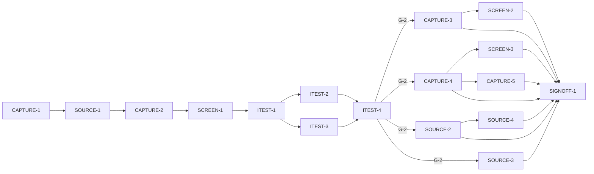

# Master Plan — Advanced capture (bs-09)

**Spec:** [bs-09-advanced-capture.feature](../bs-09-advanced-capture.feature)
**Status:** In progress — next ITEST-4 (test review → G-2; ITEST-1/2/3 done, all 10 AC tests pending + red baseline, suite 24 A)
**Architecture:** [solution intent](../../docs/paint-color-app-solution-intent.md) §"Cross-platform strategy" (CaptureSource / wide colour space / RAW fallback; D2), §"Capture & sampling" (torch, multi-point) · [scope](../../docs/paint-color-app-scope.md) §4.1 (flash/torch *Should*, multi-point *Should*, RAW/DNG *Could*) · **no wireframe yet** (the spec is proposed ahead of any mock; a future revision adds its UX)
**Code home:** /Users/matthew.quirk/Nuance · remote https://github.com/meatsquirk/Nuance · base `main` · **extends** bs-02's capture surface and bs-03's comparison, both already merged to `main` (confirmed by Matt Quirk via sibling *Code home* lines, 2026-10-11)

> Proposes the capture features scope §4.1 marks Should/Could but no mock draws: torch lighting with a
> colour-temperature warning, multi-point sampling, and wide-gamut / RAW capture. All sit behind bs-02's
> `CaptureSource` (SI D2), which returns a normalized, colour-space-tagged sample on either platform. It adds
> no new architectural layer — it extends the existing source, controller, Capture screen and bs-03's
> comparison handoff.

## Gap analysis (against `main` @ 4d4aedd; bs-02 capture + bs-03 comparison present)

| AC | Exists today | Missing |
|---|---|---|
| AC-1 torch warning | `Lighting{adequate,low}` on the source only; no torch/flash concept | torch control on `CaptureSource`; a colour-temperature warning raised when the torch turns on; the warning on the Capture screen |
| AC-2 torch-lit label | `Sample{coordinates,provenance,name,accuracy,evidence}` — no lighting/illuminant field | `Sample.litByTorch`; commit stamps it when the torch is on; a torch-warning acknowledge that keeps the torch on |
| AC-3 multi-point | sampling is a single centre point (or one imported-photo point P); one `currentSample` | mark N points; `sampleMarkedPoints()` → one reading per marked point |
| AC-4 keep position/value | one `currentSample`/`lastCommittedSample`; single centred eyedropper | a per-point reading that keeps its frame position + its own colour value; the readings shown on screen |
| AC-5 two to comparison | `router.toComparison(sample, slot)` carries **one** sample into a slot; bs-03 `ComparisonState.slotA/slotB` | carry **two** readings in one handoff so both slots open filled; a send-two control |
| AC-6 colour-space tag | `Frame.colorSpace{srgb,displayP3}` exists but is **lost** when the controller builds a `Sample` | thread the capture colour space onto `Sample.colorSpace`; a source that captures wide-gamut where available |
| AC-7 RAW | no RAW / capture-mode concept; `sampling.dart` assumes sRGB | `source.supportsRaw`; capture in RAW for the widest colour data where supported; `Sample.captureMode` |
| AC-8 narrower fallback | no capability check; always srgb frames | `source.supportsWideGamut`; fall back to the device's standard sRGB and label the narrower space |
| AC-9 normalized + tagged | coordinates are already canonical CIELAB; tag is dropped | the `CaptureSource` contract guarantees every committed sample is normalized **and** colour-space-tagged |
| AC-10 platform-agnostic | one software source; `FakeCaptureSource` models no platform | two platform configs whose raw differs but normalize to an identical tagged sample |

## Build order

| Stage | Phases |
|---|---|
| 1 Scaffold | CAPTURE-1 |
| 2 Component shells | SOURCE-1, CAPTURE-2, SCREEN-1 |
| 3 Acceptance tests | ITEST-1, ITEST-2, ITEST-3, ITEST-4 (test review, G-2) |
| 4 Behavior | CAPTURE-3, SCREEN-2, CAPTURE-4, SCREEN-3, CAPTURE-5, SOURCE-2, SOURCE-3, SOURCE-4 |
| 5 Sign-off | SIGNOFF-1 |

## Acceptance criteria coverage

| AC | Scenario | Integration test (ITEST) | Behavior phases | Status |
|---|---|---|---|---|
| AC-1 | Turning on the torch warns that its colour temperature biases the reading | ITEST-2 `TestAC01_TorchWarnsColourTemp` | SCREEN-2 | ⬜ Todo |
| AC-2 | A reading taken under the torch is labelled as lit by the torch | ITEST-2 `TestAC02_ReadingLabelledTorchLit` | CAPTURE-3 | ⬜ Todo |
| AC-3 | The painter samples several points together and gets all of them at once | ITEST-2 `TestAC03_MultiPointSamplesAllAtOnce` | CAPTURE-4 | ⬜ Todo |
| AC-4 | Each multi-point reading keeps its own position and value | ITEST-2 `TestAC04_EachPointKeepsPositionValue` | SCREEN-3 | ⬜ Todo |
| AC-5 | Any two sampled points can be sent to a comparison | ITEST-2 `TestAC05_TwoPointsToComparison` | CAPTURE-5 | ⬜ Todo |
| AC-6 | A capture is tagged with the colour space it was taken in | ITEST-3 `TestAC06_TaggedWithColourSpace` | SOURCE-2 | ⬜ Todo |
| AC-7 | RAW capture is used where the device supports it | ITEST-3 `TestAC07_RawWhereSupported` | SOURCE-3 | ⬜ Todo |
| AC-8 | A device without wide-gamut capture falls back and labels the narrower space | ITEST-3 `TestAC08_FallbackLabelsNarrower` | SOURCE-2 | ⬜ Todo |
| AC-9 | The capture interface returns a normalized, colour-space-tagged sample | ITEST-3 `TestAC09_NormalizedTaggedSample` | SOURCE-4 | ⬜ Todo |
| AC-10 | The rest of the app never sees the platform capture difference | ITEST-3 `TestAC10_PlatformAgnosticSample` | SOURCE-4 | ⬜ Todo |

10 ACs. Every AC → one integration test → ≥1 behavior phase.

## Design decisions

| # | Decision | Why |
|---|---|---|
| D-1 | bs-09 **extends** bs-02's capture surface (`CaptureSource`, `SoftwareCaptureSource`/`FakeCaptureSource`, Capture controller/state/screen, `sampling.dart`) and bs-03's comparison handoff — both already on `main`. Scaffold branches from `main`; **no dependency gate** (unlike bs-02's G-2) | the two foundations are merged; duplicating them would fork the project. SI D2 |
| D-2 | The capture colour space becomes a first-class field on the committed `Sample` (`Sample.colorSpace`), carried from the source/`Frame`; coordinates stay canonical CIELAB (that *is* "normalized"). Reuse/extend `FrameColorSpace{srgb,displayP3}` into the capture space enum (standard sRGB, wide-gamut Display P3, widest RAW space) used as the tag | the only colour-space tag today lives on `Frame` and is dropped building a `Sample`; AC-6/8/9 need it on the sample |
| D-3 | Torch is a `CaptureSource` control (`torchOn`, `turnTorchOn/Off`); turning it on raises a colour-temperature warning (the torch's fixed CT biases white balance); a reading committed while the torch is on is stamped `Sample.litByTorch`. The torch illuminant is **distinct** from `Lighting{adequate,low}` (brightness) | two separate honesty signals, like accuracy vs provenance in bs-02; the warning is about CT bias, not darkness |
| D-4 | Multi-point sampling is a **controller** operation over the current frame: the painter marks N points; `sampleMarkedPoints()` samples each via bs-02's `sampleAreaAverage`, yielding one reading per point that keeps its frame position + its own colour value. No `CaptureSource` change | reuses bs-02 pixel maths; multi-point is a control-surface concern, not a platform one |
| D-5 | "Send two to a comparison" carries **both** chosen readings into bs-03's comparison in one handoff: the router gains a pair handoff opening `ComparisonHomeScreen` with `initialA` **and** `initialB` filled (bs-02/bs-03 carried one slot, the other via the picker). The two readings land in `ComparisonState.slotA`/`slotB` | AC-5's Then is "open as sample A **and** sample B" — both slots filled at once, not one + a manual pick |
| D-6 | Wide-gamut/RAW selection + fallback live in the **source**: it exposes `supportsWideGamut`/`supportsRaw`, captures in the widest space/mode the device offers, and falls back to the device's standard sRGB when wide-gamut is absent — tagging the frame (hence the committed sample) with the space actually used | SI "widest colour space / RAW where supported; the rest of the app never sees the platform difference" |
| D-7 | "Normalized" = canonical CIELAB coordinates **plus** a non-null colour-space tag, produced regardless of platform. The platform difference (AC-10) is modelled by two `FakeCaptureSource` configs (Android/iOS) whose pre-normalization raw **differs** but which normalize to an identical tagged `Sample` | gives AC-9/AC-10 a real numeric check, not label text; the fixtures' differing raw is what makes "same after" a genuine assertion |
| D-8 | Acceptance suite is a new Flutter `integration_test` file (`integration_test/advanced_capture_test.dart`) reusing bs-02's `capture_harness` (real `buildApp`, real sampling/controller/screen/routing, real bs-03 comparison). Faked only: the capture source (extended `FakeCaptureSource`/`SceneSpec` with torch, colour-space/RAW capability, platform, multi-point knobs) and bs-01's TTS/haptic sinks. New pending gate `integration_test/bs09/pending.dart` (`BS09_RUN_PENDING`) | tests go through the real UI surface; only platform sinks are infrastructure — same shape as bs-02 D-6 |
| D-9 | Committed-state Thens are observed on bs-02's `CaptureReadEndpoint` (extended: `torchOn`, `torchWarning`, `markedPoints`, `markedReadings`, and the committed sample's `colorSpace`/`litByTorch`/`captureMode`) and bs-03's `ComparisonReadEndpoint` (`slotA`/`slotB`, AC-5); UI Thens (AC-1 warning banner, AC-4 shown readings) on the rendered widget tree | reuses the two existing read endpoints; adds observation only where the public surface can't show the state |

## Acceptance integration test plan

Module plan: [modules/ITEST.md](modules/ITEST.md).

**Where it lives and how it runs:** `integration_test/advanced_capture_test.dart` (Flutter `integration_test`),
sharing `integration_test/advanced_capture_harness.dart` which re-exports bs-02's `capture_harness.dart` and
`bs09/pending.dart`. Default: `flutter test integration_test/advanced_capture_test.dart` (pending ACs
skipped). Run-pending / red baseline: `BS09_RUN_PENDING=1 flutter test
integration_test/advanced_capture_test.dart` (host) or `--dart-define=BS09_RUN_PENDING=true` (on-device).
Single lane (widget tests are not parallel-safe within a process).
**Where assertions look:** the rendered widget tree via `WidgetTester` (torch control + warning banner text;
the multi-point readings list with per-point position + value); bs-02's `CaptureReadEndpoint` extended with
`torchOn`, `torchWarning`, `markedPoints`, `markedReadings`, and the committed sample's `colorSpace` /
`litByTorch` / `captureMode`; bs-03's `ComparisonReadEndpoint` (`slotA`/`slotB`) after the AC-5 handoff.
**What is real and what is faked:** the whole app assembled through `buildApp(deps)`; sampling, controller,
Capture screen, routing and bs-03's comparison are real. Faked (infrastructure only): the extended
`FakeCaptureSource` (torch, colour-space/RAW capability, platform raw, multi-point scene) and bs-01's
`FakeHaptics`/`FakeSpeech` sinks. No colour or sampling maths is faked.

**Fixtures:**

| Fixture | Shape |
|---|---|
| `SCENE_DIM_TORCH` | dim scene (`Lighting.low`) with a torch available at a fixed warm colour temperature; under torch the emitted colour shifts measurably from the ambient ground truth. Drives AC-1, AC-2 |
| `SCENE_THREE_POINTS` | a frame with three well-separated sample points P1/P2/P3 whose area-averages are mutually distinct (ΔE00 well apart). Drives AC-3, AC-4, AC-5 |
| `SCENE_WIDE` | device **supports** wide-gamut (Display P3) capture; known ground truth; capture tags `displayP3`. Drives AC-6; **control** for AC-8 |
| `SCENE_NARROW` | device **without** wide-gamut; falls back to the standard sRGB space; capture tags `srgb`. Drives AC-8; **control** for AC-6 |
| `SCENE_RAW` | device **supports** RAW; capture mode `raw`, widest colour data. Drives AC-7. **Control**: a non-RAW device commits `captureMode == processed` |
| `SCENE_ANDROID` / `SCENE_IOS` | two platform configs, same ground truth, **different** pre-normalization raw; each normalizes to an identical CIELAB + identical colour-space tag. Drive AC-9 (either) and AC-10 (both identical) |

**Test catalogue:**

| AC | Given: built via public flows → checked by | When | Then: exact assertions (negative Thens: after <settle point>) | Rejects |
|---|---|---|---|---|
| AC-1 | Open Capture on `SCENE_DIM_TORCH` → assert Capture screen shown, `lighting == low` and `torchOn == false` (read endpoint) | turn the torch on (tap the torch control) | a warning widget is findable whose text states the torch's **colour temperature** will bias the reading **and** `torchOn == true` | torch toggles with no warning; a warning that doesn't mention colour-temperature bias; warning present before the torch is on |
| AC-2 | On `SCENE_DIM_TORCH`, turn the torch on and acknowledge its warning (controller `turnTorchOn` + `acknowledgeTorchWarning`) → assert `torchOn == true`, banner dismissed | commit a reading (tap Capture) | `lastCommittedSample.litByTorch == true`; a sample **is** committed | litByTorch false/null with the torch on; litByTorch set with the torch off (control: ambient commit → false) |
| AC-3 | Open Capture on `SCENE_THREE_POINTS`; mark three points (markPoint ×3) → assert `markedPoints.length == 3` | sample the marked points (tap "Sample points") | `markedReadings.length == 3` — one reading per marked point | fewer than three readings (only the centre sampled); one averaged reading over all points |
| AC-4 | On `SCENE_THREE_POINTS`, mark + sample three points (as AC-3) → assert three readings exist | the readings are shown (readings list rendered) | each shown reading is labelled with the position it was sampled from **and** carries its own colour value == that point's area-average (3 distinct positions, 3 mutually distinct values, each within ~ΔE00 0.5) | all readings show one colour (positions not kept); readings share a position; a reading's value is the frame centre, not its point |
| AC-5 | On `SCENE_THREE_POINTS`, mark + sample three points (as AC-3) → assert three readings exist | send two chosen points (P1, P3) to a comparison ("Compare" on the two) | on the Comparison screen `slotA` == the reading at P1 **and** `slotB` == the reading at P3 (`ComparisonReadEndpoint`; both filled from the handoff, colours match) | comparison opens with one slot filled, the other awaiting the picker; the two swapped/duplicated; wrong two carried |
| AC-6 | Open Capture on `SCENE_WIDE` → assert `supportsWideGamut == true` (read endpoint) | commit a reading | `lastCommittedSample.colorSpace == displayP3` **and** committed colour within ~ΔE00 1 of ground truth (wide path converts honestly) | `colorSpace` null/untagged; tagged `srgb` on a wide device (control: `SCENE_NARROW` tags `srgb`) |
| AC-7 | Open Capture on `SCENE_RAW` → assert `supportsRaw == true` | commit a reading | `lastCommittedSample.captureMode == raw` **and** its `colorSpace` is the widest the device offers (not the processed sRGB pipeline) | `captureMode == processed` on a RAW-capable device; RAW set but space still narrow (control: non-RAW device → `processed`) |
| AC-8 | Open Capture on `SCENE_NARROW` → assert `supportsWideGamut == false` | commit a reading | captured in the device's standard space: `lastCommittedSample.colorSpace == srgb` (the narrower space is **labelled**) | tagged `displayP3`/wide on a non-wide device; `colorSpace` null (fallback not labelled) (control: `SCENE_WIDE` → `displayP3`) |
| AC-9 | Open Capture on `SCENE_ANDROID` → assert a capture is committable | hand the committed sample to the rest of the app (read `lastCommittedSample`) | coordinates are canonical CIELAB (normalized — within ~ΔE00 1 of ground truth, not raw device values) **and** `colorSpace != null` | coordinates left as raw device values (not normalized); `colorSpace` null (untagged) |
| AC-10 | Commit the same scene through `SCENE_ANDROID` and `SCENE_IOS` (raw differs pre-normalization) → assert both commit | hand each committed sample to the colour-science layer | the two samples are equal normalized: coordinates within ~ΔE00 0.5 of each other **and** identical `colorSpace` | the two differ (platform leaks through — coordinates diverge or tags differ); they match only because the fixtures' raw was identical (fixture enforces differing raw) |

**Red baseline** and **test augmentations:** tracked in [modules/ITEST.md](modules/ITEST.md).
Pre-seeded augmentations: **none** — the ten ACs separate cleanly onto distinct phases, and each AC test carries
its discriminating control in-fixture (AC-6↔AC-8 wide vs narrow; AC-7 RAW vs processed; AC-2 torch vs ambient;
AC-10's two platform raws differ). AC-9 leans on the colour-space tag threaded by SOURCE-2 and un-pends at
SOURCE-4; it is *pending* until then, not a limited test.

## Modules

| Module | Plan | Purpose | Depends on | Status |
|---|---|---|---|---|
| SOURCE | [modules/SOURCE.md](modules/SOURCE.md) | `CaptureSource` torch control + colour-space/RAW capability, selection + fallback, normalization contract, two-platform modelling; extended `SceneSpec`/`FakeCaptureSource` | bs-02 source | 🔄 In progress (SOURCE-1 done) |
| CAPTURE | [modules/CAPTURE.md](modules/CAPTURE.md) | Scaffold; `Sample.colorSpace`/`litByTorch`/`captureMode`; controller torch mechanism + litByTorch stamp, multi-point marking + readings, send-two-to-comparison; read-endpoint + router pair handoff | SOURCE, bs-02 controller, bs-03 comparison | 🔄 In progress (CAPTURE-1, CAPTURE-2 done) |
| SCREEN | [modules/SCREEN.md](modules/SCREEN.md) | Capture screen: torch control + colour-temperature warning banner; multi-point markers + per-point readings display; send-to-comparison control | CAPTURE | 🔄 In progress (SCREEN-1 done) |
| ITEST | [modules/ITEST.md](modules/ITEST.md) | Acceptance integration suite: one pending test per AC, and its review | all shell phases | 🔄 In progress (ITEST-1/2/3 done — all 10 AC tests pending + red baseline; ITEST-4 review next) |

## Dependency graph

**Parallel windows:** shells are layered-serial (SOURCE-1 → CAPTURE-2 → SCREEN-1). `{ITEST-2, ITEST-3}`
concurrently (split file regions). After G-2 the **CAPTURE/SCREEN track** and the **SOURCE track** run
concurrently (disjoint files): torch/multi-point/comparison vs colour-space/RAW/normalization. **Merge-risky**
(run serially within a track, or split files first): CAPTURE-3/4/5 all edit `capture_controller.dart`;
SCREEN-2/3 both edit the Capture screen/controls; SOURCE-2/3/4 all edit `capture_source.dart` /
`software_capture_source.dart` / `fake_capture_source.dart`. CAPTURE-5 edits `lib/app/router.dart` (the pair
handoff) — coordinate with any live bs-01/bs-03 nav work.

## Open gates

| Gate | Kind | Decision needed | Blocks | Status |
|---|---|---|---|---|
| G-1 | decision | Approve the spec (the `.feature` is marked "Draft: awaiting owner approval"; record approval as its first line). The spec is **proposed ahead of any wireframe** — approving accepts building these scope §4.1 Should/Could features now, with UX to be re-linked when a mock revision adds them | CAPTURE-1 | ✅ Resolved 2026-10-12: approved — Matt Quirk (spec first line stamped; scope §4.1 Should/Could capture features accepted to build now) |
| G-2 | decision | Approve the acceptance tests (ITEST-4's packet) | every behavior phase | Open |

Resolved: `✅ Resolved <date time>: <decision, one line> — <who>`.

## Known flakes

| Test | Symptom | Rate (runs) | Measured at | Owner | Status |
|---|---|---|---|---|---|
| — | none yet | | | | |

## Session log

| # | Phase | Target | Status | Tokens | Time | Notes |
|---|---|---|---|---|---|---|
| 1 | CAPTURE-1 | scaffold: branch from main, baseline run, coverage gate proof, bs09 pending runner | ✅ Done | 7,102,221 | 15m 16s (6h 58m) | G-1 approved; unit 849 + integ 131 green; gate proven both ways; 10 ACs seeded pending |
| 2 | SOURCE-1 | shell: `CaptureSource` torch + colour-space/RAW capability signatures; `SceneSpec`/`FakeCaptureSource` knobs | ✅ Done | 5,166,894 | 15m 59s (15m 59s) | unit 858 + integ 131 green; cov 100% (2 files); D-2 decided (added `CaptureColorSpace`) |
| 3 | CAPTURE-2 | shell: `Sample.colorSpace`/`litByTorch`/`captureMode`; controller command stubs; router pair-handoff signature | ✅ Done | 8,882,434 | 17m 46s | unit 877 + integ 131 green; cov 100% (6 files); 0 fix passes; `Sample.==` + read-endpoint untouched (deviations in Result) |
| 4 | SCREEN-1 | shell: Capture screen placeholders (torch control + warning, multi-point markers + readings list, send-to-comparison) | ✅ Done | 5,909,827 | 11m 12s | unit 892 green (+15); cov 100% (10 files); 0 fix passes; analyze clean; all shells done |
| 5 | ITEST-1 | acceptance-tests: harness over bs-02's, fixtures, pending gate (10 ACs), smoke | ✅ Done | 8,883,964 | 54m 53s (57m 55s) | unit 892 + integ 142 green; cov 100%; 0 fix passes; harness+7 fixtures+10 guard/smoke; no AC tests yet |
| 6 | ITEST-2 | acceptance-tests: AC-1,2,3,4,5 (pending) + red baseline | ✅ Done | 8,028,691 | 18m 58s (21m 23s) | default green, run-pending red (AC-1..5); grade 5 A; guard fix (bs-08 parity) |
| 7 | ITEST-3 | acceptance-tests: AC-6,7,8,9,10 (pending) + red baseline | ✅ Done | 8,511,371 | 23m 24s | default green (+11 ~10); run-pending red all 10 ACs (AC-6..10 on Thens, AC-1..5 on UnimplementedError); grade 5 A (suite 24 A); fake applies rawColorShift + rebootCaptureOf helper (non-AC infra); 1 fix pass |
| 8 | ITEST-4 | test-review: packet; G-2 | ⬜ Next | | | after ITEST-3 (all 10 AC tests complete); raises G-2 |
| 9 | CAPTURE-3 | behavior: AC-2 — torch mechanism (turn on/off, CT warning, acknowledge) + commit stamps litByTorch | ⬜ Todo | | | ∥ SOURCE track |
| 10 | SCREEN-2 | behavior: AC-1 — torch control + colour-temperature warning banner | ⬜ Todo | | | after CAPTURE-3 |
| 11 | CAPTURE-4 | behavior: AC-3 — markPoint + sampleMarkedPoints → one reading per point | ⬜ Todo | | | after CAPTURE-3 (controller) |
| 12 | SCREEN-3 | behavior: AC-4 — readings shown, each keeping position + its own value | ⬜ Todo | | | after CAPTURE-4; ∥-risk SCREEN-2 |
| 13 | CAPTURE-5 | behavior: AC-5 — send two readings to the comparison (router pair handoff) | ⬜ Todo | | | after CAPTURE-4 |
| 14 | SOURCE-2 | behavior: AC-6, AC-8 — colour-space selection + narrower fallback + tag threaded to Sample | ⬜ Todo | | | ∥ CAPTURE track |
| 15 | SOURCE-3 | behavior: AC-7 — RAW capture where supported + capture mode | ⬜ Todo | | | after SOURCE-2 (merge-risk) |
| 16 | SOURCE-4 | behavior: AC-9, AC-10 — normalized+tagged contract + platform-agnostic | ⬜ Todo | | | after SOURCE-2 |
| 17 | SIGNOFF-1 | sign-off: packet + summary page + manual approval | ⬜ Todo | | | |

*Tokens* / *Time* = the phase totals from the *Token usage* ledger (Time = active, wall in brackets), filled
when the row is marked done.

## Next phase

**Acceptance stage is test-complete — ITEST-4 (test review) is next, startable now (no gate blocks the ITEST
stage).** All 10 AC tests exist and are pending in `advanced_capture_test.dart`; default suite green with all
10 skipped; run-pending red baseline is all 10 red (AC-1..5 on `UnimplementedError`, AC-6..10 on their Thens);
whole-suite grade **24 A / 0 below A**.

- **ITEST-4 is a `test-review` phase — NO code.** Assemble the review packet in `modules/ITEST.md` (per-AC
  catalogue + the Red baseline table + grade grid path/counts + fixtures), confirm full regression green with
  the 10 pending, set the phase `⏸ Awaiting review`, set **G-2** to *awaiting decision*, record the ledger
  row, commit, and stop with: `/feature-next-phase --gate bs-09-advanced-capture G-2 approved | "<changes>"`.
- **G-2 is the only open gate** and blocks **every** behaviour phase (CAPTURE-3/4/5, SCREEN-2/3, SOURCE-2/3/4).
  A human approves it before any behaviour is coded; the agent never approves.
- **After G-2** the CAPTURE/SCREEN track (torch/multi-point/comparison) and the SOURCE track
  (colour-space/RAW/normalization) run concurrently (disjoint files). SOURCE-4 (AC-9/AC-10) must normalize the
  committed sample as part of the capture **contract** — the AC-9/AC-10 tests do not call `whenCalibrate`.
- **Acceptance runs need a booted sim under `coord.sh with-lock`** (host gates don't):
  `flutter test integration_test/advanced_capture_test.dart -d 5AB9D06D-…`; run-pending adds
  `--dart-define=BS09_RUN_PENDING=true`. Always pass `-d <udid>` (no device ⇒ zero tests, false green). The
  lock wrapper runs from the coord repo `/Users/matthew.quirk/Nuance`, so `cd` into the worktree inside the
  command; the device lane is shared/contended across bs-07/08/09 — use `coord.sh with-lock … --wait <n>`.

## Token usage

<!-- One row per session, appended as that session's last edit (SKILL.md § Token usage). -->

| Phase / activity | Session | Start | End | Wall | Active | Model(s) | Input | Cache write | Cache read | Output | Total | Outcome |
|---|---|---|---|---|---|---|---|---|---|---|---|---|
| PLAN | f7184106 | 2026-10-11 21:51 EDT | 22:07 | 15m 30s | 15m 30s | claude-opus-4-8 | 64 | 237,675 | 2,662,148 | 71,989 | 2,971,876 | plan written: 17 phases, 4 modules, 10 ACs; G-1 (spec approval) + G-2 (test review) open |
| CAPTURE-1 | 5df75034 | 2026-10-11 22:22 EDT | 2026-10-12 05:21 | 6h 58m | 15m 16s | claude-opus-4-8 | 134 | 146,744 | 6,913,544 | 41,799 | 7,102,221 | G-1 approved; scaffold green: unit 849, integ 131 (default), coverage gate proven both ways, 10 ACs seeded pending; no product code |
| SOURCE-1 | a100daa5 | 2026-10-12 05:46 EDT | 06:02 | 15m 59s | 15m 59s | claude-opus-4-8 | 106 | 93,948 | 5,037,451 | 35,389 | 5,166,894 | shell done; unit 858 + integ 131 green; coverage 100% (2 files); 0 fix passes |
| CAPTURE-2 | 6a869c74 | 2026-10-12 07:10 EDT | 07:28 | 17m 46s | 17m 46s | claude-opus-4-8 | 152 | 138,661 | 8,694,956 | 48,665 | 8,882,434 | shell done; unit 877 + integ 131 green; coverage 100% (6 files); 0 fix passes; Sample.== + read-endpoint untouched (deviations recorded) |
| SCREEN-1 | 53a1658d | 2026-10-12 07:54 EDT | 08:05 | 11m 12s | 11m 12s | claude-opus-4-8 | 112 | 110,831 | 5,754,688 | 44,196 | 5,909,827 | shell done; unit 892 green (+15); coverage 100% (10 files); 0 fix passes; analyze clean; all shells done |
| ITEST-1 | feb9ca4e | 2026-10-12 08:19 EDT | 09:17 | 57m 55s | 54m 53s | claude-opus-4-8 | 120 | 181,992 | 8,626,689 | 75,163 | 8,883,964 | harness+7 fixtures+pending gate; 10 guard/smoke tests green; unit 892, integ 142, coverage 100%, analyze clean; 0 ACs un-pended (no AC tests yet); 0 fix passes |
| ITEST-2 | c410d754 | 2026-10-12 09:38 EDT | 09:59 | 21m 23s | 18m 58s | claude-opus-4-8 | 136 | 260,342 | 7,705,425 | 62,788 | 8,028,691 | default green (+11 ~5); run-pending red baseline AC-1..5 (all UnimplementedError naming a bs-09 phase); unit 892/cov 100% (no lib touched); grade 5 A / 0 below A (suite 16 A); 1 fix pass (deterministic ITEST-1 guard, bs-08 parity) |
| ITEST-3 | 23365e01 | 2026-10-12 10:16 EDT | 10:40 | 23m 24s | 23m 24s | claude-opus-4-8 | 126 | 248,370 | 8,190,882 | 71,993 | 8,511,371 | default green (+11 ~10); run-pending red baseline all 10 ACs (AC-6..10 on Thens: displayP3/raw/wide-control/normalize/platform-agnostic; AC-1..5 unchanged UnimplementedError); unit 892/cov 100% (no lib); grade 5 A / 0 below (suite 24 A); 1 fix pass (rebootCaptureOf for Navigator reuse); fake applies rawColorShift + rebootCaptureOf helper (non-AC test infra) |
| **Feature total** |  | **2026-10-11 21:51 EDT** | **2026-10-12 10:40** | **9h 41m** | **2h 52m** |  | **950** | **1,418,563** | **53,585,783** | **451,982** | **55,457,278** |  |

## Sign-off

| Round | Packet | At code | Grades | Decision |
|---|---|---|---|---|
| 1 | [signoff/round-1.md](signoff/round-1.md) | `<commit>` | — | ⏸ Awaiting |
