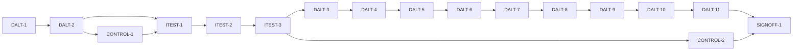

# Master Plan — Daltonization and colour-distinction aids (bs-10)

**Spec:** [bs-10-daltonization.feature](../bs-10-daltonization.feature)
**Status:** In progress — CONTROL-1 (shell) done; shells complete, next ITEST-1 (acceptance-tests, startable). G-1/G-3/G-4 ✅; G-2 open (gates DALT-3+/CONTROL-2)
**Architecture:** [docs/paint-color-app-solution-intent.md](../../docs/paint-color-app-solution-intent.md) §"Accessibility as an architectural concern" (the CVD pipeline applies simulation, the **optional daltonization remap**, grayscale and confusion detection, injected into every screen) + §"Architecture overview" (accessibility services apply to every layer); [docs/paint-color-app-scope.md](../../docs/paint-color-app-scope.md) §5.4 (daltonization), §5.1 (meaning never in colour alone), §4.5 (profile); SI D9 (display-only, stored values unchanged), D10 (on-device CVD model). Extends **bs-08**'s display pipeline (`DisplayController`/`DisplaySettings`/`DisplayScope`/`ColorChip` display-transform/`DisplayReadEndpoint`) and **bs-07**'s stored profile (`CvdProfileStore`/`CvdProfileReadEndpoint`/`AppDependencies.cvdProfile`); reuses `projectDichromat` + `CvdProfile` (`lib/a11y/cvd/`). Not drawn in the wireframe (scope-only, proposed ahead of any mock).
**Code home:** /Users/matthew.quirk/Nuance · remote https://github.com/meatsquirk/Nuance · base `main` · **extends** bs-01..bs-09 **plus bs-07 and bs-08 once merged** (confirmed by sibling *Code home* lines + Matt Quirk across bs-01..bs-09)

> Daltonization is the twelfth increment and a **display-only** cross-cutting aid. It remaps shown colours to
> maximise distinguishability for the painter's own CVD type and severity — distinct from bs-08's simulation,
> which shows how the painter sees. It changes nothing stored, never removes the label/number/icon an element
> already carries, and is injected across every screen through bs-08's existing display chokepoint. It is the
> feature bs-07 deferred its daltonization-behaviour gap to (bs-07 D-8): bs-07 proves the stored profile
> *configures* daltonization at the shared seam; bs-10 builds the remap that consumes it.

## Gap analysis (against the projected baseline: `main` @ `2a1741d` + merged bs-07 + bs-08)

bs-08 supplies the display pipeline: `DisplayController` (`ChangeNotifier`) holding `DisplaySettings {CvdType?
simulationType, double simulationSeverity, bool grayscale}`, injected app-wide via `DisplayScope`
(`InheritedNotifier`); a `ColorChip` display-transform read from `DisplayScope`; a `DisplayReadEndpoint`; the
`referenceProjectDichromat` harness pattern; the `integration_test/display_*` harness. bs-07 supplies
`CvdProfileStore` + `CvdProfileReadEndpoint`, wiring `AppDependencies.cvdProfile` to a savable/empty/changeable
stored profile (defaulting to the const default when none saved, bs-07 D-3). bs-03 supplies `projectDichromat`
(Viénot 1999) and `CvdProfile {CvdType type, double severity}`. **No daltonization remap, no `daltonization`
setting, no daltonization control, and nothing that reads the *saved* profile exist** — all net-new.

| AC | Exists today | Missing |
|---|---|---|
| AC-1 remap for type | `projectDichromat`; bs-08 `ColorChip` display-transform chokepoint | A `daltonize(c, profile)` remap + the chokepoint applying it (per the painter's type) when daltonization is on |
| AC-2 off = original | bs-08 chokepoint renders the original when no transform is active | A `daltonization` flag defaulting off so the original (unremapped) colour is shown |
| AC-3 label + value kept | Label contract (`ColorChip`/`ValueReading` require text) | The remap transforms only the swatch colour, never the label/numeric value the element carries |
| AC-4 provenance badge readable | `provenance_badge.dart` carries a label + icon | The badge stays readable from its label + icon (not colour) under the remap |
| AC-5 uses stored profile | `AppDependencies.cvdProfile` (bs-07, savable) | The chokepoint drives the remap from the stored profile's type **and** severity |
| AC-6 profile change recomputes | bs-07 `CvdProfileStore` updates the live dependency on save | The daltonization render listens to the profile store so a saved change re-renders |
| AC-7 distinct from simulation | `projectDichromat` (simulation); daltonization is a different intent | The remap aids distinction (≠ the simulation projection for the same colour + profile) |
| AC-8 stored values unchanged | Display transforms are render-only by construction | A remap applied only at render, asserted never to mutate the stored `Sample`/`ColorCoordinates` |
| AC-9 every screen | bs-08 chokepoint is the shared `ColorChip`/`DisplayScope` (global) | The remap injected at that one chokepoint so capture, readout and palette all get it |
| AC-10 no profile → no remap | bs-07 `CvdProfileReadEndpoint` exposes whether a profile is saved | A daltonization control that, with no *saved* profile, reports a self-assessment is needed |

## Build order

| Stage | Phases |
|---|---|
| 1 Scaffold | DALT-1 |
| 2 Component shells | DALT-2, CONTROL-1 |
| 3 Acceptance tests | ITEST-1, ITEST-2, ITEST-3 (test review, G-2) |
| 4 Behavior | DALT-3, DALT-4, DALT-5, DALT-6, DALT-7, DALT-8, DALT-9, DALT-10, DALT-11, CONTROL-2 |
| 5 Sign-off | SIGNOFF-1 |

## Acceptance criteria coverage

| AC | Scenario | Integration test (ITEST) | Behavior phases | Status |
|---|---|---|---|---|
| AC-1 | Daltonization remaps displayed colours for the painter's type | ITEST-2 `TestAC01_RemapForType` | DALT-3 | ⬜ Todo |
| AC-2 | With daltonization off, colours are shown unremapped | ITEST-2 `TestAC02_OffShowsOriginal` | DALT-6 | ⬜ Todo |
| AC-3 | A remapped element still shows its label and value | ITEST-2 `TestAC03_LabelAndValueKept` | DALT-9 | ⬜ Todo |
| AC-4 | A provenance badge stays distinguishable under daltonization | ITEST-2 `TestAC04_ProvenanceBadgeReadable` | DALT-10 | ⬜ Todo |
| AC-5 | The remap uses the type and severity from the stored profile | ITEST-2 `TestAC05_UsesStoredProfile` | DALT-4 | ⬜ Todo |
| AC-6 | Changing the profile updates the remap | ITEST-2 `TestAC06_ProfileChangeRecomputes` | DALT-11 | ⬜ Todo |
| AC-7 | Daltonization remaps to help the painter, where simulation shows how they see | ITEST-2 `TestAC07_DistinctFromSimulation` | DALT-5 | ⬜ Todo |
| AC-8 | Daltonization changes only what is shown, not stored values | ITEST-2 `TestAC08_StoredValuesUnchanged` | DALT-7 | ⬜ Todo |
| AC-9 | Daltonization applies on every screen while it is on | ITEST-2 `TestAC09_EveryScreen` | DALT-8 | ⬜ Todo |
| AC-10 | Without a stored profile, daltonization offers no remap | ITEST-2 `TestAC10_NoProfileNeedsAssessment` | CONTROL-2 | ⬜ Todo |

10 ACs (AC-1 is a Scenario Outline tested over its 3 examples: protan, deutan, tritan). Every AC → one
integration test → exactly one behavior phase.

## Design decisions

| # | Decision | Why |
|---|---|---|
| D-1 | Extend bs-08's **one** display pipeline — add `bool daltonization` to `DisplaySettings`, a daltonization branch to the shared `ColorChip`/`DisplayScope` display-transform, and `daltonization` to `DisplayReadEndpoint` — rather than a parallel pipeline | SI: accessibility services "apply to every layer" through one chokepoint; bs-08 D-1 designates bs-08/bs-10 as the reuse sites |
| D-2 | The remap is **error-redistribution daltonization** built on the existing `projectDichromat`: `daltonize(c, profile) = c + redistribute(c − projectDichromat(c, profile))`, scaled by `profile.severity`; a pure `ColorCoordinates daltonize(ColorCoordinates, CvdProfile)` in `lib/a11y/cvd/daltonize.dart`, swappable behind the CVD module (like D3/D10) | Reuses the shipped simulation (no second colour-space author); the exact matrix is display-only and replaceable, so it is a design decision, not a gate. Owner may review at sign-off |
| D-3 | Daltonization is driven by the **stored** profile's type + severity (`AppDependencies.cvdProfile`), *not* a painter-chosen type (unlike bs-08 simulation AC-3). The chokepoint reads the live profile; a saved change re-renders (AC-6) | Spec Rule "Daltonization follows the painter's stored profile"; AC-5/AC-6 |
| D-4 | AC-10 "no profile saved" keys off the **store's saved state** (`CvdProfileReadEndpoint.hasSavedProfile`), not the const default `cvdProfile` | bs-07 D-3 defaults `cvdProfile` to a const when none saved, so the control must consult the store to know a profile was actually saved |
| D-5 | Daltonization and simulation are **independent** display aids (no mutual exclusion); AC-7 asserts the remap ≠ the simulation projection for the same colour + profile. Daltonization × grayscale is out of scope (no bs-10 AC) | Spec Rule "display-only aid, distinct from simulation"; keeps the two toggles orthogonal |
| D-6 | The remap is applied at the `ColorChip`/`DisplayScope` chokepoint only; it never writes stored `Sample`/`ColorCoordinates` (AC-8) and never replaces the label/value/icon an element carries (AC-3/AC-4) — the label-contract widgets keep their text | SI D9 (display-only); SI §5.1 (no meaning in colour alone) |
| D-7 | bs-10 closes bs-07's deferred daltonization-behaviour gap (bs-07 D-8 verified *configuration* at the shared profile seam only) | Those behaviours did not exist when bs-07 shipped; the stored profile is the one thing all consumers read |

## Acceptance integration test plan

Module plan: [modules/ITEST.md](modules/ITEST.md).

**Where it lives and how it runs:** `integration_test/daltonization_harness.dart` + `daltonization_test.dart`,
following the repo convention (`<feature>_harness.dart`/`<feature>_test.dart` + `integration_test/bs10/pending.dart`).
Default `flutter test integration_test/daltonization_test.dart -d <udid>` skips pending ACs; run-pending adds
`--dart-define=BS10_RUN_PENDING=true`. Device lane is shared/contended — serialise through `coord.sh with-lock`
(`FNP_COORD_REPO=/Users/matthew.quirk/Nuance`); macOS has no `timeout`, so redirect long sim runs to a file.
**Where assertions look:** the rendered swatch colours (original + remapped, read off `ColorChip`/`Container`
decoration), `DisplayReadEndpoint` (`daltonization`, the effective displayed colour), `CvdProfileReadEndpoint`
(saved profile + `hasSavedProfile`), the keyed daltonization control + no-profile region, the label/value/
provenance-badge widgets, and `projectDichromat` for the AC-7 contrast.
**What is real and what is faked:** the whole app assembled through `buildApp(deps)` — real `DisplayController`,
real `daltonize`, real `ColorChip`/chokepoint rendering, real `CvdProfileStore`. Faked infrastructure only:
`FakeSpeech`, `FakeHaptics`, and an `InMemoryPersistentStore` behind the production `PersistentStore` contract
(bs-07's fixture pattern). The remap is graded against an **independent** in-harness `referenceDaltonize`
(mirroring bs-08's `referenceProjectDichromat`), never the shipped `daltonize`.

**Fixtures:**

| Fixture | Shape |
|---|---|
| `savedProfile(type, severity)` | Persists one profile via the real `CvdProfileStore` write-side (so `hasSavedProfile` true); used by AC-1/5/6/7 |
| `noProfile` | `InMemoryPersistentStore` empty (no profile saved); `hasSavedProfile` false; used by AC-10 |
| `referenceDaltonize` | Independent in-harness remap over `projectDichromat`, to grade AC-1/5 without the shipped engine |
| `screenColours` | A known `Sample` surfaced on capture, readout and palette (AC-9) + a provenance-tagged value (AC-4) |

**Test catalogue:**

| AC | Given: built via public flows → checked by | When | Then: exact assertions (negative Thens: after <settle point>) | Rejects |
|---|---|---|---|---|
| AC-1 | `savedProfile(<type>, moderate)` for each of protan/deutan/tritan → `CvdProfileReadEndpoint` type == `<type>` | turn daltonization on (control toggle) | the rendered swatch colour != the original, and == `referenceDaltonize(original, <type>, severity)` (per example) | an impl that shows the original unchanged, or remaps the same regardless of type |
| AC-2 | daltonization off (default) → `DisplayReadEndpoint.daltonization == false` | colours are displayed | the rendered swatch == the stored original; **control**: turning it on remaps it (changes) | an impl that remaps while off, or whose "off" still differs from the original |
| AC-3 | daltonization on, a colour-coded reading shown → remapped swatch != original (AC-1 holds) | the reading is displayed | its label text and numeric value are both present and unchanged while only the swatch colour changed | a remap that drops/overwrites the label or the numeric value |
| AC-4 | daltonization on, a value with provenance shown → remapped swatch != original | provenance is shown | the provenance badge's label text + icon are present and unchanged (readable without colour) while its colour is remapped | a remap that conveys provenance by colour alone / strips the badge icon or label |
| AC-5 | `savedProfile(deutan, moderate)` → read endpoint type == deutan, severity == moderate | daltonization on | the remap == `referenceDaltonize(c, deutan, moderate)`; **control**: `savedProfile(deutan, strong)` yields a *stronger* (different) remap | an impl using a hardcoded/default type or severity, ignoring the stored values |
| AC-6 | daltonization on for `savedProfile(deutan, …)` → remapped per deutan | the stored profile is saved as protan (via `CvdProfileStore`) | after the save settles, the rendered remap recomputes to `referenceDaltonize(c, protan, …)`; **control**: before the save it was the deutan remap | an impl that captures the profile once at build and never re-reads it |
| AC-7 | both simulation and daltonization available; `savedProfile(deutan, moderate)` | daltonization on (simulation off) | the remapped swatch != `projectDichromat(c, deutan, moderate)` (aids distinction, not perception) — the two transforms differ | an impl that daltonizes by *simulating* (shows the perceived colour instead of a distinguishing remap) |
| AC-8 | a `Sample` with stored colour values saved via the capture flow → `SampleSource` read == original values | daltonization remaps its displayed colour (on) | the stored `Sample`/`ColorCoordinates` read back == the original (unchanged) **after** the remapped render settles; **control**: the displayed swatch did change | a remap that writes the transformed colour back to storage |
| AC-9 | `savedProfile(deutan, …)`, daltonization on, `screenColours` surfaced | the painter moves capture → readout → palette | the known swatch is remapped (== `referenceDaltonize`) on **each** of the three screens | a remap wired into one screen only (e.g. readout), not the shared chokepoint |
| AC-10 | `noProfile` (store empty) → `CvdProfileReadEndpoint.hasSavedProfile == false` | the painter opens the daltonization control | the control reports a self-assessment is needed before colours can be remapped, and no remap is applied; **control**: with a saved profile the message is absent and the remap applies | a control that silently offers a remap against the const default, or reports nothing |

**Red baseline** and **test augmentations:** tracked in [modules/ITEST.md](modules/ITEST.md).
Pre-seeded augmentations: AC-2, AC-3, AC-4, AC-8 are **green at baseline** (the shell renders an identity remap
and keeps all text/icons), so each adds a discriminating control once the real remap exists — AC-2→DALT-6,
AC-3→DALT-9, AC-4→DALT-10, AC-8→DALT-7.

## Modules

| Module | Plan | Purpose | Depends on | Status |
|---|---|---|---|---|
| DALT | [modules/DALT.md](modules/DALT.md) | The remap engine (`lib/a11y/cvd/daltonize.dart`) + its injection into bs-08's display chokepoint + all render-side behaviour (AC-1..9) | bs-07, bs-08 | 🔄 In progress (DALT-2 done) |
| CONTROL | [modules/CONTROL.md](modules/CONTROL.md) | The daltonization settings control (toggle) + the no-saved-profile affordance (AC-10) | DALT (shell), bs-07 | 🔄 In progress (CONTROL-1 done) |
| ITEST | [modules/ITEST.md](modules/ITEST.md) | Acceptance integration suite: one pending test per AC, and its review | all shell phases | ⬜ Todo |

## Dependency graph

**Parallel windows:** few. DALT-2 → CONTROL-1 (the toggle needs `DisplayController.setDaltonization`). The
behavior phases DALT-3..DALT-11 share the `ColorChip`/display chokepoint **and** `daltonization_test.dart` →
**run sequentially**; DALT-3 is the keystone they all assert against. CONTROL-2 touches a different lib file
(the settings panel) but shares `daltonization_test.dart` with the DALT phases → **merge-risky; sequence it**.

## Open gates

| Gate | Kind | Decision needed | Blocks | Status |
|---|---|---|---|---|
| G-1 | decision | Approve the spec (record the approval as its first line, replacing the "Draft: awaiting owner approval" line) | DALT-1 | ✅ Resolved 2026-10-13 08:00 EDT: approved — Matt Quirk (spec first line amended to the approval line) |
| G-2 | decision | Approve the acceptance tests (ITEST-3's packet) | every behavior phase | Open |
| G-3 | dependency | **bs-08 signed off and merged to `main`** (lands `DisplayController`/`DisplaySettings`/`DisplayScope`/`ColorChip` display-transform/`DisplayReadEndpoint` + the `display_*` harness pattern) — closed by the human approving bs-08 SIGNOFF-1 and merging `feat/bs-08` → `main` | DALT-1 | ✅ Resolved 2026-10-13 08:00 EDT: bs-08 merged to `main` (merge `0900d44`, ancestor of `main`) — verified from git |
| G-4 | dependency | **bs-07 signed off and merged to `main`** (lands `CvdProfileStore`/`CvdProfileReadEndpoint` + savable/empty/changeable `AppDependencies.cvdProfile`) — closed by the human approving bs-07 SIGNOFF-1 and merging `feat/bs-07` → `main` | DALT-1 | ✅ Resolved 2026-10-13: bs-07 merged to `main` (merge `ecd3a9e`, ancestor of `main`) — verified from git in DALT-1 |

Resolved: `✅ Resolved <date time>: <decision, one line> — <who>`.

## Known flakes

| Test | Symptom | Rate (runs) | Measured at | Owner | Status |
|---|---|---|---|---|---|

None carried forward (sibling flake tables empty at merge). Environment gotchas (device-lane contention,
macOS `timeout` absence, long sim runs → redirect to file) are recorded in [modules/ITEST.md](modules/ITEST.md),
not as flakes.

## Session log

| # | Phase | Target | Status | Tokens | Time | Notes |
|---|---|---|---|---|---|---|
| 1 | DALT-1 | scaffold: branch off post-bs07/bs08 main, baseline, coverage-gate proof, `bs10/pending.dart` (10 ACs) + runner | ✅ Done | 4.07M | 21m 20s | unit 1220 / integ 197 green; gate proven both ways; G-1/G-3/G-4 ✅ |
| 2 | DALT-2 | shell: `daltonize` identity stub + `DisplaySettings.daltonization` + chokepoint branch + `DisplayReadEndpoint` | ✅ Done | 9.32M | 23m 50s | unit 1237 (+17) / integ 197 green; coverage 100% on 7 touched files; identity render — nothing broke |
| 3 | CONTROL-1 | shell: daltonization toggle + no-profile placeholder region (render-only) | ✅ Done | 2.49M | 14m 20s | toggle wired to setDaltonization + keyed no-profile placeholder; unit 1239 (+2)/integ 197 green; coverage 100% on 8 touched files |
| 4 | ITEST-1 | acceptance-tests: harness, fixtures (`referenceDaltonize`, saved/noProfile), pending gate, smoke | ⬜ Next | | | startable now (DALT-2 + CONTROL-1 done) |
| 5 | ITEST-2 | acceptance-tests: AC-1..10 (pending) + red baseline + grades | ⬜ Todo | | | |
| 6 | ITEST-3 | test-review: packet; G-2 | ⬜ Todo | | | |
| 7 | DALT-3 | AC-1 keystone: real remap + chokepoint applies it when on | ⬜ Todo | | | |
| 8 | DALT-4 | AC-5 remap uses stored type + severity | ⬜ Todo | | | |
| 9 | DALT-5 | AC-7 distinct from simulation | ⬜ Todo | | | |
| 10 | DALT-6 | AC-2 off = original (+ control) | ⬜ Todo | | | augments TestAC02 |
| 11 | DALT-7 | AC-8 stored values unchanged (+ control) | ⬜ Todo | | | augments TestAC08 |
| 12 | DALT-8 | AC-9 every screen | ⬜ Todo | | | |
| 13 | DALT-9 | AC-3 label + value kept (+ control) | ⬜ Todo | | | augments TestAC03 |
| 14 | DALT-10 | AC-4 provenance badge readable (+ control) | ⬜ Todo | | | augments TestAC04 |
| 15 | DALT-11 | AC-6 profile change recomputes (live) | ⬜ Todo | | | |
| 16 | CONTROL-2 | AC-10 no saved profile → self-assessment needed | ⬜ Todo | | | ∥-risky w/ DALT (shared test file) |
| 17 | SIGNOFF-1 | sign-off: packet + summary + manual approval | ⬜ Todo | | | |

*Tokens* / *Time* = the phase totals from the *Token usage* ledger (Time = active, wall in brackets), filled
when the row is marked done.

## Next phase

**ITEST-1 (acceptance-tests)** — the only startable phase now (shells complete: DALT-2 + CONTROL-1 both done).
Build `integration_test/daltonization_harness.dart` + `daltonization_test.dart`: the harness over the wired
shells, the fixtures (`referenceDaltonize`, `savedProfile`/`noProfile`, `screenColours`), the pending gate and
a smoke test. Then ITEST-2 (AC-1..10 pending + red baseline + grades) → ITEST-3 (test review, **G-2**).

**G-2** still gates every behaviour phase (DALT-3..11 and CONTROL-2); DALT-3 is the keystone the DALT
behaviour phases assert against. Work in worktree `/Users/matthew.quirk/Nuance-bs10` on `feat/bs-10`.

## Token usage

<!-- One row per session, appended as that session's last edit (SKILL.md § Token usage). -->

| Phase / activity | Session | Start | End | Wall | Active | Model(s) | Input | Cache write | Cache read | Output | Total | Outcome |
|---|---|---|---|---|---|---|---|---|---|---|---|---|
| PLAN | 040f04b0 | 2026-10-12 22:32 EDT | 22:46 | 13m 38s | 13m 38s | claude-opus-4-8 | 52 | 119,700 | 2,170,426 | 62,430 | 2,352,608 | plan written: 17 phases, 3 modules (DALT/CONTROL/ITEST), 10 ACs; gates G-1 spec + G-3 bs-08 merge + G-4 bs-07 merge |
| GATE-DECISION | ff530524 | 2026-10-13 07:59 EDT | 08:01 | 2m 14s | 2m 14s | claude-opus-4-8 | 34 | 37,170 | 986,861 | 9,008 | 1,033,073 | G-1 approved (spec) by Matt Quirk; G-3 resolved (bs-08 merged 0900d44) |
| DALT-1 | 6f42cd8f | 2026-10-13 12:40 EDT | 13:01 | 21m 20s | 21m 20s | claude-opus-4-8 | 90 | 87,074 | 3,952,138 | 30,360 | 4,069,662 | scaffold: feat/bs-10 off main @ ecd3a9e; baseline unit 1220 / integ 197 green; coverage gate proven both ways; bs10/pending.dart seeded (10 ACs); G-4 resolved (bs-07 merged ecd3a9e); no product code |
| DALT-2 | 6df95cbd | 2026-10-13 13:20 EDT | 13:44 | 23m 50s | 23m 50s | claude-opus-4-8 | 160 | 137,355 | 9,125,190 | 55,908 | 9,318,613 | shell: daltonize identity stub + daltonizeColor bridge + DisplaySettings.daltonization + setDaltonization + displayedSwatchColor chokepoint + DisplayReadEndpoint.daltonization/displayedColor + AppScope.maybeOf; unit 1237 (+17)/integ 197 green; coverage 100% on 7 touched files; identity render — nothing broke; 0/3 fix passes |
| CONTROL-1 | 1b3146e6 | 2026-10-13 14:15 EDT | 14:29 | 14m 20s | 14m 20s | claude-opus-4-8 | 62 | 76,210 | 2,397,537 | 14,425 | 2,488,234 | shell: daltonization toggle wired to setDaltonization + keyed no-profile placeholder (render-only); unit 1239 (+2)/integ 197 green; coverage 100% on 8 touched files; 0/3 fix passes |
| **Feature total** |  | **2026-10-12 22:32 EDT** | **2026-10-13 14:29** | **1h 15m** | **1h 15m** |  | **398** | **457,509** | **18,632,152** | **172,131** | **19,262,190** |  |

## Sign-off

| Round | Packet | At code | Grades | Decision |
|---|---|---|---|---|
| 1 | [signoff/round-1.md](signoff/round-1.md) | `<commit>` | — | ⏸ Awaiting |
