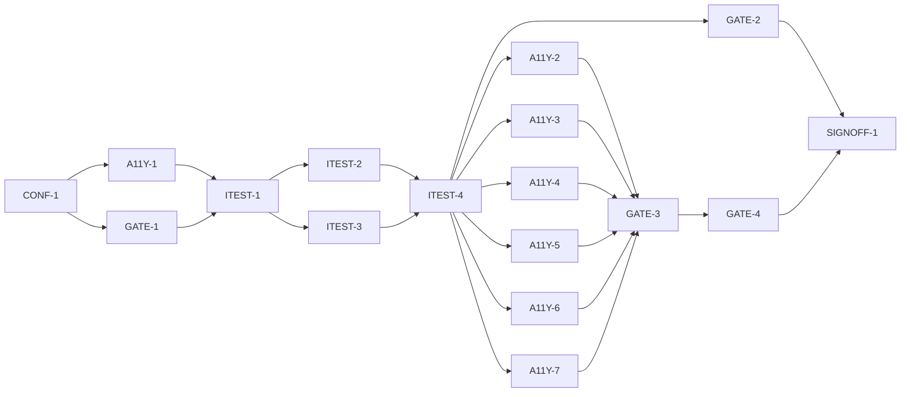

# Master Plan — Accessibility conformance

**Spec:** [bs-11-accessibility-conformance.feature](../bs-11-accessibility-conformance.feature)
**Status:** ⏸ Awaiting review — ITEST-4 test-review packet assembled (all 10 AC tests; 20 A / 2 B-pending / 0 ordinary B); **G-2 awaiting human decision** — approve via `/feature-next-phase --gate bs-11 G-2 approved | "<changes>"`
**Architecture:** [docs/paint-color-app-solution-intent.md](../../docs/paint-color-app-solution-intent.md) §"Accessibility as an architectural concern" (label contract + standing requirements + two test gates) and §"Cross-platform strategy / Parity acceptance"; [docs/paint-color-app-scope.md](../../docs/paint-color-app-scope.md) §5 (5.1/5.7/5.8/5.10). Extends every merged feature's screens (`lib/readout`, `lib/capture`, `lib/compare`, `lib/recipes`, …) assembled through `lib/app/build_app.dart`; reuses the label-contract widgets `lib/widgets/color_chip.dart`, `value_reading.dart`, `provenance_badge.dart`.
**Code home:** /Users/matthew.quirk/Nuance · remote https://github.com/meatsquirk/Nuance · base `main` (@ `0900d44`, bs-08 merged) · extends the bs-01..bs-09 foundation (confirmed by Matt Quirk via sibling *Code home* lines + planning answers, 2026-10-13)

## Gap analysis (against `main` @ `0900d44`)

| AC | Exists today | Missing |
|---|---|---|
| AC-1 colour cue | `ColorChip`/`ValueReading`/`ProvenanceBadge` enforce text beside colour; statuses rendered as text | A reusable automated check that flags any colour-coded element lacking a label/icon/pattern/number; every real screen proven to pass it |
| AC-2 no bare dot | No bare colour dots today (statuses are text) | A `StatusBadge` primitive making "status = text/icon" structural; the check's no-bare-dot rule + a non-compliant control |
| AC-3 200% scaling | No text-scaling handling; hardcoded `fontSize`; one `MediaQuery` use (keyboard inset only) | A 200%-scale check (no overflow) + layout fixes so every screen survives `TextScaler` 2.0 |
| AC-4 48dp targets | No tap-target floor anywhere (`kMinInteractiveDimension`, `MaterialTapTargetSize`, 48 — none) | A tap-target guideline check + a 48dp floor on shared controls; sweep every screen |
| AC-5 AA contrast | No theme/design-system; inline `ThemeData(useMaterial3:true)`; ad-hoc hardcoded colours | An `AppTheme` with a WCAG 2.2 AA `ColorScheme` + a contrast-guideline check; sweep ad-hoc colours to theme tokens |
| AC-6 semantic labels | `Semantics` headers/labels on the label-contract widgets + a few regions | A labelled-control check (no interactive node without a meaningful label) + labels swept across every screen's controls |
| AC-7 eyes-free | No eyes-free driver; semantics tree populated piecemeal | A semantics-only driver that completes a core task via labels + `SemanticsAction`, no coordinates |
| AC-8 no time limit | No auto-dismissing notices found, but no guarantee layer | An `AccessibleNotice` (never auto-dismisses) + a no-timeout check (survives a clock advance) + a control |
| AC-9 automated gate | No conformance model | `ConformanceResult` + `acceptanceDecision` — a result failing any rule ⇒ not accepted |
| AC-10 manual gate | — | **Manual gate only (D-2)**: no code, no automated test; the eyes-free walkthrough is performed and recorded at SIGNOFF-1 |
| AC-11 WCAG floor | — | `recordedLevel(result)` → WCAG 2.2 AA when the automated gate passed; the check thresholds pinned to AA (D-5) |
| AC-12 iOS parity | No device/VoiceOver CI; local sim convention | **Manual gate only (D-2)**: on-device VoiceOver vs TalkBack parity walkthrough, performed and recorded at SIGNOFF-1 |

## Build order

| Stage | Phases |
|---|---|
| 1 Scaffold | CONF-1 |
| 2 Component shells | A11Y-1, GATE-1 |
| 3 Acceptance tests | ITEST-1, ITEST-2, ITEST-3, ITEST-4 (test review, G-2) |
| 4 Behavior | A11Y-2, A11Y-3, A11Y-4, A11Y-5, A11Y-6, A11Y-7, GATE-2, GATE-3, GATE-4 |
| 5 Sign-off | SIGNOFF-1 (closes AC-10 + AC-12 manual gates G-3/G-4) |

## Acceptance criteria coverage

| AC | Scenario | Integration test (ITEST) | Behavior phases | Status |
|---|---|---|---|---|
| AC-1 | Every colour-coded element carries a non-colour cue | ITEST-2 `TestAC01_ColourCarriesNonColourCue` | A11Y-5 | ⬜ Todo |
| AC-2 | A status is never rendered as a bare colour dot | ITEST-2 `TestAC02_StatusNotBareColourDot` | A11Y-5 | ⬜ Todo |
| AC-3 | System font scaling to 200% does not break the layout | ITEST-3 `TestAC03_FontScale200NoBreak` | A11Y-4 | ⬜ Todo |
| AC-4 | Interactive targets meet the minimum size | ITEST-2 `TestAC04_TapTargetMin48` | A11Y-3 | ⬜ Todo |
| AC-5 | Text meets the high-contrast floor | ITEST-2 `TestAC05_ContrastFloorAA` | A11Y-2 | ⬜ Todo |
| AC-6 | Every control exposes a meaningful screen-reader label | ITEST-2 `TestAC06_ControlHasMeaningfulLabel` | A11Y-6 | ⬜ Todo |
| AC-7 | An eyes-free walkthrough completes under the screen reader | ITEST-3 `TestAC07_EyesFreeWalkthroughCompletes` | GATE-2 | ⬜ Todo |
| AC-8 | No interaction imposes a time limit and nothing auto-dismisses | ITEST-3 `TestAC08_NothingAutoDismisses` | A11Y-7 | ⬜ Todo |
| AC-9 | A feature failing the automated check is not accepted | ITEST-3 `TestAC09_FailedAutomatedCheckNotAccepted` | GATE-3 | ⬜ Todo |
| AC-10 | A feature failing the manual eyes-free walkthrough is not accepted | **manual gate (SIGNOFF-1, G-3)** — no automated test (D-2) | SIGNOFF-1 (user acceptance) | ⬜ Todo |
| AC-11 | WCAG 2.2 AA is the accepted floor | ITEST-3 `TestAC11_RecordedFloorIsWcag22AA` | GATE-4 | ⬜ Todo |
| AC-12 | The eyes-free walkthrough passes under VoiceOver as under TalkBack | **manual gate (SIGNOFF-1, G-4)** — no automated test (D-2) | SIGNOFF-1 (user acceptance) | ⬜ Todo |

12 ACs. **10 automated** (AC-1..9, AC-11) → one integration test → ≥1 behavior phase; **2 pure-manual** (AC-10, AC-12) closed by user acceptance at SIGNOFF-1 with the gap named (D-2). AC-1+AC-2 share A11Y-5 (one slice: the colour-cue / no-bare-dot primitive + check rule).

## Design decisions

| # | Decision | Why |
|---|---|---|
| D-1 | **Sweep scope:** bs-11 both ships the reusable mechanism (primitives + theme + automated check) AND runs the check over **every screen present on `main` at the branch point**, fixing each to pass. Screens added by features merged *after* bs-11 branches (bs-07, bs-10, …) self-gate per the SI ("two gates run on every feature") — bs-11 cannot sweep the future | Matt Quirk chose "sweep every screen" (planning Q1, 2026-10-13); the SI makes a11y acceptance criteria on every screen, enforced by shared widgets + per-feature gates |
| D-2 | **AC-10 and AC-12 are pure manual gates** — no code model, no automated acceptance test. The manual eyes-free walkthrough (AC-10) and the on-device VoiceOver-vs-TalkBack parity walkthrough (AC-12) are performed and recorded by the reviewer at SIGNOFF-1; closed by user acceptance with the gap named, never as passing automated gates | Matt Quirk chose "pure manual gates only" (planning Q2, 2026-10-13); both are inherently human/device judgments the repo has no device/VoiceOver CI for |
| D-3 | The **automated conformance check** (Gate A) is reusable test-support in `integration_test/conformance/`, built on Flutter's `meetsGuideline` matchers (`textContrastGuideline`, `androidTapTargetGuideline`/`iOSTapTargetGuideline`, `labeledTapTargetGuideline`) plus custom traversals (colour-cue, no-timeout, eyes-free); it produces a pure-domain `lib/a11y/conformance/ConformanceResult` | The check must inspect the widget/semantics tree (needs `flutter_test`), so it cannot live in `lib/`; the result/decision/level are pure domain and coverage-gated |
| D-4 | A single accessible `AppTheme` (`lib/app/theme.dart`, WCAG 2.2 AA `ColorScheme` + text/target theming) replaces the inline `ThemeData(useMaterial3:true)` in `buildApp`; the sweep migrates ad-hoc hardcoded colours (e.g. `capture_live_view.dart`, `capture_eyedropper.dart`) to theme tokens | Contrast is enforced structurally by one theme, not per widget; "hard to build a non-compliant screen" |
| D-5 | WCAG 2.2 AA thresholds pinned as the check's constants and AC-11's recorded floor: text contrast **4.5:1** (normal) / **3:1** (large ≥18pt, or 14pt bold); non-text/UI **3:1**; tap targets **≥48dp**; font scaling to **200%** | These are WCAG 2.2 AA definitions (not free choices); the automated check encodes exactly them so AC-5/AC-4/AC-3 and the AC-11 floor agree |
| D-6 | AC-7 (automated eyes-free) is a **semantics-only driver**: it finds controls by semantic label and activates them via `SemanticsAction`, never by widget key or screen coordinate, and asserts a core task reaches its terminal state via the read endpoint | Proves the task is operable by screen reader alone; distinct from AC-10's human gating judgment (D-2) |
| D-7 | A `StatusBadge` primitive is added to `lib/widgets/` (status always carries text/icon, never a bare dot), joining `ColorChip`; the colour-cue check rule flags any colour-bearing widget without a text/icon/label sibling | Makes AC-2 structural and gives the check a concrete rule to enforce across screens |
| D-8 | **No new device/acceptance CI job.** The repo's CI runs unit + coverage only (acceptance suites run locally on a booted device); bs-11 adds the automated check to the acceptance suite and proves the accept/reject gate logic, but wiring the suite into CI as a blocking cross-feature gate is a repo-wide follow-on, not a bs-11 phase | Consistent with the current CI; AC-9's behaviour (fail ⇒ not accepted) is the decision logic, testable without CI; avoids scope creep |

## Acceptance integration test plan

Module plan: [modules/ITEST.md](modules/ITEST.md).

**Where it lives and how it runs:** `integration_test/bs11/accessibility_harness.dart` (vocabulary + fixtures + the real screens) and `integration_test/bs11/accessibility_test.dart` (runner), over the reusable check in `integration_test/conformance/`. Default target (pending skipped): `flutter test integration_test/bs11/accessibility_test.dart -d <booted-udid>`. Run-pending / red baseline: add `--dart-define=BS11_RUN_PENDING=true`. **A booted device udid (`-d`) is mandatory** (no `-d` ⇒ zero tests, exit 0, false green — see Known flakes). Single exclusive lane via `coord.sh with-lock` in parallel sessions.
**Where assertions look:** the `ConformanceResult` the check returns for each real screen and each control fixture (per-rule pass/fail); the rendered widget/semantics tree (overflow exceptions for scaling, `meetsGuideline` matchers for contrast/targets/labels); the feature read endpoints (`CaptureReadEndpoint`, `ComparisonReadEndpoint`, `RecipeReadEndpoint`, Readout) for the eyes-free terminal state; the pure-domain `acceptanceDecision`/`recordedLevel` outputs.
**What is real and what is faked:** every real screen assembled through `buildApp(deps)` across all entry markers; the real `AppTheme`; real feature controllers/screens. Faked infrastructure only: `FakeSpeech`, `FakeHaptics` (existing). The non-compliant **control** screens are deliberate in-harness fixtures (low-contrast text, a 24dp target, a bare colour dot, an unlabelled control, an auto-dismissing SnackBar, an overflow-at-200% layout) — they exist only to prove the check discriminates. No contrast/guideline math is faked (the real Flutter matchers run).

**Fixtures:**

| Fixture | Shape |
|---|---|
| `bootedDevice` | A booted simulator/device udid passed via `-d`; mandatory for every acceptance run |
| `fakeSpeech` / `fakeHaptics` | Existing infrastructure doubles |
| `realScreens` | Every screen `buildApp` can open on `main` (Readout, Capture, Comparison, Recipes, and any others merged), each launched through its DI entry marker |
| `compliantReference` | A minimal screen built only from the bs-11 primitives + `AppTheme` — passes every rule (the check's positive control) |
| `control_lowContrast` | Text at ~2:1 on its background (fails AC-5 only) |
| `control_smallTarget` | A 24dp tappable (fails AC-4 only) |
| `control_bareDot` | A status shown as a bare coloured dot, no text/icon (fails AC-1/AC-2) |
| `control_unlabelled` | An `IconButton` with no semantic label (fails AC-6) |
| `control_autoDismiss` | A standard SnackBar that auto-dismisses on a timer (fails AC-8) |
| `control_overflow200` | A fixed-height row that clips at `TextScaler` 2.0 (fails AC-3) |
| `control_partialFail` | A screen passing most rules but failing one (drives AC-9's not-accepted) |

**Test catalogue:**

| AC | Given: built via public flows → checked by | When | Then: exact assertions (negative Thens: after <settle point>) | Rejects |
|---|---|---|---|---|
| AC-1 | Each `realScreens` entry rendered through `buildApp`; `compliantReference` renders a `ColorChip`; `control_bareDot` renders a bare swatch → read endpoint / finder confirms a colour-coded element is present on the screen | run the colour-cue check over the screen | every colour-coded element carries a label/icon/pattern/number — the cue rule **passes on every real screen and on `compliantReference`**, and **fails on `control_bareDot`** (the discriminating control) | a check that passes regardless (never flags a bare swatch), or a real screen that shows colour with no accompanying cue |
| AC-2 | A status rendered via `StatusBadge` on `compliantReference` vs `control_bareDot`'s bare dot → finder confirms a status element exists | the status is rendered / check runs | status is shown with text or an icon, **not a bare colour dot** — no-bare-dot rule passes on real screens + reference, **fails on `control_bareDot`** | a status drawn as a coloured `Container`/`CircleAvatar` with no text/icon, or a rule that accepts it |
| AC-4 | Each `realScreens` entry + `compliantReference` (≥1 interactive target present, asserted via finder) vs `control_smallTarget` | the targets are measured | each interactive target ≥ **48dp** — `meetsGuideline(androidTapTargetGuideline)` (and iOS) **passes on every real screen + reference**, **fails on `control_smallTarget`** | a control < 48dp accepted, or the guideline not actually applied |
| AC-5 | Each `realScreens` entry rendered with `AppTheme` (ColorScheme asserted to be the AA theme, not the default) vs `control_lowContrast` | contrast measured against background | text meets WCAG 2.2 AA — `meetsGuideline(textContrastGuideline)` **passes on every real screen + reference**, **fails on `control_lowContrast`** | text below 4.5:1 (3:1 large) accepted, or the contrast guideline not applied |
| AC-6 | Each `realScreens` entry + reference (interactive nodes present) vs `control_unlabelled` | each control read by the screen reader | each control announces a meaningful, non-empty label — `meetsGuideline(labeledTapTargetGuideline)` + a semantics traversal (no interactive node with empty/placeholder label) **pass on every real screen + reference**, **fail on `control_unlabelled`** | a control with no/empty semantic label accepted |
| AC-7 | App launched to a core task (Readout of a fixture sample) with semantics enabled → semantics handle active and the task's entry control present **by label** | perform the task using only semantic labels + `SemanticsAction` (no keys/coordinates) (D-6) | the task completes end-to-end — the terminal state is observed via the read endpoint; **control:** the same flow attempted through a control whose required step has no semantic label cannot progress | a flow completable only via visual coordinates (a step reachable by position, not by semantics) |
| AC-8 | A screen shows an `AccessibleNotice` and the painter is partway through → finder confirms the notice present; **settle point:** pump/advance the clock well past any default auto-dismiss duration | the painter waits without acting | nothing is dismissed/cancelled on a timer — the notice is **still present after the advance**, and the no-timeout rule passes; **control:** `control_autoDismiss`'s SnackBar is **gone** after the same advance (rule fails there) | a notice that disappears on a timer, or a reading taken before the settle point (G3) |
| AC-9 | `control_partialFail` run through the check → its `ConformanceResult` has **≥1 failing rule and ≥1 passing rule** (asserted) | the feature is reviewed for acceptance (`acceptanceDecision(result)`) | the decision is **not accepted**; **control:** a fully-passing result (reference) ⇒ **accepted** | a decision that accepts a partially-failing result, or that inspects only one rule |
| AC-11 | A fully-passing `ConformanceResult` (reference) → asserted `result.passed == true` **and** the check's pinned thresholds equal the WCAG 2.2 AA constants (D-5) | its compliance level is recorded (`recordedLevel(result)`) | it meets at least **WCAG 2.2 AA** — `recordedLevel == WcagLevel.aa22`; **control:** a failing result records below AA / none | recording AA for a failing result, or thresholds weaker than WCAG 2.2 AA |

AC-10, AC-12 have **no catalogue row** — pure manual gates (D-2), executed and recorded at SIGNOFF-1.

**Red baseline** and **test augmentations:** tracked in [modules/ITEST.md](modules/ITEST.md).
Pre-seeded augmentations: each ACn test is *limited at baseline* because its check rule is a stub until its behavior phase (the compliant side passes vacuously only if the stub says "pass"; the stub says "fail", so each fails on its Then) — the discriminating control (compliant passes **and** control fails) is confirmed by the owning phase. AC-9's aggregate `acceptanceDecision` cannot discriminate until every sub-rule exists (A11Y-2..7, GATE-2) → *B pending GATE-3*; AC-11's recorded floor → *B pending GATE-4*. The "every real screen passes" assertions are re-confirmed at SIGNOFF-1 against the full cross-feature regression.

## Modules

| Module | Plan | Purpose | Depends on | Status |
|---|---|---|---|---|
| A11Y | [modules/A11Y.md](modules/A11Y.md) | Scaffold + the compliant-by-construction layer: `AppTheme` (AA contrast), 48dp targets, 200% scaling, `StatusBadge`/colour-cue, semantic labels, `AccessibleNotice`; the per-rule check rules; and the sweep of every real screen | — | ◐ In progress (CONF-1 done) |
| GATE | [modules/GATE.md](modules/GATE.md) | The conformance gate: the aggregate `ConformanceResult` + `acceptanceDecision` + `recordedLevel` (pure domain) and the eyes-free semantics-only driver | A11Y | ◐ In progress (GATE-1 done) |
| ITEST | [modules/ITEST.md](modules/ITEST.md) | Acceptance integration suite over every real screen + controls: one pending test per automated AC, and its review | all shell phases | ◐ In progress (ITEST-1/2/3 done; next ITEST-4 review) |

## Dependency graph

**Parallel windows:** A11Y-1 ∥ GATE-1 (disjoint: `lib/app/theme.dart`+`lib/widgets/` vs `lib/a11y/conformance/`). ITEST-2 ∥ ITEST-3 **share `accessibility_test.dart` → merge-risky; run sequentially** (or split into two runner files). Behavior A11Y-2..7 each edit the shared `lib/app/theme.dart` and multiple feature screens (the sweep) and add a rule to `integration_test/conformance/` → **merge-risky; run sequentially**. GATE-2 (eyes-free; `lib/a11y/conformance/` + `integration_test/conformance/eyes_free.dart`) is disjoint from the A11Y sweep and **may run ∥ one A11Y phase**. GATE-3 is a barrier (needs every sub-rule); GATE-4 follows GATE-3. **Coordination:** bs-11 changes the shared `buildApp` theme + shared widgets; in-flight features (feat/bs-07, future bs-10) must rebase onto the merged theme — sequence the bs-11 merge with those.

## Open gates

| Gate | Kind | Decision needed | Blocks | Status |
|---|---|---|---|---|
| G-1 | decision | Approve the spec (record approval as its first line, replacing the `# Draft: awaiting owner approval` banner) | CONF-1 | ✅ Resolved 2026-10-13 07:59 EDT: approved — Matt Quirk (owner); spec's first line now records the approval |
| G-2 | decision | Approve the acceptance tests (ITEST-4's packet) | every behavior phase | ⏸ Awaiting decision 2026-10-13: packet assembled at ITEST-4 ([modules/ITEST.md](modules/ITEST.md) § *Review packet*) — `--gate bs-11 G-2 approved \| "<changes>"` |
| G-3 | decision | AC-10 — the **manual eyes-free walkthrough** passes (performed under the live screen reader at SIGNOFF-1); a fail blocks acceptance (D-2) | SIGNOFF-1 (AC-10) | Open |
| G-4 | decision | AC-12 — **on-device VoiceOver-vs-TalkBack parity** verified on iOS reference hardware at SIGNOFF-1 (D-2) | SIGNOFF-1 (AC-12) | Open |

Resolved: `✅ Resolved <date time>: <decision, one line> — <who>`.

## Known flakes

| Test | Symptom | Rate (runs) | Measured at | Owner | Status |
|---|---|---|---|---|---|
| coverage_gate — const-constructor line | `flutter test --coverage` intermittently records a const-folded constructor line in `lib/**` as uncovered, so the gate may FAIL on a file this phase never touched | intermittent | first bs-01 `88c5add` | re-run `flutter test --coverage` once; green on re-run ⇒ ignore | Open (carried) |
| integration suite — no `-d <udid>` | `flutter test integration_test/…` with no booted device runs zero tests and still exits 0 (false green) | deterministic | bs-05/bs-06 | always pass `-d <booted-udid>` | Open (carried) |

## Session log

| # | Phase | Target | Status | Tokens | Time | Notes |
|---|---|---|---|---|---|---|
| 1 | CONF-1 | scaffold: worktree+branch from main, baseline, coverage-gate confirm, bs11 pending gate (10 ACs), guideline-matcher availability | ✅ Done | 3,094,668 | 9m 08s | branch @ `801a064`; unit 1000/1000; gate both-ways; 10 ACs pending; matchers OK |
| 2 | A11Y-1 | shell: `lib/app/theme.dart` `AppTheme` wired into `buildApp` (behaviour unchanged) + `StatusBadge` + `AccessibleNotice` shells | ✅ Done | 4,591,022 | 9m 25s | unit 1018/1018; cov 100% touched; readout itest 12/12 on sim |
| 3 | GATE-1 | shell: `lib/a11y/conformance/` types (`ConformanceResult`/`ConformanceRuleId`/`AcceptanceDecision`/`WcagLevel` + `acceptanceDecision`/`recordedLevel` signatures) + `integration_test/conformance/` check stub | ✅ Done | 3,553,802 | 17m 14s | last shell; unit 1034/1034; cov 100% touched; full regression 173/173 on sim |
| 4 | ITEST-1 | acceptance-tests: harness, real-screen + control fixtures, pending gate (10 ACs), smoke test | ✅ Done | 7,883,599 | 17m 28s | harness over 6 real screens + 7 controls; suite 9/9 on sim; cov 100% touched; no AC tests yet ⇒ no red baseline |
| 5 | ITEST-2 | acceptance-tests: AC-1,2,4,5,6 (pending) + red baseline | ✅ Done | 5,523,993 | 14m 07s | 5 A/0; default 9/9 green, red baseline 9/5, cov 100% touched |
| 6 | ITEST-3 | acceptance-tests: AC-3,7,8,9,11 (pending) + red baseline | ✅ Done | 7,854,428 | 26m 55s | 3 A / 2 B-pending (AC-9→GATE-3, AC-11→GATE-4); default 9/9 green, red baseline 9/10, cov 100% touched |
| 7 | ITEST-4 | test-review: packet; G-2 | ⏸ Awaiting review | 1,641,073 | 3m 33s | packet assembled (all 10 ACs; 20 A / 2 B-pending); G-2 awaiting human decision |
| 8 | A11Y-2 | AC-5 contrast: AA `AppTheme` + contrast check rule + sweep colours | ⬜ Todo | | | sweeps all screens |
| 9 | A11Y-3 | AC-4 targets: 48dp floor + tap-target check rule + sweep controls | ⬜ Todo | | | |
| 10 | A11Y-4 | AC-3 scaling: 200% resilience + scaling check rule + sweep layouts | ⬜ Todo | | | |
| 11 | A11Y-5 | AC-1+AC-2 colour-cue / no-bare-dot: `StatusBadge` + `ColorChip` + cue check rule + sweep | ⬜ Todo | | | slice (2 ACs) |
| 12 | A11Y-6 | AC-6 semantic labels: meaningful labels + labelled-control check rule + sweep | ⬜ Todo | | | |
| 13 | A11Y-7 | AC-8 no time limit: `AccessibleNotice` (no auto-dismiss) + no-timeout check rule + sweep | ⬜ Todo | | | |
| 14 | GATE-2 | AC-7 eyes-free: semantics-only driver completes a core task | ⬜ Todo | | | ∥ one A11Y phase |
| 15 | GATE-3 | AC-9 automated gate: aggregate result + `acceptanceDecision` (fail any ⇒ not accepted) | ⬜ Todo | | | barrier (needs all rules) |
| 16 | GATE-4 | AC-11 WCAG floor: `recordedLevel` == AA when passed; thresholds pinned to WCAG 2.2 AA | ⬜ Todo | | | |
| 17 | SIGNOFF-1 | sign-off: packet + summary + manual AC-10 (G-3) + manual AC-12 (G-4) + human decision | ⬜ Todo | | | |

*Tokens* / *Time* = the phase totals from the *Token usage* ledger (Time = active, wall in brackets), filled when the row is marked done.

## Next phase

**ITEST-4 (test review) is done — `⏸ Awaiting review`.** The G-2 review packet is assembled in `modules/ITEST.md` § *Review packet*: all 10 automated ACs (test name / Given checks / When / Then + Rejects), the red-baseline summary (9 pass / 10 fail, each honest-red), the augmentation schedule (TestAC09→GATE-3, TestAC11→GATE-4), the grid path + counts (**20 A / 2 B-pending / 0 ordinary B**), and what to look at first (the D-1 "every real screen" sweep + the control fixtures). Stage 3 is complete; **no agent phase can run until G-2 is decided.**

**Human decision required — G-2:** `/feature-next-phase --gate bs-11 G-2 approved` (or `--gate bs-11 G-2 "changes: <items>"`). Approval un-blocks the **entire behaviour stage**: A11Y-2..7 (sweep screens; share `lib/app/theme.dart` + feature screens + `integration_test/conformance/` ⇒ run **sequentially**), GATE-2 (eyes-free; disjoint ⇒ may run ∥ one A11Y phase), then GATE-3 (barrier — needs every sub-rule) → GATE-4. Changes-requested turns each item into an `ITEST` change phase + a fresh review before behaviour. G-3/G-4 remain for SIGNOFF-1 (manual AC-10/AC-12).

## Token usage

<!-- One row per session, appended as that session's last edit (SKILL.md § Token usage). -->

| Phase / activity | Session | Start | End | Wall | Active | Model(s) | Input | Cache write | Cache read | Output | Total | Outcome |
|---|---|---|---|---|---|---|---|---|---|---|---|---|
| PLAN | fnp-c571cf86 | 2026-10-13 | | | | claude-opus-4-8 | | | | | | plan written |
| PLAN | d0fe19ea | 2026-10-13 05:14 EDT | 07:39 | 2h 24m | 14m 21s | claude-opus-4-8 | 56 | 338,185 | 1,850,667 | 66,518 | 2,255,426 | plan written: 17 phases, 3 modules, 12 ACs (10 automated + 2 manual) |
| GATE-DECISION | d0fe19ea | 2026-10-13 07:58 EDT | 08:00 | 1m 26s | 1m 26s | claude-opus-4-8 | 16 | 12,853 | 1,569,275 | 4,393 | 1,586,537 | G-1 approved: spec approved by Matt Quirk; CONF-1 startable |
| CONF-1 | 98b4e49e | 2026-10-13 09:06 EDT | 09:15 | 9m 08s | 9m 08s | claude-opus-4-8 | 66 | 89,804 | 2,971,212 | 33,586 | 3,094,668 | scaffold: feat/bs-11 @ 801a064; unit 1000/1000; coverage gate both-ways; 10 automated ACs pending; meetsGuideline matchers OK |
| A11Y-1 | 7580c44e | 2026-10-13 11:55 EDT | 12:04 | 9m 25s | 9m 25s | claude-opus-4-8 | 104 | 96,011 | 4,460,803 | 34,104 | 4,591,022 | shell: AppTheme wired into buildApp (behaviour-preserving) + StatusBadge/AccessibleNotice shells; unit 1018/1018; cov 100% touched; readout itest 12/12 on sim; fix passes 0/3 |
| GATE-1 | d4009850 | 2026-10-13 13:39 EDT | 13:56 | 17m 14s | 17m 14s | claude-opus-4-8 | 82 | 84,176 | 3,436,044 | 33,500 | 3,553,802 | shell: conformance model + check/eyes-free stubs; unit 1034/1034; cov 100% touched; full regression 173/173 on sim; fix passes 0/3 |
| ITEST-1 | 8f960ca6 | 2026-10-13 14:14 EDT | 14:32 | 17m 28s | 17m 28s | claude-opus-4-8 | 118 | 246,999 | 7,573,061 | 63,421 | 7,883,599 | acceptance-tests: harness + 6 real-screen sweep + 7 control fixtures + smoke; suite 9/9 on sim; cov 100% touched; no AC tests ⇒ no red baseline; analyze clean |
| ITEST-2 | de245eb8 | 2026-10-13 14:56 EDT | 15:10 | 14m 07s | 14m 07s | claude-opus-4-8 | 100 | 206,078 | 5,276,578 | 41,237 | 5,523,993 | 5 A/0 B; default 9/9 green, red baseline 9 pass/5 fail (each fails at Then), cov 100% touched |
| ITEST-3 | 092c04da | 2026-10-13 15:53 EDT | 16:20 | 26m 55s | 26m 55s | claude-opus-4-8 | 120 | 268,263 | 7,527,062 | 58,983 | 7,854,428 | acceptance-tests: AC-3/7/8/9/11 pending; default 9/9 green, red baseline 9/10; cov 100% touched; grade 3 A / 2 B-pending (AC-9→GATE-3, AC-11→GATE-4) |
| ITEST-4 | fa9a54d5 | 2026-10-13 16:31 EDT | 16:35 | 3m 33s | 3m 33s | claude-opus-4-8 | 38 | 79,526 | 1,548,295 | 13,214 | 1,641,073 | test-review: G-2 packet assembled (all 10 AC tests; 20 A / 2 B-pending / 0 ordinary B); ⏸ awaiting human G-2 decision |
| **Feature total** |  | **2026-10-13 05:14 EDT** | **2026-10-13 16:35** | **4h 03m** | **1h 53m** |  | **700** | **1,421,895** | **36,212,997** | **348,956** | **37,984,548** |  |

## Sign-off

| Round | Packet | At code | Grades | Decision |
|---|---|---|---|---|
| 1 | [signoff/round-1.md](signoff/round-1.md) | `<commit>` | | ⏸ Not yet created |
