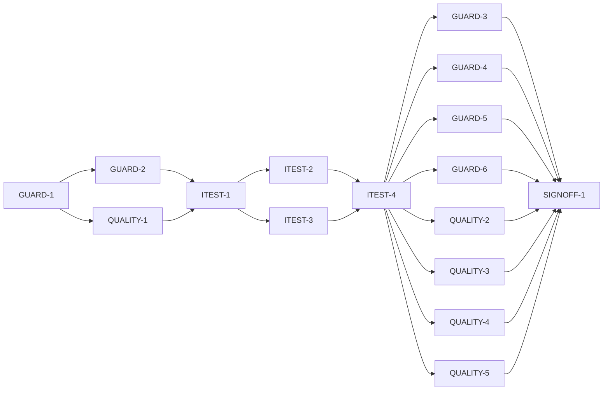

# Master Plan — Core non-functional requirements

**Spec:** [bs-12-non-functional-requirements.feature](../bs-12-non-functional-requirements.feature)
**Status:** In progress — GUARD-4 done (AC-6/AC-7/AC-8 ✅ privacy; grade 3 A/0); next GUARD-5 (GUARD-5/6 + QUALITY-2/3/4/5 all startable)
**Architecture:** [docs/paint-color-app-solution-intent.md](../../docs/paint-color-app-solution-intent.md) §"Non-functional requirements and accuracy targets", §"Cross-platform strategy / Parity acceptance", §"Decisions" (D1/D2/D3/D4/D5/D10); [docs/paint-color-app-scope.md](../../docs/paint-color-app-scope.md) §8 (accuracy targets) + §10 (non-goals). Cross-cutting over every feature merged on `main` at the branch point — `lib/capture`, `lib/readout`, `lib/compare`, `lib/recipes`, `lib/projects`, `lib/palette`, `lib/correction`, `lib/display`, `lib/onboarding`, `lib/color_science`, `lib/store` — all assembled through `lib/app/build_app.dart`.
**Code home:** /Users/matthew.quirk/Nuance · remote https://github.com/meatsquirk/Nuance · base `main` (@ `ecd3a9e`, bs-07 merged — carries bs-01..09 + bs-07 + bs-08) · extends the bs-01..bs-09 foundation (confirmed by Matt Quirk via sibling *Code home* lines, 2026-10-13)

## Gap analysis (against `main` @ `ecd3a9e`)

| AC | Exists today | Missing |
|---|---|---|
| AC-1 offline — every core fn works | No network anywhere (zero http/dio/socket in `lib/`); all core flows pure/in-memory + local SQLite; capture/readout/compare/search/projects/export all present | A guard test that **runs every core flow under a network block** and proves each completes (true-by-construction, not enforced) |
| AC-2 no fn blocks on connectivity | Same — nothing awaits a socket | The guard proving no core flow waits on/requires a connection |
| AC-3 reading settles + indicator | Frame-count settle (`kStabilityFrameTarget=12`, `capture_controller.dart`); "SETTLING n/12 → STABLE" indicator (`capture_live_view.dart`) | Automated mechanism test (indicator shows + reading reaches STABLE) + a generous CI regression budget; the **"~1–2s on target hardware" number is owner on-device evidence** at SIGNOFF (D-3) |
| AC-4 recipe search top 3–5 in budget | `MixOptions.topK=5`; search returns ≤5 ranked candidates (`subtractive_engine.dart`) | Automated test (top 3–5 returned) + CI regression budget; **target-hardware timing is owner evidence** at SIGNOFF (D-3) |
| AC-5 live preview frame rate | No timed camera feed — `SoftwareCaptureSource` emits a finite 12-frame list, not a timed stream; no fps concept | **Pure-manual (D-3)**: on-device preview frame rate, recorded by the owner at SIGNOFF; no automated test |
| AC-6 photos/samples never leave device | No network send; source photos + SQLite under the app-documents dir; export = PDF **bytes to the device share/print sheet**, never disk/network (`ProjectController.lastExport`) | A guard proving nothing leaves the device (network sink untouched) **and** stored artefacts are local-only |
| AC-7 no account, no telemetry | No auth/account anywhere; no analytics/firebase/telemetry/crashlytics/sentry in `pubspec`/lock | A dependency guard (forbidden-package list) + runtime guard (nothing sent) |
| AC-8 future sync opt-in | No sync/off-device path exists in v1 (D8: no server contribution subsystem) | A **no-off-device-path guard** — sharing is vacuously opt-in because there is none; the guard fails if an unconsented off-device send is introduced (D-6) |
| AC-9 poor conditions downgrade accuracy | `CaptureAccuracy` {approximate ≤8 / calibrated ≤3}; **lighting** downgrades the tier; policy is "downgrade, never refuse" (bs-02 AC-6/7/8 tested) | **Fix (D-5):** "unlocked exposure (AE/AWB/focus)" and "missing reference card" are **not** explicit downgrade/label triggers today (card-missing is a silent `calibrate` no-op); make both downgrade the stated accuracy rather than returning it as trustworthy |
| AC-10 card+controlled → ΔE00 ≤ 3 | Single CIEDE2000 `deltaE00`; `calibrated` tier bound = 3; card normalisation path | **Synthetic held-out dataset + accuracy harness (D-2)** running the card+controlled path and asserting ΔE00 ≤ 3; **not physical spectrophotometer ground truth** (gap, D-2) |
| AC-11 no-card daylight → ΔE00 ≤ 8, labelled approximate | `approximate` tier bound = 8; "approximate" labelling exists | Synthetic harness asserting ΔE00 ≤ 8 **and** the approximate label (D-2); physical ground truth deferred (gap) |
| AC-12 recipe vs swatch → ΔE00 ≤ 5 in-gamut | Engine computes predicted colour (Kubelka–Munk) + its ΔE00 vs target; verdict bands | Synthetic harness asserting ΔE00 ≤ 5 for in-gamut targets (D-2); physical mixed-swatch ground truth deferred (gap) |
| AC-13 out-of-gamut, no false recipe | `MixOptions.gamutThreshold=5.0`; flagged + `GamutBanner`; nearest-not-a-match (bs-04 ENGINE-5) | A test confirming an out-of-gamut target is identified and **no recipe is offered as a match**, with an in-gamut control that is not flagged |
| AC-14 mixing engine swappable | `abstract interface class MixingEngine`; `SubtractiveMixingEngine` wired via `AppDependencies.mixingEngine`; callers depend on the interface | A swap test: inject an alternate `MixingEngine`, run callers, prove callers are unchanged |
| AC-15 CVD model swappable | `abstract interface class ConfusionCheck` (CVD model seam); `DichromatConfusionCheck`/`NoopConfusionCheck` wired via `AppDependencies.confusionCheck` | A swap test: inject an alternate `ConfusionCheck`, run callers, prove callers are unchanged |
| AC-16 one tested colour-science library | Conversions behind `ColorScience`/`conversions.dart` (wraps `color_models`); single ΔE00 `deltaE00` in `lib/compare/difference.dart`, all callers route through it | A source guard: **no file outside the two authorities computes a colour-space conversion or a ΔE** — guarded **in place** (D-4), two single-authority files, no refactor |
| AC-17 only native capture differs per platform | Zero platform-specific Dart in `lib/` (no `Platform.is*`/`MethodChannel`/conditional imports); native dirs are default scaffolding; `CaptureSource` is the one intended seam | A source guard: platform-conditional code appears **only** under `lib/capture/source/` |

**17 ACs. 16 automated** (all but AC-5) → one integration test → ≥1 behavior phase. **1 pure-manual** (AC-5 live-preview fps) closed by user acceptance at SIGNOFF-1 with the gap named (D-3). **Known gaps carried to sign-off:** AC-10/11/12 are proven against a **synthetic** dataset, not physical ground truth (D-2); AC-3/AC-4 "~1–2s on target hardware" are owner on-device evidence (D-3).

## Build order

| Stage | Phases |
|---|---|
| 1 Scaffold | GUARD-1 |
| 2 Component shells | GUARD-2, QUALITY-1 |
| 3 Acceptance tests | ITEST-1, ITEST-2, ITEST-3, ITEST-4 (test review, G-2) |
| 4 Behavior | GUARD-3, GUARD-4, GUARD-5, GUARD-6, QUALITY-2, QUALITY-3, QUALITY-4, QUALITY-5 |
| 5 Sign-off | SIGNOFF-1 (closes AC-5 manual gate G-3) |

## Acceptance criteria coverage

| AC | Scenario | Integration test (ITEST) | Behavior phases | Status |
|---|---|---|---|---|
| AC-1 | With networking disabled, every core function still works | ITEST-2 `TestAC01_OfflineCoreFunctionsWork` | GUARD-3 | ✅ Done (GUARD-3 2026-10-14; A) |
| AC-2 | No core function blocks on connectivity | ITEST-2 `TestAC02_NoFunctionBlocksOnConnectivity` | GUARD-3 | ✅ Done (GUARD-3 2026-10-14; A) |
| AC-3 | A committed reading settles within the budget with a visible indicator | ITEST-3 `TestAC03_ReadingSettlesWithIndicator` | QUALITY-5 | ⬜ Todo |
| AC-4 | Recipe search returns within the budget | ITEST-3 `TestAC04_RecipeSearchReturnsTopCandidates` | QUALITY-5 | ⬜ Todo |
| AC-5 | Live capture holds a usable preview frame rate | **manual gate (SIGNOFF-1, G-3)** — no automated test (D-3) | SIGNOFF-1 (user acceptance) | ⬜ Todo |
| AC-6 | Photos and samples never leave the device | ITEST-2 `TestAC06_PhotosAndSamplesStayOnDevice` | GUARD-4 | ✅ Done (GUARD-4 2026-10-14; A) |
| AC-7 | There is no account and no telemetry in v1 | ITEST-2 `TestAC07_NoAccountNoTelemetry` | GUARD-4 | ✅ Done (GUARD-4 2026-10-14; A) |
| AC-8 | Any future sync is opt-in and explicit | ITEST-2 `TestAC08_FutureSyncIsOptIn` | GUARD-4 | ✅ Done (GUARD-4 2026-10-14; A) |
| AC-9 | Poor conditions downgrade the stated accuracy rather than failing quietly | ITEST-3 `TestAC09_PoorConditionsDowngradeAccuracy` | QUALITY-2 | ⬜ Todo |
| AC-10 | Capture with reference card in controlled lighting meets ΔE00 ≤ 3 | ITEST-3 `TestAC10_CardControlledMeetsDeltaE3` | QUALITY-4 | ⬜ Todo |
| AC-11 | Capture without reference card in daylight meets ΔE00 ≤ 8, labelled approximate | ITEST-3 `TestAC11_CardlessDaylightApproximateUnder8` | QUALITY-4 | ⬜ Todo |
| AC-12 | Recipe prediction vs a physically mixed swatch meets ΔE00 ≤ 5 in-gamut | ITEST-3 `TestAC12_RecipePredictionUnder5InGamut` | QUALITY-4 | ⬜ Todo |
| AC-13 | An out-of-gamut target is identified, no false recipe | ITEST-3 `TestAC13_OutOfGamutNoFalseRecipe` | QUALITY-3 | ⬜ Todo |
| AC-14 | The mixing engine can be replaced without touching its callers | ITEST-2 `TestAC14_MixingEngineSwappable` | GUARD-5 | ⬜ Todo |
| AC-15 | The CVD model can be replaced without touching its callers | ITEST-2 `TestAC15_CvdModelSwappable` | GUARD-5 | ⬜ Todo |
| AC-16 | Colour-science conversions come from one tested library | ITEST-2 `TestAC16_OneColourScienceLibrary` | GUARD-6 | ⬜ Todo |
| AC-17 | Only the native capture implementation differs per platform | ITEST-2 `TestAC17_OnlyNativeCaptureDiffersPerPlatform` | GUARD-6 | ⬜ Todo |

## Design decisions

| # | Decision | Why |
|---|---|---|
| D-1 | **Verify + fix (reusable guards).** bs-12 ships reusable NFR guards (network-block/offline, privacy/telemetry, one-colour-library, platform, interface-swap, accuracy, performance) as acceptance mechanism **and** fixes the gaps they reveal (AC-9's triggers). It verifies over **every feature merged on `main` at the branch point** (bs-01..09 + bs-07 + bs-08); features merged later (bs-10, bs-11) self-assert via the guards — bs-12 cannot sweep the future | Matt Quirk chose "verify + fix, ship reusable guards" (planning Q3, 2026-10-13); mirrors bs-11 D-1's sweep-at-branch-point philosophy |
| D-2 | **Accuracy AC-10/11/12 are fully automated against a bundled *synthetic* held-out dataset** (deterministic colour/recipe samples carried as a test fixture), asserting ΔE00 ≤ 3 / ≤ 8 (+ approximate label) / ≤ 5 in-gamut and the target logic. This proves the ΔE math, the tiering and the labelling — **not** real-world device accuracy. Physical spectrophotometer / mixed-swatch validation (SI validation method) is **out of bs-12 scope**, carried as a known gap owned by the Phase-0.5/Phase-1 accuracy gate | Matt Quirk chose "fully automate on a synthetic set" (planning Q1, 2026-10-13); the repo has no spectrophotometer/held-out physical fixture and no device CI, so synthetic is the only automatable option; the gap is named honestly at sign-off |
| D-3 | **Performance is hybrid.** AC-3/AC-4: automate the mechanism (stability indicator shows + reading reaches STABLE; search returns top 3–5) plus a **generous CI regression budget** (a wall-clock ceiling that catches pathological regressions on the sim, explicitly not the target-hardware figure). The literal "~1–2s on target hardware" (AC-3/AC-4) and the **live-preview frame rate (AC-5)** are owner on-device measurements recorded at SIGNOFF; AC-5 is **pure-manual** (no automated test), closed by user acceptance with the gap named | Matt Quirk chose "hybrid: mechanism + manual budget" (planning Q2, 2026-10-13); the app has a frame-count settle and no timed camera feed, so true timing is device-only, but the mechanism and a regression ceiling are worth gating in CI |
| D-4 | **One colour-science library guarded in place.** Conversions stay behind `ColorScience`/`lib/color_science/conversions.dart` (wrapping `color_models`); ΔE00 stays the single `deltaE00` in `lib/compare/difference.dart`. The AC-16 source guard forbids any **other** file computing a colour-space conversion or a ΔE directly — two single-authority files, no code move | Behaviour-preserving and lower-risk than consolidating ΔE into `lib/color_science/`; the invariant is "one tested authority per concern", which the guard enforces without a refactor that would touch every caller |
| D-5 | **AC-9 fix:** make **"unlocked exposure" (AE/AWB/focus not locked)** and **"missing reference card"** explicit downgrade/label triggers in `lib/capture`. Today only lighting downgrades the tier, and a missing card is a silent `calibrate()` no-op; after the fix a reading taken under any of the three poor conditions carries a downgraded stated accuracy (or an explicit approximate label), never returned as if trustworthy | The spec's AC-9 names three conditions (poor lighting **or** unlocked exposure **or** missing card); only the first is a trigger today, so the invariant is not actually enforced |
| D-6 | **AC-8 (future sync opt-in) = a no-off-device-path guard.** v1 ships no code path that sends data off-device (D8: no server contribution subsystem), so any future sync is vacuously opt-in. The guard asserts the invariant and **fails if an unconsented off-device send is introduced** — it does not build a sync feature | The requirement is about a future capability; the honest, testable form in v1 is "no off-device path exists, and the guard defends that" |
| D-7 | **Guards are reusable test-support**, not product code: source-scan (needs file access), network-block (`HttpOverrides`), interface-swap, accuracy and performance harnesses live in `integration_test/nfr/` and are consumed by the bs12 acceptance suite. The **only `lib/` change** bs-12 makes is the AC-9 reliability trigger fix in `lib/capture` | Keeps the coverage gate scoped to the one real behaviour change; the verification mechanism belongs with the test harness (mirrors bs-11 D-3) |
| D-8 | **Branch from `main` @ `ecd3a9e` now** (bs-01..09 + bs-07 + bs-08). bs-10 (daltonization) and bs-11 (accessibility conformance) are planned/in-progress, not merged — out of the branch-point sweep; they self-assert via the reusable guards once merged | Waiting would serialise bs-12 behind two in-flight features; the guards are reusable so later features inherit them |

## Acceptance integration test plan

Module plan: [modules/ITEST.md](modules/ITEST.md).

**Where it lives and how it runs:** `integration_test/bs12/nfr_harness.dart` (vocabulary + fixtures + the real assembled app) and `integration_test/bs12/nfr_test.dart` (runner), over the reusable guards in `integration_test/nfr/`. Default target (pending skipped): `flutter test integration_test/bs12/nfr_test.dart -d flutter-tester`. Run-pending / red baseline: add `--dart-define=BS12_RUN_PENDING=true` (or host env `BS12_RUN_PENDING=1`). **`-d flutter-tester` (the host VM) is required from GUARD-4 on** — discovered at GUARD-4: the source-scan ACs (AC-7/AC-8, and AC-16/AC-17 at GUARD-6) read the repo tree (`lib/`, the control fixtures) through `dart:io`, which resolves only with `cwd = repo root`; an iOS-sim target (`-d <udid>`) runs in the app sandbox where those paths don't exist, so the scan controls can't discriminate there. The flow/app-pumping ACs (AC-1/2/6/9/…) are `flutter_tester`-compatible (platform sinks faked), so the whole file runs on the host. **A device (`-d flutter-tester`) is still mandatory** — a bare `flutter test integration_test/…` with no device runs zero tests and exits 0 (false green — see Known flakes); `-d flutter-tester` runs them all on the host without a sim/Xcode build and needs no device lane.
**Where assertions look:** the `networkBlock` sink (proves nothing was sent — AC-1/2/6/7/8); the existing feature read endpoints (`CaptureReadEndpoint`, `ComparisonReadEndpoint`, `RecipeReadEndpoint`, project/export state) for flow-completion and settle/out-of-gamut state; the `CaptureAccuracy`/stated-accuracy surface for AC-9; the single `deltaE00` output over the synthetic set for AC-10/11/12; the source-scan results over `lib/` for AC-16/AC-17; `AppDependencies` call sites for AC-14/15; `Stopwatch` elapsed vs the CI budget for AC-3/AC-4.
**What is real and what is faked:** every real screen/flow assembled through `buildApp(deps)`; the real engines, `ColorScience`, `deltaE00`, capture controller and persistence store (a test executor-backed `drift` double — on-device SQLite without a device file). Faked infrastructure only: `FakeSpeech`, `FakeHaptics` (existing), the `networkBlock` `HttpOverrides`, and the **swap doubles** `altMixingEngine` / `altConfusionCheck` (exist only to prove the seam). The **control** cases (a planted network-touching flow, a stray-ΔE file, a `Platform.is` outside capture, a caller bound to the concrete engine, a poor-condition reading returned trustworthy, an in-gamut target) are deliberate fixtures proving each guard discriminates. No colour math is faked.

**Fixtures:**

| Fixture | Shape |
|---|---|
| `bootedDevice` | A booted simulator/device udid passed via `-d`; mandatory for every acceptance run |
| `fakeSpeech` / `fakeHaptics` | Existing infrastructure doubles |
| `networkBlock` | An `HttpOverrides` whose `createHttpClient` throws on any connection attempt, installed around a flow; the sink records any attempt (AC-1/2/6/7/8) |
| `realFlows` | The core flows through `buildApp`: capture → readout → compare → recipe search → save project → export |
| `syntheticAccuracySet` | Deterministic held-out samples with known expected colour/ΔE for the three accuracy conditions (card+controlled, card-less daylight, recipe-vs-swatch) + in/out-of-gamut targets (D-2) |
| `altMixingEngine` / `altConfusionCheck` | Alternate interface implementations injected via `AppDependencies` to prove the swap seams (AC-14/15) |
| `control_networkTouch` | A planted flow that attempts a connection (fails AC-1/AC-2) |
| `control_strayColourMath` | A planted file computing a conversion/ΔE outside the authorities (fails AC-16) |
| `control_platformDart` | A planted `Platform.is`/`MethodChannel` outside `lib/capture/source/` (fails AC-17) |
| `control_boundToConcrete` | A caller referencing the concrete engine type (fails AC-14) |
| `control_trustworthyPoor` | A poor-condition reading returned without a downgrade (fails AC-9) |
| `control_inGamut` | An in-gamut target that must **not** be flagged out-of-gamut (AC-13 positive control) |

**Test catalogue:**

| AC | Given: built via public flows → checked by | When | Then: exact assertions (negative Thens: after <settle point>) | Rejects |
|---|---|---|---|---|
| AC-1 | `realFlows` launched through `buildApp` with `networkBlock` installed → read endpoints confirm each flow's entry state present | run every core function (capture, readout, compare, recipe search, save project, export) | each function reaches its terminal state (read endpoints) **and** `networkBlock` recorded **zero** attempts; **control:** `control_networkTouch` throws under the block | a flow that silently degrades/stubs under the block, or a guard that passes without exercising every core function |
| AC-2 | Same flows under the block → each flow's completion observed | the painter uses any core function | no flow awaits/requires a connection — all complete deterministically (no hang/timeout) with zero network attempts; **control:** `control_networkTouch` cannot complete | a function that blocks waiting for connectivity, or a guard that only checks "no error" not "no wait" |
| AC-3 | A capture committed through the real controller with the stability indicator present (finder) → `CaptureReadEndpoint` shows the settling state | frames are averaged to commit | the indicator shows progress (SETTLING n/12) then the reading reaches STABLE and commits; **and** elapsed (`Stopwatch`) is under the generous CI budget; **(target-hardware ~1–2s is owner evidence at SIGNOFF)** | a reading that commits with no visible indicator, or never settles, or a test asserting the device figure in CI (D-3) |
| AC-4 | A recipe search over the real engine for a seeded target → `RecipeReadEndpoint` has candidates | the search runs | 3–5 ranked candidates return **and** elapsed is under the CI budget; **(target-hardware ~1–2s is owner evidence at SIGNOFF)** | returning >5 or <3 candidates, or asserting the device figure in CI |
| AC-6 | `realFlows` capture + save + export under `networkBlock`; the store is the local test executor; `ProjectController.lastExport` holds the PDF bytes → read endpoints confirm the artefacts exist | the app captures, saves and exports | **zero** network attempts recorded, stored artefacts resolve to local (app-documents / in-memory executor) paths, and export bytes are never written off-device; **control:** `control_networkTouch` is detected | an upload path accepted, or a guard that checks storage but not the network sink |
| AC-7 | The resolved dependency set (pubspec/lock parsed by the guard) + `networkBlock` over a full session | the app runs | no account/auth surface is reachable **and** no forbidden package (firebase/analytics/telemetry/crashlytics/sentry/http client) is present **and** nothing is sent; **control:** adding a forbidden package name to the fixture list trips the guard | a telemetry/analytics dependency accepted, or an account flow present |
| AC-8 | The source/dependency guard over `lib/` + the `networkBlock` session | data would be shared off the device | **no off-device code path exists** (no sender reachable); the guard fails if an unconsented off-device send is introduced; **control:** a planted off-device sender without a consent flag trips it (D-6) | any path that shares data off-device without an explicit opt-in, or a guard that assumes "no code = pass" without defending against a planted sender |
| AC-9 | Readings committed under each poor condition — low lighting, unlocked exposure (AE/AWB/focus not locked), missing reference card — through the real controller → stated accuracy observed on `CaptureReadEndpoint` | a reading is produced under each condition | stated accuracy is **downgraded / labelled approximate**, never returned as trustworthy, for **all three** conditions; **control:** `control_trustworthyPoor` (a poor reading with no downgrade) is rejected | only lighting downgrading (exposure/card ignored — the current gap), or a reading returned at full stated accuracy under a poor condition |
| AC-10 | `syntheticAccuracySet` card+controlled samples run through the capture→reading pipeline + the card normalisation path → the single `deltaE00` vs the known expected | the result is validated against the synthetic ground truth | ΔE00 ≤ **3** across the card+controlled set (D-2); **control:** a sample perturbed beyond 3 fails | a pipeline whose card+controlled error exceeds 3, or a test comparing the impl against itself (uses the independent `referenceDeltaE00`) |
| AC-11 | `syntheticAccuracySet` card-less daylight samples through the pipeline → `deltaE00` vs expected + the stated-accuracy label | validated against synthetic ground truth | ΔE00 ≤ **8** **and** the reading is labelled **approximate** (D-2); **control:** a card-less reading mislabelled calibrated fails | ΔE00 > 8 accepted, or a card-less reading not labelled approximate |
| AC-12 | `syntheticAccuracySet` in-gamut targets → the engine's predicted colour → `deltaE00` vs the synthetic mixed-swatch value | the prediction is validated | ΔE00 ≤ **5** for in-gamut targets (D-2); **control:** an in-gamut prediction perturbed beyond 5 fails | a prediction error > 5 for an in-gamut target accepted |
| AC-13 | `syntheticAccuracySet` out-of-gamut target + `control_inGamut` through the engine → `RecipeReadEndpoint.outOfGamut` + candidate list | the search runs | the out-of-gamut target is **identified** (banner/flag set) and **no recipe is offered as a match**; **control:** `control_inGamut` is **not** flagged and does return recipes | an out-of-gamut target returned with a recipe presented as a match (false recipe), or an in-gamut target flagged out-of-gamut |
| AC-14 | The app assembled through `buildApp` with `altMixingEngine` injected via `AppDependencies.mixingEngine` → recipe callers run | the engine implementation is swapped | callers produce correct results through the interface with **no reference to the concrete `SubtractiveMixingEngine`** (asserted via the swap + the source guard); **control:** `control_boundToConcrete` fails the guard | a caller that imports/instantiates the concrete engine, or a swap that doesn't actually exercise the callers |
| AC-15 | The app assembled with `altConfusionCheck` injected via `AppDependencies.confusionCheck` → CVD callers (onboarding/compare/display) run | the model implementation is swapped | CVD callers run through the interface with no reference to the concrete `DichromatConfusionCheck`; **control:** a caller bound to the concrete model fails | a caller bound to the concrete CVD model, or a swap not exercising callers |
| AC-16 | The source guard scans every `lib/` file for colour-space conversions and ΔE computations → list of offenders outside the authorities | a conversion or ΔE is needed | the **only** conversion authority is `ColorScience`/`conversions.dart` and the **only** ΔE authority is `deltaE00` — **zero** offenders (D-4); **control:** `control_strayColourMath` is listed | a file computing a conversion/ΔE directly (bypassing the authority), or a guard that only checks imports not computations |
| AC-17 | The source guard scans every `lib/` file for `Platform.is*`/`MethodChannel`/`EventChannel`/conditional imports → list of platform-conditional sites | the two platform builds are compared | platform-conditional code appears **only** under `lib/capture/source/` — **zero** offenders elsewhere; **control:** `control_platformDart` is listed | platform-conditional logic in a non-capture module, or a guard scanning only part of `lib/` |

AC-5 has **no catalogue row** — pure-manual gate (D-3), executed and recorded at SIGNOFF-1.

**Red baseline** and **test augmentations:** tracked in [modules/ITEST.md](modules/ITEST.md).
Pre-seeded augmentations: each ACn test is *limited at baseline* because its guard rule is a stub until its behavior phase (compliant side passes vacuously only if the stub says "pass"; the stub says "fail", so each fails on its Then) — the discriminating control (real invariant holds **and** the control fails) is confirmed by the owning phase. AC-9 cannot discriminate the exposure/card conditions until the triggers exist → *B pending QUALITY-2*; AC-10/11/12 cannot run until `syntheticAccuracySet` + the harness exist → *B pending QUALITY-4*; AC-14/15 cannot swap until the injection path is wired → *B pending GUARD-5*. The "every real flow" assertions are re-confirmed at SIGNOFF-1 against the full cross-feature regression.

## Modules

| Module | Plan | Purpose | Depends on | Status |
|---|---|---|---|---|
| GUARD | [modules/GUARD.md](modules/GUARD.md) | The invariant guards (reusable test-support, no product change): offline/network-block, privacy/telemetry, interface-swap, one-colour-library, platform | — | 🔄 In progress |
| QUALITY | [modules/QUALITY.md](modules/QUALITY.md) | The measured/behavioural targets: synthetic accuracy (D-2), performance mechanism + CI budget (D-3), out-of-gamut, and the one `lib/` change — the AC-9 reliability downgrade fix (D-5) | GUARD (shells) | 🔄 In progress |
| ITEST | [modules/ITEST.md](modules/ITEST.md) | Acceptance integration suite over the real flows + controls: one pending test per automated AC, and its review | GUARD-2, QUALITY-1 | ✅ Done (ITEST-1/2/3/4; G-2 approved 2026-10-14) |

## Dependency graph

**Parallel windows:** GUARD-2 ∥ QUALITY-1 (disjoint: `integration_test/nfr/guards/` vs `integration_test/nfr/quality/` + the `lib/capture` AC-9 seam). ITEST-2 ∥ ITEST-3 **share `nfr_test.dart` → merge-risky; run sequentially** (or split into two runner files). Behavior phases editing the shared `nfr_test.dart` + a shared guard file are **merge-risky; sequence them**; QUALITY-2 (the only `lib/capture` change) is disjoint from the GUARD guards and **may run ∥ one GUARD behavior phase**. **Coordination:** bs-12 adds test-support + one `lib/capture` change; the AC-16/AC-17 source guards and the AC-1/AC-6 network guard become reusable acceptance mechanism that bs-10/bs-11 (and later features) inherit — sequence the bs-12 merge so in-flight branches rebase onto the AC-9 capture change.

## Open gates

| Gate | Kind | Decision needed | Blocks | Status |
|---|---|---|---|---|
| G-1 | decision | Approve the spec (record approval as its first line, replacing the `# Draft: awaiting owner approval` banner) | GUARD-1 | ✅ Resolved 2026-10-13 14:59 EDT: approved — Matt Quirk (spec first line amended to the approval line) |
| G-2 | decision | Approve the acceptance tests (ITEST-4's packet) | every behavior phase | ✅ Resolved 2026-10-14 07:41 EDT: **approved** — Matt Quirk. The 16-AC acceptance suite + whole-suite grid (6 A / 10 B pending / 0 ordinary B) approved, incl. the recommendation to reduce QUALITY-3 (AC-13) & QUALITY-5 (AC-3/4) to un-pend+guard (green at baseline) and the D-2/D-3 gaps carried to sign-off. Behaviour stage un-blocked. |
| G-3 | decision | AC-5 — the **live-preview frame rate** verified on device at SIGNOFF, and the AC-3/AC-4 **target-hardware ~1–2s timings** recorded as owner evidence (D-3); a fail blocks acceptance | SIGNOFF-1 (AC-5) | Open |

Resolved: `✅ Resolved <date time>: <decision, one line> — <who>`.

## Known flakes

| Test | Symptom | Rate (runs) | Measured at | Owner | Status |
|---|---|---|---|---|---|
| coverage_gate — const-constructor line | `flutter test --coverage` intermittently records a const-folded constructor line in `lib/**` as uncovered, so the gate may FAIL on a file this phase never touched | intermittent | first bs-01 `88c5add` | re-run `flutter test --coverage` once; green on re-run ⇒ ignore | Open (carried) |
| integration suite — no `-d <udid>` | `flutter test integration_test/…` with no booted device runs zero tests and still exits 0 (false green) | deterministic | bs-05/bs-06 | always pass `-d <booted-udid>` | Open (carried) |
| integration suite — sim `stopApp`/`terminate` teardown race | a file's `tearDownAll` fails with `Unable to terminate <bundle-id>: … found nothing to terminate` (NSPOSIXErrorDomain code=3); the app already exited, so the whole run exits 1 and marks that file's tests as *did not complete* — not an assertion failure | intermittent (1/2 full-suite runs: hit at GUARD-1; **not** hit at GUARD-2 — clean 197 pass / exit 0) | bs-12 GUARD-1 | re-run the affected file alone (`correction_test` → 22/22 green in isolation); real `-N` count stays 0 | Open |

## Session log

| # | Phase | Target | Status | Tokens | Time | Notes |
|---|---|---|---|---|---|---|
| 1 | GUARD-1 | scaffold: worktree+branch from main, baseline, coverage-gate confirm, bs12 pending gate (16 ACs) | ✅ Done | 7.84M | 32m 51s | G-1 ✅; baseline unit 1220 / integ 188 (0 fails); gate both ways; pending 16 ACs |
| 2 | GUARD-2 | shell: `integration_test/nfr/guards/` scaffolds — source-scan, swap-harness, network-block/offline harness (stubs) | ✅ Done | 3.72M | 17m 40s | ∥ QUALITY-1; analyze clean, unit 1220, acceptance 197 |
| 3 | QUALITY-1 | shell: `integration_test/nfr/quality/` scaffolds — accuracy harness + `syntheticAccuracySet`, perf harness (stubs) + the `lib/capture` AC-9 downgrade seam (behaviour unchanged) | ✅ Done | 9.16M | 20m 33s | analyze clean, unit 1228 (+8), coverage 100%/2 lib files, acceptance 197/0; AC-9 seam `AccuracyDowngradeReason`+`activeDowngradeReasons` (no trigger) |
| 4 | ITEST-1 | acceptance-tests: harness, real-flow + control + swap fixtures, pending gate (16 ACs), smoke test | ✅ Done | 7.3M | 17m 59s | grade 15 A/0; analyze clean, unit 1228, acceptance 15 pass/exit 0 (16 ACs pending); `nfr_harness.dart`+`nfr_test.dart` |
| 5 | ITEST-2 | acceptance-tests: AC-1,2,6,7,8,14,15,16,17 (pending) + red baseline | ✅ Done | 27.1M | 1h 00m (3h 13m) | 9 pending AC tests; default +15/~9/exit 0; run-pending +15/−9 (clean red baseline); grade 3 A / 6 B pending / 0 ordinary B |
| 6 | ITEST-3 | acceptance-tests: AC-3,4,9,10,11,12,13 (pending) + red baseline | ✅ Done | 19.0M | 47m 22s | grade 3 A / 4 B pending / 0 ordinary B; default +15/~16/exit 0; run-pending +18/−13; AC-3/4/13 green at baseline (bs-02/bs-04), AC-9→QUALITY-2, AC-10/11/12→QUALITY-4 |
| 7 | ITEST-4 | test-review: packet; G-2 | ✅ Done | 1.89M | 4m 22s | packet + whole-suite grid 6 A / 10 B pending / 0 ordinary B (+15 A smoke); **G-2 approved 2026-10-14 by Matt Quirk** → behaviour stage un-blocked |
| 8 | GUARD-3 | AC-1+AC-2 offline: network-block guard over every core flow | ✅ Done | 7.42M | 9m 39s | sink.record() wired (no lib change); un-pended AC-1/AC-2; analyze clean, unit 1228, acceptance default 17 pass/14 skip/exit 0; grade 2 A/0 |
| 9 | GUARD-4 | AC-6+AC-7+AC-8 privacy: nothing-leaves + no-telemetry + no-off-device-path guards | ✅ Done | 11.5M | 27m 11s | real `forbiddenDependencies`/`offDeviceSenders` scans (no lib change); un-pended AC-6/7/8, closed TestAC07/08; analyze clean, unit 1228, acceptance `-d flutter-tester` 21 pass/11 skip/exit 0, run-pending +24/−8 (8 = intact red baseline); grade 3 A/0. **Suite runs on `-d flutter-tester`** (host) — source scans read the repo tree (line 81) |
| 10 | GUARD-5 | AC-14+AC-15 swappable: inject alt engine + alt CVD, callers unchanged | ⬜ Next | | | startable; shares `source_guard.dart`+`nfr_test.dart` with GUARD-4/6 (sequence); also GUARD-6 + QUALITY-2/3/4/5 startable |
| 11 | GUARD-6 | AC-16+AC-17 one-colour-lib + portability: source-scan guard rules | ⬜ Todo | | | |
| 12 | QUALITY-2 | AC-9 reliability fix: unlocked-exposure + missing-card downgrade triggers (`lib/capture`) | ⬜ Todo | | | ∥ one GUARD phase |
| 13 | QUALITY-3 | AC-13 out-of-gamut: identified, no false recipe + in-gamut control | ⬜ Todo | | | |
| 14 | QUALITY-4 | AC-10+AC-11+AC-12 accuracy: synthetic set + harness asserts ΔE00 ≤ 3 / ≤ 8+approx / ≤ 5 | ⬜ Todo | | | |
| 15 | QUALITY-5 | AC-3+AC-4 performance: indicator+settle + top 3–5 + CI budget | ⬜ Todo | | | |
| 16 | SIGNOFF-1 | sign-off: packet + summary + manual AC-5 (G-3) + AC-3/4 device evidence + human decision | ⬜ Todo | | | |

*Tokens* / *Time* = the phase totals from the *Token usage* ledger (Time = active, wall in brackets), filled when the row is marked done.

## Next phase

**GUARD-4 done 2026-10-14 (AC-6/AC-7/AC-8 ✅ privacy; grade 3 A/0).** The real `forbiddenDependencies` (reads `pubspec.lock`) and `offDeviceSenders` (`lib/` source scan, comment/string-masked) landed in `source_guard.dart`; TestAC07/08 augmentations closed (AC-7/8 B-pending → A). **No `lib/` change.** 5 behaviour ACs-in-8-tests remain, across 4 phases. **Important (discovered here):** the bs-12 acceptance suite now runs on **`-d flutter-tester`** (host VM, cwd = repo root) because the source scans read the repo tree — an iOS-sim target breaks AC-7/8 (and AC-16/17 at GUARD-6). See "how it runs" (line 81).

**Startable now (each depends only on ITEST-4):** GUARD-5 (AC-14/15 swap), GUARD-6 (AC-16/17 one-lib+portability), QUALITY-2 (AC-9 downgrade — the only `lib/capture` change), QUALITY-4 (AC-10/11/12 accuracy), QUALITY-3 (AC-13 — un-pend+guard), QUALITY-5 (AC-3/4 — un-pend+guard).
- **Merge-risk:** every behaviour phase un-pends in the shared `integration_test/bs12/pending.dart` and most edit the shared `nfr_test.dart`; GUARD-5/6 also share `source_guard.dart` → **sequence these** (one phase per session, `/clear` between). QUALITY-2 (`lib/capture` only) may run ∥ one GUARD phase in a separate `--parallel` session with a worktree claim. GUARD-5/6 reuse GUARD-4's shared `maskCommentsAndStrings` + `_scanSource` machinery.
- **Recommended order:** the un-pend+guard QUALITY-3 / QUALITY-5 next (low risk, green at baseline), then the heavier GUARD-5/6 + QUALITY-2/4.

G-3 (AC-5 device frame rate + AC-3/4 target-hardware ~1–2 s) stays a SIGNOFF-1 manual gate (D-3). Gaps carried to sign-off: D-2 (synthetic accuracy set) + D-3 (device timings).

## Token usage

<!-- One row per session, appended as that session's last edit (SKILL.md § Token usage). -->

| Phase / activity | Session | Start | End | Wall | Active | Model(s) | Input | Cache write | Cache read | Output | Total | Outcome |
|---|---|---|---|---|---|---|---|---|---|---|---|---|
| PLAN | 47f7357b | 2026-10-13 12:26 EDT | 13:47 | 1h 21m | 15m 33s | claude-opus-4-8 | 70 | 291,619 | 2,467,416 | 65,289 | 2,824,394 | plan written: 16 phases, 3 modules (GUARD/QUALITY/ITEST), 17 ACs (16 automated + AC-5 manual) |
| GUARD-1 | a927d1cc | 2026-10-13 14:16 EDT | 15:29 | 1h 12m | 32m 51s | claude-opus-4-8 | 146 | 125,483 | 7,663,865 | 54,806 | 7,844,300 | scaffold done: baseline unit 1220 / integ 188 (0 assertion fails, teardown flake isolated-green); coverage gate both ways; pending.dart 16 ACs; G-1 approved |
| GUARD-2 | 3958a690 | 2026-10-13 15:53 EDT | 16:11 | 17m 40s | 17m 40s | claude-opus-4-8 | 78 | 92,664 | 3,589,500 | 37,267 | 3,719,509 | shell: 3 guard scaffolds (source/offline/swap) wired to real seams; analyze clean, unit 1220, acceptance 197/0; no lib change |
| QUALITY-1 | 0d43da2b | 2026-10-13 16:32 EDT | 16:52 | 20m 33s | 20m 33s | claude-opus-4-8 | 134 | 151,736 | 8,959,060 | 48,618 | 9,159,548 | shell done: quality scaffolds (accuracy+perf+synthetic set) + AC-9 lib seam (AccuracyDowngradeReason + activeDowngradeReasons, no trigger); analyze clean, unit 1228, coverage 100%/2, acceptance 197/0 |
| ITEST-1 | 18db4951 | 2026-10-13 17:24 EDT | 17:42 | 17m 59s | 17m 59s | claude-opus-4-8 | 116 | 256,738 | 6,981,519 | 54,729 | 7,293,102 | harness + smoke done: 15 scaffold tests (5 flow-launch + 6 guard/harness-wired + 2 pending-gate + 2 fakes); analyze clean, unit 1228, coverage 100%, acceptance 15 pass/exit 0 (16 ACs pending); grade 15 A/0 |
| ITEST-2 | 9af4cb2a | 2026-10-13 17:59 EDT | 21:12 | 3h 13m | 1h 00m | claude-opus-4-8 | 276 | 875,261 | 26,027,948 | 186,170 | 27,089,655 | 9 pending AC tests (AC-1,2,6,7,8,14,15,16,17); default +15/~9/exit 0, run-pending +15/-9 clean red baseline; grade 3 A / 6 B pending / 0 ordinary B — PASS |
| ITEST-3 | df303f4e | 2026-10-13 21:31 EDT | 22:19 | 47m 22s | 47m 22s | claude-opus-4-8 | 192 | 378,184 | 18,468,216 | 114,747 | 18,961,339 | 7 pending AC tests (AC-3,4,9,10,11,12,13); default +15/~16/exit 0, run-pending +18/-13; grade 3 A / 4 B pending / 0 ordinary B — PASS; AC-3/4/13 green at baseline (bs-02/bs-04), AC-9->QUALITY-2, AC-10/11/12->QUALITY-4 |
| ITEST-4 | e007e168 | 2026-10-14 05:25 EDT | 05:29 | 4m 22s | 4m 22s | claude-opus-4-8 | 40 | 92,054 | 1,782,850 | 19,529 | 1,894,473 | test-review: packet assembled + whole-suite grid 6 A / 10 B pending / 0 ordinary B (+15 A smoke); G-2 awaiting human decision; no code run |
| SIGNOFF-DECISION | e007e168 | 2026-10-14 07:41 EDT | 07:42 | 1m 18s | 1m 18s | claude-opus-4-8 | 20 | 122,259 | 1,359,042 | 5,368 | 1,486,689 | ITEST-4 approved — G-2 approved 2026-10-14 by Matt Quirk; behaviour stage un-blocked (GUARD-3..6, QUALITY-2..5) |
| GUARD-3 | 98019302 | 2026-10-14 07:54 EDT | 08:03 | 9m 39s | 9m 39s | claude-opus-4-8 | 130 | 187,002 | 7,199,601 | 36,480 | 7,423,213 | AC-1+AC-2 offline delivered: sink.record() wired (no lib change), un-pended AC-1/AC-2; analyze clean, unit 1228, acceptance default 17 pass/14 skip/exit 0; grade 2 A/0 |
| GUARD-4 | 7b639a43 | 2026-10-14 09:05 EDT | 09:32 | 27m 11s | 27m 11s | claude-opus-4-8 | 156 | 278,062 | 11,172,920 | 84,999 | 11,536,137 | AC-6/7/8 privacy un-pended; real forbiddenDependencies + offDeviceSenders scans (no lib change); analyze clean, unit 1228, acceptance -d flutter-tester 21 pass/11 skip/exit 0, run-pending +24/-8; grade 3 A/0 — PASS |
| **Feature total** |  | **2026-10-13 12:26 EDT** | **2026-10-14 09:32** | **8h 12m** | **4h 14m** |  | **1,358** | **2,851,062** | **95,671,937** | **708,002** | **99,232,359** |  |

## Sign-off

| Round | Packet | At code | Grades | Decision |
|---|---|---|---|---|
| 1 | [signoff/round-1.md](signoff/round-1.md) | `<commit>` | | ⏸ Not yet created |
