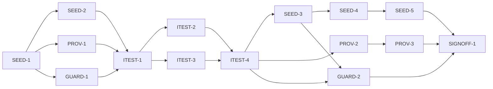

# Master Plan — Paint dataset integrity and provenance

**Spec:** [bs-13-paint-dataset-integrity.feature](../bs-13-paint-dataset-integrity.feature)
**Status:** In progress — SEED-2 ✅ shell (dataset surface wired, empty-seed-neutral); next the remaining shells PROV-1 ∥ GUARD-1
**Architecture:** [docs/paint-color-app-solution-intent.md](../../docs/paint-color-app-solution-intent.md) §"Paint database and data pipeline" (D6/D7/D9), §"Mixing engine" (D3), §"Capabilities and components"; [docs/paint-color-app-scope.md](../../docs/paint-color-app-scope.md) §6.1–6.7. Builds on the bs-04 mixing engine (`lib/recipes/engine/`), the `Paint`/`PaintPalette`/`PaletteSource` seam (`lib/recipes/`, `lib/domain/paint.dart`) and the `Provenance`/`Sample`/`EvidencePoint` model (`lib/domain/`), all assembled through `lib/app/build_app.dart`.
**Code home:** /Users/matthew.quirk/Nuance · remote https://github.com/meatsquirk/Nuance · base `main` (@ `7015390`, bs-10 merged — carries bs-01..bs-10) · extends existing (confirmed by Matt Quirk via sibling *Code home* lines + cwd, 2026-10-14)

## Gap analysis (against `main` @ `7015390`)

| AC | Exists today | Missing |
|---|---|---|
| AC-1 solved from optical data, not looked up | Engine `inverse(Sample, PaintPalette, MixOptions)` genuinely solves recipes from per-paint masstone optical data (`subtractive_engine.dart`); no lookup table anywhere | A **shipped seed dataset** of optical-data entries + a loader, and a test proving a recipe is produced by the solver over stored optical data (not a stored RGB→recipe answer) |
| AC-2 candidates come from the LLM | Nothing — no candidate-combination record; palettes are in-memory/empty | The seed's **candidate mappings** stamped with a build-time `llmSeed` origin in the manifest; a test that candidate paint-sets carry the LLM origin (and there is no runtime LLM) |
| AC-3 ratios from the solver, never the LLM | `RecipeComponent.partsFraction` is produced only by the engine's optimiser; no LLM/network code in `lib/` | A **reusable guard** proving ratios originate only from the solver and the seed schema carries **no ratio field** (a planted llm-ratio control is rejected) |
| AC-4 LLM metadata accepted, claimed values rejected | `Paint` carries metadata (`pigmentIndex`, `opacity`); no ingest path, no spectral/claimed fields | A **seed loader ingest rule**: accept metadata (pigment index, opacity, lightfastness), **reject** any LLM-claimed spectral curves / ratios; a control record with claimed values is stripped |
| AC-5 held-out set mixed & measured → ΔE00 distribution | Nothing — no validation artefact | A **validation manifest** recording a held-out recipe set (count 50–100) and its ΔE00 distribution; a test asserting the recorded shape (synthetic/recorded, not physical — D-5) |
| AC-6 ships only on evidence (threshold + beats LLM alone) | Nothing — no ship decision | A **ship-decision** in the manifest: shippable iff the distribution clears a usable threshold **and** hybrid mean ΔE00 < LLM-alone mean; controls failing either are not shippable |
| AC-7 every value carries an enforced tier by origin | `ProvenanceTier {measured, calculated, estimated, confirmed}` + `Provenance` enforced non-null on `Sample` (`lib/domain/`) | A **tier-by-origin derivation**: spectrophotometer→Measured, solver-over-measured→Calculated, unconfirmed LLM seed→Estimated, user's own measured mix→Confirmed; an `EvidenceKind` on each evidence point |
| AC-8 evidence stored append-only | `Sample.evidence` is an append-*ready* `List<EvidencePoint>` — **shape only**, nothing appends | An **append-only** operation that adds evidence while retaining every earlier point (prior evidence never dropped/reordered) |
| AC-9 Estimated promoted only by a measured/photographed swatch | Nothing — no promotion path (self-confirmation *flow* is bs-05) | The enforced **schema rule**: appending a photographed/instrument swatch evidence point promotes an Estimated value to Confirmed |
| AC-10 opinions never promote | Nothing | The enforced rule: an `opinion`-kind evidence point contributes nothing to the tier and never triggers promotion (single-user app has no voting; D-7) |
| AC-11 shipped seed stays narrow | Nothing shipped yet (palettes empty by default; persistence is bs-06) | The shipped seed asset constrained to **one brand, one medium, ~15 paints**, with a test pinning the scope |

**11 ACs. All 11 automated** → one integration test → ≥1 behavior phase. **Known gaps carried to sign-off (D-5):** AC-5/AC-6 prove the manifest's **shape and ship-decision logic** over a recorded/representative validation manifest, **not** a physical spectrophotometer measurement; the seed's optical values are a reviewed representative set, not instrument-measured (the *Measured* tier needs the deferred measured-pigment engine, SI). The real Phase-0.5 weekend-of-swatching validation is owner evidence confirmed at SIGNOFF-1 (G-3).

## Build order

| Stage | Phases |
|---|---|
| 1 Scaffold | SEED-1 |
| 2 Component shells | SEED-2, PROV-1, GUARD-1 |
| 3 Acceptance tests | ITEST-1, ITEST-2, ITEST-3, ITEST-4 (test review, G-2) |
| 4 Behavior | SEED-3, SEED-4, SEED-5, PROV-2, PROV-3, GUARD-2 |
| 5 Sign-off | SIGNOFF-1 (confirms G-3 Phase-0.5 evidence gap) |

## Acceptance criteria coverage

| AC | Scenario | Integration test (ITEST) | Behavior phases | Status |
|---|---|---|---|---|
| AC-1 | Recipes are solved from stored optical data, not retrieved as answers | ITEST-2 `TestAC01_RecipesSolvedFromOpticalData` | SEED-3 (+ GUARD-2 augment) | ⬜ Todo |
| AC-2 | Candidate paint combinations come from the LLM | ITEST-2 `TestAC02_CandidatesFromLlm` | SEED-4 | ⬜ Todo |
| AC-3 | Every shipped ratio comes from the solver, never from the LLM | ITEST-2 `TestAC03_RatiosFromSolverNeverLlm` | GUARD-2 | ⬜ Todo |
| AC-4 | LLM metadata is accepted while LLM-claimed measured values are rejected | ITEST-2 `TestAC04_MetadataAcceptedClaimedValuesRejected` | SEED-4 (+ GUARD-2 augment) | ⬜ Todo |
| AC-5 | A held-out recipe set is mixed and measured before shipping | ITEST-2 `TestAC05_HeldOutValidationRecorded` | SEED-5 | ⬜ Todo |
| AC-6 | The seed ships only if it clears the threshold and beats the LLM alone | ITEST-2 `TestAC06_SeedShipsOnlyOnEvidence` | SEED-5 | ⬜ Todo |
| AC-7 | Every value carries an enforced provenance tier (4 origins) | ITEST-3 `TestAC07_EnforcedProvenanceTierByOrigin` | PROV-2 | ⬜ Todo |
| AC-8 | Evidence behind a value is stored append-only | ITEST-3 `TestAC08_EvidenceAppendOnly` | PROV-2 | ⬜ Todo |
| AC-9 | An Estimated value is promoted only by a photographed or measured swatch | ITEST-3 `TestAC09_PromotedOnlyByMeasuredSwatch` | PROV-3 | ⬜ Todo |
| AC-10 | Opinions never promote a value | ITEST-3 `TestAC10_OpinionsNeverPromote` | PROV-3 | ⬜ Todo |
| AC-11 | The shipped seed covers one brand, one medium and ~15 paints | ITEST-2 `TestAC11_ShippedSeedStaysNarrow` | SEED-3 | ⬜ Todo |

## Design decisions

| # | Decision | Why |
|---|---|---|
| D-1 | **Verify via shipped manifest + guards; no live pipeline.** bs-13 ships no runtime LLM and no in-app network path. The build-time seeding/validation (candidate origins, held-out ΔE00 distribution, ship decision) is carried as a **reviewed shipped manifest**, and bs-13 asserts the integrity invariants hold on what ships via reusable guards | Owner decision (planning Q1, 2026-10-14); matches the SI (offline, single-user, build-time pipeline is dev-tooling not app code); physical swatch measurement can't be automated in-app |
| D-2 | **Ship the seed as a read-only asset + loader in bs-13.** One brand / one medium / ~15 paints, each entry carrying optical data + metadata + a provenance origin, behind the existing `PaletteSource` seam. bs-13 owns the **shipped default seed**; **bs-06** owns the user's own-palette persistence — they coexist behind `PaletteSource` | Owner decision (planning Q2, 2026-10-14); makes "stores optical data" and "narrow seed" concrete and testable against real shipped data |
| D-3 | **Provenance tier is derived from append-only evidence, enforced in the domain model** (SI D9), not UI policy. bs-13 adds an `EvidenceKind` to `EvidencePoint`, a tier-by-origin derivation, an append-only add, and the Estimated→Confirmed promotion **rule**. The self-confirmation *flow* (capturing the swatch) stays bs-05/capture; bs-13 owns the enforced **schema rule** | The spec defers the self-confirmation *path* to bs-05 but the honest-provenance **rule** (D9) must be enforced in the model; one model (extends `Sample`/`EvidencePoint`), not a parallel type |
| D-4 | **Guards are reusable test-support**, no product code (bs-12 D-7 pattern): the AC-3 ratio-provenance guard, the AC-1 no-lookup-table guard, and the AC-4 no-claimed-value guard live in `integration_test/bs13/guards/` and become reusable acceptance mechanism | Keeps the coverage gate scoped to the real product changes (dataset + provenance model); the verification mechanism belongs with the harness |
| D-5 | **Manifest validation is recorded, not physical.** AC-5/AC-6 prove the manifest's shape (held-out count 50–100 + ΔE00 distribution) and the ship-decision logic (clears threshold **and** hybrid beats LLM-alone), over a recorded/representative manifest — **not** a spectrophotometer measurement. The physical Phase-0.5 validation (SI: a weekend of swatching) is a **known gap** owned by the Phase-0.5 accuracy gate, confirmed by the owner at SIGNOFF-1 (G-3) | The repo has no spectrophotometer / physical held-out fixture; recorded-manifest + logic is the only automatable form; the gap is named honestly at sign-off (mirrors bs-12 D-2) |
| D-6 | **Branch from `main` @ `7015390`** (bs-01..bs-10). The bs-04 engine, the `Paint`/`PaletteSource` seam and the `Provenance`/`Sample`/`EvidencePoint` model are all present. bs-11/bs-12 are in-flight (not merged) — bs-13 builds its own guards, independent of bs-12's NFR guards | Avoids serialising bs-13 behind two in-flight features; the needed foundation is already on `main` |
| D-7 | **AC-10 (opinions never promote) is a schema invariant, not a voting feature.** The single-user app has no voting UI; the rule is "an `opinion`-kind evidence point contributes nothing to the tier and never triggers promotion" | Keeps the honest-provenance rule enforced in the model without building the community/voting subsystem the SI scopes out |

## Acceptance integration test plan

Module plan: [modules/ITEST.md](modules/ITEST.md).

**Where it lives and how it runs:** `integration_test/bs13/dataset_harness.dart` (vocabulary + fixtures + the real wired dataset/provenance model via `buildApp(deps)`), `integration_test/bs13/dataset_test.dart` (runner), pending gate `integration_test/bs13/pending.dart`, reusable guards in `integration_test/bs13/guards/`. Default (pending skipped): `flutter test integration_test/bs13/dataset_test.dart -d flutter-tester`. Run-pending / red baseline: add `--dart-define=BS13_RUN_PENDING=true` (or host env `BS13_RUN_PENDING=1`). bs-13 is pure-Dart (dataset/model/guards — no camera), so the host **`flutter-tester`** device is used, **not** an iOS sim — **no device lane**. A `-d` is still mandatory (no `-d` ⇒ zero tests, exit 0, false green — see Known flakes).
**Where assertions look:** the `DatasetReadEndpoint` (loaded `SeedDataset` entries, their origins, and the `ValidationManifest`) for AC-1/2/4/5/6/11; the guard results over `lib/` + the seed schema for AC-1/3/4; the `ProvenanceReadEndpoint` / the pure `ProvenanceDerivation.tierFor` + the append-only add for AC-7/8/9/10. ΔE00 is the shipped `deltaE00` (`lib/compare/difference.dart`), never a second copy.
**What is real and what is faked:** the real `AssetSeedLoader` over the real shipped seed asset, the real `SubtractiveMixingEngine` (bs-04) for the solve, the real `ColorScience`/`deltaE00`, and the real provenance/evidence model assembled through `buildApp`. Faked only: deliberate **control** fixtures that prove each guard discriminates (`control_llmRatio`, `control_lookupTable`, `control_claimedSpectral`, `control_manifestFailThreshold`, `control_manifestFailBeatsLlm`, `control_opinionOnly`). No colour math and no provenance logic is faked.

**Fixtures:**

| Fixture | Shape |
|---|---|
| `shippedSeed` | The real `SeedDataset` loaded by `AssetSeedLoader` over the shipped asset (one brand / one medium / ~15 paints) — used by AC-1/2/4/5/6/11 |
| `realEngine` | The bs-04 `SubtractiveMixingEngine`, used to solve a recipe over `shippedSeed` (AC-1) |
| `heldOutManifest` | A `ValidationManifest` recording 50–100 held-out recipes + a ΔE00 distribution + a passing ship decision (AC-5/6) |
| `evInstrument` / `evSolver` / `evLlmSeed` / `evUserSwatch` / `evOpinion` | One `EvidencePoint` of each `EvidenceKind`, for the AC-7 tier-by-origin cases and AC-8/9/10 |
| `control_llmRatio` | A planted seed entry carrying a ratio field (must fail the AC-3 guard) |
| `control_lookupTable` | A planted target-colour→recipe answer mapping (must fail the AC-1 no-lookup guard) |
| `control_claimedSpectral` | An ingest record carrying metadata **and** claimed spectral curves/ratios (metadata kept, claimed values stripped — AC-4) |
| `control_manifestFailThreshold` / `control_manifestFailBeatsLlm` | Manifests failing the usable threshold / the beats-LLM-alone test (must be not-shippable — AC-6) |
| `control_opinionOnly` | An Estimated value given only an `opinion` evidence point (must stay Estimated — AC-10) |

**Test catalogue:**

| AC | Given: built via public flows → checked by | When | Then: exact assertions (negative Thens: after <settle point>) | Rejects |
|---|---|---|---|---|
| AC-1 | `shippedSeed` loaded via `AssetSeedLoader` → `DatasetReadEndpoint` shows entries carrying optical data (masstone), and **no** target→recipe answer rows | a recipe is produced for a target over the seed via `realEngine.inverse` | the returned `Recipe` is produced by the solver from the stored optical data; the seed has **no** stored RGB→recipe answer the result could have been retrieved from; **control:** `control_lookupTable` is flagged by the no-lookup guard (GUARD-2) | a dataset that stores target→recipe answers, or a test that doesn't prove the result came from the solver (not a lookup) |
| AC-2 | `shippedSeed` → `DatasetReadEndpoint` exposes the candidate mappings and their origins | candidate combinations are generated (read from the manifest) | every candidate paint-set carries origin `llmSeed` (the LLM's qualitative knowledge), recorded in the manifest; and there is no runtime LLM path | candidate sets with no recorded origin, or an origin other than `llmSeed`, or a runtime LLM call |
| AC-3 | `shippedSeed` + a scan of `lib/` via the ratio-provenance guard → list of ratio producers and seed ratio fields | the parts for a mix are produced | **every** ratio comes from `SubtractiveMixingEngine` (the only producer) and the seed schema carries **no** ratio field — zero offenders; **control:** `control_llmRatio` is listed | a ratio sourced from the seed/LLM rather than the solver, or a guard that checks imports but not where ratios are produced |
| AC-4 | `control_claimedSpectral` ingested by `AssetSeedLoader` → `DatasetReadEndpoint` shows the resulting entry | the data is ingested | the metadata (pigment index, opacity, lightfastness) is **accepted/retained** and the claimed spectral curves + ratios are **rejected/stripped** (absent from the stored entry); **control:** an entry asserting it kept a claimed spectral curve fails | an ingest that stores LLM-claimed spectral/ratio values, or one that also drops the valid metadata |
| AC-5 | `heldOutManifest` loaded → `DatasetReadEndpoint.manifest` | the held-out recipes are mixed and measured (recorded) | the manifest records a held-out count in **[50, 100]** and a ΔE00 distribution (summary stats present, non-empty) | a manifest with no distribution, or a count outside 50–100, accepted as validated |
| AC-6 | `heldOutManifest` (passing) + `control_manifestFailThreshold` + `control_manifestFailBeatsLlm` → the ship-decision logic | the ship decision is made | the passing manifest is **shippable** iff it clears the usable threshold **and** hybrid mean ΔE00 < LLM-alone mean; **controls:** each failing manifest is **not** shippable | a seed that ships without clearing the threshold, or without beating the LLM-alone baseline, or a decision that checks only one condition |
| AC-7 | A value built from each of `evInstrument` / `evSolver` / `evLlmSeed` / `evUserSwatch` → `ProvenanceDerivation.tierFor` / `ProvenanceReadEndpoint` | the value is stored | the derived tier is **Measured / Calculated / Estimated / Confirmed** respectively, and the shown label matches the spec's qualifier (e.g. "Estimated — not yet verified", "Confirmed — you measured this") | an origin that maps to the wrong tier, or a value stored with no enforced tier |
| AC-8 | A value already carrying `evLlmSeed` → append `evUserSwatch` via the append-only add → `ProvenanceReadEndpoint` evidence list | new evidence is recorded | the new point is **appended** and the earlier point is **retained** (evidence length grows, prior point still present, order preserved); **control:** an attempt to drop/replace prior evidence is not supported by the API | an append that overwrites/reorders prior evidence, or a mutable list that loses history |
| AC-9 | An Estimated value (`evLlmSeed` only) → append `evUserSwatch` (photographed/measured) → re-derive | the painter records a photographed/instrument swatch | the value is promoted to **Confirmed** (tier Estimated→Confirmed); the promotion is driven **only** by the swatch evidence | a promotion on anything but a photographed/instrument swatch, or no promotion when a valid swatch is recorded |
| AC-10 | `control_opinionOnly`: an Estimated value → append `evOpinion` → re-derive | only votes/opinions are offered | the value is **not** promoted — it stays Estimated (the opinion point contributes nothing to the tier) | an opinion promoting (or otherwise raising) a value's tier |
| AC-11 | `shippedSeed` → `DatasetReadEndpoint` brand/medium/paint count | its scope is set | the seed covers **one brand**, **one medium**, and **~15 paints** (count within 12–18); scope is pinned | a seed spanning multiple brands/media, or a paint count far from ~15 |

**Red baseline** and **test augmentations:** tracked in [modules/ITEST.md](modules/ITEST.md).
Pre-seeded augmentations: each ACn test is *limited at baseline* because its product/guard is a stub until its behavior phase. AC-1's no-lookup discrimination needs the GUARD-2 guard → *B pending GUARD-2*; AC-4's claimed-value rejection needs both the SEED-4 ingest rule and the GUARD-2 schema guard → *B pending SEED-4/GUARD-2*; AC-9's promotion can't be exercised until the PROV-3 rule exists → *B pending PROV-3*.

## Modules

| Module | Plan | Purpose | Depends on | Status |
|---|---|---|---|---|
| SEED | [modules/SEED.md](modules/SEED.md) | The shipped seed dataset asset + loader + ingest rule + validation/ship manifest (product code, `lib/dataset/`) | — | 🔄 In progress (SEED-2 ✅) |
| PROV | [modules/PROV.md](modules/PROV.md) | The runtime provenance/evidence model: tier-by-origin derivation, append-only evidence, Estimated→Confirmed promotion rule (product code, `lib/domain/`) | — | ⬜ Todo |
| GUARD | [modules/GUARD.md](modules/GUARD.md) | Reusable integrity guards (no product code): ratios-only-from-solver, no-lookup-table, no-claimed-value-stored | — | ⬜ Todo |
| ITEST | [modules/ITEST.md](modules/ITEST.md) | Acceptance integration suite over the real seed/model + controls: one pending test per AC, and its review | SEED-2, PROV-1, GUARD-1 | ⬜ Todo |

## Dependency graph

**Parallel windows:** SEED-2 ∥ PROV-1 ∥ GUARD-1 (disjoint: `lib/dataset/` vs `lib/domain/` vs `integration_test/bs13/guards/`). ITEST-2 ∥ ITEST-3 **share `dataset_test.dart` + `pending.dart` → merge-risky; run sequentially**. Behavior: SEED-3→SEED-4→SEED-5 **sequence** (share `lib/dataset/` + the seed asset); PROV-2→PROV-3 **sequence** (share `lib/domain/` provenance); GUARD-2 is disjoint (`integration_test/bs13/guards/`) and **may run ∥ a PROV behavior phase**, but depends on SEED-3 (needs the shipped seed to inspect) so it starts after SEED-3. **Coordination:** bs-13 adds `lib/dataset/` + extends `lib/domain/` provenance + reusable guards; sequence the bs-13 merge after bs-11/bs-12 land so it rebases onto any shared `lib/domain`/`build_app` changes.

## Open gates

| Gate | Kind | Decision needed | Blocks | Status |
|---|---|---|---|---|
| G-1 | decision | Approve the spec (record approval as its first line, replacing the `# Draft: awaiting owner approval` banner) | SEED-1 | ✅ Resolved 2026-10-14 16:06: approved — spec banner flipped to approval line — Matt Quirk |
| G-2 | decision | Approve the acceptance tests (ITEST-4's packet) | every behavior phase | Open |
| G-3 | decision | Confirm the shipped seed's optical values + validation manifest reflect **real reviewed Phase-0.5 evidence** (owner), or accept the named gap — the bs-13 automated tests prove only the schema/ship-logic over a representative manifest (D-5) | SIGNOFF-1 (AC-5/AC-6 real-world fidelity) | Open |

Resolved: `✅ Resolved <date time>: <decision, one line> — <who>`.

## Known flakes

| Test | Symptom | Rate (runs) | Measured at | Owner | Status |
|---|---|---|---|---|---|
| coverage_gate — a `const` constructor line in `lib/**` | Carried from bs-01..bs-12: `flutter test --coverage` can record a const-folded constructor line as uncovered, so the gate may FAIL on a file the phase never touched | not quantified | — | any phase running the coverage gate | open — re-run `flutter test --coverage` once; green on re-run ⇒ ignore |
| bs13 acceptance — no `-d` | Carried: `flutter test integration_test/…` without a device runs **zero** tests and still exits 0 (false green) | — | — | every phase running the acceptance suite | open — always pass `-d flutter-tester` |
| cross-feature regression — whole `integration_test/` dir on `flutter-tester` | The host device launches the app only **once** per process; files after the first fail to relaunch (`Unable to start the app on the device` [E]) — not real failures | deterministic | SEED-1 @ `7015390` | any phase running the full regression | open — run the regression **per-file** (one `flutter test <file>` each), sum counts |
| bs-06/07/08 UI+persistence ITests on `flutter-tester` | `palette_test` AC-3/AC-5, `self_assessment_test` AC-4, `display_test` AC-9 fail on the host (sqlite/path_provider platform channels + real rendering unavailable) — **green on the iPhone 17 sim** (verified 21/0, 23/0, 24/0 under the device lock) | deterministic (host) | SEED-1 @ `7015390` | full-regression phases | open — run these feature suites on the **iPhone 17 sim** via the device lane, not the host; bs-13's own pure-Dart suite stays on `flutter-tester` |

## Session log

| # | Phase | Target | Status | Tokens | Time | Notes |
|---|---|---|---|---|---|---|
| 1 | SEED-1 | scaffold: branch off `main`, baseline run, coverage-gate + acceptance-runner self-check, record baseline | ✅ Done | 6,139,369 | 22m 06s | G-1 ✅; baseline unit 1279/0, sim integ 222/0, analyze clean |
| 2 | SEED-2 | shell: `lib/dataset/` types + `SeedLoader`/`AssetSeedLoader` + `SeededPaletteSource` + `DatasetReadEndpoint` + wiring | ✅ Done | 15,898,272 | 34m 54s | analyze clean; unit 1315/0; coverage 100%/6; integ 222/0 (sim) |
| 3 | PROV-1 | shell: `EvidenceKind` + tier-derivation seam + append-only add stub + `ProvenanceReadEndpoint` | ⬜ Next | | | ∥ GUARD-1 |
| 4 | GUARD-1 | shell: reusable guard harness (source-scan + schema-check scaffolding) | ⬜ Todo | | | ∥ SEED-2, PROV-1 |
| 5 | ITEST-1 | acceptance-tests: harness, fixtures, pending gate, smoke test | ⬜ Todo | | | |
| 6 | ITEST-2 | acceptance-tests: AC-1,2,3,4,5,6,11 (pending) + red baseline | ⬜ Todo | | | seq before ITEST-3 |
| 7 | ITEST-3 | acceptance-tests: AC-7,8,9,10 (pending) + red baseline | ⬜ Todo | | | shares runner → after ITEST-2 |
| 8 | ITEST-4 | test-review: packet; G-2 | ⬜ Todo | | | |
| 9 | SEED-3 | AC-1, AC-11: ship the seed asset + loader; solve from it | ⬜ Todo | | | |
| 10 | SEED-4 | AC-2, AC-4: candidate-origin manifest + ingest accept/reject | ⬜ Todo | | | after SEED-3 |
| 11 | SEED-5 | AC-5, AC-6: validation manifest + ship decision | ⬜ Todo | | | after SEED-4 |
| 12 | PROV-2 | AC-7, AC-8: tier-by-origin derivation + append-only evidence | ⬜ Todo | | | |
| 13 | PROV-3 | AC-9, AC-10: promotion on swatch; opinions never promote | ⬜ Todo | | | after PROV-2 |
| 14 | GUARD-2 | AC-3: ratios-from-solver guard (+ AC-1/AC-4 structural augments) | ⬜ Todo | | | after SEED-3 |
| 15 | SIGNOFF-1 | sign-off: packet + summary page + manual approval (G-3) | ⬜ Todo | | | |

*Tokens* / *Time* = the phase totals from the *Token usage* ledger (Time = active, wall in brackets), filled when the row is marked done.

## Next phase

SEED-2 (shell) ✅ done — `lib/dataset/` surface built (`SeedDataset`/`SeedPaintEntry`/`CandidateMapping`/`ValidationManifest`/`SeedLoader`+`AssetSeedLoader`/`SeededPaletteSource`+`CompositePaletteSource`/`DatasetReadEndpoint`) and wired into `build_app` (`AppDependencies.seedDataset` default empty; read endpoint mounted; seed composed into the **solve** path only, write-path persistence untouched). Empty-seed-neutral: analyze clean, unit 1315/0, coverage 100% on all 6 touched files, integ regression 222/0 on the iPhone 17 sim (== baseline).

The two remaining shells are startable and **run concurrently in separate sessions** (`--parallel`, disjoint ownership): PROV-1 (`lib/domain/`) ∥ GUARD-1 (`integration_test/bs13/guards/`). Run e.g. `/feature-next-phase --parallel bs13 PROV-1`. Both (with SEED-2) feed ITEST-1 — ITEST cannot start until all three shells land. G-2 (ITEST-4 test review) still blocks every behavior phase; G-3 is a SIGNOFF-1 decision. Reminder: full regression runs **per-file** on the host, UI/persistence files on the iPhone 17 sim (see Known flakes); bs-13's own suite is pure-Dart (`flutter-tester`). SEED-3 reconciliation carried in SEED-2's Checkpoint (shippable placeholder, local `SeedOrigin`→`EvidenceKind`).

## Token usage

<!-- One row per session, appended as that session's last edit (SKILL.md § Token usage). -->

| Phase / activity | Session | Start | End | Wall | Active | Model(s) | Input | Cache write | Cache read | Output | Total | Outcome |
|---|---|---|---|---|---|---|---|---|---|---|---|---|
| PLAN | c8a994a2 | 2026-10-14 14:16 EDT | 15:14 | 57m 41s | 17m 23s | claude-opus-4-8 | 66 | 192,330 | 2,696,529 | 74,952 | 2,963,877 | plan written |
| GATE-DECISION | 9322eaed | 2026-10-14 16:06 EDT | 16:07 | 1m 29s | 1m 29s | claude-opus-4-8 | 32 | 38,265 | 958,072 | 5,144 | 1,001,513 | G-1 approved — bs-13 spec approved by Matt Quirk; SEED-1 unblocked |
| SEED-1 | c8a8789e | 2026-10-14 16:08 EDT | 16:31 | 22m 06s | 22m 06s | claude-opus-4-8 | 124 | 106,263 | 5,995,882 | 37,100 | 6,139,369 | scaffold verify: branch off 7015390 confirmed; baseline unit 1279/0, integ 222/0 (iPhone 17 sim), analyze clean; coverage gate PASS-clean/FAIL-on-gap; no product code |
| SEED-2 | 4f988a02 | 2026-10-14 17:46 EDT | 18:21 | 34m 54s | 34m 54s | claude-opus-4-8 | 194 | 197,147 | 15,611,037 | 89,894 | 15,898,272 | shell: lib/dataset surface + build_app wiring; analyze clean, unit 1315/0, coverage 100%/6, integ 222/0 (iPhone 17 sim); behaviour unchanged |
| **Feature total** |  | **2026-10-14 14:16 EDT** | **2026-10-14 18:21** | **1h 56m** | **1h 15m** |  | **416** | **534,005** | **25,261,520** | **207,090** | **26,003,031** |  |

## Sign-off

| Round | Packet | At code | Grades | Decision |
|---|---|---|---|---|
| 1 | [signoff/round-1.md](signoff/round-1.md) | `<commit>` | — | ⏸ Awaiting |
