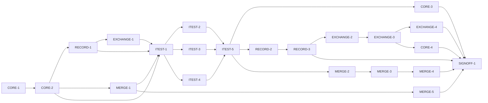

# Master Plan — bs-14 Crowd-refinement of the AI mappings (peer-to-peer evidence sharing)

**Spec:** [bs-14-peer-to-peer-evidence-sharing.feature](../bs-14-peer-to-peer-evidence-sharing.feature)
**Status:** In progress — behaviour stage; **CORE-4 done (AC-2 ✅); CORE module complete. AC-1/2/3/4/5/7/8/9/10/11/12 ✅; all 11 un-pended ACs graded A (11 A/0)**. Only AC-6 pending (EXCHANGE-2). G-4 still open — blocks EXCHANGE-2/4 (and SIGNOFF-1 via EXCHANGE-4).
**Architecture:** `docs/paint-color-app-solution-intent.md` SI "Quiet crowd-refinement of the AI mappings" (lines ~270–284), decisions D8/D9; `docs/paint-color-app-scope.md` §6.4 (community refinement), §6.6 (abuse & quality controls). Builds on bs-13 provenance+dataset model.
**Code home:** `/Users/matthew.quirk/Nuance` · git (feature worktrees `Nuance-bsNN`) · base `main` @ `c00422f` (rebased onto the bs-13 merge at CORE-1; plan-time base was `167c5db`) · extends existing Flutter app (confirmed by Matt Quirk via memory + cwd, 2026-10-14)

> **FUTURE / post-v1 feature.** The spec is a draft awaiting owner approval (G-1) and is roadmap Phase 3 (SI D8): a serverless peer-to-peer evidence layer, invisible to the painter, limited to anonymous mix-accuracy records that refine the *Estimated* AI mappings only. This plan is written against bs-13's **planned** provenance/dataset surface; it cannot run until bs-13 is signed off and merged to main (G-3), and it introduces the first sanctioned off-device path, which must be reconciled with bs-12's network-block guards (G-4). A plan-upgrade pass is expected once bs-13's real surface lands. **G-3 resolved 2026-10-15** (bs-13 merged to main @ `c00422f`); CORE-1 confirmed the real surface present — `ProvenanceDerivation`/`appendEvidence`/`promoteWithOwnSwatch`/`tierFor` in `lib/domain/provenance_derivation.dart`, `EvidenceKind` in `lib/domain/sample.dart` (**not** `lib/domain/provenance.dart` as D-2 / the parallel note still say — a surface drift for MERGE-1 / the upgrade pass to reconcile), `CandidateMapping` + declared-palette in `lib/dataset/seed_dataset.dart`.

## Gap analysis (against `167c5db`)

| AC | Exists today | Missing |
|---|---|---|
| AC-1 opt-in, never shown mechanism | Nothing. No sharing subsystem, no consent state. | `SharingConsent`/`ConsentStore`; one-time plain-language opt-in; guarantee no peers/devices/syncing/network surface. |
| AC-2 no per-exchange action | Nothing. | Silent background exchange; no prompt; only "recipes improve over time" surfaces. |
| AC-3 record carries only mapping evidence | No record type. Nearest kin: shape-only `EvidencePoint{coordinates,source}` (`lib/domain/sample.dart`). | `MixAccuracyRecord{paintCombination, declaredPalette, measuredColour, tier}` built from confirmed/measured evidence. |
| AC-4 nothing personal leaves | Nothing. bs-12 guards *forbid* any off-device path. | Redaction/construction that carries none of photo/project/sample/profile/identifier/location; a bs-14 boundary guard. |
| AC-5 no-palette record not shared | No declared-palette concept on a record. | Declared-palette (brand/line/medium) required at share selection; else excluded as not interpretable. |
| AC-6 exchange only missing, hash-keyed, dedup | No transport, no gossip. | `PeerTransport` + `GossipExchange`: offered = mine − theirs by content hash; drop dups/already-seen (seen-set). |
| AC-7 no peer ⇒ nothing waited on | No exchange; core flows don't reference one. | Fire-and-forget scheduler; no core flow awaits the exchange; silent no-op when no peer reachable. |
| AC-8 clustered crowd records refine Estimated | bs-13 *plans* a source-agnostic clustering rule; not in code. | `CrowdRefine`: recompute an Estimated mapping's value as a robust central estimate of clustered peer records, outliers discarded. |
| AC-9 crowd evidence never Confirms | bs-13 *plans* tier-by-origin derivation + promotion; not in code. | `EvidenceKind.peerContributed` excluded from Confirmed derivation; user-facing provenance stays "Estimated — not yet verified". |
| AC-10 append-only source-tagged merge | bs-13 *plans* append-only `EvidencePoint` add; shape-only today, nothing appends. | `EvidenceMerge`: each received record appended & tagged peer-contributed; none overwrites another. |
| AC-11 statistical outliers discarded | None. | Outlier rejection in the estimate (same path as AC-8, distinct fixture). |
| AC-12 rate-limit per source | None. | `SourceRateLimiter`: bound the volume accepted from any one source. |

## Build order

| Stage | Phases |
|---|---|
| 1 Scaffold | CORE-1 |
| 2 Component shells | CORE-2, RECORD-1, EXCHANGE-1, MERGE-1 |
| 3 Acceptance tests | ITEST-1, ITEST-2, ITEST-3, ITEST-4, ITEST-5 (test review, G-2) |
| 4 Behavior | CORE-3, RECORD-2, RECORD-3, MERGE-2, MERGE-3, MERGE-4, MERGE-5, EXCHANGE-2, EXCHANGE-3, EXCHANGE-4 (*enabler*), CORE-4 |
| 5 Sign-off | SIGNOFF-1 |

## Acceptance criteria coverage

| AC | Scenario | Integration test (ITEST) | Behavior phases | Status |
|---|---|---|---|---|
| AC-1 | The painter opts in once in plain terms and is never shown the mechanism | ITEST-2 `TestAC01_OptInOnceNeverShown` | CORE-3 | ✅ |
| AC-2 | No exchange ever asks the painter to do anything | ITEST-2 `TestAC02_NoPerExchangeAction` | CORE-4 | ✅ Done |
| AC-3 | A shared record carries only the mapping evidence | ITEST-2 `TestAC03_RecordCarriesOnlyEvidence` | RECORD-2 | ✅ |
| AC-4 | No photo, project, sample, profile or identifier leaves the device | ITEST-2 `TestAC04_NothingPersonalLeaves` | RECORD-2 | ✅ |
| AC-5 | A record without a declared palette is not shared | ITEST-2 `TestAC05_NoPaletteNotShared` | RECORD-3 | ✅ |
| AC-6 | Two reachable installs exchange only the records each is missing | ITEST-3 `TestAC06_ExchangeOnlyMissing` | EXCHANGE-2 | ⬜ Todo |
| AC-7 | With no peer reachable, nothing happens and nothing is waited on | ITEST-3 `TestAC07_NoPeerNoWait` | EXCHANGE-3 | ✅ |
| AC-8 | Clustered crowd records improve an Estimated mapping's value | ITEST-4 `TestAC08_ClusteredRefine` | MERGE-3 | ✅ |
| AC-9 | Crowd evidence never promotes a value to Confirmed on the painter's screen | ITEST-4 `TestAC09_NeverPromotes` | MERGE-4 | ✅ |
| AC-10 | Records from many devices merge without overwriting | ITEST-3 `TestAC10_AppendOnlyMerge` | MERGE-2 | ✅ |
| AC-11 | Statistical outliers are discarded from the local estimate | ITEST-4 `TestAC11_OutlierDiscarded` | MERGE-3 | ✅ |
| AC-12 | The volume one source can contribute is bounded | ITEST-4 `TestAC12_RateLimited` | MERGE-5 | ✅ |

## Design decisions

| # | Decision | Why |
|---|---|---|
| D-1 | bs-14 branches off main only after bs-13 is signed off & merged (G-3); it consumes bs-13's `EvidenceKind`/append/`ProvenanceDerivation` + SEED `CandidateMapping`/declared-palette surface, never redefining them. | The spec "attaches to" bs-13's append-only, source-tagged provenance and clustering model; those types are planned, not yet in code. |
| D-2 | Add `EvidenceKind.peerContributed` to bs-13's enum (MERGE-1). Peer evidence refines an Estimated value but never contributes to the Confirmed derivation. | AC-9/AC-10: crowd evidence merges as data and improves the starting point, but only the painter's own measured mix promotes to Confirmed (SI, D9). |
| D-3 | The acceptance suite fakes `PeerTransport` (in-process two-install loopback). The real mDNS/socket local-network transport (EXCHANGE-4) carries no AC and is verified by a manual on-device walkthrough at sign-off. | The ACs assert the gossip *logic* (offer-missing, dedup, no-wait), not platform discovery. Mirrors bs-12's pure-manual AC-5 approach. |
| D-4 | bs-14 is the single sanctioned off-device path. bs-12's network-block / no-off-device-path guards are amended (G-4) to permit only the consented, record-only P2P exchange; a bs-14 boundary guard asserts nothing but a `MixAccuracyRecord` crosses. | bs-12 actively forbids any off-device traffic; the exception must be explicit, minimal and guarded, not a blanket relaxation. |
| D-5 | The exchange is fire-and-forget: no core flow awaits it; no-peer and transport failure are silent. | AC-7: core function never waits on an exchange; AC-2: the painter is never prompted. |
| D-6 | Crowd refinement reuses bs-13's source-agnostic clustering rule (robust central estimate, outlier discard) rather than a new estimator. AC-8 and AC-11 exercise the same code path with different fixtures. | SI: "aggregated locally by the same evidence-clustering rule used for the private loop." |
| D-7 | Content hash (over the record's canonical content) keys the gossip: offer-missing + dedup + seen-set. Byte-identical records collapse at exchange; two *distinct* measurements from two devices both append as source-tagged evidence at merge. | Reconciles AC-6 (dedup already-seen) with AC-10 (append without overwriting) — dedup is at transport, append is per distinct measurement. |
| D-8 | A declared palette (brand/line/medium) is mandatory for a shareable record; records lacking it are excluded at selection. | AC-5 / scope §6.6: a recipe without a declared palette is not interpretable. |

## Acceptance integration test plan

Module plan: [modules/ITEST.md](modules/ITEST.md).

**Where it lives and how it runs:** `integration_test/bs14/`; built on the real app via `buildApp(AppDependencies(...))` with a faked `PeerTransport` (in-process loopback) as the only infrastructure fake. Pure-Dart logic (no camera) → default target `flutter test integration_test/bs14/<file> -d flutter-tester` (a `-d` is mandatory — see Known flakes). No device lane. Pending gate via `--dart-define=BS14_RUN_PENDING=true` (default run skips pending ACs); un-pend = delete the AC's pending entry.
**Where assertions look:** read endpoints added in the shell phases — `SharingConsentReadEndpoint` (consent + user-facing sharing-surface inventory), `RecordInspectEndpoint` (prepared record contents + selected share-set), `ExchangeOutcomeEndpoint` (offered/received sets, dedup drops, whether any wait occurred), `MappingEvidenceEndpoint` (a mapping's derived value, source-tagged evidence list, derived tier/label).
**What is real and what is faked:** real `ColorScience`, the single shipped `deltaE00`, bs-13's provenance/derivation/clustering, and all bs-14 product code via production wiring; **only** `PeerTransport` is faked (two in-memory installs over a loopback). No real network.

**Fixtures:**

| Fixture | Shape |
|---|---|
| `twoInstalls` | Two `buildApp` instances A, B sharing one fake loopback `PeerTransport`; each seeded with its own record set. AC-6, AC-7, AC-2. |
| `seedMapping` | A bs-13 SEED `CandidateMapping` with an `llmSeed`-only Estimated value and a declared palette (brand/line/medium). AC-8..AC-11. |
| `confirmedEvidence` | A painter's own `photographedSwatch`/instrument `EvidencePoint` + declared palette, to build a record from. AC-3, AC-4. |
| `peerRecords(n, spread, outlier?)` | n `MixAccuracyRecord`s for one mapping with controlled CIELAB spread, optionally one statistical outlier. AC-8, AC-11, AC-12. |
| `noPaletteRecord` | A candidate record whose declared palette is absent. AC-5. |

**Test catalogue:**

| AC | Given: built via public flows → checked by | When | Then: exact assertions (negative Thens: after <settle point>) | Rejects |
|---|---|---|---|---|
| AC-1 | Painter offered the plain-language opt-in → `SharingConsentReadEndpoint.offerCopy` == "help improve recipe accuracy by sharing anonymous mix results" and `consented==false` | Painter opts in via the public opt-in action | `consented==true`; `userFacingSharingSurfaces` contains no item mentioning peers/devices/syncing/network (empty of network concepts) | An impl that, after opt-in, exposes a "peers nearby"/"last synced"/network status surface |
| AC-2 | `twoInstalls`, painter opted in → `consented==true`; a prompt/notification sink is empty | Records are exchanged in the background (fake transport runs) | Prompt sink still empty after the exchange settles; the only surfaced change is a recipe-improved signal (no network/sync wording) | An impl that emits a per-exchange prompt/toast/notification |
| AC-3 | `confirmedEvidence` present → `RecordInspectEndpoint.prepared` is non-null | A record is prepared to share | `prepared` carries exactly {paintCombination (canonical paint ids), declaredPalette (brand/line/medium), measuredColour (CIELAB/CIELCh), tier} and no other field | An impl that omits the tier or the declared palette, or adds extra fields |
| AC-4 | `confirmedEvidence` present (with a project/sample/profile in app state) → prepared record exists | The record's contents are inspected | prepared contains no photograph, project, saved sample, CVD profile, identifier or location (field-set disjoint from those) | An impl that serializes a sample id, device id, project ref or location |
| AC-5 | `noPaletteRecord` is a candidate → it appears among candidates | Records to share are selected | the selected share-set excludes `noPaletteRecord`; reason recorded "not interpretable — no declared palette" | An impl that shares a record with an empty/absent declared palette |
| AC-6 | `twoInstalls`: A has {r1,r2}, B has {r2,r3} (by content hash); B already saw r1 earlier → `ExchangeOutcomeEndpoint` sees each side's hash index | A and B exchange | A offers only {r1} to B (r2 common, dropped); B offers only {r3} to A; r1 not re-offered to B (already-seen); duplicates dropped | An impl that offers the full set, re-offers already-seen records, or keys by object identity not content hash |
| AC-7 | `twoInstalls` with no reachable peer (transport.discover returns none) → a core flow (e.g. compute a recipe) is invoked | The app runs and the core flow completes | no exchange occurred (`ExchangeOutcomeEndpoint.exchanges==0`); the core flow returned without ever awaiting the exchange (`waitedOnExchange==false`) | An impl where a core flow blocks/awaits discovery, or throws when no peer is present |
| AC-8 | `seedMapping` (Estimated, llmSeed-only) + `peerRecords(7, tight, +1 outlier)` merged → `MappingEvidenceEndpoint` shows 8 evidence points | the local value is recomputed | the derived value equals the robust central estimate of the clustered records with the outlier discarded (within tolerance of the cluster centroid, not the plain mean) | An impl that plain-averages all points (outlier shifts the result) or ignores the crowd entirely |
| AC-9 | after AC-8's refine → `MappingEvidenceEndpoint.derivedTier` observed | the user-facing provenance is shown | label is "Estimated — not yet verified"; tier is `estimated` — even if a peer record claims an instrument tier (**augmented by MERGE-4**) | An impl that promotes to Confirmed because peer evidence is high-tier, or shows "Confirmed/verified" |
| AC-10 | `peerRecords(3)` arriving from 3 distinct device sources for one mapping → merge invoked | they are merged into the local copy | all 3 appended (evidence length grew by 3); each tagged `peerContributed` with its source; prior points unchanged (none overwritten, order preserved) | An impl that overwrites/replaces on merge, dedups distinct measurements, or drops the source tag |
| AC-11 | `seedMapping` + `peerRecords(6, tight, +1 far outlier)` merged | the local estimate is computed | the outlier is excluded from the estimate (result within tolerance of the 6-cluster centroid), not averaged in | An impl that averages all 7 (result pulled toward the outlier) |
| AC-12 | a stream of `peerRecords(100)` all from a single source → ingest invoked | the records are ingested | the count accepted from that source is capped at the per-source limit (< 100); excess rejected; records from other sources unaffected | An impl with no cap (all 100 accepted) or a global cap that starves other sources |

**Red baseline** and **test augmentations:** tracked in [modules/ITEST.md](modules/ITEST.md).
Pre-seeded augmentations: MERGE-4 strengthens `TestAC09` to assert even an instrument-tier *peer* record never promotes to Confirmed.

## Modules

| Module | Plan | Purpose | Depends on | Status |
|---|---|---|---|---|
| CORE | [modules/CORE.md](modules/CORE.md) | Scaffold; `lib/sharing/` package + app wiring; consent state + the invisibility guarantee | bs-13 (G-3) | ✅ Done |
| RECORD | [modules/RECORD.md](modules/RECORD.md) | The anonymous mix-accuracy record: type, builder, privacy redaction, declared-palette gate, content hash | CORE | ✅ Done |
| EXCHANGE | [modules/EXCHANGE.md](modules/EXCHANGE.md) | Serverless gossip: transport interface, offer-missing/dedup, no-wait; real platform transport (enabler) | CORE, RECORD | 🔄 In progress |
| MERGE | [modules/MERGE.md](modules/MERGE.md) | Append-only source-tagged merge, crowd refine, never-promote, rate-limit | CORE, RECORD, bs-13 PROV | ✅ Done |
| ITEST | [modules/ITEST.md](modules/ITEST.md) | Acceptance integration suite: one pending test per AC, and its review | all shell phases | 🔄 In progress |

## Dependency graph

**Parallel windows:**
- Shells: CORE-2 first; then RECORD-1; then EXCHANGE-1 ∥ MERGE-1.
- AC-tests: ITEST-2 ∥ ITEST-3 ∥ ITEST-4 after ITEST-1.
- Behavior: RECORD-2→3 ∥ the MERGE chain (MERGE-2→3→4) ∥ MERGE-5 (disjoint files). CORE-3 standalone early. EXCHANGE-2 needs RECORD done; CORE-4 needs EXCHANGE-3.
- **Merge-risky pairs:** MERGE-1 edits bs-13-owned `lib/domain/provenance.dart` (adds `EvidenceKind.peerContributed`) — cross-feature; keep the edit additive and reconcile at bs-13 merge. CORE-4 and the EXCHANGE phases both touch app wiring / the exchange scheduler — serialize or name the conflict.

## Open gates

| Gate | Kind | Decision needed | Blocks | Status |
|---|---|---|---|---|
| G-1 | decision | Approve the spec (record approval as its first line, replacing the draft banner) | CORE-1 | ✅ Resolved 2026-10-14: spec approved; draft banner replaced with approval line (feat/bs-14 spec) — Matt Quirk |
| G-2 | decision | Approve the acceptance tests (ITEST-5's packet) | every behavior phase | ✅ Resolved 2026-10-16 07:37: **Approved** — Matt Quirk. Acceptance suite accepted as-is (11 A + AC-9 B-pending-MERGE-4 augmentation carried to MERGE-4); behaviour stage unblocked |
| G-3 | dependency | bs-13 signed off & merged to main — its PROV (`EvidenceKind`, append-only add, `ProvenanceDerivation`) and SEED (`CandidateMapping`, declared-palette) surface present on main — closed by the bs-13 sign-off merge | CORE-1 (scaffold branches off a main that contains bs-13) | ✅ Resolved 2026-10-15: bs-13 signed off (`bcde3be`) & merged to main (`c00422f`); surface verified present at CORE-1 (`provenance_derivation.dart`, `sample.dart` `EvidenceKind`, `seed_dataset.dart` `CandidateMapping`) — Matt Quirk (bs-13 sign-off) |
| G-4 | decision | Approve the single sanctioned off-device path and how bs-12's network-block / no-off-device-path guards are reconciled to permit only the consented, record-only P2P exchange — routed to the owner | EXCHANGE-2, EXCHANGE-4 | Open |

Resolved: `✅ Resolved <date time>: <decision, one line> — <who>`.

## Known flakes

| Test | Symptom | Rate (runs) | Measured at | Owner | Status |
|---|---|---|---|---|---|
| coverage_gate | `flutter test --coverage` intermittently records a const-folded constructor line in `lib/**` as uncovered → gate may FAIL on an untouched file; re-run once, green ⇒ ignore | intermittent | bs-01 `88c5add` | re-run workaround | Open (carried) |
| integration suite (no `-d`) | `flutter test integration_test/…` with no device runs **0** tests, exits 0 (false green) | deterministic | bs-05/bs-06 | always pass `-d flutter-tester` | Open (carried) |
| host pair combined | `flutter test integration_test/bs12/nfr_test.dart integration_test/bs13/dataset_test.dart -d flutter-tester` fails to **load** bs13 after bs12 completes (two heavy source-scanning + pdf-loading suites in one isolate); each passes alone (33 / 19) | deterministic when combined | CORE-3 `522d9aa` | run the two host files **one per `flutter test`** | Open (carried) |

## Session log

| # | Phase | Target | Status | Tokens | Time | Notes |
|---|---|---|---|---|---|---|
| 1 | CORE-1 | scaffold: branch (off bs-13-merged main), baseline, coverage gate, bs14 integration runner | ✅ Done | 6,209,519 | 23m 46s | G-1 ✅, G-3 ✅ resolved; rebased onto `c00422f`; baseline unit 1413/0, integ 293/293 (241 sim + 52 flutter-tester) |
| 2 | CORE-2 | shell: `lib/sharing/` package + `SharingConsent`/`ConsentStore` + `SharingScope` wiring + `SharingConsentReadEndpoint` | ✅ Done | 10,823,845 | 30m 53s | unit 1432/0, cov 100%/5 touched, regression green (host 52 + sim 222 harness + conformance 1432); additive store-gated wiring, behaviour-neutral |
| 3 | RECORD-1 | shell: `MixAccuracyRecord` + content hash + `RecordBuilder` + `RecordInspectEndpoint` | ✅ Done | 5,181,744 | 12m 49s | unit 1464/0, cov 100%/9 touched; 4 record files, no behaviour; FNV-1a content hash (D-7) |
| 4 | EXCHANGE-1 | shell: `PeerTransport` + `GossipExchange` skeleton + seen-set + fire-and-forget scheduler + `ExchangeOutcomeEndpoint` | ✅ Done | 4,252,500 | 11m 52s | unit 1488/0, cov 100%/14 touched; 5 files, no behaviour, nothing wired into assembly |
| 5 | MERGE-1 | shell: `EvidenceMerge` + `CrowdRefine` + `SourceRateLimiter` + `EvidenceKind.peerContributed` + `MappingEvidenceEndpoint` | ✅ Done | 5,237,948 | 11m 08s | last shell done; unit 1511/0, cov 100%/19 touched; shell stage complete |
| 6 | ITEST-1 | acceptance-tests: harness (two-install fake transport), fixtures, pending gate, smoke test | ✅ Done | 7,810,941 | 20m 38s | scaffold suite 12/12 (default+run-pending); no lib touched |
| 7 | ITEST-2 | acceptance-tests: AC-1, AC-2, AC-3, AC-4, AC-5 (pending) + red baseline | ✅ Done | 6,582,231 | 21m 58s | 5 pending, red baseline clean, 5 A |
| 8 | ITEST-3 | acceptance-tests: AC-6, AC-7, AC-10 (pending) + red baseline | ✅ Done | 4,609,896 | 12m 39s | 3 A, red baseline 3/3 clean, no lib touched |
| 9 | ITEST-4 | acceptance-tests: AC-8, AC-9, AC-11, AC-12 (pending) + red baseline | ✅ Done | 6,488,618 | 19m 29s | 3 A + AC-9 B-pending-MERGE-4; baseline 3 red (AC-8/11→MERGE-3, AC-12→MERGE-5) + AC-9 green (limited); no lib touched, unit 1511/0 |
| 10 | ITEST-5 | test-review: packet; G-2 | ✅ Done | 2,005,695 | 6m 07s | packet assembled (modules/ITEST.md § Test-review packet); **G-2 Approved 2026-10-16 by Matt Quirk** (11 A + AC-9 B-pending-MERGE-4 carried to MERGE-4); behaviour stage unblocked |
| 11 | CORE-3 | AC-1 one-time plain-language opt-in + invisibility | ✅ Done | 18,326,126 | 47m 46s | AC-1 ✅ un-pended + graded A; `SharingOptInOffer` + live-consent `_SharingRoot`; unit 1519/0, cov 100%/20 touched; regression host 52 + sim 241/241 |
| 12 | RECORD-2 | AC-3 + AC-4 build record, carry only evidence, nothing personal | ✅ Done | 12,296,700 | 24m 58s | AC-3+AC-4 ✅ un-pended, graded A (AC-3 B→A in-phase, value assertion); `Sample.paintIds` recipe source; unit 1527/0, cov 100%/20 touched |
| 13 | RECORD-3 | AC-5 no declared palette ⇒ not shared | ✅ Done | 5,784,122 | 10m 21s | AC-5 ✅ un-pended, graded A (4 A/0); `selectShareSet` drops absent-palette candidates; unit 1530/0, cov 100%/1 touched; RECORD module complete; fix passes 0/3 |
| 14 | MERGE-2 | AC-10 append-only source-tagged merge | ✅ Done | 6,290,218 | 11m 35s | AC-10 ✅ un-pended, graded A (5 A/0); `EvidenceMerge.ingest` appends source-tagged peerContributed points via bs-13 append-only add; unit 1532/0, cov 100%/1 touched; fix passes 0/3 |
| 15 | MERGE-3 | AC-8 + AC-11 crowd refine, robust central estimate, outlier discard | ✅ Done | 6,284,723 | 15m 51s | AC-8+AC-11 ✅ un-pended, graded A (7 A/0); robust central estimate (coord-wise median → modified z-score MAD, outliers discarded) in `crowd_refine.dart`; unit 1537/0, cov 100%/1 touched; fix passes 0/3 |
| 16 | MERGE-4 | AC-9 never promote to Confirmed | ✅ Done | 7,077,181 | 14m 53s | AC-9 ✅ un-pended, graded **A** (B→A; 8 A/0); never-promote already enforced by MERGE-1/2 (`ingest` stamps `peerContributed`, `tierFor` excludes it) — MERGE-4 added derivation glue `RefineResult.label = qualifier(tier)` + both `TestAC09` augmentations (5-peer Given realized; high-tier peer still Estimated); unit 1537/0, cov 100%/1 touched; fix passes 0/3 |
| 17 | MERGE-5 | AC-12 per-source rate limit | ✅ Done | 7,627,140 | 15m 13s | AC-12 ✅ un-pended, graded A (9 A/0); rate limit in `EvidenceMerge.ingest` via stateful `SourceRateLimiter` (per-source cap 50, seeded from existing log); MERGE module complete; unit 1544/0, cov 100%/2 touched; fix passes 0/3 |
| 18 | EXCHANGE-2 | AC-6 offer-missing, hash-keyed, dedup | ⬜ Todo | | | needs G-4 |
| 19 | EXCHANGE-3 | AC-7 no peer ⇒ no exchange, no wait | ✅ Done | 5,300,757 | 14m 22s | AC-7 ✅ un-pended, graded A (10 A/0); `gossip_exchange.dart` no-peer short-circuit + per-reachable-peer conduct count; unit 1545/0, cov 100%/20 touched; fix passes 1/3 (harness guard) |
| 20 | EXCHANGE-4 | *enabler* real mDNS/socket transport (no AC; manual on-device at sign-off) | ⬜ Todo | | | needs G-4 |
| 21 | CORE-4 | AC-2 no per-exchange action (silent background exchange) | ✅ Done | 14,820,009 | 37m 40s | AC-2 ✅ un-pended, graded A (11 A/0); CORE module complete; silent fire-and-forget exchange over inert `InactivePeerTransport` + `recipesImproveSignal` surface; unit 1553/0, cov 100%/21 touched; regression host 52 + sim 222 + conformance 1553; fix passes 1/3 (const-ctor coverage) |
| 22 | SIGNOFF-1 | sign-off: packet + summary page + manual approval | ⬜ Todo | | | |

*Tokens* / *Time* = the phase totals from the *Token usage* ledger (Time = active, wall in brackets), filled when the row is marked done.

## Next phase

**CORE-4 ✅ done** (AC-2 un-pended, graded **A**; **11 A/0** over un-pended AC-1,2,3,4,5,7,8,9,10,11,12). **CORE module complete.** `_SharingRoot` fires one silent, fire-and-forget `ExchangeScheduler` round on adopting a consented state — over the inert `InactivePeerTransport` (no peer ⇒ no-op until EXCHANGE-4 wires the real transport under G-4), no prompt/speech/haptic — and surfaces only `SharingConsent.recipesImproveSignal`. `exchangeScheduler` added to `SharingDependencies`; `ExchangeOutcomeEndpoint` mounted (snapshot). Only **AC-6** (EXCHANGE-2) remains pending.

**Nothing is startable without G-4.** The three remaining phases all wait on it:

- **EXCHANGE-2 (AC-6)** — `mine − theirs` offer/receive + dedup. Needs **G-4** (+ RECORD done ✅).
- **EXCHANGE-4 (enabler, no AC)** — real mDNS/socket transport; swaps `InactivePeerTransport`. Needs **G-4** (+ EXCHANGE-2).
- **SIGNOFF-1** — last; needs CORE-4 ✅ and EXCHANGE-4 (so transitively G-4).

**Decision gate G-4 blocks the rest of the feature.** Resolve it with `/feature-next-phase --gate bs14 G-4 approved | "<decision>"` — approve the single sanctioned off-device path and the bs-12 network-block/no-off-device-path reconciliation — then EXCHANGE-2 is startable.

## Token usage

<!-- One row per session, appended as that session's last edit (SKILL.md § Token usage). -->

| Phase / activity | Session | Start | End | Wall | Active | Model(s) | Input | Cache write | Cache read | Output | Total | Outcome |
|---|---|---|---|---|---|---|---|---|---|---|---|---|
| PLAN | | | | | | | | | | | | plan written |
| PLAN | 5e34b79c | 2026-10-14 17:46 EDT | 18:07 | 21m 02s | 13m 45s | claude-opus-4-8 | 58 | 171,188 | 1,871,095 | 50,988 | 2,093,329 | plan written |
| GATE-DECISION | 5e34b79c | 2026-10-14 18:12 EDT | 18:13 | 0m 58s | 0m 58s | claude-opus-4-8 | 18 | 6,316 | 1,231,854 | 3,848 | 1,242,036 | G-1 approved |
| CORE-1 | b46e8d1e | 2026-10-15 14:21 EDT | 14:45 | 23m 46s | 23m 46s | claude-opus-4-8 | 116 | 120,199 | 6,041,574 | 47,630 | 6,209,519 | scaffold done: rebased onto c00422f (G-3 closed), baseline unit 1413/0 + integration 293/293 (241 sim + 52 flutter-tester), coverage gate self-check pass, bs14 pending-gate skeleton seeded (12 ACs) |
| CORE-2 | cb033af6 | 2026-10-15 15:07 EDT | 15:38 | 30m 53s | 30m 53s | claude-opus-4-8 | 142 | 186,599 | 10,578,399 | 58,705 | 10,823,845 | shell done: lib/sharing package (SharingConsent/ConsentStore/SharingScope/SharingConsentReadEndpoint) + additive store-gated build_app wiring; unit 1432/0, cov 100%/5 touched, regression green (host 52 + sim 222 harness + conformance 1432) |
| RECORD-1 | b9a0623b | 2026-10-15 21:12 EDT | 21:25 | 12m 49s | 12m 49s | claude-opus-4-8 | 104 | 107,895 | 5,030,224 | 43,521 | 5,181,744 | shell: MixAccuracyRecord + content hash + RecordBuilder + RecordInspectEndpoint; analyze clean, unit 1464/0, cov 100% on 9 touched files |
| EXCHANGE-1 | 54c45686 | 2026-10-15 21:30 EDT | 21:42 | 11m 52s | 11m 52s | claude-opus-4-8 | 84 | 102,667 | 4,102,419 | 47,330 | 4,252,500 | shell done: 5 files, unit 1488/0, cov 100%/14 touched, suite green |
| MERGE-1 | 2772e279 | 2026-10-15 21:51 EDT | 22:02 | 11m 08s | 11m 08s | claude-opus-4-8 | 104 | 104,983 | 5,093,636 | 39,225 | 5,237,948 | shell done: EvidenceMerge+CrowdRefine+SourceRateLimiter+MappingEvidenceEndpoint+EvidenceKind.peerContributed; unit 1511/0, cov 100%/19 touched; no behaviour |
| ITEST-1 | 5ef25313 | 2026-10-15 22:06 EDT | 22:27 | 20m 38s | 20m 38s | claude-opus-4-8 | 102 | 253,811 | 7,483,311 | 73,717 | 7,810,941 | acceptance-tests harness: fake loopback transport + fixtures + pending gate + scaffold suite 12/12 green (default+run-pending), analyze clean, unit 1511/0, no lib touched |
| ITEST-2 | fefe49ea | 2026-10-16 05:46 EDT | 06:08 | 21m 58s | 21m 58s | claude-opus-4-8 | 88 | 245,812 | 6,262,961 | 73,370 | 6,582,231 | acceptance-tests: AC-1..5 pending + red baseline 5/5 clean, default green, 5 A (AC-2/AC-4 B→A in-phase), no lib touched, unit 1511/0 |
| ITEST-3 | 24ee30f0 | 2026-10-16 06:15 EDT | 06:27 | 12m 39s | 12m 39s | claude-opus-4-8 | 74 | 231,861 | 4,335,265 | 42,696 | 4,609,896 | acceptance-tests: AC-6/7/10 pending + red baseline 3/3 clean, default green (3 skipped), 3 A/0, fix passes 0/3, no lib touched, unit 1511/0 |
| ITEST-4 | c90e6526 | 2026-10-16 06:31 EDT | 06:50 | 19m 29s | 19m 29s | claude-opus-4-8 | 92 | 249,816 | 6,162,907 | 75,803 | 6,488,618 | acceptance-tests: AC-8/9/11/12 pending + baseline (3 red + AC-9 green/limited); 3 A + AC-9 B-pending-MERGE-4; fix passes 0/3; no lib touched, unit 1511/0 |
| ITEST-5 | eeebdfa2 | 2026-10-16 07:18 EDT | 07:25 | 6m 07s | 6m 07s | claude-opus-4-8 | 48 | 76,326 | 1,913,214 | 16,107 | 2,005,695 | test-review packet assembled; G-2 routed to a human (awaiting decision) |
| SIGNOFF-DECISION | b12df42e | 2026-10-16 07:35 EDT | 07:39 | 4m 20s | 3m 35s | claude-opus-4-8 | 44 | 61,512 | 1,636,629 | 14,823 | 1,713,008 | ITEST-5 approved |
| CORE-3 | a8dbce2b | 2026-10-16 08:01 EDT | 08:49 | 47m 46s | 47m 46s | claude-opus-4-8 | 190 | 355,826 | 17,868,569 | 101,541 | 18,326,126 | AC-1 done, graded A; unit 1519/0 cov 100%/20; regression host 52 + sim 241/241 |
| RECORD-2 | 42bf888e | 2026-10-16 09:00 EDT | 09:25 | 24m 58s | 24m 58s | claude-opus-4-8 | 174 | 259,955 | 11,961,569 | 75,002 | 12,296,700 | AC-3+AC-4 un-pended, graded A (3 A/0; AC-3 B->A in-phase); fix passes 1/3 |
| RECORD-3 | 3a6034c7 | 2026-10-16 09:36 EDT | 09:46 | 10m 21s | 10m 21s | claude-opus-4-8 | 118 | 158,296 | 5,597,538 | 28,170 | 5,784,122 | AC-5 un-pended, graded A (4 A/0); selectShareSet drops absent-palette candidates; RECORD module complete; fix passes 0/3 |
| MERGE-2 | 9b12732a | 2026-10-16 10:09 EDT | 10:21 | 11m 35s | 11m 35s | claude-opus-4-8 | 126 | 191,760 | 6,067,585 | 30,747 | 6,290,218 | AC-10 un-pended, graded A (5 A/0); EvidenceMerge.ingest appends source-tagged peerContributed points via bs-13 append-only add; unit 1532/0, cov 100%/1 touched; fix passes 0/3 |
| MERGE-3 | 14e8923c | 2026-10-16 10:25 EDT | 10:41 | 15m 51s | 15m 51s | claude-opus-4-8 | 114 | 230,538 | 6,004,757 | 49,314 | 6,284,723 | AC-8+AC-11 un-pended, graded A (7 A/0); robust central estimate (coord-wise median + modified-z-score MAD outlier discard) in crowd_refine.dart; unit 1537/0, cov 100%/1 touched; fix passes 0/3 |
| MERGE-4 | ec3a37c7 | 2026-10-16 10:46 EDT | 11:01 | 14m 53s | 14m 53s | claude-opus-4-8 | 110 | 253,956 | 6,774,672 | 48,443 | 7,077,181 | AC-9 un-pended, graded A (B→A; 8 A/0); never-promote enforced by MERGE-1/2 (ingest stamps peerContributed, tierFor excludes it), MERGE-4 adds derivation glue RefineResult.label=qualifier(tier) + both TestAC09 augmentations; unit 1537/0, cov 100%/1 touched; fix passes 0/3 |
| MERGE-5 | 91efb0ed | 2026-10-16 11:09 EDT | 11:24 | 15m 13s | 15m 13s | claude-opus-4-8 | 124 | 266,710 | 7,314,260 | 46,046 | 7,627,140 | AC-12 un-pended, graded A (9 A/0); per-source rate limit in EvidenceMerge.ingest via stateful SourceRateLimiter (cap 50, seeded from existing log); MERGE module complete; unit 1544/0, cov 100%/2 touched; fix passes 0/3 |
| EXCHANGE-3 | 1bdd40a9 | 2026-10-16 11:39 EDT | 11:54 | 14m 22s | 14m 22s | claude-opus-4-8 | 104 | 214,181 | 5,051,255 | 35,217 | 5,300,757 | AC-7 un-pended + graded A (10 A/0); unit 1545/0, cov 100%/20 touched; fix passes 1/3 |
| CORE-4 | f41d75ca | 2026-10-16 12:12 EDT | 12:50 | 37m 40s | 37m 40s | claude-opus-4-8 | 202 | 316,351 | 14,420,835 | 82,621 | 14,820,009 | AC-2 un-pended, graded A (11 A/0); CORE module complete; silent fire-and-forget exchange + recipesImproveSignal; unit 1553/0, cov 100%/21; regression host 52 + sim 222 + conformance 1553; fix passes 1/3 |
| **Feature total** |  | **2026-10-14 17:46 EDT** | **2026-10-16 12:50** | **6h 30m** | **6h 22m** |  | **2,336** | **4,166,558** | **142,804,528** | **1,084,864** | **148,058,286** |  |

## Sign-off

| Round | Packet | At code | Grades | Decision |
|---|---|---|---|---|
| 1 | [signoff/round-1.md](signoff/round-1.md) | | | ⏸ Awaiting |
