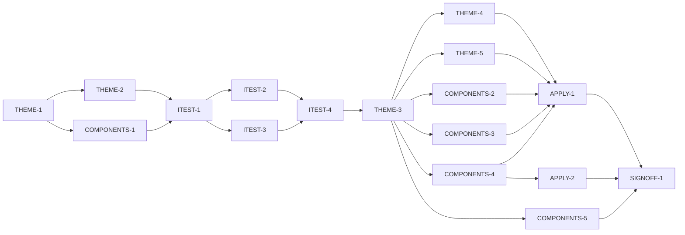

# Master Plan — Visual design system

**Spec:** [bs-17-visual-design-system.feature](../bs-17-visual-design-system.feature)
**Status:** In progress — THEME ✅ + COMPONENTS-2 done (AC-10 ✅, AC-7 pill half closed); next COMPONENTS-3/4/5 ∥
**Architecture:** the wireframe [docs/Color blindness artist tool.zip → "Paint Color Assistant.dc.html"]; its THEME token object and component treatments; [docs/paint-color-app-solution-intent.md] §Presentation (Flutter UI); existing theme chokepoint `lib/app/theme.dart` (bs-11 A11Y-1/2/3) and `test/app/theme_test.dart`.
**Code home:** `/Users/matthew.quirk/Nuance` (worktree `/Users/matthew.quirk/Nuance-bs17`) · https://github.com/meatsquirk/Nuance.git · base `main` · extends existing (confirmed by Matt Quirk, 2026-10-16)

## Gap analysis (against `c00422f`)

| AC | Exists today | Missing |
|---|---|---|
| AC-1 surfaces warm-paper | `AppTheme.light()` adopts the **stock M3** scheme (background/surface are M3 defaults, not warm paper) | the warm-paper palette (`#F3F1EC`/`#FFFFFF`/`#E9E6DF`) as the scheme's surfaces |
| AC-2 ink/muted/line neutrals | stock M3 onSurface/outline | the `#16150F`/`#57544C`/`#CFCAC0` neutrals |
| AC-3 cobalt accent | stock M3 primary (indigo-ish) | the `#2F55C8` accent + white onAccent as the primary CTA colour |
| AC-4 palette clears contrast floor | `test/app/theme_test.dart` proves the **stock** scheme clears AA | the same proof re-established over the **warm-paper** tokens (bs-11's guarantee preserved, not by equality) |
| AC-5 Next prose/headings | theme textTheme is stock M3 (Roboto/SF) | Atkinson Hyperlegible Next as the theme's default family; fonts bundled |
| AC-6 Mono labels/readouts | none | Atkinson Hyperlegible Mono family on label/readout styles; fonts bundled |
| AC-7 pill/card shape | stock M3 radii (buttons ~20, cards 12) | fully-rounded (stadium) pills + the 16–22 card radius via theme shape |
| AC-8 border weights | stock | the 1/2/3px border-weight scale on component themes |
| AC-9 mono micro-label style | none | uppercase + .06em + 700 mono text style (theme `labelSmall`/wrapper) |
| AC-10 pill variants | stock `FilledButton`/`OutlinedButton` used ad hoc | semantic `PillButton` primary(ink-fill)/secondary(outline) wrappers |
| AC-11 speak FAB | speak controls are ad-hoc buttons/icons | round accent `SpeakButton` component |
| AC-12 cards/panels | ad-hoc `Container`/`Card` | `SurfaceCard` + emphasis(ink border) + inverted(ink bg) variants |
| AC-13 provenance badge signature | `ProvenanceBadge`+`ProvenanceIcon` carry glyph+text (bs-10/bs-11) | the wireframe border-style signature (solid/fill/dashed) on the badge |
| AC-14 one theme, no hardcoded palette | theme installed once at `MaterialApp` (bs-11); screens mostly read `Theme.of` | **~7** residual hardcoded `Color(0x…)` in UI code to route through the theme (capture device literals excluded, D-4) |
| AC-15 swatch approximation caption | readout swatch has a "a hint, not the message" line (bs-01); not universal | a shared approximation caption on every rendered colour swatch |

## Build order

| Stage | Phases |
|---|---|
| 1 Scaffold | THEME-1 (bundle fonts, baseline, coverage gate) |
| 2 Component shells | THEME-2, COMPONENTS-1 |
| 3 Acceptance tests | ITEST-1, ITEST-2, ITEST-3, ITEST-4 (test review, G-2) |
| 4 Behavior | THEME-3, THEME-4, THEME-5, COMPONENTS-2, COMPONENTS-3, COMPONENTS-4, COMPONENTS-5, APPLY-1, APPLY-2 |
| 5 Sign-off | SIGNOFF-1 |

## Acceptance criteria coverage

| AC | Scenario | Integration test (ITEST) | Behavior phases | Status |
|---|---|---|---|---|
| AC-1 | Surfaces use the warm-paper palette | ITEST-2 `TestAC01_Surfaces` | THEME-3 | ✅ Done |
| AC-2 | Ink, muted text and hairlines use the warm-paper neutrals | ITEST-2 `TestAC02_Neutrals` | THEME-3 | ✅ Done |
| AC-3 | The primary action colour is the cobalt accent | ITEST-2 `TestAC03_Accent` | THEME-3 | ✅ Done |
| AC-4 | The warm-paper palette still meets the accessibility contrast floor | ITEST-2 `TestAC04_ContrastFloor` | THEME-3 | ✅ Done |
| AC-5 | Prose and headings render in Atkinson Hyperlegible Next | ITEST-2 `TestAC05_NextFont` | THEME-4 | ✅ Done |
| AC-6 | Micro-labels and numeric readouts render in Atkinson Hyperlegible Mono | ITEST-2 `TestAC06_MonoFont` | THEME-4 | ✅ Done |
| AC-7 | Buttons render as fully-rounded pills and cards as rounded panels | ITEST-3 `TestAC07_Shape` | THEME-5 | 🔄 Theme done (A-core); pill rendered-instance ✅ (COMPONENTS-2); card augmentation owed by COMPONENTS-4 |
| AC-8 | Borders follow the weight scale | ITEST-3 `TestAC08_BorderWeights` | THEME-5 | ✅ Done |
| AC-9 | Monospace micro-labels render uppercase with wide letter-spacing | ITEST-3 `TestAC09_MonoLabel` | THEME-5 | ✅ Done |
| AC-10 | Primary actions render as ink-filled pills and secondary as outline pills | ITEST-3 `TestAC10_Pills` | COMPONENTS-2 | ✅ Done |
| AC-11 | The speak action renders as a round accent floating button | ITEST-3 `TestAC11_SpeakFab` | COMPONENTS-3 | ⬜ Todo |
| AC-12 | Panels render as bordered surface cards with emphasis and inverted variants | ITEST-3 `TestAC12_Cards` | COMPONENTS-4 | ⬜ Todo |
| AC-13 | Provenance badges render with the glyph-and-border signature | ITEST-3 `TestAC13_ProvenanceSignature` | COMPONENTS-5 | ⬜ Todo |
| AC-14 | Every screen inherits the one installed theme | ITEST-3 `TestAC14_OneThemeNoHardcode` | APPLY-1 | ⬜ Todo |
| AC-15 | A displayed colour swatch carries its approximation caption | ITEST-3 `TestAC15_SwatchCaption` | APPLY-2 | ⬜ Todo |

## Design decisions

| # | Decision | Why |
|---|---|---|
| D-1 | Bundle Atkinson Hyperlegible Next + Mono as app assets (`assets/fonts/`, declared in `pubspec.yaml`); do **not** use `google_fonts` | the SI mandates fully-offline operation; a network font fetch would break that and the first-run render |
| D-2 | Rewrite `AppTheme` to the warm-paper `ColorScheme`; change `test/app/theme_test.dart` from "`light()` **equals** stock M3" to "`light()` **is** the warm-paper scheme **and** clears the AA floor" | the equals-stock assertion is the exact thing bs-17 changes; bs-11's real guarantee (AA floor) is preserved by re-proving it on the new tokens |
| D-3 | Only the light warm-paper theme is in-bound; keep `AppTheme.dark()` as API but `buildApp` wires light only (status quo). Dark theme (wireframe `THEMES.dark`, oklch accent) deferred | bs-08 leaves light/dark unspecified; scope stays minimal. Confirm defer-vs-include at G-1 |
| D-4 | Capture's fixed "device" colours (viewfinder stripes `#2B2A26`/`#24231F`, reticle `#69673B`, shutter, feed placeholder) are intentional non-palette literals, **excluded** from the AC-14 no-hardcoded-colour sweep | they emulate a camera surface, not app chrome; theming them would be wrong |
| D-5 | Store the accent as sRGB `#2F55C8` (the wireframe's own fallback literal), the practical equivalent of its `oklch(0.48 0.16 262)` | Flutter `ColorScheme` is sRGB; oklch precision belongs with the deferred dark theme (D-3) |
| D-6 | AC-13 **augments** the existing `ProvenanceBadge`/`ProvenanceIcon` (glyph+text, bs-10/bs-11) with the wireframe's border-style signature; it does not re-create them | reuse the owned non-colour-cue widget; add only the missing visual treatment |
| D-7 | AC-7/8/9 are made true at the **ThemeData** level (button/card themes + `labelSmall`), so component wrappers inherit them | one chokepoint; avoids per-widget restyling and keeps the "single theme" guarantee (AC-14) |

## Acceptance integration test plan

Module plan: [modules/ITEST.md](modules/ITEST.md).

**Where it lives and how it runs:** `integration_test/design_system_harness.dart` + `integration_test/design_system_test.dart` (mirrors the per-feature harness pattern already in `integration_test/`). Default target runs `flutter test -d flutter-tester integration_test/design_system_test.dart`; the pending gate is the project's established per-feature pending mechanism (one pending test per AC; **un-pend = delete the AC's pending guard row**), with a `--dart-define=BS17_RUN_PENDING=true` red-baseline target. Lane: the standard widget/integration lane (no exclusive device needed; pumps `buildApp` under `flutter-tester`).
**Where assertions look:** the pumped `buildApp` widget tree and its `Theme.of(context)` (`ColorScheme`, `TextTheme`, component themes, shapes); the component widgets' rendered geometry/decoration; and a **source-scan read endpoint** over `lib/` (precedent: bs-11 `integration_test/conformance/checks/`, bs-12 source-scan ACs) for AC-14's no-hardcoded-palette rule.
**What is real and what is faked:** the real `buildApp`, real `AppTheme`, real component widgets and real screens via production assembly; only platform capture/IO fakes already used by sibling harnesses are faked (the design system is pure Flutter rendering).

**Fixtures:**

| Fixture | Shape |
|---|---|
| `pumpApp` | pumps the production `buildApp` with the existing fake capture/IO deps; returns a tester positioned on each primary screen (reuses sibling harness wiring) |
| `WarmPaper` token table | the expected hex/token values (`#F3F1EC`/`#FFFFFF`/`#E9E6DF`/`#16150F`/`#57544C`/`#CFCAC0`/`#2F55C8`) the token tests assert against |
| `screenRoster` | the list of primary screens (capture, readout, compare, recipes, palette) walked by AC-14/AC-15 |

**Test catalogue:**

| AC | Given: built via public flows → checked by | When | Then: exact assertions (negative Thens: after <settle point>) | Rejects |
|---|---|---|---|---|
| AC-1 | `pumpApp` on each screen → `Theme.of` resolves | screen rendered | `colorScheme.surface`/`surfaceContainerLowest`/`surfaceContainer` equal the warm-paper tokens (not M3 defaults) | an impl that leaves the stock M3 surfaces |
| AC-2 | `pumpApp` → `Theme.of` | rendered | `colorScheme.onSurface == #16150F`, a muted role `== #57544C`, `outline/outlineVariant == #CFCAC0` | stock onSurface/outline |
| AC-3 | `pumpApp` → `Theme.of` | rendered | `colorScheme.primary == #2F55C8` and `onPrimary == #FFFFFF` | stock M3 primary |
| AC-4 | `AppTheme.light()` tokens → contrast fn (bs-11's ratio math) | measured | every meaningful text-on-surface pairing ≥ AA floor (4.5 normal / 3.0 large) | a palette edit that drops any pairing below AA |
| AC-5 | `pumpApp` → find a heading/body `Text` → resolved `TextStyle` | rendered | `fontFamily` is "Atkinson Hyperlegible Next" | stock Roboto/SF default |
| AC-6 | `pumpApp` → find a `MonoLabel`/readout `Text` | rendered | `fontFamily` is "Atkinson Hyperlegible Mono" | a label left in the sans family |
| AC-7 | `pumpApp` → a `PillButton` and a `SurfaceCard` | rendered | button shape is a `StadiumBorder` (fully rounded); card radius within 16–22 | stock button (`RoundedRectangle` r~20) / stock card r12 |
| AC-8 | `pumpApp` → bordered card, divider, warning | rendered | border side widths resolve to 1 (hairline), 2 (standard), 3 (emphasis) | a flat/0-width or uniform-width impl |
| AC-9 | `pumpApp` → a `MonoLabel` | rendered | text is upper-cased, `fontWeight==700`, `letterSpacing≈0.06em·size` | a mixed-case or un-tracked label |
| AC-10 | `pumpApp` → `PillButton.primary` and `.secondary` | rendered | primary = ink background + paper label, no border; secondary = transparent + border, ink label | both variants identical / colour-swapped only |
| AC-11 | `pumpApp` on a speak-bearing screen → `SpeakButton` | rendered | round (circular/stadium 1:1), accent fill, carries a speaker icon | a text button / non-accent fill |
| AC-12 | `pumpApp` → `SurfaceCard`, `.emphasis`, `.inverted` | rendered | ordinary = surface fill + hairline border; emphasis = ink border; inverted = ink fill + paper-coloured text | all three rendered the same |
| AC-13 | build each provenance kind → `ProvenanceBadge` | rendered | each kind's badge shows its glyph and its border style (solid/fill/dashed); kinds distinguishable with colour removed | a colour-only differentiation |
| AC-14 | `pumpApp` walk `screenRoster`; source-scan `lib/` (minus D-4 exclusions) | rendered / scanned | no screen wraps a child in its own `Theme`/`MaterialApp`; **zero** residual hardcoded palette `Color(0x…)` outside the exclusions | a screen that installs a local theme or hardcodes a palette colour |
| AC-15 | `pumpApp` walk `screenRoster`; find each colour swatch widget | rendered | every rendered swatch has an associated approximation caption in its subtree/semantics | a bare swatch with no caption |

**Red baseline** and **test augmentations:** tracked in [modules/ITEST.md](modules/ITEST.md).
Pre-seeded augmentations: AC-14 is partially green at baseline (bs-11 already installs one theme and swept most hardcoded colours), so `TestAC14` can't fully discriminate until **APPLY-1** removes the ~7 residual palette literals — APPLY-1 augments it to assert zero. AC-7/AC-10/AC-12 can't discriminate until the component wrappers exist — the component behavior phases augment their rendered-geometry assertions.

## Modules

| Module | Plan | Purpose | Depends on | Status |
|---|---|---|---|---|
| THEME | [modules/THEME.md](modules/THEME.md) | the warm-paper tokens, Atkinson fonts and shape/border/label styles in the one `AppTheme` chokepoint; scaffold + font bundling | — | ✅ Complete |
| COMPONENTS | [modules/COMPONENTS.md](modules/COMPONENTS.md) | the styled widget set (`PillButton`, `SpeakButton`, `SurfaceCard`, `MonoLabel`) + the provenance-badge signature | THEME | 🔄 In progress |
| APPLY | [modules/APPLY.md](modules/APPLY.md) | wire the screens to the theme + components; remove residual hardcoded palette colours; the shared swatch caption | THEME, COMPONENTS | ⬜ Todo |
| ITEST | [modules/ITEST.md](modules/ITEST.md) | acceptance integration suite: one pending test per AC, and its review | THEME-2, COMPONENTS-1 | 🔄 In progress |

## Dependency graph

**Parallel windows:** THEME-2 ∥ COMPONENTS-1 (disjoint: `lib/app/theme.dart` vs `lib/widgets/`). ITEST-2 ∥ ITEST-3. After ITEST-4: THEME-4 ∥ THEME-5 (both on THEME-3); COMPONENTS-2/3/4/5 run concurrently with each other and with THEME-4/5 (disjoint files: `lib/widgets/` vs `lib/app/theme.dart`). Merge-risky: APPLY-1 touches many screen files — run it alone, after the component phases land, to avoid screen-file conflicts.

## Open gates

| Gate | Kind | Decision needed | Blocks | Status |
|---|---|---|---|---|
| G-1 | decision | Approve the spec **and** the scope expansion: bring a visual design system in-bound (presentation was excluded by the original derivation §6/§8) and amend SI §Presentation; confirm D-3 (defer the dark theme) | THEME-1 | ✅ Resolved 2026-10-17: approved — spec + scope expansion (visual design system in-bound) accepted, SI amended (D12), dark theme deferred (D-3) — Matt Quirk |
| G-2 | decision | Approve the acceptance tests (ITEST-4's packet) | every behavior phase (THEME-3.. / COMPONENTS-2.. / APPLY-..) | ✅ Resolved 2026-10-17: approved — all 15 AC tests accepted as-is (13 straight A, 2 A-core/B-pending AC-7/AC-14 deferrals accepted, AC-15 screen-grain caption intended) — Matt Quirk |

Resolved: `✅ Resolved <date time>: <decision, one line> — <who>`.

## Known flakes

| Test | Symptom | Rate (runs) | Measured at | Owner | Status |
|---|---|---|---|---|---|
| — | none carried from siblings at plan time | — | `c00422f` | — | — |

## Session log

| # | Phase | Target | Status | Tokens | Time | Notes |
|---|---|---|---|---|---|---|
| 1 | PLAN | plan the full task set | ✅ Done | 3,681,114 | 16m 59s (3h 38m) | this session |
| 2 | THEME-1 | scaffold: baseline, coverage gate, bundle Atkinson fonts | ✅ Done | 2,907,678 | 6m 03s | baseline 1413✅; gate proven; 9 TTFs bundled, families declared |
| 3 | THEME-2 | shell: AppTheme token/shape accessor surface (values unchanged) | ✅ Done | 1,643,747 | 5m 52s | surface added, app byte-identical; suite 1418✅, 100% cov on theme.dart |
| 4 | COMPONENTS-1 | shell: PillButton/SpeakButton/SurfaceCard/MonoLabel API (stock-styled) | ✅ Done | 4,522,630 | 10m 25s | 4 widgets, final API, app byte-identical; suite 1435✅, 100% cov on 4 touched files |
| 5 | ITEST-1 | acceptance-tests: harness, pumpApp, pending gate, smoke test | ✅ Done | 9,741,639 | 14m 48s | 11 scaffold tests green (both modes); 15 ACs seeded pending; no lib change |
| 6 | ITEST-2 | acceptance-tests: AC-1..AC-6 (pending) + red baseline | ✅ Done | 5,081,339 | 15m 37s | 6 AC tests pending; red baseline 6 FAIL; grades 6A |
| 7 | ITEST-3 | acceptance-tests: AC-7..AC-15 (pending) + red baseline | ✅ Done | 8,124,050 | 28m 38s | 9 AC tests pending; red baseline 9 FAIL (AC-14 PARTIAL); grades 7A + 2 A-core/B-pending (AC-7, AC-14) PASS |
| 8 | ITEST-4 | test-review: packet; G-2 | ✅ Done | 1,479,183 | 3m 27s | packet assembled for all 15 ACs; G-2 approved 2026-10-17 (Matt Quirk) |
| 9 | THEME-3 | AC-1 + AC-2 + AC-3 + AC-4 (warm-paper ColorScheme + AA proof) | ✅ Done | 7,460,317 | 17m 10s | warm-paper scheme wired; unit 1434✅, 100% cov theme.dart; acc AC-1..4✅ (11 skip); bs-11 a11y regression 19✅; grades 4A/0B |
| 10 | THEME-4 | AC-5 + AC-6 (Atkinson Next/Mono in TextTheme) | ✅ Done | 6,244,445 | 11m 59s | Atkinson Next on prose, Mono on micro-label; unit 1438✅, 100% cov theme.dart; acc AC-1..6✅ (9 skip); bs-11 a11y regression 19✅; grades 6A re-grade (AC-1..6), 0B; guards A |
| 11 | THEME-5 | AC-7 + AC-8 + AC-9 (shape/border/mono-label theme styles) | ✅ Done | 6,172,745 | 14m 30s | shape (stadium pills + r18 card), 1/2/3 border scale, mono label w700/.06em wired into themeData; unit 1442✅, 100% cov theme.dart; acc AC-1..9✅ (6 skip); bs-11 a11y regression 19✅; grades 8A + AC-7 A-core/B-pending (COMPONENTS-2/4); THEME module complete |
| 12 | COMPONENTS-2 | AC-10 (PillButton primary/secondary) | ✅ Done | 6,332,367 | 13m 15s | ink-fill/paper-label/w800 primary + transparent/ink-label/2px-border secondary, StadiumBorder inherited; unit 1444✅, 100% cov pill_button.dart; acc AC-1..10✅ (21/5 skip); grades 9A + AC-7 A-core/B-pending (COMPONENTS-4); closes AC-7 pill half |
| 13 | COMPONENTS-3 | AC-11 (SpeakButton accent FAB) | ⬜ Next | | | ∥ COMPONENTS-4/5 (disjoint lib/widgets/) |
| 14 | COMPONENTS-4 | AC-12 (SurfaceCard + emphasis + inverted) | ⬜ Todo | | | ∥ |
| 15 | COMPONENTS-5 | AC-13 (provenance badge glyph+border signature) | ⬜ Todo | | | ∥ |
| 16 | APPLY-1 | AC-14 (one theme; remove residual hardcoded palette colours) | ⬜ Todo | | | run alone (many screens) |
| 17 | APPLY-2 | AC-15 (shared swatch approximation caption) | ⬜ Todo | | | |
| 18 | SIGNOFF-1 | sign-off: packet + summary page + manual approval | ⬜ Todo | | | |

*Tokens* / *Time* = the phase totals from the *Token usage* ledger (Time = active, wall in brackets), filled when the row is marked done.

## Next phase

COMPONENTS-2 finalised `PillButton` (AC-10 ✅) — ink-fill/paper-label/w800 primary + transparent/ink-label/2px-ink-border secondary, both fully-rounded via the inherited theme `StadiumBorder` (widget-level colours only; `lib/app/theme.dart` stays frozen). It also closed **AC-7's pill-half** augmentation (the AC-10 test now asserts `isA<StadiumBorder>` on the mounted pills).

Startable now — all three **concurrently** (each owns its own `lib/widgets/*.dart`, disjoint; separate `--parallel` sessions off COMPONENTS-2's commit):
- **COMPONENTS-3** (AC-11 SpeakButton accent FAB).
- **COMPONENTS-4** (AC-12 SurfaceCard + emphasis + inverted, reads `AppTheme.inverted`) — closes AC-7's rendered-**card** augmentation.
- **COMPONENTS-5** (AC-13 provenance badge glyph+border signature).
- **APPLY-1** (AC-14, run alone — touches many screens) then **APPLY-2** (AC-15) come after the component phases; **SIGNOFF-1** last.

Augmentations still owed: **AC-7 card half** (COMPONENTS-4 — a rendered `SurfaceCard` inheriting `cardTheme` r18), **AC-14** (APPLY-1 zero residuals + pin D-4 set). The AC-7 pill half and TestAC10/AC12 are closed.

## Token usage

<!-- One row per session, appended as that session's last edit (SKILL.md § Token usage). -->

| Phase / activity | Session | Start | End | Wall | Active | Model(s) | Input | Cache write | Cache read | Output | Total | Outcome |
|---|---|---|---|---|---|---|---|---|---|---|---|---|
| PLAN | b65a3514 | 2026-10-16 19:17 EDT | 22:55 | 3h 38m | 16m 59s | claude-opus-4-8 | 72 | 348,935 | 3,262,969 | 69,138 | 3,681,114 | plan written (full task set: 4 modules, 18 phases, 15 ACs; G-1/G-2 open) |
| GATE-DECISION | b6511436 | 2026-10-17 04:35 EDT | 04:37 | 2m 00s | 2m 00s | claude-opus-4-8 | 42 | 41,030 | 1,265,707 | 7,643 | 1,314,422 | G-1 approved: spec + scope expansion (visual design system in-bound), SI amended (D12), dark theme deferred (D-3) — Matt Quirk |
| THEME-1 | 7995f073 | 2026-10-17 04:50 EDT | 04:56 | 6m 03s | 6m 03s | claude-opus-4-8 | 68 | 77,326 | 2,809,502 | 20,782 | 2,907,678 | scaffold: 9 Atkinson TTFs bundled + declared (D-1, no google_fonts); baseline 1413 green; coverage gate proven clean-pass + planted-gap fail; no product code |
| THEME-2 | c19b50dd | 2026-10-17 07:50 EDT | 07:56 | 5m 52s | 5m 52s | claude-opus-4-8 | 44 | 69,871 | 1,555,790 | 18,042 | 1,643,747 | shell: AppTheme design-token accessor surface (sunkenSurface/inverted/monoLabel/1-2-3px borders) returning stock-derived values; app byte-identical (nothing wired into themeData); suite 1418 green; 100% line coverage on theme.dart; fix passes 0/3 |
| COMPONENTS-1 | b7a6ff90 | 2026-10-17 08:07 EDT | 08:18 | 10m 25s | 10m 25s | claude-opus-4-8 | 104 | 81,524 | 4,408,646 | 32,356 | 4,522,630 | shell: 4 styled widgets (PillButton/SpeakButton/SurfaceCard/MonoLabel) final API, stock-rendered; app byte-identical; suite 1435 green; 100% line coverage on 4 touched files; fix passes 3/3 (SpeakButton test mechanics only) |
| ITEST-1 | 5e6a723e | 2026-10-17 08:30 EDT | 08:45 | 14m 48s | 14m 48s | claude-opus-4-8 | 120 | 185,650 | 9,497,315 | 58,554 | 9,741,639 | acceptance harness: pumpApp over 5 roster screens + BS17_RUN_PENDING gate (15 ACs seeded pending) + AC-14 source-scan helper + 11 scaffold tests green both modes; unit 1435 green; coverage gate PASS (no lib touched); fix passes 1/3 |
| ITEST-2 | 92e0b7ed | 2026-10-17 09:24 EDT | 09:39 | 15m 37s | 15m 37s | claude-opus-4-8 | 90 | 231,325 | 4,809,505 | 40,419 | 5,081,339 | acceptance-tests: 6 pending AC tests (AC-1..AC-6) — token roles AC-1/2/3, bs-11 WCAG contrast floor AC-4, Atkinson Next/Mono AC-5/6; default 11 scaffold green + 6 skipped; run-pending red baseline all 6 FAIL at the expected assertion (AC-4 on THEME-3 precondition); unit 1435 green; coverage gate PASS (no lib touched); grades 6A PASS; fix passes 0/3 |
| ITEST-3 | 0cf6aa56 | 2026-10-17 18:06 EDT | 18:35 | 28m 38s | 28m 38s | claude-opus-4-8 | 106 | 346,197 | 7,692,082 | 85,665 | 8,124,050 | acceptance-tests: 9 pending AC tests (AC-7..AC-15); default 11 scaffold green + 15 skipped; run-pending red baseline all 9 FAIL at documented assertion (AC-14 PARTIAL, 12 residual literals); unit 1435 green; coverage gate PASS (no lib touched); grades 7A + 2 A-core/B-pending (AC-7→COMPONENTS-2/4, AC-14→APPLY-1) PASS; fix passes 0/3 |
| ITEST-4 | 04ac06a6 | 2026-10-17 22:21 EDT | 22:24 | 3m 27s | 3m 27s | claude-opus-4-8 | 36 | 85,350 | 1,377,586 | 16,211 | 1,479,183 | test-review: packet assembled for all 15 ACs (13 straight A, 2 A-core/B-pending AC-7/AC-14, 0 plain-B); phase ⏸ awaiting G-2 decision; no code/test change |
| SIGNOFF-DECISION | 58d04a62 | 2026-10-17 22:38 EDT | 22:40 | 2m 51s | 2m 26s | claude-opus-4-8 | 38 | 54,235 | 1,346,319 | 10,137 | 1,410,729 | ITEST-4 approved (G-2): all 15 AC tests accepted as-is — Matt Quirk 2026-10-17 |
| THEME-3 | 4b65cff7 | 2026-10-17 22:42 EDT | 22:59 | 17m 10s | 17m 10s | claude-opus-4-8 | 116 | 249,368 | 7,146,357 | 64,476 | 7,460,317 | behavior: warm-paper ColorScheme (AC-1..4) + D-2 AA proof wired into AppTheme.light(); unit 1434 green, 100% cov theme.dart; acceptance AC-1..4 green (11 later ACs skip); bs-11 a11y regression 19 green; grades 4 straight A, 0 B; fix passes 0/3 |
| THEME-4 | 941db6f9 | 2026-10-18 07:38 EDT | 07:50 | 11m 59s | 11m 59s | claude-opus-4-8 | 118 | 221,591 | 5,988,568 | 34,168 | 6,244,445 | behavior: Atkinson Next on prose + Mono on micro-label (AC-5/AC-6); unit 1438 green, 100% cov theme.dart; acceptance AC-1..6 green (9 skip); bs-11 a11y regression 19 green; grades 6A re-grade (AC-1..6) 0B; fix passes 0/3 |
| THEME-5 | 37cfa4f1 | 2026-10-18 07:57 EDT | 08:12 | 14m 30s | 14m 30s | claude-opus-4-8 | 124 | 222,797 | 5,911,349 | 38,475 | 6,172,745 | behavior: shape (stadium pills + r18 card), 1/2/3 border scale, mono label w700/.06em wired into themeData (AC-7/8/9); unit 1442 green, 100% cov theme.dart; acceptance AC-1..9 green (6 skip); bs-11 a11y regression 19 green; grades 8 straight A + AC-7 A-core/B-pending (COMPONENTS-2/4), 0 plain-B; guards A; fix passes 1/3 |
| COMPONENTS-2 | fc7d583b | 2026-10-18 08:15 EDT | 08:28 | 13m 15s | 13m 15s | claude-opus-4-8 | 116 | 222,424 | 6,066,310 | 43,517 | 6,332,367 | AC-10 built + un-pended; acc 21/5 green; grade PASS 9A + AC-7 A-core/B-pending COMPONENTS-4; closes AC-7 pill half |
| **Feature total** |  | **2026-10-16 19:17 EDT** | **2026-10-18 08:28** | **6h 04m** | **2h 43m** |  | **1,194** | **2,437,623** | **63,138,005** | **539,583** | **66,116,405** |  |

## Sign-off

| Round | Packet | At code | Grades | Decision |
|---|---|---|---|---|
| 1 | [signoff/round-1.md](signoff/round-1.md) | `<commit>` | | ⏸ Awaiting |
