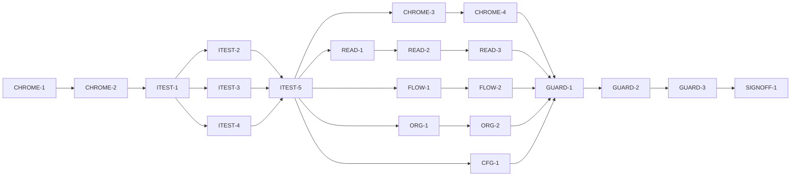

# Master Plan — bs-18 Apply the visual design system to every screen and the app chrome

**Spec:** [bs-18-apply-visual-components.feature](../bs-18-apply-visual-components.feature)
**Status:** Not started — next CHROME-1 (scaffold), blocked by G-1 (approve the spec)
**Architecture:** Wireframe `Paint Color Assistant.dc.html` (+ `support.js`) from `docs/Color blindness artist tool.zip`; [specs/wireframe-spec-derivation.md](../wireframe-spec-derivation.md); bs-17 component contracts ([specs/bs-17-visual-design-system.feature](../bs-17-visual-design-system.feature), [bs-17 APPLY module](../bs-17-visual-design-system/modules/APPLY.md)) and theme chokepoint `lib/app/theme.dart`.
**Code home:** `/Users/matthew.quirk/Nuance` · https://github.com/meatsquirk/Nuance · base `main` @ `d3a1c4f` → `feat/bs-18-apply-visual-components` · extends existing (confirmed by Matt Quirk, 2026-10-19)

This feature is **presentation-application over bs-17**: it swaps the widget that renders
a control/region for the finished bs-17 wrapper, builds the wireframe's bottom nav + top
bar, and fixes the Capture warning overlap. No screen's behaviour, data, numbers or
semantics change. The wrappers already exist and are acceptance-tested (bs-17 COMPONENTS);
this feature only *opts screens into them*.

## Gap analysis (against `d3a1c4f`)

| AC | Exists today | Missing |
|---|---|---|
| AC-1 Bottom nav | No bottom nav; `_home()` in `build_app.dart` picks ONE home by entry precedence | A design-system bottom nav bar with 4 destinations + a non-colour-only active indicator |
| AC-2 Top bar | Screens show ad-hoc headers; `Capture` title present | A consistent design-system top bar (title in Atkinson, back/close, theme toggle) across destinations |
| AC-3 Capture controls | `capture_controls.dart` uses ad-hoc buttons (10 matches); `capture_screen.dart` partly uses a wrapper | Shutter → 88px round button; actions → PillButtons; torch/import → design-system controls |
| AC-4 Capture warnings | `capture_live_view.dart` stacks warnings as overlapping `Positioned` banners (overlap bug) | Non-overlapping stacked banners in the design-system banner style |
| AC-5 Readout | `value_region.dart` partly swapped; `actions_bar.dart` ad-hoc (5 matches) | Value/name/space regions in SurfaceCards; mono eyebrows; speak as SpeakButton FAB |
| AC-6 Compare | `compare/actions_bar.dart` (3) + `slots_region.dart` (4) ad-hoc | A/B outline pills; "Find recipes" ink pill; diff/statement in SurfaceCards; SpeakButton |
| AC-7 Recipes | `recipe_list_region.dart` (4), `target_region.dart` (2), `gamut_banner.dart` ad-hoc | Recipe rows → SurfaceCards; ranked/out-of-gamut notes in design-system text; pill actions |
| AC-8 Palette | `paint_list_region.dart` partly swapped; `palette_screen.dart` (3), `vision_profile_card.dart` (3) ad-hoc; `provenance_badge.dart` exists | Rows/chips through components; ProvenanceBadge glyph-and-border on every row; add-from-dataset pill |
| AC-9 Projects | `projects_region.dart` (2) ad-hoc | Project entries → SurfaceCards; open/create → pills |
| AC-10 Display & onboarding | `display/settings_screen.dart` (4), onboarding steps (3+3+2+2+1) ad-hoc | View-switch/options → pills/segmented; onboarding steps → SurfaceCards + next/back pills |
| AC-11 Single theme | Screens already read `Theme.of(context)`; likely no nested Theme today | A standing guard that no swapped screen introduces a nested `Theme`/`MaterialApp` |
| AC-12 Swatch caption everywhere | `SwatchCaption` on 3 screens | Exactly one caption on every swatch-bearing screen |
| AC-13 A11y preserved | bs-11 conformance green at `d3a1c4f` | A regression proof that the restyle keeps ≥48dp targets + AA contrast app-wide |
| AC-14 No new hardcoded palette | bs-17 AC-14 source-scan covers today's `lib/**` | Scan still clean after the swaps (same bs-17 exclusion list) |

## Build order

| Stage | Phases |
|---|---|
| 1 Scaffold | CHROME-1 |
| 2 Component shells | CHROME-2 |
| 3 Acceptance tests | ITEST-1, ITEST-2, ITEST-3, ITEST-4, ITEST-5 (test review, G-2) |
| 4 Behavior | CHROME-3, CHROME-4, READ-1, READ-2, READ-3, FLOW-1, FLOW-2, ORG-1, ORG-2, CFG-1, GUARD-1, GUARD-2, GUARD-3 |
| 5 Sign-off | SIGNOFF-1 |

## Acceptance criteria coverage

| AC | Scenario | Integration test (ITEST) | Behavior phases | Status |
|---|---|---|---|---|
| AC-1 | The app shows the design-system bottom navigation | ITEST-2 `TestAC01_BottomNav` | CHROME-3 | ⬜ Todo |
| AC-2 | Each primary screen shows the design-system top bar | ITEST-2 `TestAC02_TopBar` | CHROME-4 | ⬜ Todo |
| AC-3 | The Capture screen's controls render as design-system components | ITEST-2 `TestAC03_CaptureControls` | READ-1 | ⬜ Todo |
| AC-4 | The Capture screen's warnings stack without overlapping | ITEST-2 `TestAC04_CaptureWarnings` | READ-2 | ⬜ Todo |
| AC-5 | The Readout screen renders its regions as cards with mono eyebrows and a speak FAB | ITEST-2 `TestAC05_Readout` | READ-3 | ⬜ Todo |
| AC-6 | The Compare screen renders its controls and rows as design-system components | ITEST-3 `TestAC06_Compare` | FLOW-1 | ⬜ Todo |
| AC-7 | The Recipes screen renders recipes as cards with mono notes and pill actions | ITEST-3 `TestAC07_Recipes` | FLOW-2 | ⬜ Todo |
| AC-8 | The Palette screen renders paints, provenance and the add action as design-system components | ITEST-3 `TestAC08_Palette` | ORG-1 | ⬜ Todo |
| AC-9 | The Projects region renders projects as cards with pill actions | ITEST-3 `TestAC09_Projects` | ORG-2 | ⬜ Todo |
| AC-10 | The Display and Onboarding screens render through the design system | ITEST-3 `TestAC10_DisplayOnboarding` | CFG-1 | ⬜ Todo |
| AC-11 | Every screen inherits the one installed theme | ITEST-4 `TestAC11_SingleTheme` | GUARD-2 | ⬜ Todo |
| AC-12 | Every swatch-bearing screen carries its approximation caption | ITEST-4 `TestAC12_SwatchCaption` | GUARD-1 | ⬜ Todo |
| AC-13 | The restyle preserves accessibility | ITEST-4 `TestAC13_A11yPreserved` | GUARD-3 | ⬜ Todo |
| AC-14 | No new hardcoded palette colours are introduced | ITEST-4 `TestAC14_NoHardcodedPalette` | GUARD-2 | ⬜ Todo |

## Design decisions

| # | Decision | Why |
|---|---|---|
| D-1 | Build the bottom nav + top bar as new app chrome; the default app becomes a 4-destination `IndexedStack` (Capture/Compare/Recipes/Palette) under one `Scaffold`, replacing the entry-precedence single-`_home()` for the default route (deep-link entries still open their screen). | The wireframe's nav/top-bar were "presentation / not specified"; user expanded scope 2026-10-19 to match the mock. |
| D-2 | Presentation only — a phase changes only the widget rendering a control/region, never a screen's behaviour, data, numbers, routing semantics or spoken output. | Mirrors the bs-17 APPLY constraint; keeps the signed-off bs-01..bs-14/bs-17 suites green. |
| D-3 | Acceptance tests are Flutter widget/integration tests (flutter-tester lane) asserting the wrapper is **present** AND the superseded ad-hoc widget **absent** for each named control/region. | Several screens are already partly swapped; a present-only assertion would pre-pass and not discriminate a no-op. |
| D-4 | Extend the bs-17 AC-14 source-scan rule to the newly-swapped screens, reusing its exact exclusion list (camera-device literals in `lib/capture/**`, colour-data modules). | One source-scan chokepoint; no second palette definition. |
| D-5 | One screen-group behavior phase per AC, small blast radius; the GUARD app-wide sweeps run last, after every screen is swapped. | Broad screen edits are merge-risky (bs-17 APPLY-1 "run alone" lesson); a per-screen phase localises regressions. |
| D-6 | The AC-4 warning fix lays the capture banners in a single vertical run (Column/stacked offsets) instead of same-origin `Positioned` banners. | Root cause of the observed overlap in `capture_live_view.dart`. |
| D-7 | CHROME phases own `build_app.dart`; no other phase edits it, so screen-group modules stay disjoint and parallelisable. | Avoids the build_app.dart merge conflicts seen across bs-07/bs-11/bs-17. |

## Acceptance integration test plan

Module plan: [modules/ITEST.md](modules/ITEST.md).

**Where it lives and how it runs:** `integration_test/visual_application/` (one file per AC group + a
harness). Default target runs the suite with the new tests **pending**; the red-baseline target runs with
`--dart-define=BS18_RUN_PENDING=true` to prove each pending test fails for the right reason. Runs on the
`flutter-tester` lane like the sibling conformance suites; the exclusive iOS-sim lane is not needed (these
are widget/pump tests, no camera/device).
**Where assertions look:** the pumped widget tree — `find.byType(PillButton/SpeakButton/SurfaceCard/MonoLabel/SwatchCaption/ProvenanceBadge)`, destination/active-indicator keys exposed by the CHROME-2 shell, and the absence of the superseded ad-hoc widget (`find.byType(ElevatedButton/TextButton/Card)` scoped to the control under test). AC-13 reuses the bs-11 tap-target/contrast checks; AC-14 reuses the bs-17 source-scan.
**What is real and what is faked:** screens are pumped through their production builders with real controllers over in-memory fixture sources (the sibling features' fake sources); nothing about rendering is faked. No network, camera or platform channels.

**Fixtures:**

| Fixture | Shape |
|---|---|
| `aReading` | one captured sample with L*a*b* + colour name + provenance, for Readout/Capture |
| `aComparison` | A and B samples with a computed difference + statement, for Compare |
| `recipesForTarget` | a target with ≥2 recipes incl. one out-of-gamut, for Recipes |
| `aPalette` | ≥3 paints with mixed provenance (measured / dataset / opinion), for Palette |
| `aProject` | one saved project with a name + notes, for Projects |
| `anOnboardingStep` | one onboarding step mid-flow + a Display settings snapshot, for CFG |

**Test catalogue:**

| AC | Given: built via public flows → checked by | When | Then: exact assertions (negative Thens: after settle) | Rejects |
|---|---|---|---|---|
| AC-1 | App pumped on default route → `find.byKey(bottomNavKey)` present | chrome renders | nav exposes 4 destination keys (Capture/Compare/Recipes/Palette); active destination has the non-colour active marker key; nav `DecoratedBox` colours == theme tokens | a nav drawn but active state by colour only; a nav missing a destination |
| AC-2 | App pumped on each destination → top bar finder present | screen renders | title Text uses Atkinson family; back/close affordance present where the destination needs it; theme-toggle control present | an ad-hoc header without the toggle; a hardcoded title style |
| AC-3 | Capture pumped with `aReading` → shutter/torch/import finders | controls render | `find.byKey(shutterKey)` is the 88px round button; primary actions `find.byType(PillButton)` present; `find.byType(ElevatedButton)` absent among capture actions; torch/import are design-system controls | leaving an `ElevatedButton`/`TextButton` action un-swapped |
| AC-4 | Capture pumped with ≥2 active warnings → both warning keys present | warnings render | each warning in a distinct banner; their render rects do not intersect (`!rectA.overlaps(rectB)`) | same-origin `Positioned` banners whose rects intersect (the current bug) |
| AC-5 | Readout pumped with `aReading` → region finders | reading renders | value/name/space regions each have an ancestor `SurfaceCard`; each eyebrow `find.byType(MonoLabel)`; speak `find.byType(SpeakButton)`; old `Card`/plain speak `IconButton` absent | regions left as bare `Column`s; speak left as an `IconButton` |
| AC-6 | Compare pumped with `aComparison` → control finders | comparison renders | A & B are `PillButton.secondary`; "Find mixing recipes" is `PillButton.primary`; diff & statement under `SurfaceCard`; speak `SpeakButton`; old `OutlinedButton`/`TextButton` for these absent | one of A/B/find left ad-hoc; rows not carded |
| AC-7 | Recipes pumped with `recipesForTarget` → recipe & note finders | list renders | each recipe row under a `SurfaceCard`; ranked-by note `MonoLabel`/body style; out-of-gamut note in design-system style; actions `PillButton`; old `Card` rows absent | recipe rows left as ad-hoc `Card`/`ListTile`; notes hardcoded |
| AC-8 | Palette pumped with `aPalette` → row/badge/add finders | list renders | each paint row renders via the design-system row/chip; each row has a `ProvenanceBadge` (glyph+border); add-from-dataset `PillButton`; old add button absent | a row with no `ProvenanceBadge`; add left ad-hoc |
| AC-9 | Projects region pumped with `aProject` → entry/action finders | list renders | each project entry under a `SurfaceCard`; open & create `PillButton`; old entry tiles/buttons absent | entries as bare `ListTile`s; actions ad-hoc |
| AC-10 | Display settings + `anOnboardingStep` pumped → control finders | screens render | view-switch/options `PillButton` or design-system segmented; onboarding step content under `SurfaceCard`; next/back `PillButton`; old buttons absent | a settings toggle or onboarding nav left as `ElevatedButton`/`TextButton` |
| AC-11 | Each primary + config screen pumped → widget tree walked | it renders | no descendant `Theme` or `MaterialApp` under the screen subtree (count == 0 below the app root) | a screen that wraps a subtree in its own `Theme` to recolour |
| AC-12 | Each swatch-bearing screen pumped → `find.byKey(SwatchCaption.captionKey)` | it renders | exactly one caption per such screen (`findsOneWidget`); a non-swatch screen shows none | a swatch screen with zero captions, or one per swatch (`findsNWidgets`) |
| AC-13 | Every screen pumped post-swap → bs-11 target/contrast checks | measured | every interactive control ≥48dp; every text pairing ≥ AA (reuse `checks/target.dart` + theme contrast test over the live screens) | a pill/FAB/nav item under 48dp; a mono label below AA on its surface |
| AC-14 | Swapped `lib/**` source scanned → bs-17 source-scan rule | scan runs | zero hardcoded palette `Color(0x..)` outside the bs-17 exclusion list | a screen re-introducing a literal brand colour instead of a token |

**Red baseline** and **test augmentations:** tracked in [modules/ITEST.md](modules/ITEST.md).
Pre-seeded augmentations: AC-3 (capture partly swapped) strengthened by READ-1; AC-5 (value_region swapped) by READ-3; AC-8 (paint_list partly swapped) by ORG-1; AC-12 (caption on 3 screens) by GUARD-1; AC-11/AC-14 may be green at baseline (control-case rows) — confirmed/strengthened by GUARD-2.

## Modules

| Module | Plan | Purpose | Depends on | Status |
|---|---|---|---|---|
| CHROME | [modules/CHROME.md](modules/CHROME.md) | Scaffold; bottom nav + top bar; owns `build_app.dart` | — | ⬜ Todo |
| READ | [modules/READ.md](modules/READ.md) | Readout + Capture screen swaps (incl. warning-overlap fix) | ITEST (G-2) | ⬜ Todo |
| FLOW | [modules/FLOW.md](modules/FLOW.md) | Compare + Recipes screen swaps | ITEST (G-2) | ⬜ Todo |
| ORG | [modules/ORG.md](modules/ORG.md) | Palette + Projects screen swaps | ITEST (G-2) | ⬜ Todo |
| CFG | [modules/CFG.md](modules/CFG.md) | Display + Onboarding screen swaps | ITEST (G-2) | ⬜ Todo |
| GUARD | [modules/GUARD.md](modules/GUARD.md) | App-wide guards: swatch caption, single theme, a11y, source-scan | all screen modules | ⬜ Todo |
| ITEST | [modules/ITEST.md](modules/ITEST.md) | Acceptance integration suite: one pending test per AC, and its review | CHROME-2 | ⬜ Todo |

## Dependency graph

**Parallel windows:** after ITEST-5, the screen-group modules run concurrently over disjoint dirs:
CHROME (`lib/app/**`), READ (`lib/readout/**`,`lib/capture/**`), FLOW (`lib/compare/**`,`lib/recipes/**`),
ORG (`lib/palette/**`,`lib/projects/**`), CFG (`lib/display/**`,`lib/onboarding/**`). **Merge-risky:** any
CHROME phase vs any other phase (CHROME owns `build_app.dart`, which all screens are wired through) — run
CHROME-3/CHROME-4 alone; READ-1 vs READ-2 both touch `lib/capture/**` (sequence them). GUARD-1/2/3 depend on
every screen phase and must run after them, sequentially.

## Open gates

| Gate | Kind | Decision needed | Blocks | Status |
|---|---|---|---|---|
| G-1 | decision | Approve the spec (record the approval as its first line) | CHROME-1 | Open |
| G-2 | decision | Approve the acceptance tests (ITEST-5's packet) | every behavior phase | Open |

Resolved: `✅ Resolved <date time>: <decision, one line> — <who>`.

## Known flakes

| Test | Symptom | Rate (runs) | Measured at | Owner | Status |
|---|---|---|---|---|---|
| palette AC-3 | flutter-tester-lane native fail off exclusive lane (bs-06) | carried | `c00422f` | bs-06 / off-lane | Open |
| palette AC-5 | flutter-tester-lane native fail off exclusive lane (bs-06) | carried | `c00422f` | bs-06 / off-lane | Open |
| self_assessment AC-4 | flutter-tester-lane native fail off exclusive lane (bs-07) | carried | `c00422f` | bs-07 / off-lane | Open |
| display AC-9 | flutter-tester-lane native fail off exclusive lane (bs-08) | carried | `c00422f` | bs-08 / off-lane | Open |

## Session log

| # | Phase | Target | Status | Tokens | Time | Notes |
|---|---|---|---|---|---|---|
| 1 | CHROME-1 | scaffold: branch from main@d3a1c4f, baseline, coverage gate, BS18 pending runner | ⬜ Next | | | blocked by G-1 |
| 2 | CHROME-2 | shell: bottom-nav + top-bar widget shells + 4-destination IndexedStack wiring + active-destination keys | ⬜ Todo | | | |
| 3 | ITEST-1 | acceptance-tests: harness, fixtures, pending gate, smoke | ⬜ Todo | | | |
| 4 | ITEST-2 | acceptance-tests: AC-1,2,3,4,5 (pending) + red baseline | ⬜ Todo | | | ∥ ITEST-3, ITEST-4 |
| 5 | ITEST-3 | acceptance-tests: AC-6,7,8,9,10 (pending) + red baseline | ⬜ Todo | | | ∥ ITEST-2, ITEST-4 |
| 6 | ITEST-4 | acceptance-tests: AC-11,12,13,14 (pending) + red baseline | ⬜ Todo | | | ∥ ITEST-2, ITEST-3 |
| 7 | ITEST-5 | test-review: packet; G-2 | ⬜ Todo | | | |
| 8 | CHROME-3 | AC-1 — bottom navigation | ⬜ Todo | | | run alone (build_app.dart) |
| 9 | CHROME-4 | AC-2 — top bar | ⬜ Todo | | | run alone (build_app.dart) |
| 10 | READ-1 | AC-3 — capture controls | ⬜ Todo | | | ∥ FLOW/ORG/CFG |
| 11 | READ-2 | AC-4 — capture warning overlap fix | ⬜ Todo | | | after READ-1 (lib/capture) |
| 12 | READ-3 | AC-5 — readout cards + mono + speak FAB | ⬜ Todo | | | ∥ FLOW/ORG/CFG |
| 13 | FLOW-1 | AC-6 — compare | ⬜ Todo | | | ∥ READ/ORG/CFG |
| 14 | FLOW-2 | AC-7 — recipes | ⬜ Todo | | | ∥ READ/ORG/CFG |
| 15 | ORG-1 | AC-8 — palette | ⬜ Todo | | | ∥ READ/FLOW/CFG |
| 16 | ORG-2 | AC-9 — projects | ⬜ Todo | | | ∥ READ/FLOW/CFG |
| 17 | CFG-1 | AC-10 — display + onboarding | ⬜ Todo | | | ∥ READ/FLOW/ORG |
| 18 | GUARD-1 | AC-12 — swatch caption on every swatch screen | ⬜ Todo | | | after all screen phases |
| 19 | GUARD-2 | AC-11 + AC-14 — single theme + source-scan | ⬜ Todo | | | after GUARD-1 |
| 20 | GUARD-3 | AC-13 — a11y regression (targets + contrast) | ⬜ Todo | | | after GUARD-2 |
| 21 | SIGNOFF-1 | sign-off: packet + summary page + manual approval | ⬜ Todo | | | |

*Tokens* / *Time* = the phase totals from the *Token usage* ledger (Time = active, wall in brackets).

## Next phase

CHROME-1 (scaffold) is next but **blocked by G-1 (approve the spec)**. On approval: branch
`feat/bs-18-apply-visual-components` off `main@d3a1c4f`, record the baseline test run, confirm the coverage
gate, and add the `BS18_RUN_PENDING` pending-test runner. Nothing else is startable until CHROME-1 lands.

## Token usage

<!-- One row per session, appended as that session's last edit. -->

| Phase / activity | Session | Start | End | Wall | Active | Model(s) | Input | Cache write | Cache read | Output | Total | Outcome |
|---|---|---|---|---|---|---|---|---|---|---|---|---|
| PLAN | _pending_ | | | | | | | | | | | plan written |
| PLAN | 82f13234 | 2026-10-19 06:13 EDT | 06:35 | 21m 31s | 14m 30s | claude-opus-4-8 | 64 | 118,672 | 5,121,862 | 36,098 | 5,276,696 | plan written (spec + master + 7 module plans; 14 ACs, 21 phases); authored via fork subagent (~209k tokens) |
| **Feature total** |  | **2026-10-19 06:13 EDT** | **2026-10-19 06:35** | **21m 31s** | **14m 30s** |  | **64** | **118,672** | **5,121,862** | **36,098** | **5,276,696** |  |

## Sign-off

| Round | Packet | At code | Grades | Decision |
|---|---|---|---|---|
| 1 | [signoff/round-1.md](signoff/round-1.md) | `<commit>` | _tbd_ | ⏸ Awaiting |
