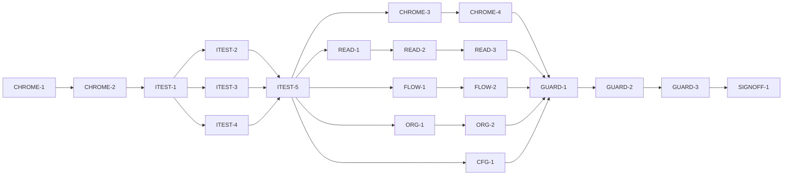

# Master Plan — bs-18 Apply the visual design system to every screen and the app chrome

**Spec:** [bs-18-apply-visual-components.feature](../bs-18-apply-visual-components.feature)
**Status:** ✅ Done — signed off 2026-10-20 by Matt Quirk at `9d0436d` (SIGNOFF-1 approved). 14/14 ACs ✅, suite 17 A / 0 below A. Ready to merge to `main` (use clean-merged-branches).
**Architecture:** Wireframe `Paint Color Assistant.dc.html` (+ `support.js`) from `docs/Color blindness artist tool.zip`; [specs/wireframe-spec-derivation.md](../wireframe-spec-derivation.md); bs-17 component contracts ([specs/bs-17-visual-design-system.feature](../bs-17-visual-design-system.feature), [bs-17 APPLY module](../bs-17-visual-design-system/modules/APPLY.md)) and theme chokepoint `lib/app/theme.dart`.
**Code home:** `/Users/matthew.quirk/Nuance` · https://github.com/meatsquirk/Nuance · base `main` @ `d3a1c4f` → `feat/bs-18-apply-visual-components` · extends existing (confirmed by Matt Quirk, 2026-10-19)

This feature is **presentation-application over bs-17**: it swaps the widget that renders
a control/region for the finished bs-17 wrapper, builds the wireframe's bottom nav + top
bar, and fixes the Capture warning overlap. No screen's behaviour, data, numbers or
semantics change. The wrappers already exist and are acceptance-tested (bs-17 COMPONENTS);
this feature only *opts screens into them*.

## Gap analysis (against `d3a1c4f`)

| AC | Exists today | Missing |
|---|---|---|
| AC-1 Bottom nav | No bottom nav; `_home()` in `build_app.dart` picks ONE home by entry precedence | A design-system bottom nav bar with 4 destinations + a non-colour-only active indicator |
| AC-2 Top bar | Screens show ad-hoc headers; `Capture` title present | A consistent design-system top bar (title in Atkinson, back/close, theme toggle) across destinations |
| AC-3 Capture controls | `capture_controls.dart` uses ad-hoc buttons (10 matches); `capture_screen.dart` partly uses a wrapper | Shutter → 88px round button; actions → PillButtons; torch/import → design-system controls |
| AC-4 Capture warnings | `capture_live_view.dart` stacks warnings as overlapping `Positioned` banners (overlap bug) | Non-overlapping stacked banners in the design-system banner style |
| AC-5 Readout | `value_region.dart` partly swapped; `actions_bar.dart` ad-hoc (5 matches) | Value/name/space regions in SurfaceCards; mono eyebrows; speak as SpeakButton FAB |
| AC-6 Compare | `compare/actions_bar.dart` (3) + `slots_region.dart` (4) ad-hoc | A/B outline pills; "Find recipes" ink pill; diff/statement in SurfaceCards; SpeakButton |
| AC-7 Recipes | `recipe_list_region.dart` (4), `target_region.dart` (2), `gamut_banner.dart` ad-hoc | Recipe rows → SurfaceCards; ranked/out-of-gamut notes in design-system text; pill actions |
| AC-8 Palette | `paint_list_region.dart` partly swapped; `palette_screen.dart` (3), `vision_profile_card.dart` (3) ad-hoc; `provenance_badge.dart` exists | Rows/chips through components; ProvenanceBadge glyph-and-border on every row; add-from-dataset pill |
| AC-9 Projects | `projects_region.dart` (2) ad-hoc | Project entries → SurfaceCards; open/create → pills |
| AC-10 Display & onboarding | `display/settings_screen.dart` (4), onboarding steps (3+3+2+2+1) ad-hoc | View-switch/options → pills/segmented; onboarding steps → SurfaceCards + next/back pills |
| AC-11 Single theme | Screens already read `Theme.of(context)`; likely no nested Theme today | A standing guard that no swapped screen introduces a nested `Theme`/`MaterialApp` |
| AC-12 Swatch caption everywhere | `SwatchCaption` on 3 screens | Exactly one caption on every swatch-bearing screen |
| AC-13 A11y preserved | bs-11 conformance green at `d3a1c4f` | A regression proof that the restyle keeps ≥48dp targets + AA contrast app-wide |
| AC-14 No new hardcoded palette | bs-17 AC-14 source-scan covers today's `lib/**` | Scan still clean after the swaps (same bs-17 exclusion list) |

## Build order

| Stage | Phases |
|---|---|
| 1 Scaffold | CHROME-1 |
| 2 Component shells | CHROME-2 |
| 3 Acceptance tests | ITEST-1, ITEST-2, ITEST-3, ITEST-4, ITEST-5 (test review, G-2) |
| 4 Behavior | CHROME-3, CHROME-4, READ-1, READ-2, READ-3, FLOW-1, FLOW-2, ORG-1, ORG-2, CFG-1, GUARD-1, GUARD-2, GUARD-3 |
| 5 Sign-off | SIGNOFF-1 |

## Acceptance criteria coverage

| AC | Scenario | Integration test (ITEST) | Behavior phases | Status |
|---|---|---|---|---|
| AC-1 | The app shows the design-system bottom navigation | ITEST-2 `TestAC01_BottomNav` | CHROME-3 | ✅ Done |
| AC-2 | Each primary screen shows the design-system top bar | ITEST-2 `TestAC02_TopBar` | CHROME-4 | ✅ Done |
| AC-3 | The Capture screen's controls render as design-system components | ITEST-2 `TestAC03_CaptureControls` | READ-1 | ✅ Done |
| AC-4 | The Capture screen's warnings stack without overlapping | ITEST-2 `TestAC04_CaptureWarnings` | READ-2 | ✅ Done |
| AC-5 | The Readout screen renders its regions as cards with mono eyebrows and a speak FAB | ITEST-2 `TestAC05_Readout` | READ-3 | ✅ Done |
| AC-6 | The Compare screen renders its controls and rows as design-system components | ITEST-3 `TestAC06_Compare` | FLOW-1 | ✅ Done |
| AC-7 | The Recipes screen renders recipes as cards with mono notes and pill actions | ITEST-3 `TestAC07_Recipes` | FLOW-2 | ✅ Done |
| AC-8 | The Palette screen renders paints, provenance and the add action as design-system components | ITEST-3 `TestAC08_Palette` | ORG-1 | ✅ Done |
| AC-9 | The Projects region renders projects as cards with pill actions | ITEST-3 `TestAC09_Projects` | ORG-2 | ✅ Done |
| AC-10 | The Display and Onboarding screens render through the design system | ITEST-3 `TestAC10_DisplayOnboarding` | CFG-1 | ✅ Done |
| AC-11 | Every screen inherits the one installed theme | ITEST-4 `TestAC11_SingleTheme` | GUARD-2 | ✅ Done |
| AC-12 | Every swatch-bearing screen carries its approximation caption | ITEST-4 `TestAC12_SwatchCaption` | GUARD-1 | ✅ Done |
| AC-13 | The restyle preserves accessibility | ITEST-4 `TestAC13_A11yPreserved` | GUARD-3 | ✅ Done |
| AC-14 | No new hardcoded palette colours are introduced | ITEST-4 `TestAC14_NoHardcodedPalette` | GUARD-2 | ✅ Done |

## Design decisions

| # | Decision | Why |
|---|---|---|
| D-1 | Build the bottom nav + top bar as new app chrome; the default app becomes a 4-destination `IndexedStack` (Capture/Compare/Recipes/Palette) under one `Scaffold`, replacing the entry-precedence single-`_home()` for the default route (deep-link entries still open their screen). | The wireframe's nav/top-bar were "presentation / not specified"; user expanded scope 2026-10-19 to match the mock. |
| D-2 | Presentation only — a phase changes only the widget rendering a control/region, never a screen's behaviour, data, numbers, routing semantics or spoken output. | Mirrors the bs-17 APPLY constraint; keeps the signed-off bs-01..bs-14/bs-17 suites green. |
| D-3 | Acceptance tests are Flutter widget/integration tests (flutter-tester lane) asserting the wrapper is **present** AND the superseded ad-hoc widget **absent** for each named control/region. | Several screens are already partly swapped; a present-only assertion would pre-pass and not discriminate a no-op. |
| D-4 | Extend the bs-17 AC-14 source-scan rule to the newly-swapped screens, reusing its exact exclusion list (camera-device literals in `lib/capture/**`, colour-data modules). | One source-scan chokepoint; no second palette definition. |
| D-5 | One screen-group behavior phase per AC, small blast radius; the GUARD app-wide sweeps run last, after every screen is swapped. | Broad screen edits are merge-risky (bs-17 APPLY-1 "run alone" lesson); a per-screen phase localises regressions. |
| D-6 | The AC-4 warning fix lays the capture banners in a single vertical run (Column/stacked offsets) instead of same-origin `Positioned` banners. | Root cause of the observed overlap in `capture_live_view.dart`. |
| D-7 | CHROME phases own `build_app.dart`; no other phase edits it, so screen-group modules stay disjoint and parallelisable. | Avoids the build_app.dart merge conflicts seen across bs-07/bs-11/bs-17. |

## Acceptance integration test plan

Module plan: [modules/ITEST.md](modules/ITEST.md).

**Where it lives and how it runs:** `integration_test/visual_application/` (one file per AC group + a
harness). Default target runs the suite with the new tests **pending**; the red-baseline target runs with
`--dart-define=BS18_RUN_PENDING=true` to prove each pending test fails for the right reason. Runs on the
`flutter-tester` lane like the sibling conformance suites; the exclusive iOS-sim lane is not needed (these
are widget/pump tests, no camera/device).
**Where assertions look:** the pumped widget tree — `find.byType(PillButton/SpeakButton/SurfaceCard/MonoLabel/SwatchCaption/ProvenanceBadge)`, destination/active-indicator keys exposed by the CHROME-2 shell, and the absence of the superseded ad-hoc widget (`find.byType(ElevatedButton/TextButton/Card)` scoped to the control under test). AC-13 reuses the bs-11 tap-target/contrast checks; AC-14 reuses the bs-17 source-scan.
**What is real and what is faked:** screens are pumped through their production builders with real controllers over in-memory fixture sources (the sibling features' fake sources); nothing about rendering is faked. No network, camera or platform channels.

**Fixtures:**

| Fixture | Shape |
|---|---|
| `aReading` | one captured sample with L*a*b* + colour name + provenance, for Readout/Capture |
| `aComparison` | A and B samples with a computed difference + statement, for Compare |
| `recipesForTarget` | a target with ≥2 recipes incl. one out-of-gamut, for Recipes |
| `aPalette` | ≥3 paints with mixed provenance (measured / dataset / opinion), for Palette |
| `aProject` | one saved project with a name + notes, for Projects |
| `anOnboardingStep` | one onboarding step mid-flow + a Display settings snapshot, for CFG |

**Test catalogue:**

| AC | Given: built via public flows → checked by | When | Then: exact assertions (negative Thens: after settle) | Rejects |
|---|---|---|---|---|
| AC-1 | App pumped on default route → `find.byKey(bottomNavKey)` present | chrome renders | nav exposes 4 destination keys (Capture/Compare/Recipes/Palette); active destination has the non-colour active marker key; nav `DecoratedBox` colours == theme tokens | a nav drawn but active state by colour only; a nav missing a destination |
| AC-2 | App pumped on each destination → top bar finder present | screen renders | title Text uses Atkinson family; back/close affordance present where the destination needs it; theme-toggle control present | an ad-hoc header without the toggle; a hardcoded title style |
| AC-3 | Capture pumped with `aReading` → shutter/torch/import finders | controls render | `find.byKey(shutterKey)` is the 88px round button; primary actions `find.byType(PillButton)` present; `find.byType(ElevatedButton)` absent among capture actions; torch/import are design-system controls | leaving an `ElevatedButton`/`TextButton` action un-swapped |
| AC-4 | Capture pumped with ≥2 active warnings → both warning keys present | warnings render | each warning in a distinct banner; their render rects do not intersect (`!rectA.overlaps(rectB)`) | same-origin `Positioned` banners whose rects intersect (the current bug) |
| AC-5 | Readout pumped with `aReading` → region finders | reading renders | value/name/space regions each have an ancestor `SurfaceCard`; each eyebrow `find.byType(MonoLabel)`; speak `find.byType(SpeakButton)`; old `Card`/plain speak `IconButton` absent | regions left as bare `Column`s; speak left as an `IconButton` |
| AC-6 | Compare pumped with `aComparison` → control finders | comparison renders | A & B are `PillButton.secondary`; "Find mixing recipes" is `PillButton.primary`; diff & statement under `SurfaceCard`; speak `SpeakButton`; old `OutlinedButton`/`TextButton` for these absent | one of A/B/find left ad-hoc; rows not carded |
| AC-7 | Recipes pumped with `recipesForTarget` → recipe & note finders | list renders | each recipe row under a `SurfaceCard`; ranked-by note `MonoLabel`/body style; out-of-gamut note in design-system style; actions `PillButton`; old `Card` rows absent | recipe rows left as ad-hoc `Card`/`ListTile`; notes hardcoded |
| AC-8 | Palette pumped with `aPalette` → row/badge/add finders | list renders | each paint row renders via the design-system row/chip; each row has a `ProvenanceBadge` (glyph+border); add-from-dataset `PillButton`; old add button absent | a row with no `ProvenanceBadge`; add left ad-hoc |
| AC-9 | Projects region pumped with `aProject` → entry/action finders | list renders | each project entry under a `SurfaceCard`; open & create `PillButton`; old entry tiles/buttons absent | entries as bare `ListTile`s; actions ad-hoc |
| AC-10 | Display settings + `anOnboardingStep` pumped → control finders | screens render | view-switch/options `PillButton` or design-system segmented; onboarding step content under `SurfaceCard`; next/back `PillButton`; old buttons absent | a settings toggle or onboarding nav left as `ElevatedButton`/`TextButton` |
| AC-11 | Each primary + config screen pumped → widget tree walked | it renders | no descendant `Theme` or `MaterialApp` under the screen subtree (count == 0 below the app root) | a screen that wraps a subtree in its own `Theme` to recolour |
| AC-12 | Each swatch-bearing screen pumped → `find.byKey(SwatchCaption.captionKey)` | it renders | exactly one caption per such screen (`findsOneWidget`); a non-swatch screen shows none | a swatch screen with zero captions, or one per swatch (`findsNWidgets`) |
| AC-13 | Every screen pumped post-swap → bs-11 target/contrast checks | measured | every interactive control ≥48dp; every text pairing ≥ AA (reuse `checks/target.dart` + theme contrast test over the live screens) | a pill/FAB/nav item under 48dp; a mono label below AA on its surface |
| AC-14 | Swapped `lib/**` source scanned → bs-17 source-scan rule | scan runs | zero hardcoded palette `Color(0x..)` outside the bs-17 exclusion list | a screen re-introducing a literal brand colour instead of a token |

**Red baseline** and **test augmentations:** tracked in [modules/ITEST.md](modules/ITEST.md).
Pre-seeded augmentations: AC-3 (capture partly swapped) strengthened by READ-1; AC-5 (value_region swapped) by READ-3; AC-8 (paint_list partly swapped) by ORG-1; AC-12 (caption on 3 screens) by GUARD-1; AC-11/AC-14 may be green at baseline (control-case rows) — confirmed/strengthened by GUARD-2.

## Modules

| Module | Plan | Purpose | Depends on | Status |
|---|---|---|---|---|
| CHROME | [modules/CHROME.md](modules/CHROME.md) | Scaffold; bottom nav + top bar; owns `build_app.dart` | — | ✅ Done |
| READ | [modules/READ.md](modules/READ.md) | Readout + Capture screen swaps (incl. warning-overlap fix) | ITEST (G-2) | ✅ Done |
| FLOW | [modules/FLOW.md](modules/FLOW.md) | Compare + Recipes screen swaps | ITEST (G-2) | ✅ Done (FLOW-1 + FLOW-2) |
| ORG | [modules/ORG.md](modules/ORG.md) | Palette + Projects screen swaps | ITEST (G-2) | ✅ Done (ORG-1, ORG-2) |
| CFG | [modules/CFG.md](modules/CFG.md) | Display + Onboarding screen swaps | ITEST (G-2) | ✅ Done |
| GUARD | [modules/GUARD.md](modules/GUARD.md) | App-wide guards: swatch caption, single theme, a11y, source-scan | all screen modules | ✅ Done (GUARD-1/2/3) |
| ITEST | [modules/ITEST.md](modules/ITEST.md) | Acceptance integration suite: one pending test per AC, and its review | CHROME-2 | ✅ Done (ITEST-1..5; G-2 approved) |

## Dependency graph

**Parallel windows:** after ITEST-5, the screen-group modules run concurrently over disjoint dirs:
CHROME (`lib/app/**`), READ (`lib/readout/**`,`lib/capture/**`), FLOW (`lib/compare/**`,`lib/recipes/**`),
ORG (`lib/palette/**`,`lib/projects/**`), CFG (`lib/display/**`,`lib/onboarding/**`). **Merge-risky:** any
CHROME phase vs any other phase (CHROME owns `build_app.dart`, which all screens are wired through) — run
CHROME-3/CHROME-4 alone; READ-1 vs READ-2 both touch `lib/capture/**` (sequence them). GUARD-1/2/3 depend on
every screen phase and must run after them, sequentially.

## Open gates

| Gate | Kind | Decision needed | Blocks | Status |
|---|---|---|---|---|
| G-1 | decision | Approve the spec (record the approval as its first line) | CHROME-1 | ✅ Resolved 2026-10-19 07:33 EDT: approved — Matt Quirk (recorded on the spec's first line) |
| G-2 | decision | Approve the acceptance tests (ITEST-5's packet) | every behavior phase | ✅ Resolved 2026-10-19 19:48 EDT: approved — Matt Quirk (14 pending acceptance tests approved as-is; the 6 non-blocking reviewer items carry to their owning behavior phases per the packet defaults — notably AC-6 cross-screen ownership, which FLOW-1 must resolve) |

Resolved: `✅ Resolved <date time>: <decision, one line> — <who>`.

## Known flakes

| Test | Symptom | Rate (runs) | Measured at | Owner | Status |
|---|---|---|---|---|---|
| palette AC-3 | flutter-tester-lane native fail off exclusive lane (bs-06) | carried | `c00422f` | bs-06 / off-lane | Open |
| palette AC-5 | flutter-tester-lane native fail off exclusive lane (bs-06) | carried | `c00422f` | bs-06 / off-lane | Open |
| self_assessment AC-4 | intake "I have a diagnosis" tap missed below the fold (bs-07) | carried | `c00422f` | bs-07 | ✅ Resolved CFG-1 (added `ensureVisible` to the intake drivers; bs-07 now 24/0) |
| display AC-9 | flutter-tester-lane native fail off exclusive lane (bs-08) | carried | `c00422f` | bs-08 / off-lane | Open |
| whole `visual_application/` dir | under sustained load (many back-to-back runs) every file hits "Unable to start the app on the device" / "log reader failed" at launch — not a test failure; each file passes run alone / in a small batch | env (device saturation) | CHROME-3 session 2026-10-20 | infra / off-lane | Open |

## Session log

| # | Phase | Target | Status | Tokens | Time | Notes |
|---|---|---|---|---|---|---|
| 1 | CHROME-1 | scaffold: branch from main@d3a1c4f, baseline, coverage gate, BS18 pending runner | ✅ Done | 5.04M | 16m (16m) | branch @ fa21c49; unit 1643✅; gate ✅ both ways; runner ✅ both ways; 4 carried flakes reproduce |
| 2 | CHROME-2 | shell: bottom-nav + top-bar widget shells + 4-destination IndexedStack wiring + active-destination keys | ✅ Done | 19.06M | 52m (1h 04m) | AppDestination/AppShell/AppTopBar + theme tokens; unit 1668✅; cov gate 100% on 5 files; bs-11 19✅ + bs-14 offer✅ (no a11y/behaviour regression); additive fall-through only (G-2 before shell is prod default) |
| 3 | ITEST-1 | acceptance-tests: harness, fixtures, pending gate, smoke | ✅ Done | 5.35M | 13m (13m) | harness+6 fixtures+smoke; default 13✅/1 skip, run-pending 14✅/0 — gate both ways; unit 1668✅; cov gate PASS (no lib touched); folded in CHROME-1 pending_runner_test |
| 4 | ITEST-2 | acceptance-tests: AC-1,2,3,4,5 (pending) + red baseline | ✅ Done | 8.78M | 22m (22m) | AC-1 green@baseline (A); AC-2/4 A; AC-3→READ-1, AC-5→READ-3 A-core/B-pending; grade PASS 0 plain-B |
| 5 | ITEST-3 | acceptance-tests: AC-6,7,8,9,10 (pending) + red baseline | ✅ Done | 11.88M | 35m (35m) | AC-6/9/10 A, AC-7→FLOW-2 / AC-8→ORG-1 A-core/B-pending; grade PASS 0 plain-B; harness got CFG pumps; 4 G-2 review items (headline: AC-6 cross-screen ownership) |
| 6 | ITEST-4 | acceptance-tests: AC-11,12,13,14 (pending) + red baseline | ✅ Done | 6.41M | 22m (22m) | all 4 green@baseline + discriminating controls; grade PASS straight-A ×4, 0 plain-B; 3 augmentations satisfied at ITEST-4 (none owed); reuses bs-17 scan + bs-11 conformance |
| 7 | ITEST-5 | test-review: packet; G-2 | ✅ Done | 1.08M | 2m 43s (2m 43s) | packet assembled (modules/ITEST.md § G-2); **G-2 approved 2026-10-19 — Matt Quirk**; A=10 / A-core-B-pending=4 / plain-B=0 |
| 8 | CHROME-3 | AC-1 — bottom navigation | ✅ Done | 16.50M | 33m (8h 04m) | AC-1 ✅ A; nav is now the prod-visible default (captureSource routes through the shell); unit 1669✅; cov 100%/6 files; bs-02/09/10/11/14 re-verified✅; fixed pre-existing CHROME-2 regression in bs-01 readout AC-11 (nav-label collision) |
| 9 | CHROME-4 | AC-2 — top bar | ✅ Done | 9.93M | 25m (25m) | AC-2 ✅ A; AppTopBar + presentation-only ThemeToggleButton (D-3) mounted on all 5 screens; auto-back preserved (D-2); unit 1671✅; cov 100%/11 files; grade A/A 0-B; 10 sibling suites re-verified✅; palette AC-3/AC-5 = known bs-06 flakes (reproduce at BASE) |
| 10 | READ-1 | AC-3 — capture controls | ✅ Done | 10.07M | 24m (24m) | AC-3 ✅ A (promoted from A-core/B-pending via the full ad-hoc-absent augmentation); shutter→88px round FilledButton, actions→pills, toggles/radius→filled-vs-outlined; unit 1673✅; cov 100%/12; 8 siblings re-verified✅ (bs-02 AC-5 cast fix); grade A/A/A 0-B |
| 11 | READ-2 | AC-4 — capture warning overlap fix | ✅ Done | 8.17M | 20m 33s (20m 33s) | AC-4 ✅ A; warnings relaid in one vertical Column of SurfaceCard banners (D-6) → rects non-overlapping at 200%; keys/text/visibility/semantics unchanged; unit 1675✅; cov 100%/13; grade A/A/A/A 0-B; 8 siblings re-verified✅ (bs-11 contrast holds); fix 0/3 |
| 12 | READ-3 | AC-5 — readout cards + mono + speak FAB | ✅ Done | 20.70M | 36m 23s (36m 23s) | AC-5 ✅ A (promoted A-core/B-pending READ-3→straight A via the speak-at-anchor + Card-absent augmentation); name/value/space regions→SurfaceCard + MonoLabel eyebrows, speak→always-visible Scaffold FAB SpeakButton; unit 1675✅; cov 100%/2; grade A×5 0-B; 10 siblings re-verified✅ (bs-01/daltonization readout pumps got a tall-surface fix; bs-11 eyes-free + contrast hold); fix 0/3; display AC-9 = pre-existing flake (reproduces at BASE) |
| 13 | FLOW-1 | AC-6 — compare | ✅ Done | 10.99M | 25m 25s (25m 25s) | AC-6 ✅ A; readout compare/recipes→pills, diff/statement carded, compare speak→SpeakButton FAB; resolved G-2 cross-screen ownership + outline augmentation |
| 14 | FLOW-2 | AC-7 — recipes | ✅ Done | 14.73M | 27m 04s (27m 04s) | AC-7 ✅ straight A; recipe rows → SurfaceCard, Speak recipe → SpeakButton, ranked-by + out-of-gamut notes → MonoLabel; closed the TestAC07 "notes hardcoded" augmentation; unit 1676✅, cov 100%/2, grade A=7/0-B, fix 0/3; bs-04 24 + bs-05 22 + bs-11 19 re-verified✅ |
| 15 | ORG-1 | AC-8 — palette | ✅ Done | 10.83M | 26m 57s (26m 57s) | AC-8 ✅ straight A; add-from-dataset → PillButton.secondary, vision card → SurfaceCard + retake pill; closed the TestAC08 "old add button absent" augmentation; unit 1676✅, cov 100%/2, grade A=8/0-B, fix 1/3; bs-06 21/2 + bs-07 23/1 (only carried off-lane flakes) |
| 16 | ORG-2 | AC-9 — projects | ✅ Done | 5.42M | 17m 57s (17m 57s) | AC-9 ✅ straight A; project entries → SurfaceCard, open → PillButton.primary, export → PillButton.secondary (both ad-hoc TextButtons gone); no augmentation owed (fully-ad-hoc BASE, wholesale key-preserving swap); unit 1676✅, cov 100%/1, grade A=9/0-B, fix 0/3; bs-06 21/2 + bs-07 23/1 (only carried off-lane flakes; bs-06 project ACs all green) |
| 17 | CFG-1 | AC-10 — display + onboarding | ✅ Done | 23.22M | 44m 06s (44m 06s) | AC-10 ✅ straight A; sim+theme options → PillButton, each display group + every onboarding step → SurfaceCard, continue/seeResult/save → PillButton.primary, result pair + SwatchCaption; in-step answer buttons left TextButton (FLOW-1 rule). unit 1676✅, cov 100%/8, grade A=10/0-B, fix 1/3 (ListTile-in-card Material + bs-07 intake ensureVisible). bs-07 24/0 (AC-4 flake fixed), bs-10 25/0, bs-08 20✅ + AC-9 carried (compare-screen, unrelated) |
| 18 | GUARD-1 | AC-12 — swatch caption on every swatch screen | ✅ Done | 2.29M | 4m 30s | AC-12 ✅ A (carried from ITEST-4); no `lib/**` change — invariant already held, un-pend only; cov PASS (no touched lib); default run AC-12 green, AC-11/13/14 skip |
| 19 | GUARD-2 | AC-11 + AC-14 — single theme + source-scan | ✅ Done | 2.15M | 4m 53s | AC-11+AC-14 un-pended, grades A carried from ITEST-4; no `lib/**` change (invariants held), cov PASS, fix 0/3; default run AC-11/12/14 green, AC-13 skips |
| 20 | GUARD-3 | AC-13 — a11y regression (targets + contrast) | ✅ Done | 3.94M | 12m 34s | AC-13 un-pended, grade A carried; no `lib/**` change (48dp+AA sweep already held over full roster), cov N/A, fix 0/3; all 14 ACs delivered → 0 pending; suite green (10/10 files) |
| 21 | SIGNOFF-1 | sign-off: packet + summary page + manual approval | ✅ Done | 6.78M | 35m 42s | packet [signoff/round-1.md](signoff/round-1.md); full verify green (analyze clean, unit 1676, cov-gate PASS, bs-18 29/29 both modes, cross-feature 341/3-flakes); fresh re-grade 17 A/0; 1 cheap smoke hardening applied; **✅ approved 2026-10-20 by Matt Quirk** |

*Tokens* / *Time* = the phase totals from the *Token usage* ledger (Time = active, wall in brackets).

## Next phase

**✅ Feature complete — SIGNOFF-1 approved 2026-10-20 by Matt Quirk at code `9d0436d`.** All 21 phases done;
14/14 ACs ✅; fresh re-grade 17 A / 0 below A. No phases remain.

- **Next action (human):** merge `feat/bs-18-apply-visual-components` → `main` with the **clean-merged-branches**
  skill (handles the `--no-ff` merge + leaves untracked `docs/`, `ios/` swiftpm, `.claude/` snapshots alone).
- **Carried flakes (not bs-18, do not block merge):** bs-06 palette AC-3/AC-5 + bs-08 display AC-9 — off-lane
  viewport artifacts in code bs-18 does not touch (D-2), reproduce at merge-base `c00422f`.
- **Deferred (accepted, out of bs-18 scope):** wireframe dark theme (bs-17 D-3); any sRGB accent refinement.

## Token usage

<!-- One row per session, appended as that session's last edit. -->

| Phase / activity | Session | Start | End | Wall | Active | Model(s) | Input | Cache write | Cache read | Output | Total | Outcome |
|---|---|---|---|---|---|---|---|---|---|---|---|---|
| PLAN | 82f13234 | 2026-10-19 06:13 EDT | 06:35 | 21m 31s | 14m 30s | claude-opus-4-8 | 64 | 118,672 | 5,121,862 | 36,098 | 5,276,696 | plan written (spec + master + 7 module plans; 14 ACs, 21 phases); authored via fork subagent (~209k tokens) |
| GATE-DECISION | 82f13234 | 2026-10-19 07:32 EDT | 07:33 | 0m 56s | 0m 56s | claude-opus-4-8 | 14 | 4,918 | 1,364,584 | 3,408 | 1,372,924 | G-1 approved: spec approved by Matt Quirk |
| CHROME-1 | 9120d633 | 2026-10-19 08:01 EDT | 08:17 | 16m 21s | 16m 20s | claude-opus-4-8 | 96 | 103,845 | 4,895,223 | 36,877 | 5,036,041 | scaffold complete: branch @ fa21c49; unit 1643 pass; coverage gate + BS18_RUN_PENDING runner proven both directions; 4 carried flakes reproduce |
| CHROME-2 | c0641155 | 2026-10-19 09:44 EDT | 10:49 | 1h 04m | 52m 35s | claude-opus-4-8 | 206 | 217,878 | 18,751,062 | 94,967 | 19,064,113 | shell done: AppDestination/AppShell/AppTopBar + chrome theme tokens; unit 1668 pass; coverage gate 100% on 5 touched files; bs-11 19 + bs-14 offer green (no regression); additive fall-through only (G-2 gates shell-as-default) |
| ITEST-1 | 1df2c4ee | 2026-10-19 11:52 EDT | 12:05 | 13m 18s | 13m 18s | claude-opus-4-8 | 66 | 178,518 | 5,113,924 | 53,190 | 5,345,698 | harness + 6 fixtures + smoke; pending gate proven both directions (default 13/1 skip, run-pending 14/0); unit 1668; coverage gate PASS (no lib touched) |
| ITEST-2 | b4717acb | 2026-10-19 12:36 EDT | 12:58 | 22m 12s | 22m 12s | claude-opus-4-8 | 114 | 324,963 | 8,390,366 | 69,419 | 8,784,862 | AC-1..5 pending tests + red baseline; AC-1 green@baseline(A), AC-2/4 A, AC-3→READ-1/AC-5→READ-3 A-core/B-pending; grade gate PASS 0 plain-B; cov gate PASS (no lib) |
| ITEST-3 | fa1c824b | 2026-10-19 15:46 EDT | 16:22 | 35m 18s | 35m 18s | claude-opus-4-8 | 148 | 473,904 | 11,305,573 | 98,271 | 11,877,896 | AC-6..10 pending tests + red baseline; AC-6/9/10 A, AC-7->FLOW-2 / AC-8->ORG-1 A-core/B-pending; grade gate PASS 0 plain-B; harness extended with CFG pumps; cov gate PASS (no lib) |
| ITEST-4 | 8dd2548b | 2026-10-19 17:47 EDT | 18:09 | 21m 46s | 21m 46s | claude-opus-4-8 | 96 | 260,811 | 6,091,638 | 61,448 | 6,413,993 | AC-11..14 pending + green-baseline w/ controls; grade PASS straight-A x4, 0 plain-B; 3 augmentations satisfied |
| ITEST-5 | d8dfb528 | 2026-10-19 19:36 EDT | 19:39 | 2m 43s | 2m 43s | claude-opus-4-8 | 24 | 72,638 | 998,440 | 12,561 | 1,083,663 | test-review packet assembled; G-2 routed to human (awaiting decision); grid A=10 / A-core-B-pending=4 / plain-B=0; blocks every behavior phase |
| SIGNOFF-DECISION | d8dfb528 | 2026-10-19 20:47 EDT | 20:48 | 1m 28s | 1m 28s | claude-opus-4-8 | 22 | 101,155 | 1,310,893 | 6,205 | 1,418,275 | ITEST-5 approved — G-2 approved by Matt Quirk; 14 pending acceptance tests approved as-is; behavior stage open |
| CHROME-3 | 55c96a98 | 2026-10-19 22:00 EDT | 2026-10-20 06:05 | 8h 04m | 32m 35s | claude-opus-4-8 | 176 | 383,424 | 16,015,776 | 96,207 | 16,495,583 | AC-1 un-pended (A); nav is prod-visible default (captureSource routes through shell, no main.dart change); unit 1669 pass; cov gate 100%/6 files; bs-02/09/10/11/14 re-verified green; fixed pre-existing CHROME-2 regression in bs-01 readout AC-11 (nav-label collision); grade A=5/B=0; fix passes 1/3 |
| CHROME-4 | 44b8cfca | 2026-10-20 07:25 EDT | 07:51 | 25m 04s | 25m 04s | claude-opus-4-8 | 154 | 227,379 | 9,642,044 | 57,436 | 9,927,013 | AC-2 top bar un-pended; green + grade A/A; unit 1671, cov 100%/11, 10 siblings re-verified |
| READ-1 | 57b7c403 | 2026-10-20 07:56 EDT | 08:20 | 24m 10s | 24m 10s | claude-opus-4-8 | 138 | 262,938 | 9,750,049 | 59,205 | 10,072,330 | AC-3 un-pended + augmentation; shutter 88px round FilledButton, actions pills, toggles/radius filled-vs-outlined; unit 1673, cov 100%/12, grade A(AC-1/2/3) 0-B; 8 siblings re-verified (bs-02 AC-5 cast fix); fix passes 1/3 |
| READ-2 | e2bfefd1 | 2026-10-20 10:26 EDT | 10:46 | 20m 33s | 20m 33s | claude-opus-4-8 | 138 | 251,514 | 7,870,002 | 50,560 | 8,172,214 | AC-4 un-pended + green; capture warnings relaid as a single vertical Column of SurfaceCard banners (D-6), rects non-overlapping at 200%; keys/text/visibility/semantics unchanged; unit 1675, cov 100%/13, grade A/A/A/A 0-B, 8 siblings re-verified, fix 0/3 |
| READ-3 | 827503f5 | 2026-10-20 10:58 EDT | 11:34 | 36m 23s | 36m 23s | claude-opus-4-8 | 230 | 352,507 | 20,229,588 | 112,773 | 20,695,098 | AC-5 un-pended + green; promoted A-core/B-pending READ-3 → straight A; readout regions carded + MonoLabel eyebrows + always-visible speak FAB; unit 1675, cov 100%/2, grade A×5 0-B, fix 0/3; display AC-9 = pre-existing off-lane flake |
| FLOW-1 | a37e367e | 2026-10-20 11:38 EDT | 12:04 | 25m 25s | 25m 25s | claude-opus-4-8 | 154 | 298,211 | 10,621,841 | 70,967 | 10,991,173 | AC-6 un-pended straight A; readout compare/recipes→pills + compare diff/statement carded + speak→SpeakButton FAB; resolved G-2 cross-screen ownership + outline augmentation; unit 1676, cov 100%/3, grade A=6/0-B; fix 2/3 (test-infra); bs-03 26 + readout siblings re-verified |
| FLOW-2 | cbc0b114 | 2026-10-20 12:15 EDT | 12:42 | 27m 04s | 27m 04s | claude-opus-4-8 | 188 | 273,772 | 14,378,643 | 81,289 | 14,733,892 | AC-7 un-pended straight A; recipe rows→SurfaceCard + Speak recipe→SpeakButton + ranked-by/out-of-gamut notes→MonoLabel; closed TestAC07 augmentation; unit 1676, cov 100%/2, grade A=7/0-B, fix 0/3; bs-04 24 + bs-05 22 + bs-11 19 re-verified |
| ORG-1 | 865bc909 | 2026-10-20 12:46 EDT | 13:13 | 26m 57s | 26m 57s | claude-opus-4-8 | 180 | 225,794 | 10,563,037 | 44,618 | 10,833,629 | AC-8 un-pended straight A; add-from-dataset->PillButton.secondary + vision card->SurfaceCard + retake pill; closed TestAC08 'old add button absent' augmentation; unit 1676, cov 100%/2, grade A=8/0-B, fix 1/3; bs-06 21/2 + bs-07 23/1 (only carried off-lane flakes) |
| ORG-2 | 18218673 | 2026-10-20 13:37 EDT | 13:55 | 17m 57s | 17m 57s | claude-opus-4-8 | 108 | 215,129 | 5,168,834 | 38,188 | 5,422,259 | AC-9 un-pended + green; projects→SurfaceCard, open→PillButton.primary, export→PillButton.secondary; unit 1676, cov 100%/1, grade A=9/0-B, fix 0/3; bs-06 21/2 + bs-07 23/1 carried off-lane flakes |
| CFG-1 | 1c6899e7 | 2026-10-20 14:47 EDT | 15:31 | 44m 06s | 44m 06s | claude-opus-4-8 | 258 | 366,559 | 22,745,429 | 112,346 | 23,224,592 | AC-10 straight A; un-pended; unit 1676, cov 100%/8, grade A=10/0-B, fix 1/3; bs-07 24/0 bs-10 25/0 bs-08 20+AC-9 carried |
| GUARD-1 | e141ef0b | 2026-10-20 15:47 EDT | 15:52 | 4m 30s | 4m 30s | claude-opus-4-8 | 50 | 80,706 | 2,190,953 | 15,714 | 2,287,423 | AC-12 un-pended, grade A carried; no lib change (invariant held), cov PASS, fix 0/3 |
| GUARD-2 | b0f1327f | 2026-10-20 16:02 EDT | 16:07 | 4m 53s | 4m 53s | claude-opus-4-8 | 44 | 83,784 | 2,052,734 | 14,204 | 2,150,766 | AC-11 + AC-14 un-pended (single theme + source-scan); grades A carried from ITEST-4; no lib change (invariants held); cov PASS; default run AC-11/12/14 green, AC-13 skips; fix 0/3 |
| GUARD-3 | fd7a375f | 2026-10-20 16:23 EDT | 16:35 | 12m 34s | 12m 34s | claude-opus-4-8 | 78 | 102,748 | 3,809,796 | 25,843 | 3,938,465 | AC-13 un-pended (a11y regression: 48dp+AA over full roster); grade A carried from ITEST-4; no lib change (sweep already held), cov N/A, fix 0/3; all 14 ACs delivered → 0 pending; suite green 10/10 files |
| SIGNOFF-1 | 9072bbeb | 2026-10-20 17:29 EDT | 18:05 | 35m 42s | 35m 42s | claude-opus-4-8 | 104 | 292,057 | 6,435,518 | 48,180 | 6,775,859 | sign-off packet assembled; full verify green (analyze clean, unit 1676, cov-gate PASS, bs-18 29/29 both modes, cross-feature 341/3 carried flakes); fresh re-grade 17 A/0; smoke owner-validity hardened; awaiting --signoff |
| SIGNOFF-DECISION | 9072bbeb | 2026-10-20 20:38 EDT | 20:41 | 2m 28s | 2m 28s | claude-opus-4-8 | 26 | 59,615 | 969,525 | 7,596 | 1,036,762 | SIGNOFF-1 approved — bs-18 signed off by Matt Quirk at 9d0436d; feature Status Done; ready to merge to main |
| **Feature total** |  | **2026-10-19 06:13 EDT** | **2026-10-20 20:41** | **16h 31m** | **8h 41m** |  | **2,876** | **5,333,439** | **205,787,334** | **1,307,570** | **212,431,219** |  |

## Sign-off

| Round | Packet | At code | Grades | Decision |
|---|---|---|---|---|
| 1 | [signoff/round-1.md](signoff/round-1.md) | `9d0436d` | 17 A / 0 below A | ✅ Approved 2026-10-20 — Matt Quirk |
