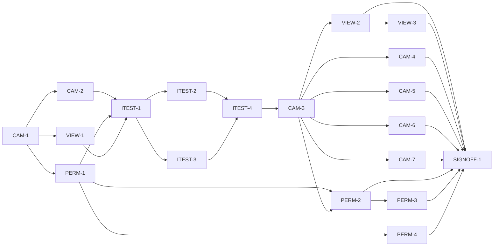

# Master Plan — bs-19 Live camera capture source

**Spec:** [bs-19-live-camera-capture.feature](../bs-19-live-camera-capture.feature)
**Status:** In progress — CAM-1 scaffold done; next CAM-2 ∥ PERM-1 ∥ VIEW-1 (shells)
**Architecture:** `lib/capture/source/` (`CaptureSource`, `Frame`, `SoftwareCaptureSource`), `lib/capture/capture_live_view.dart` (placeholder feed), `lib/app/build_app.dart` + `lib/main.dart` (`AppDependencies.captureSource` injection seam); `docs/paint-color-app-solution-intent.md` (SI D2 capture). Wireframe: the Capture live-view region.
**Code home:** /Users/matthew.quirk/Nuance · https://github.com/meatsquirk/Nuance.git · base `main` · extends existing (confirmed by Matt Quirk, 2026-10-20)

## Gap analysis (against `main` @ fa21c49 — d3a1c4f + bs-18 plan/gate; capture code is bs-02, present on main)

| AC | Exists today | Missing |
|---|---|---|
| AC-1 Live preview | `capture_live_view.dart` renders `ColoredBox(0xFF3A3A3A)` placeholder + grayscale filter + `liveViewKey` | A render path that paints the active source's `Frame` into the view |
| AC-2 Frame conversion | `Frame`/`Pixel.pixelAt`, `FrameColorSpace` | `CameraImage` (YUV420/BGRA) → `Frame` RGB conversion |
| AC-3 Reading follows live frame | Source-agnostic sampling in `CaptureController` already samples `pixelAt` of the active source's frame | A real streaming source whose frames change with the scene; assertion that the reading tracks the live frame, not the placeholder |
| AC-4 Value-only grayscale | `ColorFiltered` grayscale over the placeholder | The same filter over real rendered frames |
| AC-5 AE·AWB·AF lock | `CaptureLocks`, lock controls, "approximate" warning plumbing on the software source | Locks that drive the **real** camera; warning clears from real lock state |
| AC-6 Torch | `torchOn`/`turnTorchOn/Off` on the abstraction + `litByTorch` stamp | Torch wired to the **real** device flash LED |
| AC-7 Permission + fallback | `captureSource` injection seam; `SoftwareCaptureSource` default | Runtime camera-permission request; graceful fallback + "camera access needed" state; production source selection |
| AC-8 No-camera fallback | software default | Camera-availability probe; fallback wiring |
| AC-9 Lifecycle | — | Camera controller acquire/release tied to app lifecycle + screen dispose |
| AC-10 Platform declarations | neither declared | Android `CAMERA` permission + `<uses-feature>`; iOS `NSCameraUsageDescription` |

## Build order

| Stage | Phases |
|---|---|
| 1 Scaffold | CAM-1 |
| 2 Component shells | CAM-2, PERM-1, VIEW-1 |
| 3 Acceptance tests | ITEST-1, ITEST-2, ITEST-3, ITEST-4 (test review, G-2) |
| 4 Behavior | CAM-3 (*enabler-ish*), VIEW-2, CAM-4, VIEW-3, CAM-5, CAM-6, CAM-7, PERM-2, PERM-3, PERM-4 |
| 5 Sign-off | SIGNOFF-1 |

## Acceptance criteria coverage

| AC | Scenario | Integration test (ITEST) | Behavior phases | Status |
|---|---|---|---|---|
| AC-1 | The live view shows the camera feed | ITEST-2 `TestAC01_LivePreview` | VIEW-2 | ⬜ Todo |
| AC-2 | Camera frames convert to the correct colour | ITEST-2 `TestAC02_FrameConversion` | CAM-3 | ⬜ Todo |
| AC-3 | The reading follows the live camera frame | ITEST-2 `TestAC03_ReadingFollowsFrame` | CAM-4 | ⬜ Todo |
| AC-4 | Value-only mode shows the live feed in grayscale | ITEST-2 `TestAC04_ValueOnlyLive` | VIEW-3 | ⬜ Todo |
| AC-5 | Locking AE·AWB·AF settles the live camera | ITEST-2 `TestAC05_LockClearsWarning` | CAM-5 | ⬜ Todo |
| AC-6 | The torch toggles the device light | ITEST-3 `TestAC06_Torch` | CAM-6 | ⬜ Todo |
| AC-7 | Permission requested; denial falls back gracefully | ITEST-3 `TestAC07_PermissionFallback` | PERM-2 | ⬜ Todo |
| AC-8 | A device with no camera falls back gracefully | ITEST-3 `TestAC08_NoCameraFallback` | PERM-3 | ⬜ Todo |
| AC-9 | Camera released and re-acquired across lifecycle | ITEST-3 `TestAC09_Lifecycle` | CAM-7 | ⬜ Todo |
| AC-10 | The app declares camera use on both platforms | ITEST-3 `TestAC10_PlatformDeclarations` | PERM-4 | ⬜ Todo |

## Design decisions

| # | Decision | Why |
|---|---|---|
| D-1 | Real source uses the official Flutter `camera` plugin (project-local dep, added in CAM-2) | Maintained, cross-platform, exposes `CameraImage` frames + lock/torch/lifecycle controls |
| D-2 | `CameraCaptureSource` is the production default **only when** a camera is available AND permission granted; `SoftwareCaptureSource` (demo scene) is the graceful fallback and stays the test/driver source | Keeps the app usable with no camera / denied permission; preserves the deterministic default seam `main.dart` already wires |
| D-3 | Permission requested at first live-capture entry; denial is non-fatal — fallback + a visible "camera access needed" affordance, never a crash or black screen | AC-7; respects platform permission UX |
| D-4 | Frame conversion is pure-Dart (`CameraImage` YUV420/Android, BGRA/iOS → `Frame` RGB), downsampled for sampling cost, unit-tested with golden pixels | AC-2; keeps colour maths testable off-device |
| D-5 | Acceptance tests inject a scripted `CaptureSource` (known frames + lock/torch/permission/availability state) at the `AppDependencies.captureSource` seam — no real hardware on `flutter-tester`; the real plugin is verified by a device walkthrough at sign-off | Mirrors `FakeCaptureSource`; the plugin's platform channels can't run under `flutter-tester` |
| D-6 | **Deferred (out of scope):** real reference-card calibration/`normaliseAgainstCard` against the live camera, RAW capture, and wide-gamut selection — the camera source reports the processed sRGB pipeline and leaves card-normalisation on the software path | Those need camera-specific CV / device tuning; this feature delivers the live feed + sampling. Listed at sign-off as a known gap |
| D-7 | Camera lifecycle tied to `WidgetsBindingObserver` + screen dispose: release on `inactive`/`paused`, re-init on `resumed` | AC-9; avoids a leaked/locked controller and black frames |

## Acceptance integration test plan

Module plan: [modules/ITEST.md](modules/ITEST.md).

**Where it lives and how it runs:** `integration_test/live_camera/`, run `-d flutter-tester` per file (the repo's canonical lane; the whole dir won't launch at once under load — run per-file). Default target skips pending; run-pending via `--dart-define=BS19_RUN_PENDING=true`.
**Where assertions look:** the Capture widget tree (live-view render vs placeholder, grayscale filter, warning text, torch/lock affordances), the `CaptureController`/capture state (current reading, `litByTorch`), the capture **read endpoint** extended in PERM-1 (active source kind + permission state), and a static source-scan of `android/app/src/main/AndroidManifest.xml` + `ios/Runner/Info.plist` (AC-10, like bs-11/12/13 source-scan ACs).
**What is real and what is faked:** real `buildApp` assembly, real `CaptureController`, real live-view widget, real conversion maths; **faked** = the camera device, via a scripted `CaptureSource` injected at `captureSource:` (the plugin's platform channels are the only thing stubbed). AC-10 reads the real repo config files.

**Fixtures:**

| Fixture | Shape |
|---|---|
| `ScriptedCameraSource` | A `CaptureSource` (based on the `FakeCaptureSource`/`SoftwareCaptureSource` pattern) emitting a controllable list of known `Frame`s, with settable locks, torch, lighting, `referenceCardPresent`, and test-only `activeKind`/`permissionState`/`available` signals. Drives AC-1..AC-9 |
| `knownFrame(colour)` | A `Frame` whose pixel at the reticle is a specified colour; a second distinct-colour frame for the conversion control (AC-2) and the "reading follows frame" change (AC-3) |
| `rawCameraImage(yuv420 / bgra)` | Encoded device-style buffers with known pixels, fed to the conversion unit under test (AC-2) |
| `permissionScenario` | `granted` / `denied` / `undetermined` / `noHardware` — selects the source-selection path (AC-7, AC-8) |
| `platformManifests` | The on-disk `AndroidManifest.xml` + `Info.plist`, read by the AC-10 source-scan |

**Test catalogue:**

| AC | Given: built via public flows → checked by | When | Then: exact assertions (negative Thens after a settle point) | Rejects |
|---|---|---|---|---|
| AC-1 | Scripted source active + permission granted (inject `captureSource` = ScriptedCameraSource, `permissionState=granted`) → assert read endpoint reports `activeKind==camera` before the When | Capture screen opens | live view contains the frame-render widget painting the source frame; **no** `ColoredBox(0xFF3A3A3A)` placeholder under `liveViewKey` (after first frame pumps) | A view that keeps the placeholder / ignores frames |
| AC-2 | A `rawCameraImage` with a known reticle pixel → assert the raw buffer's documented bytes | convert to `Frame` | `frame.pixelAt(reticle)` == known colour within tolerance; **control:** a second different-colour buffer yields a correspondingly different pixel | Channel-swapped (BGR↔RGB) or mis-ranged YUV conversion; a constant pixel |
| AC-3 | Scripted source active, emitting `knownFrame(c1)` → assert current reading == c1 | source emits `knownFrame(c2)` | current reading updates to c2; reading == live frame pixel under reticle, not a fixed value (**control:** c1≠c2) | A sampler reading a stale/placeholder/fixed colour |
| AC-4 | Scripted source active, frame visible → assert view shows colour frame | value-only toggled on | live view wraps the frame render in the saturation-0 `ColorFiltered`; overlaid readings remain outside the filter (in colour) | Graying the whole screen incl. readings; filtering the placeholder only |
| AC-5 | Scripted source, `locks.allLocked==false`, reading marked approximate → assert the "exposure not locked" warning is present | painter locks AE+AWB+AF | source `locks.allLocked==true`; the "exposure not locked" warning is **absent** after the lock settles (settle point: next stability/warning rebuild) | Clearing the warning without locking; locking state not reflected from the source |
| AC-6 | Scripted source, `torchOn==false` → assert torch-off affordance | painter turns torch on | source `torchOn==true`; a reading committed now is stamped `litByTorch`; **then** turning it off → `torchOn==false` (settle: after the off tap rebuild) | A torch toggle that doesn't reach the source; missing `litByTorch` stamp |
| AC-7 | `permissionScenario=undetermined`, a permission seam recording requests → assert no request made before the When | Capture opened for live read | the permission seam received exactly one request; **granted** branch → `activeKind==camera`; **denied** branch → `activeKind==software` and a "camera access needed" affordance is present and the app did not throw (settle: after the decision resolves) | Never requesting; crashing/black-screen on denial; staying on a dead camera source |
| AC-8 | `permissionScenario=noHardware` (available==false) → assert the availability probe reports none | Capture opens | `activeKind==software`; reading + import-photo flows still work; no throw (settle: after assembly) | Crash / black view when no camera; forcing a camera source that can't stream |
| AC-9 | Scripted source active, a lifecycle-observer seam recording acquire/release → assert one acquire, zero releases | app sent `paused` then `resumed` (dispatch lifecycle) | a release recorded on `paused`; a re-acquire recorded on `resumed`; the live feed renders again (not frozen/black) after resume (settle: after the resumed frame pumps) | Leaking the controller (no release); not re-acquiring (frozen/black after resume) |
| AC-10 | The real `AndroidManifest.xml` + `Info.plist` on disk → read them | source-scan | Android file contains `android.permission.CAMERA` and `<uses-feature android:name="android.hardware.camera...">`; iOS file contains a non-empty `NSCameraUsageDescription` | Missing either declaration; an empty usage string |

**Red baseline** and **test augmentations:** tracked in [modules/ITEST.md](modules/ITEST.md).
Pre-seeded augmentations: AC-3/AC-5/AC-6 may run **green at baseline** against a scripted source because the reading/lock/torch pipeline is already source-agnostic — their discriminating value is the *live-frame-change* / *source-state-reflection* control above; the AC-test phases confirm each still Rejects a placeholder/fixed implementation, and the owning behavior phase (which makes the **real** `CameraCaptureSource` drive those signals) keeps them green. AC-1/AC-2/AC-4/AC-7/AC-8/AC-9/AC-10 are red at baseline (no render path / conversion / permission / fallback / lifecycle / declarations yet).

## Modules

| Module | Plan | Purpose | Depends on | Status |
|---|---|---|---|---|
| CAM | [modules/CAM.md](modules/CAM.md) | Real `CameraCaptureSource` over the `camera` plugin: frame stream + conversion, AE·AWB·AF locks, torch, lifecycle | — | 🔶 In progress |
| VIEW | [modules/VIEW.md](modules/VIEW.md) | Render the active source's frames in the live view (replace the placeholder); value-only grayscale over real frames | CAM | ⬜ Todo |
| PERM | [modules/PERM.md](modules/PERM.md) | Permission request + graceful fallback + production source selection + platform declarations + read endpoint | CAM | ⬜ Todo |
| ITEST | [modules/ITEST.md](modules/ITEST.md) | Acceptance integration suite: one pending test per AC, and its review | all shell phases | ⬜ Todo |

## Dependency graph

**Parallel windows:** the three shells (CAM-2 ∥ PERM-1 ∥ VIEW-1) touch disjoint files. ITEST-2 ∥ ITEST-3. After CAM-3, the CAM behavior phases (CAM-4/5/6/7) and VIEW-2 run concurrently; PERM-2/3 form a short chain; PERM-4 (manifests) is independent. Merge-risky pair: CAM-3 and VIEW-2 both read `capture_live_view.dart` — sequence VIEW-2 after CAM-3.

## Open gates

| Gate | Kind | Decision needed | Blocks | Status |
|---|---|---|---|---|
| G-1 | decision | Approve the spec (record the approval as its first line) | CAM-1 | ✅ Resolved 2026-10-21: approved — spec first line records it — Matt Quirk |
| G-2 | decision | Approve the acceptance tests (ITEST-4's packet) | every behavior phase | Open |

Resolved: `✅ Resolved <date time>: <decision, one line> — <who>`.

## Known flakes

| Test | Symptom | Rate (runs) | Measured at | Owner | Status |
|---|---|---|---|---|---|
| bs-06 palette AC-3 | provenance-legend "Found 0 widgets" off the exclusive iOS-sim lane | carried | `c00422f` | bs-06 (off-lane viewport) | Open |
| bs-06 palette AC-5 | travel-set selection off-lane | carried | `c00422f` | bs-06 (device-independent) | Open |
| bs-08 display AC-9 | spoken-phrasing off-lane | carried | `c00422f` | bs-08 (off-lane viewport) | Open |

## Session log

| # | Phase | Target | Status | Tokens | Time | Notes |
|---|---|---|---|---|---|---|
| 1 | CAM-1 | scaffold: branch, BS19_RUN_PENDING runner, baseline, coverage gate | ✅ Done | 4,687,376 | 13m 23s (44m 03s) | G-1 approved in-session; baseline 1643✓; gate both ways |
| 2 | CAM-2 | shell: `camera` dep + `CameraCaptureSource` skeleton + source-selection factory seam (default software) | ⬜ Next | | | ∥ PERM-1 ∥ VIEW-1 |
| 3 | PERM-1 | shell: permission seam + capture-state availability/permission field + manifest/plist entries + read endpoint | ⬜ Todo | | | ∥ CAM-2 ∥ VIEW-1 |
| 4 | VIEW-1 | shell: frame-render widget seam in live view (inactive: null→placeholder) | ⬜ Todo | | | ∥ CAM-2 ∥ PERM-1 |
| 5 | ITEST-1 | acceptance-tests: harness, `ScriptedCameraSource` + fixtures, pending gate (all 10 pending), smoke | ⬜ Todo | | | |
| 6 | ITEST-2 | acceptance-tests: AC-1..AC-5 (pending) + red baseline | ⬜ Todo | | | ∥ ITEST-3 |
| 7 | ITEST-3 | acceptance-tests: AC-6..AC-10 (pending) + red baseline | ⬜ Todo | | | ∥ ITEST-2 |
| 8 | ITEST-4 | test-review: packet; G-2 | ⬜ Todo | | | |
| 9 | CAM-3 | AC-2 frame conversion + real frame stream (enabler-ish) | ⬜ Todo | | | blocks VIEW-2, CAM-4/5/6/7, PERM-2 |
| 10 | VIEW-2 | AC-1 live preview renders real frames | ⬜ Todo | | | after CAM-3 |
| 11 | CAM-4 | AC-3 reading follows the live frame | ⬜ Todo | | | ∥ VIEW-2 |
| 12 | VIEW-3 | AC-4 value-only grayscale over live frame | ⬜ Todo | | | after VIEW-2 |
| 13 | CAM-5 | AC-5 real AE·AWB·AF locks clear the warning | ⬜ Todo | | | ∥ |
| 14 | CAM-6 | AC-6 real device torch | ⬜ Todo | | | ∥ |
| 15 | CAM-7 | AC-9 camera lifecycle release/resume | ⬜ Todo | | | ∥ |
| 16 | PERM-2 | AC-7 permission request + denial fallback + state | ⬜ Todo | | | after PERM-1, CAM-3 |
| 17 | PERM-3 | AC-8 no-camera fallback | ⬜ Todo | | | after PERM-2 |
| 18 | PERM-4 | AC-10 platform declarations (Android + iOS) | ⬜ Todo | | | ∥ |
| 19 | SIGNOFF-1 | sign-off: packet + summary page + manual approval | ⬜ Todo | | | after all behavior |

*Tokens* / *Time* = the phase totals from the *Token usage* ledger (Time = active, wall in brackets), filled when the row is marked done.

## Next phase

**CAM-1 (scaffold) ✅ done** (G-1 approved in the same session; branch `feat/bs-19` off `main` @ `11944b6`; `BS19_RUN_PENDING` runner; baseline 1643✓; gate proven both ways). Three shell phases are now startable and **run concurrently** (disjoint file ownership):
- **CAM-2** (shell): `camera` dep + inert `CameraCaptureSource` + stub `frame_conversion.dart` + `selectCaptureSource` factory seam (still software by default). Owns `pubspec.yaml`, `lib/capture/source/`.
- **PERM-1** (shell): permission seam + capture-state availability/permission field + Android manifest / iOS plist entries + read endpoint.
- **VIEW-1** (shell): frame-render widget seam in the live view (inactive: null → placeholder).
- All three block ITEST-1 (harness). The behavior stage is additionally gated by **G-2** (test review, ITEST-4). Run each shell in its own `/clear`ed session (or `--parallel`).

## Token usage

<!-- One row per session, appended as that session's last edit (SKILL.md § Token usage). -->

| Phase / activity | Session | Start | End | Wall | Active | Model(s) | Input | Cache write | Cache read | Output | Total | Outcome |
|---|---|---|---|---|---|---|---|---|---|---|---|---|
| PLAN | 9072bbeb | 2026-10-20 20:38 EDT | 22:43 | 2h 04m | 41m 52s | claude-opus-4-8 | 132 | 286,390 | 7,949,040 | 81,245 | 8,316,807 | plan written (spec 10 ACs + master + CAM/VIEW/PERM/ITEST modules, 19 phases); real CameraCaptureSource over camera plugin; shared session after bs-18 signoff |
| CAM-1 | a47f10a5 | 2026-10-21 06:03 EDT | 06:47 | 44m 03s | 13m 23s | claude-opus-4-8 | 92 | 95,473 | 4,554,587 | 37,224 | 4,687,376 | scaffold done; G-1 approved in-session (on main); branch off 11944b6; BS19_RUN_PENDING runner (10 ACs seeded); baseline 1643 pass; coverage gate proven both directions; no product code |
| **Feature total** |  | **2026-10-20 20:38 EDT** | **2026-10-21 06:47** | **2h 48m** | **55m 15s** |  | **224** | **381,863** | **12,503,627** | **118,469** | **13,004,183** |  |

## Sign-off

| Round | Packet | At code | Grades | Decision |
|---|---|---|---|---|
| — | _not yet_ | | | |
