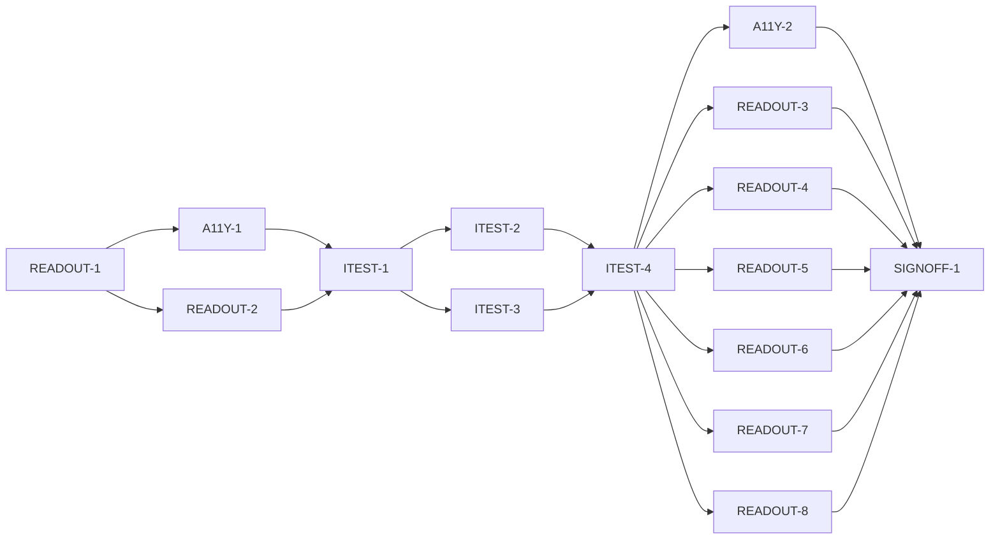

# Master Plan — UI improvements (bs-20)

**Spec:** [bs-20-ui-improvements.feature](../bs-20-ui-improvements.feature)
**Status:** In progress — shells underway; A11Y-1 done, next READOUT-2 (the other shell). Spec approved (G-1) 2026-10-24 by Matt Quirk.
**Architecture:** Wireframe `Paint Color Assistant.dc.html` (Readout "value-first" + "spec sheet", merged); solution intent `docs/paint-color-app-solution-intent.md`; deferred/kept items [bs-20-ui-improvements.deferred.md](../bs-20-ui-improvements.deferred.md). Extends bs-01 Color readout (`lib/readout/`) and bs-08 Display & simulation settings (`lib/display/`).
**Code home:** `/Users/matthew.quirk/Nuance` · origin remote · base `main` (`11944b6`) · extends existing (confirmed by Matt Quirk, 2026-10-24). Advisory: branch the scaffold off `main` **after bs-19 merges** — both touch `lib/app/build_app.dart` (see D-1).

## Gap analysis (against `11944b6`)

| AC | Exists today | Missing |
|---|---|---|
| AC-1 hero value card | `ValueRegion` shows L\* at 48px in a plain row (`value_region.dart:73`) | A bordered hero card making the value the largest reading |
| AC-2 0–10 value scale | Bare text `Munsell value N` (`value_region.dart:84`) | A labelled 0–10 scale with the sample's value marked |
| AC-3 equal-size swatches | Grayscale 48×48 (`value_region.dart:53`); displayed `ColorChip` a different size | The two swatches sized equal |
| AC-4 all spaces at once | One-at-a-time `SpaceSelector` (bs-01 AC-5) | All four spaces rendered together; selector removed |
| AC-5 space definitions | None | Tap a space name → fuller plain-language definition + example |
| AC-6 accessibility default off | No accessibility setting exists | `DisplaySettings.accessibilityFeatures` (default false) + toggle in the panel |
| AC-7 Speak hidden when off | Speak always shown (`actions_bar.dart`) | Hide Speak while accessibility off |
| AC-8 Speak shown when on | — | Reveal Speak when accessibility on |
| AC-9 "Color" spelling | App uses "Colour"/"grayscale" | User-facing readout copy spells it "Color" |

## Build order

| Stage | Phases |
|---|---|
| 1 Scaffold | READOUT-1 |
| 2 Component shells | A11Y-1, READOUT-2 |
| 3 Acceptance tests | ITEST-1, ITEST-2, ITEST-3, ITEST-4 (test review, G-2) |
| 4 Behavior | A11Y-2, READOUT-3, READOUT-4, READOUT-5, READOUT-6, READOUT-7, READOUT-8 |
| 5 Sign-off | SIGNOFF-1 |

## Acceptance criteria coverage

| AC | Scenario | Integration test (ITEST) | Behavior phases | Status |
|---|---|---|---|---|
| AC-1 | The lightness value is shown in a prominent bordered card | ITEST-2 `TestAC01_HeroCard` | READOUT-4 | ⬜ Todo |
| AC-2 | The Munsell value reads on a 0-10 scale with the sample marked | ITEST-2 `TestAC02_ValueScale` | READOUT-5 | ⬜ Todo |
| AC-3 | The true-colour swatch is as large as the grayscale swatch | ITEST-2 `TestAC03_EqualSwatches` | READOUT-4 | ⬜ Todo |
| AC-4 | Every colour space is shown together on the readout | ITEST-2 `TestAC04_AllSpaces` | READOUT-3 | ⬜ Todo |
| AC-5 | The painter opens a colour space's name to learn what it means | ITEST-2 `TestAC05_Definitions` | READOUT-6 | ⬜ Todo |
| AC-6 | Accessibility features are off by default | ITEST-3 `TestAC06_DefaultOff` | A11Y-2 | ⬜ Todo |
| AC-7 | With accessibility features off, Speak is hidden | ITEST-3 `TestAC07_SpeakHidden` | READOUT-7 | ⬜ Todo |
| AC-8 | Turning accessibility features on reveals Speak | ITEST-3 `TestAC08_SpeakShown` | READOUT-7 | ⬜ Todo |
| AC-9 | The readout uses "Color" rather than "Colour" | ITEST-2 `TestAC09_ColorSpelling` | READOUT-8 | ⬜ Todo |

## Design decisions

| # | Decision | Why |
|---|---|---|
| D-1 | Scaffold branches off `main`; advise branching after bs-19 merges | Both features edit `build_app.dart`; bs-20 is readout/settings, bs-19 is camera — mostly disjoint, so advisory not a hard gate |
| D-2 | The `accessibilityFeatures` flag lives on the existing `DisplaySettings`/`DisplayController` (bs-08), read via the app-wide `DisplayScope`; default `false` | Reuse the established display-state chokepoint; the readout reads the flag the same way it reads simulation/grayscale |
| D-3 | bs-20 supersedes bs-01 AC-5 (space selector) and re-gates bs-01 AC-8 (Speak). The bs-01 acceptance tests for AC-5 and AC-8 are **reconciled** (AC-5 selector test retired; AC-8 test sets accessibility on) in the phases that change them | Removing the selector and hiding Speak by default would otherwise red the merged bs-01 suite |
| D-4 | B2 definitions are an owner-authorized educational addition beyond the SI/wireframe; SI not amended | They are presentation-level help text, not new colour science; the SI authority (owner) requested them live |
| D-5 | Speak is hidden by default (accessibility off); Acknowledge / capture banner stays always visible | Owner decision 2026-10-24; see G-3 for the bs-11 conformance check |

## Acceptance integration test plan

Module plan: [modules/ITEST.md](modules/ITEST.md).

**Where it lives and how it runs:** `integration_test/ui_improvements/` (new). Per-file `flutter test -d flutter-tester integration_test/ui_improvements/<file>_test.dart` (the whole dir won't launch at once — house gotcha). Pending gate keyed by `--dart-define=BS20_RUN_PENDING=true`.
**Where assertions look:** widget finders over the real `ReadoutScreen` and `DisplaySettingsScreen` pumped through production wiring (`buildApp`/`DisplayScope`); no new read endpoint expected (presentation is observable by finders). A `DisplayController` is driven to toggle `accessibilityFeatures` for AC-7/AC-8.
**What is real and what is faked:** real readout + settings widgets and the real `ColorScience`/`DisplayController`; only the sample and injected `Speech`/`Haptics`/`AppRouter` are test doubles (as in bs-01's suite).

**Fixtures:**

| Fixture | Shape |
|---|---|
| `warmTerracotta` | The bs-01 sample (L 58, Munsell 10R 5.5/6) — used by AC-1/AC-4/AC-5/AC-9 |
| `value2Sample` | A low-value sample (Munsell value 2) — AC-2 scale marking |
| `anySample` | A plain sample — AC-3 swatch sizing, AC-7/AC-8 Speak visibility |

**Test catalogue:**

| AC | Given: built via public flows → checked by | When | Then: exact assertions | Rejects |
|---|---|---|---|---|
| AC-1 | `warmTerracotta` reading pumped via `buildApp` → readout renders | readout shown | the value-hero card (keyed) exists; its L text is the largest fontSize among readout readings | a plain-row value with no card, or a card not the largest reading |
| AC-2 | `value2Sample` → readout renders | readout shown | a 0–10 scale widget (keyed) exists with 11 labelled steps 0..10; the step at value 2 carries the "marked" decoration | a bare "Munsell value 2" text; a scale with no marked step |
| AC-3 | `anySample` → readout renders | readout shown | grayscale swatch and displayed-colour swatch finders report equal width & height | swatches of different size |
| AC-4 | `warmTerracotta` → readout renders | readout shown | CIELCh, Munsell, sRGB **and** CIELAB values all present simultaneously; no `SpaceSelector` in the tree | only one space shown; a selector present |
| AC-5 | `warmTerracotta`, all spaces shown | tap the "Munsell" space name | a definition panel for Munsell appears with non-empty definition text **and** an example | name not tappable; tapping shows nothing; definition without an example |
| AC-6 | fresh `DisplaySettings` via `DisplayScope` → settings panel | panel shown | the accessibility-features toggle finder reports value `false` | toggle defaulting on, or absent |
| AC-7 | accessibility off (default) → readout | readout shown | no "Speak this readout" control in the tree | Speak still shown while off |
| AC-8 | accessibility off → turn it on via the controller → readout | readout shown | a "Speak this readout" control is present | Speak absent after turning on |
| AC-9 | `warmTerracotta` → readout | readout shown | rendered readout text contains "Color"; no "Colour"/"colour" substring in user-facing text | any "Colour" left in readout copy |

**Red baseline** and **test augmentations:** tracked in [modules/ITEST.md](modules/ITEST.md).
Pre-seeded augmentations: AC-7's "hidden" assertion can pass vacuously until Speak exists in the new layout — READOUT-7 strengthens it alongside AC-8 (both the off→hidden and on→shown directions), so neither passes on a Speak-less or always-on implementation.

## Modules

| Module | Plan | Purpose | Depends on | Status |
|---|---|---|---|---|
| READOUT | [modules/READOUT.md](modules/READOUT.md) | Re-compose the Readout to the wireframe (hero card, 0–10 scale, equal swatches, all-spaces-at-once, per-space definitions), gate Speak, "Color" copy | A11Y (reads the flag) | 🔄 In progress |
| A11Y | [modules/A11Y.md](modules/A11Y.md) | The accessibility-features setting: `DisplaySettings` flag (default off), controller setter, settings-panel toggle | — | 🔄 In progress |
| ITEST | [modules/ITEST.md](modules/ITEST.md) | Acceptance integration suite: one pending test per AC, and its review | all shell phases | ⬜ Todo |

## Dependency graph

**Parallel windows:** A11Y-1 ∥ READOUT-2 (different dirs). ITEST-2 ∥ ITEST-3. In the behavior stage the READOUT-* phases touch overlapping files in `lib/readout/` — run them **serially** (merge-risky); A11Y-2 (settings) is disjoint and may run alongside any one READOUT phase.

## Open gates

| Gate | Kind | Decision needed | Blocks | Status |
|---|---|---|---|---|
| G-1 | decision | Approve the spec | READOUT-1 | ✅ Resolved 2026-10-24: approved — Matt Quirk |
| G-2 | decision | Approve the acceptance tests (ITEST-4's packet) | every behavior phase | Open |
| G-3 | decision | Confirm hiding Speak by default (accessibility off) does not violate bs-11 accessibility-conformance; if it does, run bs-11's conformance with accessibility on | READOUT-7, SIGNOFF-1 | Open |

Resolved: `✅ Resolved <date time>: <decision, one line> — <who>`.

## Known flakes

| Test | Symptom | Rate (runs) | Measured at | Owner | Status |
|---|---|---|---|---|---|
| bs-06 palette AC-3 / AC-5 | off-lane flutter-tester fail (source-scan ACs) | carried | `c00422f` | other feature (bs-06) | Open (carried) |
| bs-08 display AC-9 | off-lane flutter-tester fail | carried | `c00422f` | other feature (bs-08) | Open (carried) |
| bs-07 self_assessment AC-4 | off-lane flutter-tester fail | carried | `c00422f` | other feature (bs-07) | Open (carried) |

## Session log

| # | Phase | Target | Status | Tokens | Time | Notes |
|---|---|---|---|---|---|---|
| 1 | READOUT-1 | scaffold: branch, baseline, coverage gate, suite skeleton | ✅ Done | 3,024,669 | 6m 06s | 1643 unit pass; gate clean-PASS/planted-FAIL; flutter-tester OK; no lib/ change |
| 2 | A11Y-1 | shell: `accessibilityFeatures` flag + controller setter + panel toggle | ✅ Done | 3,730,986 | 6m 00s | 1648 unit pass (+5); cov 100% on 3 touched; toggle inert |
| 3 | READOUT-2 | shell: readout widget skeletons (hero/scale/all-spaces/definition), wired, behaviour unchanged | ⬜ Next | | | ∥ A11Y-1 |
| 4 | ITEST-1 | acceptance-tests: harness, fixtures, pending gate (9 pending), smoke | ⬜ Todo | | | |
| 5 | ITEST-2 | acceptance-tests: AC-1/2/3/4/5/9 (pending) + red baseline | ⬜ Todo | | | ∥ ITEST-3 |
| 6 | ITEST-3 | acceptance-tests: AC-6/7/8 (pending) + red baseline | ⬜ Todo | | | ∥ ITEST-2 |
| 7 | ITEST-4 | test-review: packet; G-2 | ⬜ Todo | | | |
| 8 | A11Y-2 | AC-6 accessibility off by default | ⬜ Todo | | | ∥ one READOUT phase |
| 9 | READOUT-3 | AC-4 all spaces at once; retire bs-01 AC-5 selector test (D-3) | ⬜ Todo | | | |
| 10 | READOUT-4 | AC-1 hero card + AC-3 equal swatches | ⬜ Todo | | | |
| 11 | READOUT-5 | AC-2 0–10 value scale | ⬜ Todo | | | |
| 12 | READOUT-6 | AC-5 per-space definitions | ⬜ Todo | | | |
| 13 | READOUT-7 | AC-7 + AC-8 Speak gating; reconcile bs-01 AC-8 test (D-3); G-3 | ⬜ Todo | | | |
| 14 | READOUT-8 | AC-9 "Color" copy | ⬜ Todo | | | |
| 15 | SIGNOFF-1 | sign-off: packet + summary + manual approval | ⬜ Todo | | | |

*Tokens* / *Time* = phase totals from the *Token usage* ledger (Time = active, wall in brackets), filled when the row is marked done.

## Next phase

A11Y-1 shell done (`accessibilityFeatures` axis on `DisplaySettings`/`DisplayController` + panel toggle, inert). One shell left, startable now:
- **READOUT-2** — readout widget shells (hero card, `ValueScale`, `AllSpacesRegion`, `SpaceDefinition`), wired, behaviour unchanged (`lib/readout/`). Gates on unit + coverage + existing-suite-green only (no AC yet).

Once READOUT-2 lands, the acceptance stage opens: ITEST-1, then ITEST-2 ∥ ITEST-3, then ITEST-4 (test review, G-2). Carry: D-1 — bs-19 still unmerged and both features edit `build_app.dart`; the overlap bites in later behavior phases.

## Token usage

<!-- One row per session, appended as that session's last edit (SKILL.md § Token usage). -->

| Phase / activity | Session | Start | End | Wall | Active | Model(s) | Input | Cache write | Cache read | Output | Total | Outcome |
|---|---|---|---|---|---|---|---|---|---|---|---|---|
| PLAN | (this session) | | | | | claude-opus-4-8 | | | | | | plan written |
| PLAN | a6d95575 | 2026-10-23 05:35 EDT | 2026-10-24 23:04 | 41h 28m | 25m 15s | claude-opus-4-8 | 62 | 628,351 | 4,051,863 | 84,389 | 4,764,665 | plan written: spec (G-1 approved) + READOUT/A11Y/ITEST modules |
| READOUT-1 | 6c00cb72 | 2026-10-24 23:51 EDT | 23:57 | 6m 06s | 6m 06s | claude-opus-4-8 | 72 | 72,101 | 2,933,446 | 19,050 | 3,024,669 | scaffold done: 1643 unit pass; coverage gate clean-PASS/planted-FAIL; flutter-tester runner confirmed; no lib change |
| A11Y-1 | 19e8c8cf | 2026-10-25 00:15 EDT | 00:21 | 6m 00s | 6m 00s | claude-opus-4-8 | 86 | 77,294 | 3,635,723 | 17,883 | 3,730,986 | shell done: accessibilityFeatures axis + panel toggle (inert); 1648 unit pass (+5), coverage 100% on 3 touched files |
| **Feature total** |  | **2026-10-23 05:35 EDT** | **2026-10-25 00:21** | **41h 40m** | **37m 21s** |  | **220** | **777,746** | **10,621,032** | **121,322** | **11,520,320** |  |

## Sign-off

| Round | Packet | At code | Grades | Decision |
|---|---|---|---|---|
| 1 | signoff/round-1.md | — | — | ⏸ Not yet reached |
